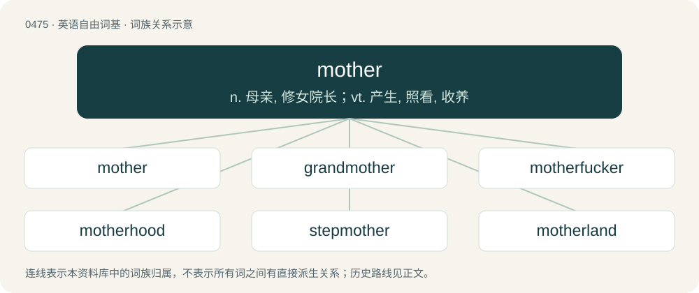

# 0542 · mother — n. 母亲, 修女院长；vt. 产生, 照看, 收养

[总目录](../00_总目录_按常用程度.md)

**类型**：英语自由词基　｜　**来源语言**：见词源记录

## 核心含义与来源

- 核心含义：n. 母亲, 修女院长；vt. 产生, 照看, 收养
- 英文含义：A female parent, especially of a human; a female who parents a child (which she has given birth to, adopted, fostered, etc).
- 词形：mother

**多个词源／构词路径**：同一拼写可能有不同来源；以下按词性和含义分别列出。

**来源记录 1**（名词；A female parent, especially of a human; a female who parents a child (which she has given birth to, adopted, fostered, etc).）

From Middle English moder, from Old English mōdor, from Proto-West Germanic \*mōder, from Proto-Germanic \*mōdēr, from Proto-Indo-European \*méh₂tēr. Doublet of Madeira, mata, mater, matrix, and matter. Some have proposed that the "dregs" sense is from Middle Dutch modder (“filth”), from Proto-Germanic \*muþraz (“sediment”), but modder is not known in this meaning. On the other hand, words for "mother" have developed the secondary sense of "dregs" in several Romance and Germanic languages; compare Dutch moer, French mère de vinaigre, German Essigmutter, Italian madre, Medieval Latin māter, and Spanish madre.

**来源记录 2**（动词；To give birth to or produce (as its female parent) a child. (Compare father.)）

From Middle English modren, from the noun (see above).

**来源记录 3**（名词；Motherfucker.）

Clipping of motherfucker.

## 词族图

## 单词速览（常用到不常用）

| 单词 | 音标 | 释义 |
|---|---|---|
| [mother](#w-1) | 英 /ˈmʌð.ə/；美 /ˈmʌðɚ/ | n. 母亲, 修女院长；vt. 产生, 照看, 收养 |
| [grandmother](#w-2) | 英 /ˈɡɹæn(d)ˌmʌðə(r)/；美 /ˈɡɹæn(d)ˌmʌðɚ/ | n. 祖母, 女祖先 |
| [motherfucker](#w-3) | 英 /mʌðəˌfʌkə/；美 /mʌðɚˌfʌkɚ/ | n. （通常指男性）不要脸的家伙, 混账东西 |
| [motherhood](#w-4) | 英 /ˈmʌðəhʊd/；美 /ˈmʌðɚˌhʊd/ | n. 母道, 母性, 母亲们 |
| [stepmother](#w-5) | 英 /ˈstɛpmʌðə/ | n. 继母 |
| [motherland](#w-6) | 英 /ˈmʌð.ə.lænd/；美 /ˈmʌðɚˌlænd/ | n. 祖国 |
| [godmother](#w-7) | 英 /ˈɡɒdmʌðə/ | n. 教母, 女监护人 |
| [motherly](#w-8) | 英 /ˈmʌðəli/；美 /ˈmʌðɚli/ | a. 母亲的 |
| [mothership](#w-9) | /ˈmʌðəʃɪp/ | n. 航母 |
| [motherless](#w-10) | /ˈmʌðəlis/ | a. 无母的 |

## 逐词详解

### 1. mother

**词性**：名词　｜　**音标**：英 /ˈmʌð.ə/；美 /ˈmʌðɚ/

**中文释义**：n. 母亲, 修女院长；vt. 产生, 照看, 收养

**英文义项**：A female parent, especially of a human; a female who parents a child (which she has given birth to, adopted, fostered, etc). / A pregnant female; mother-to-be; a female who gestates a baby.

**词源与演化**：

From Middle English moder, from Old English mōdor, from Proto-West Germanic \*mōder, from Proto-Germanic \*mōdēr, from Proto-Indo-European \*méh₂tēr. Doublet of Madeira, mata, mater, matrix, and matter. Some have proposed that the "dregs" sense is from Middle Dutch modder (“filth”), from Proto-Germanic \*muþraz (“sediment”), but modder is not known in this meaning. On the other hand, words for "mother" have developed the secondary sense of "dregs" in several Romance and Germanic languages; compare Dutch moer, French mère de vinaigre, German Essigmutter, Italian madre, Medieval Latin māter, and Spanish madre.

**例句**：

> Nutrients and oxygen obtained by the mother are conveyed to the fetus.

该用例对应义项：A pregnant female; mother-to-be; a female who gestates a baby.

### 2. grandmother

**词性**：名词　｜　**音标**：英 /ˈɡɹæn(d)ˌmʌðə(r)/；美 /ˈɡɹæn(d)ˌmʌðɚ/

**中文释义**：n. 祖母, 女祖先

**英文义项**：A mother of someone's parent. / A female ancestor or progenitor.

**构词拆分**：grand- + mother

**词源与演化**：

From Middle English graundmodre, grauntmoder, granmoder; equivalent to grand- + mother. Compare French grand-mère. Superseded earlier eldmother, eldermother.

**例句**：

> My grandmother's old watch has been lying in the drawer for years.

### 3. motherfucker

**词性**：名词　｜　**音标**：英 /mʌðəˌfʌkə/；美 /mʌðɚˌfʌkɚ/

**中文释义**：n. （通常指男性）不要脸的家伙, 混账东西

**英文义项**：An extremely contemptible, vicious or mean person. / Any person, often but not always with the connotation that the person is disliked or is threatening.

**构词拆分**：mother + fucker

**词源与演化**：

Compound of mother + fucker; attested since 1918. The injury comes from the implication of somebody sleeping with their own mother, but was probably not used literally until later. Also analyzed as a calque of Hindustani مَادَر چود (mādar cod) / मादरचोद (mādarcod).

**例句**：

> I jammed my finger in the door yesterday. It hurt like a motherfucker.

该用例对应义项：To an extreme degree.

### 4. motherhood

**词性**：名词　｜　**音标**：英 /ˈmʌðəhʊd/；美 /ˈmʌðɚˌhʊd/

**中文释义**：n. 母道, 母性, 母亲们

**英文义项**：The state of being a mother. / Mothers, considered as a group.

**构词拆分**：mother + -hood

**词源与演化**：

From Middle English moderhode, moderhede, equivalent to mother + -hood.

**用法示例／搭配（非完整句）**：

> the nation's motherhood

该用例对应义项：Mothers, considered as a group.

### 5. stepmother

**词性**：名词　｜　**音标**：英 /ˈstɛpmʌðə/

**中文释义**：n. 继母

**英文义项**：A person or thing likened to a stereotypical stepmother, having cold, cruel, or ungenerous qualities. / An animal, typically a bird, who raises the offspring of another animal.

**构词拆分**：step- + mother

**词源与演化**：

From Middle English stepmoder, from Old English stēopmōdor, from Proto-Germanic \*steupamōdēr (“stepmother”), corresponding to step- + mother. Cognate with Saterland Frisian Stäifmuur (“stepmother”), Dutch stiefmoeder (“stepmother”), German Low German Steevmoder (“stepmother”), German Stiefmutter (“stepmother”), Danish stedmor (“stepmother”), Swedish styvmor (“stepmother”), Icelandic stjúpmóðir (“stepmother”). Compare also West Frisian styfmem (“stepmother”).

**例句**：

> I get on well with my stepsister but not with my stepmother.

### 6. motherland

**词性**：名词　｜　**音标**：英 /ˈmʌð.ə.lænd/；美 /ˈmʌðɚˌlænd/

**中文释义**：n. 祖国

**英文义项**：The country of one's ancestors. / The country of one's birth.

**构词拆分**：mother + land

**词源与演化**：

From mother + land. First attested in 1711.

**例句**：

> Today you play jazz while tomorrow you are going to sell out your motherland.

### 7. godmother

**词性**：名词　｜　**音标**：英 /ˈɡɒdmʌðə/

**中文释义**：n. 教母, 女监护人

**英文义项**：A woman present at the christening of a baby who promises to help raise the child in a Christian manner; a female godparent who sponsors the baptism of a child.

**构词拆分**：god- + mother

**词源与演化**：

From Middle English godmoder, from Old English godmōdor (“godmother”), equivalent to god- + mother. Cognate with Old High German gotmuoter (“godmother”), Old Norse guðmóðir (“godmother”), Icelandic guðmóður (“godmother”), Swedish gudmoder (“godmother”), Danish gudmor (“godmother”).

**例句**：

> I don't know if my son's godmother and godfather are still alive.

### 8. motherly

**词性**：形容词　｜　**音标**：英 /ˈmʌðəli/；美 /ˈmʌðɚli/

**中文释义**：a. 母亲的

**英文义项**：Befitting a mother; warm, caring, nurturing, protective, loving.

**构词拆分**：mother + -ly

**词源与演化**：

From Middle English moderly, from Old English mōdorlīċ (“motherly, maternal”), from Proto-Germanic \*mōdērlīkaz (“motherly, maternal”), equivalent to mother + -ly.

**例句**：

> Ceres is named after the Roman goddess of growing plants, harvest, and motherly love.

### 9. mothership

**词性**：名词　｜　**音标**：/ˈmʌðəʃɪp/

**中文释义**：n. 航母

**英文义项**：The state of being a mother.

**构词拆分**：mother + -ship

**词源与演化**：

From Middle English modership, equivalent to mother + -ship.

### 10. motherless

**词性**：形容词　｜　**音标**：/ˈmʌðəlis/

**中文释义**：a. 无母的

**英文义项**：Without a (living) mother. / Without mother (mucilaginous substance in fermenting liquid).

**构词拆分**：mother + -less

**词源与演化**：

From Middle English moderles, from Old English mōdorlēas, from Proto-Germanic \*mōdērlausaz, equivalent to mother + -less. Cognate with Saterland Frisian muurloos (“motherless”), Dutch moederloos (“motherless”), German mutterlos (“motherless”), Danish moderløs (“motherless”), Swedish moderlös (“motherless”), Icelandic móðurlaus (“motherless”).

**例句**：

> You poor motherless children! How I pity you; and yet I can do nothing to help you!
