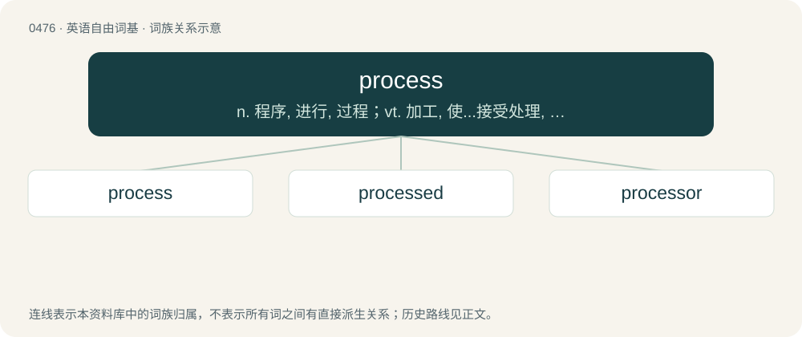

# 0544 · process — n. 程序, 进行, 过程；vt. 加工, 使...接受处理, 对...处置, 对...起诉；a. 经加工的, 有特殊光效的

[总目录](../00_总目录_按常用程度.md)

**类型**：英语自由词基　｜　**来源语言**：见词源记录

## 核心含义与来源

- 核心含义：n. 程序, 进行, 过程；vt. 加工, 使...接受处理, 对...处置, 对...起诉；a. 经加工的, 有特殊光效的
- 英文含义：A series of events leading to a result or product.
- 词形：process

**多个词源／构词路径**：同一拼写可能有不同来源；以下按词性和含义分别列出。

**来源记录 1**（名词；A series of events leading to a result or product.）

From Middle English proces, from Old French procés (“journey”), from Latin prōcessus (“course, progression”), nominalization of prōcēdō (“proceed, advance”).

**来源记录 2**（动词；To walk in a procession, especially in a liturgical context.）

Back-formation from procession.

## 词族图

## 单词速览（常用到不常用）

| 单词 | 音标 | 释义 |
|---|---|---|
| [process](#w-1) | 英 /ˈpɹəʊ.sɛs/；美 /ˈpɹɑ.sɛs/ | n. 程序, 进行, 过程；vt. 加工, 使...接受处理, 对...处置, 对...起诉；a. 经加工的, 有特殊光效的 |
| [processed](#w-2) | 英 /ˈpɹəʊsɛst/；美 /ˈpɹɑsɛst/ | a. 处理的, 加工过的 |
| [processor](#w-3) | 英 /ˈpɹəʊˌsɛsə(ɹ)/；美 /ˈpɹɑˌsɛsɚ/ | n. 信息处理机, 加工者, 处理者；\[计\] 处理器 |

## 逐词详解

### 1. process

**词性**：名词　｜　**音标**：英 /ˈpɹəʊ.sɛs/；美 /ˈpɹɑ.sɛs/

**中文释义**：n. 程序, 进行, 过程；vt. 加工, 使...接受处理, 对...处置, 对...起诉；a. 经加工的, 有特殊光效的

**英文义项**：A series of events leading to a result or product. / The set of procedures used in the manufacture of a product, especially in the food and chemical industries.

**词源与演化**：

From Middle English proces, from Old French procés (“journey”), from Latin prōcessus (“course, progression”), nominalization of prōcēdō (“proceed, advance”).

**例句**：

> This product of last month's quality standards committee is quite good, even though the process was flawed.

该用例对应义项：A series of events leading to a result or product.

### 2. processed

**词性**：形容词　｜　**音标**：英 /ˈpɹəʊsɛst/；美 /ˈpɹɑsɛst/

**中文释义**：a. 处理的, 加工过的

**英文义项**：That has completed a required process. / Modified through manufacture such as refinement or food processing.

**构词拆分**：process + -ed

**词源与演化**：

From process + -ed.

**例句**：

> The processed data can now be used to generate statistics.

该用例对应义项：That has completed a required process.

### 3. processor

**词性**：名词　｜　**音标**：英 /ˈpɹəʊˌsɛsə(ɹ)/；美 /ˈpɹɑˌsɛsɚ/

**中文释义**：n. 信息处理机, 加工者, 处理者；\[计\] 处理器

**英文义项**：A person or institution who processes things (foods, photos, applications, etc.). / A device which processes, which changes something (a computer processor, food processor, etc.).

**构词拆分**：process + -or

**词源与演化**：

Recorded since 1909, from process + -or.

**例句**：

> This computer has two processors, but only one keyboard.

该用例对应义项：A microprocessor.
