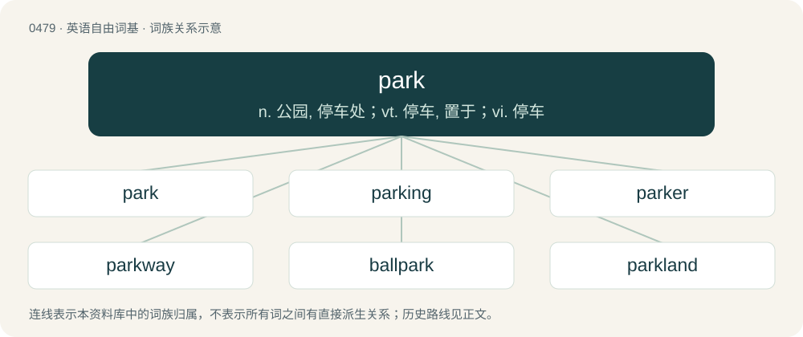

# 0546 · park — n. 公园, 停车处；vt. 停车, 置于；vi. 停车

[总目录](../00_总目录_按常用程度.md)

**类型**：英语自由词基　｜　**来源语言**：见词源记录

## 核心含义与来源

- 核心含义：n. 公园, 停车处；vt. 停车, 置于；vi. 停车
- 英文含义：A tract of ground kept in its natural state, about or adjacent to a residence, such as for the preservation of game, for walking, riding, or the like.
- 词形：park

**来源记录 1**（名词；A tract of ground kept in its natural state, about or adjacent to a residence, such as for the preservation of game, for walking, riding, or the like.）

From Middle English park, from Old French parc (“livestock pen”), from Medieval Latin parcus, parricus, from Frankish \*parrik (“enclosure, pen, fence”). Cognate with Dutch perk (“enclosure; flowerbed”), Old High German pfarrih, pferrih (“enclosure, pen”), Old English pearroc (“enclosure”) (whence modern English paddock), Old Norse parrak, parak (“enclosure, pen; distress, anxiety”), Icelandic parraka (“to keep pent in under restraint and coercion”). More at parrock, paddock.

## 词族图

## 单词速览（常用到不常用）

| 单词 | 音标 | 释义 |
|---|---|---|
| [park](#w-1) | 英 /pɑːk/；/pɑɹk/ | n. 公园, 停车处；vt. 停车, 置于；vi. 停车 |
| [parking](#w-2) | 英 /ˈpɑː.kɪŋ/；美 /ˈpɑɹ.kɪŋ/ | n. 停车；a. 停车的 |
| [parker](#w-3) | 英 /ˈpɑːkə/；美 /ˈpɑɹkɚ/ | n. 停放车辆的人 |
| [parkway](#w-4) | 美 /ˈpɑɹkˌweɪ/ | n. 公园道路, 驾车专用道路 |
| [ballpark](#w-5) | 美 /ˈbɔl(ˌ)pɑɹk/ | n. （美）棒球场；活动领域；可变通范围 |
| [parkland](#w-6) | /ˈpɑːk.lænd/ | n. 公用场地；有树丛的开阔草地 |
| [skatepark](#w-7) | /ˈskeitpɑːk/ | n. 滑板运动场地 |
| [parkside](#w-8) |  | n. 园畔酒店 |
| [parklife](#w-9) |  | 【英文】The lifestyle and culture of parkgoers. |

## 逐词详解

### 1. park

**词性**：名词　｜　**音标**：英 /pɑːk/；/pɑɹk/

**中文释义**：n. 公园, 停车处；vt. 停车, 置于；vi. 停车

**英文义项**：A tract of ground kept in its natural state, about or adjacent to a residence, such as for the preservation of game, for walking, riding, or the like. / A piece of ground in or near a city or town, enclosed and kept for ornament and recreation.

**词源与演化**：

From Middle English park, from Old French parc (“livestock pen”), from Medieval Latin parcus, parricus, from Frankish \*parrik (“enclosure, pen, fence”). Cognate with Dutch perk (“enclosure; flowerbed”), Old High German pfarrih, pferrih (“enclosure, pen”), Old English pearroc (“enclosure”) (whence modern English paddock), Old Norse parrak, parak (“enclosure, pen; distress, anxiety”), Icelandic parraka (“to keep pent in under restraint and coercion”). More at parrock, paddock.

**例句**：

> She went to the park for a jog with him.

该用例对应义项：A tract of ground kept in its natural state, about or adjacent to a residence, such as for the preservation of game, for walking, riding, or the like.

### 2. parking

**词性**：名词　｜　**音标**：英 /ˈpɑː.kɪŋ/；美 /ˈpɑɹ.kɪŋ/

**中文释义**：n. 停车；a. 停车的

**英文义项**：The action of the verb to park. / Space in which to park a car or other vehicle, such as a parking lot or curbside parking.

**构词拆分**：park + -ing

**词源与演化**：

From park + -ing (participial).

**例句**：

> They found his car in a parking thirty miles away; apparently it had been stolen by a joyrider.

该用例对应义项：Space in which to park a car or other vehicle, such as a parking lot or curbside parking.

### 3. parker

**词性**：名词　｜　**音标**：英 /ˈpɑːkə/；美 /ˈpɑɹkɚ/

**中文释义**：n. 停放车辆的人

**英文义项**：A parkkeeper. / Someone who parks a motor vehicle.

**构词拆分**：From park + -er.

**词源与演化**：

From park + -er.

**例句**：

> The parker put the hyena asleep and moved it to a safer area.

### 4. parkway

**词性**：名词　｜　**音标**：美 /ˈpɑɹkˌweɪ/

**中文释义**：n. 公园道路, 驾车专用道路

**英文义项**：A path, carriage-way, or road through a park or a landscaped right of way. / A scenic freeway.

**构词拆分**：park + way

**词源与演化**：

From park + way.

**例句**：

> As they cruised, she remembered the old saw: Why do we drive on a parkway and park in a driveway?

该用例对应义项：A divided highway with a landscaped median.

### 5. ballpark

**词性**：名词　｜　**音标**：美 /ˈbɔl(ˌ)pɑɹk/

**中文释义**：n. （美）棒球场；活动领域；可变通范围

**英文义项**：A field, stadium or park where ball, especially baseball, is played. / The general vicinity; somewhere close; a broad approximation.

**构词拆分**：ball + park

**词源与演化**：

From ball + park. Sense 2 related to ballpark figure.

**例句**：

> Let’s get in the ballpark, then worry about the fine details.

该用例对应义项：The general vicinity; somewhere close; a broad approximation.

### 6. parkland

**词性**：名词　｜　**音标**：/ˈpɑːk.lænd/

**中文释义**：n. 公用场地；有树丛的开阔草地

**英文义项**：Land suitable for use as a park. / A landscape characterized by a mixture of treed groves and open grasslands, akin to a Eurasian forest steppe.

**构词拆分**：park + land

**词源与演化**：

From park + land.

**例句**：

> Gigantic space stations were soon constructed with parkland inside the shell structure.

### 7. skatepark

**词性**：名词　｜　**音标**：/ˈskeitpɑːk/

**中文释义**：n. 滑板运动场地

**英文义项**：A recreational area designed for skateboarders.

**构词拆分**：skate + park

**词源与演化**：

From skate + park.

**例句**：

> Benedito loves to ride his skateboard at the skatepark.

### 8. parkside

**词性**：形容词

**中文释义**：n. 园畔酒店

**英文义项**：By the side of a park.

**构词拆分**：park + side

**词源与演化**：

From park + side.

### 9. parklife

**词性**：名词

**英文义项**：The lifestyle and culture of parkgoers.

**构词拆分**：park + life

**词源与演化**：

park + life. Almost unattested prior to the 1994 Blur single "Parklife".
