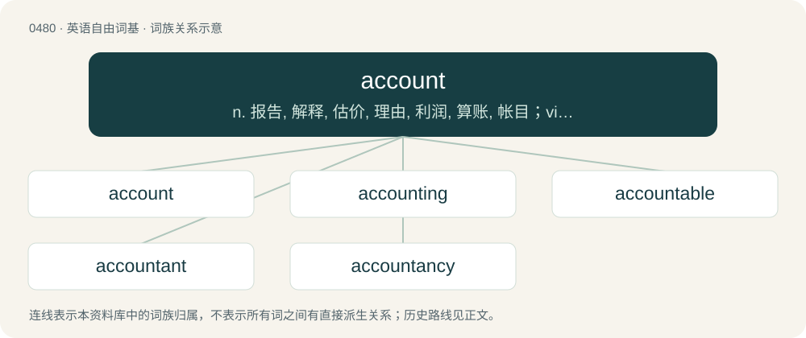

# 0547 · account — n. 报告, 解释, 估价, 理由, 利润, 算账, 帐目；vi. 报帐, 解释, 导致, 报偿, 占, 杀死；vt. 认为

[总目录](../00_总目录_按常用程度.md)

**类型**：英语自由词基　｜　**来源语言**：见词源记录

## 核心含义与来源

- 核心含义：n. 报告, 解释, 估价, 理由, 利润, 算账, 帐目；vi. 报帐, 解释, 导致, 报偿, 占, 杀死；vt. 认为
- 英文含义：A registry of pecuniary transactions; a written or printed statement of business dealings or debts and credits, and also of other things subjected to a reckoning or review.
- 词形：account

**多个词源／构词路径**：同一拼写可能有不同来源；以下按词性和含义分别列出。

**来源记录 1**（名词；A registry of pecuniary transactions; a written or printed statement of business dealings or debts and credits, and also of other things subjected to a reckoning or review.）

From Middle English acounte, from Anglo-Norman acunte (“account”), from Old French aconte, from aconter (“to reckon”), from Latin computō (“to sum up”).

**来源记录 2**（动词；To estimate, consider (something to be as described).）

From Old French acounter, accomptere et al., from a- + conter (“to count”)). Compare count.

## 词族图

## 单词速览（常用到不常用）

| 单词 | 音标 | 释义 |
|---|---|---|
| [account](#w-1) | 美 /əˈkaʊnt/ | n. 报告, 解释, 估价, 理由, 利润, 算账, 帐目；vi. 报帐, 解释, 导致, 报偿, 占, 杀死；vt. 认为 |
| [accounting](#w-2) | /əˈkaʊn.tɪŋ/ | n. 会计学, 帐单, 清帐；\[计\] 帐户处理, 记帐 |
| [accountable](#w-3) | /əˈkaʊntəbl̩/ | a. 负有责任的, 可说明的, 可解释的；\[经\] 负有责任的 |
| [accountant](#w-4) | 美 /əˈkaʊn.tənt/ | n. 会计人员, 会计师；\[经\] 会计师, 会计人员 |
| [accountancy](#w-5) | 美 /əˈkaʊnt.ən.si/ | n. 会计工作, 会计学；\[经\] 会计工作, 会计学术, 会计职业 |

## 逐词详解

### 1. account

**词性**：名词　｜　**音标**：美 /əˈkaʊnt/

**中文释义**：n. 报告, 解释, 估价, 理由, 利润, 算账, 帐目；vi. 报帐, 解释, 导致, 报偿, 占, 杀死；vt. 认为

**英文义项**：A registry of pecuniary transactions; a written or printed statement of business dealings or debts and credits, and also of other things subjected to a reckoning or review. / A bank account.

**词源与演化**：

From Middle English acounte, from Anglo-Norman acunte (“account”), from Old French aconte, from aconter (“to reckon”), from Latin computō (“to sum up”).

**例句**：

> Since the system outage, I've been unable to log in to my account.

该用例对应义项：Authorization as a specific registered user in accessing a system.

### 2. accounting

**词性**：名词　｜　**音标**：/əˈkaʊn.tɪŋ/

**中文释义**：n. 会计学, 帐单, 清帐；\[计\] 帐户处理, 记帐

**英文义项**：The development and use of a system for recording and analyzing the financial transactions and financial status of an individual or a business. / A relaying of events; justification of actions.

**构词拆分**：account + -ing

**词源与演化**：

\* First attested in the late 14th century. \* account + -ing

**例句**：

> He was required to give a thorough accounting of his time.

该用例对应义项：A relaying of events; justification of actions.

### 3. accountable

**词性**：形容词　｜　**音标**：/əˈkaʊntəbl̩/

**中文释义**：a. 负有责任的, 可说明的, 可解释的；\[经\] 负有责任的

**英文义项**：Obliged, when called upon, to answer (for one’s deeds); answerable. / Obliged to keep accurate records (of property or funds).

**构词拆分**：account + -able

**词源与演化**：

From account + -able. First attested around 1400.

**例句**：

> You will be held accountable for your misdemeanors.

该用例对应义项：Obliged, when called upon, to answer (for one’s deeds); answerable.

### 4. accountant

**词性**：名词　｜　**音标**：美 /əˈkaʊn.tənt/

**中文释义**：n. 会计人员, 会计师；\[经\] 会计师, 会计人员

**英文义项**：One who renders account; one accountable. / A reckoner, or someone who maintains financial matters for a person(s).

**构词拆分**：account + -ant

**词源与演化**：

From Middle English, from Middle French acuntant. Equivalent to account + -ant. First attested in the mid 15th century.

**例句**：

> Is it possible to pass the tax accountant exam by self study?

### 5. accountancy

**词性**：名词　｜　**音标**：美 /əˈkaʊnt.ən.si/

**中文释义**：n. 会计工作, 会计学；\[经\] 会计工作, 会计学术, 会计职业

**英文义项**：The function of compiling and providing financial information primarily by reports referred to as financial statements, including bookkeeping, systems design, analysis and interpretation of accounting information. / A company or organisation that performs such a function.

**构词拆分**：From account + -ancy.

**词源与演化**：

From account + -ancy.

**例句**：

> She studied accountancy before joining a firm.

该用例对应义项：The function of compiling and providing financial information primarily by reports referred to as financial statements, including bookkeeping, systems design, analysis and interpretation of accounting information.
