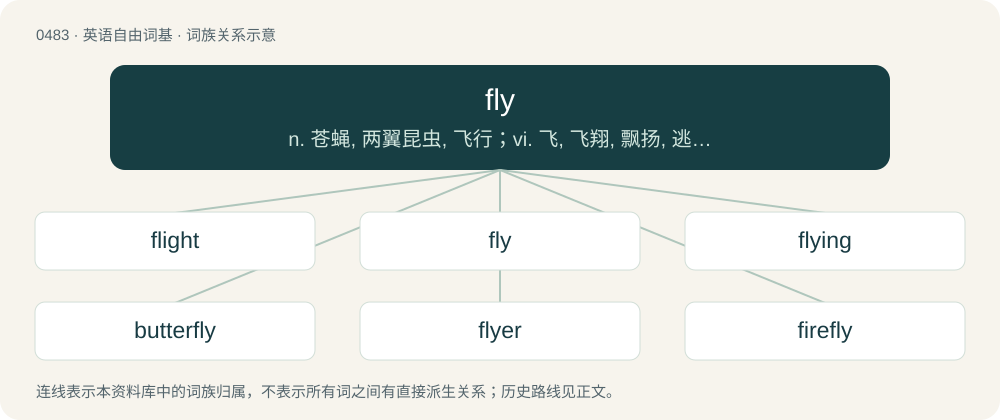

# 0548 · fly — n. 苍蝇, 两翼昆虫, 飞行；vi. 飞, 飞翔, 飘扬, 逃走；vt. 飞, 飞越, 使飘扬, 逃出

[总目录](../00_总目录_按常用程度.md)

**类型**：英语自由词基　｜　**来源语言**：见词源记录

## 核心含义与来源

- 核心含义：n. 苍蝇, 两翼昆虫, 飞行；vi. 飞, 飞翔, 飘扬, 逃走；vt. 飞, 飞越, 使飘扬, 逃出
- 英文含义：Any insect of the order Diptera; characterized by having two wings (except for some wingless species), also called true flies.
- 词形：fly

**多个词源／构词路径**：同一拼写可能有不同来源；以下按词性和含义分别列出。

**来源记录 1**（名词；Any insect of the order Diptera; characterized by having two wings (except for some wingless species), also called true flies.）

From Middle English fflye, flehe, flei, fleie, fley, fleye, fleȝe, flie, fliȝe, flye, vliȝe, vlye, from Old English flēge, flēoge, flīeġe (“a fly”), from Proto-West Germanic \*fleugā, from Proto-Germanic \*fleugǭ (“a fly”), from Proto-Indo-European \*plewk- (“to flow, fly, run; to splash”), enlargement of \*plew- (“to flow, fly, run”). Cognates Cognate with Scots flee, flei (“fly”), North Frisian fleeg (“fly”), Saterland Frisian Fljooge (“fly”), Alemannic German Flüüge (“fly”), Cimbrian blòiga, vlòiga (“fly”), Dutch vlieg (“fly”), German Fliege (“fly”), Low German Fleeg (“fly”), Vilamovian fłig, fłyjǵ (“fly”), Yiddish פֿליג (flig, “fly”), Danish and Norwegian Bokmål flue (“fly”), Faroese, Icelandic, and Swedish fluga (“fly”), Norwegian Nynorsk fluga, fluge, fluggu, flugu (“fly”).

**来源记录 2**（动词；To travel through the air, another gas, or a vacuum, without being in contact with a grounded surface.）

From Middle English flei, fley, fleye, fleȝhenn, flien, fliȝe, flyen, flyyn, from Old English flēgan, flēogan, from Proto-West Germanic \*fleugan, from Proto-Germanic \*fleuganą (“to fly”), from Proto-Indo-European \*plewk- (“to flow, fly, run; to splash”), enlargement of \*plew- (“to flow, fly, run”). Compare Etymology 1. Cognates Cognate with Scots flei (“to fly”), Yola vlee (“to fly”), North Frisian fli, fliin, fliine, fliinj, flä, fläie, flö (“to fly”), Saterland Frisian fljoge, fljooge (“to fly”), West Frisian fleane (“to fly”), Central Franconian fleeje (“to fly”), Dutch vliegen (“to fly”), Low German flegen (“to fly”), German fliegen (“to fly”), Luxembourgish fléien (“to fly”), Vilamovian fłig (“to fly”), Yiddish פֿליִען (flien, “to fly”), Danish flyve (“to fly”), Faroese fljúgva, flúgva (“to fly”), Icelandic fljúga (“to fly”), Norwegian Bokmål fly, flyge, flyve (“to fly”), Norwegian Nynorsk fljuga, fly, flyga, flyge (“to fly”), Scanian flyğa (“to fly”), Swedish flyga (“to fly”); also Cornish lew (“rudder”), Old Irish luí (“rudder”), Welsh llyw (“rudder”), Latin pluit, pluō (“to rain”), Ancient Greek πλέω (pléō, “to sail; to float”), Lithuanian plaukti (“to swim; to float”), Bulgarian пля́скам (pljáskam, “to slap; to clap; to splash; to jabber; to blemish”), Czech pleskat (“to slap; to flap, lap”), Macedonian плеска (pleska, “to slap”), Russian плеска́ть (pleskátʹ, “to splash”), Serbo-Croatian пље̏скати, pljȅskati (“to applaud; to slap”), Ukrainian плеска́ти (pleskáty, “to splash”), Armenian լուանալ (luanal), լվալ (lval), լվանալ (lvanal, “to wash”), Tocharian A and Tocharian B plu- (“to fly”), Sanskrit प्लु (plu, “to float; to sail”). More at flee and flow.

**来源记录 3**（名词；An act of flying.）

From Middle English flye (“flying, flight”), from Old English flyġe (“flying, flight”), from Proto-Germanic \*flugiz.

**来源记录 4**（形容词；Quick-witted, alert, mentally sharp.）

Uncertain; probably from the verb or noun.

**来源记录 5**（名词；A wing.）

Related to German Flügel (“a wing”), Dutch vleugel (“a wing”), Swedish flygel (“a wing”).

## 词族图

## 单词速览（常用到不常用）

| 单词 | 音标 | 释义 |
|---|---|---|
| [flight](#w-1) | 英 /ˈflaɪ̯t/；/ˈflɐɪ̯t/ | n. 飞行, 射程, 逃走, 飞跃, 飞机航程, 班机, 迁徙, 飞逝；vi. 迁徙；vt. 射击(飞禽), 为(箭)装上羽毛, 使惊飞 |
| [fly](#w-2) | /flaɪ/ | n. 苍蝇, 两翼昆虫, 飞行；vi. 飞, 飞翔, 飘扬, 逃走；vt. 飞, 飞越, 使飘扬, 逃出 |
| [flying](#w-3) | /ˈflaɪ.ɪŋ/ | a. 飞的, 飘扬的, 飞速的；n. 飞行, 飞花 |
| [butterfly](#w-4) | /ˈbʌ.tə(ɹ).flaɪ/ | n. 蝴蝶；\[医\] 蝶式棉块, 翼形皮癣, 纸蝶 |
| [flyer](#w-5) | /ˈflaɪə(ɹ)/ | n. 飞鸟, 飞行物, 飞行员, 快车, 传单, 飞跳；\[经\] 投机买卖, 孤注一掷, (广告)传单 |
| [firefly](#w-6) | 英 /ˈfaɪ.əˌflaɪ/；美 /ˈfaɪ.ɚˌflaɪ/ | n. 萤火虫 |
| [dragonfly](#w-7) | /ˈdɹæɡənˌflaɪ/ | n. 蜻蜓 |
| [flywheel](#w-8) | /ˈflaihwiːl/ | n. 飞轮, 惯性轮；\[化\] 飞轮 |
| [flyweight](#w-9) | /ˈflaiweit/ | n. 次最轻量级选手 |
| [flycatcher](#w-10) | /ˈflaikætʃə/ | n. 捕蝇器, 捕蝇草 |
| [superfly](#w-11) | /ˈsjuːpəflai/ | 【英文】A fly (insect) with remarkable properties, such as resistance to insecticide. |
| [gadfly](#w-12) | 英 /ˈɡædflaɪ/；美 /ˈɡædˌflaɪ/ | n. 形似苍蝇, 牛虻, 讨厌的人；\[医\] 虻 |
| [flytrap](#w-13) | /ˈflaitræp/ | n. 捕蝇器, 捕蝇草 |
| [mayfly](#w-14) | /ˈmeiflai/ | n. 蜉蝣, 蜉蝣状钓饵 |

## 逐词详解

### 1. flight

**词性**：名词　｜　**音标**：英 /ˈflaɪ̯t/；/ˈflɐɪ̯t/

**中文释义**：n. 飞行, 射程, 逃走, 飞跃, 飞机航程, 班机, 迁徙, 飞逝；vi. 迁徙；vt. 射击(飞禽), 为(箭)装上羽毛, 使惊飞

**英文义项**：The act of flying; the ability to fly. / An instance of flying.

**构词拆分**：fly + -t

**词源与演化**：

From Middle English flight, from Old English flyht (“flight”), from Proto-West Germanic \*fluhti (“flight”), derived from \*fleuganą (“to fly”), from Proto-Indo-European \*plewk- (“to fly”), enlargement of \*plew- (“flow”). Analyzable as fly + -t (variant of -th). Cognate with West Frisian flecht (“flight”), Dutch vlucht (“flight”), German Flucht (“flight”) (etymology 2).

**例句**：

> The central figure in the painting is a young woman, surrounded by a flight of angels.

该用例对应义项：A group of angels or types of angels, e.g., seraphim, cherubim.

### 2. fly

**词性**：名词　｜　**音标**：/flaɪ/

**中文释义**：n. 苍蝇, 两翼昆虫, 飞行；vi. 飞, 飞翔, 飘扬, 逃走；vt. 飞, 飞越, 使飘扬, 逃出

**英文义项**：Any insect of the order Diptera; characterized by having two wings (except for some wingless species), also called true flies. / Especially, any of the insects of the family Muscidae, such as the common housefly (other families of Diptera include mosquitoes and midges).

**词源与演化**：

From Middle English fflye, flehe, flei, fleie, fley, fleye, fleȝe, flie, fliȝe, flye, vliȝe, vlye, from Old English flēge, flēoge, flīeġe (“a fly”), from Proto-West Germanic \*fleugā, from Proto-Germanic \*fleugǭ (“a fly”), from Proto-Indo-European \*plewk- (“to flow, fly, run; to splash”), enlargement of \*plew- (“to flow, fly, run”). Cognates Cognate with Scots flee, flei (“fly”), North Frisian fleeg (“fly”), Saterland Frisian Fljooge (“fly”), Alemannic German Flüüge (“fly”), Cimbrian blòiga, vlòiga (“fly”), Dutch vlieg (“fly”), German Fliege (“fly”), Low German Fleeg (“fly”), Vilamovian fłig, fłyjǵ (“fly”), Yiddish פֿליג (flig, “fly”), Danish and Norwegian Bokmål flue (“fly”), Faroese, Icelandic, and Swedish fluga (“fly”), Norwegian Nynorsk fluga, fluge, fluggu, flugu (“fly”).

**例句**：

> How long does it take to fly from Tokyo to Los Angeles?

### 3. flying

**词性**：形容词　｜　**音标**：/ˈflaɪ.ɪŋ/

**中文释义**：a. 飞的, 飘扬的, 飞速的；n. 飞行, 飞花

**英文义项**：That flies or can fly. / Brief or hurried.

**构词拆分**：fly + -ing

**词源与演化**：

From Middle English fleynge, fleeʒinge, flihinde, vlyinde, vleoinde, flyand, ffleghand, flighand (also fleoninde, fleonninde, etc.), from Old English flēogende, from Proto-Germanic \*fleugandz (“flying”), present participle of Proto-Germanic \*fleuganą (“to fly”), equivalent to fly + -ing. Cognate with Saterland Frisian fljoogend (“flying”), West Frisian fleanend (“flying”), Dutch vliegend (“flying”), German Low German flegend (“flying”), German fliegend (“flying”), Danish flyvende (“flying”), Swedish flygande (“flying”), Icelandic fljúgandi (“flying”).

**例句**：

> Flying ferries are the watercraft of the future!

该用例对应义项：Capable of foiling.

### 4. butterfly

**词性**：名词　｜　**音标**：/ˈbʌ.tə(ɹ).flaɪ/

**中文释义**：n. 蝴蝶；\[医\] 蝶式棉块, 翼形皮癣, 纸蝶

**英文义项**：A flying insect of the order Lepidoptera, distinguished from moths by their diurnal activity and generally brighter colouring. / The imago (final form) of such an insect, consisting usually of a long body with large flat wings, as opposed to earlier instars such as caterpillar or pupa.

**构词拆分**：butter + fly

**词源与演化**：

From Middle English buterflie, butturflye, boterflye, from Old English buterflēoge, equivalent to butter + fly. Cognate with Dutch botervlieg, German Butterfliege (“butterfly”). The name may have originally been applied to butterflies of a yellowish color, or reflected a belief that butterflies ate milk and butter (compare German Molkendieb (“butterfly”, literally “whey-thief”) and Low German Botterlicker (“butterfly”, literally “butter-licker”)), or that they excreted a butter-like substance (compare Dutch boterschijte (“butterfly”, literally “butter-excretor”)). Compare also German Schmetterling from Schmetten (“cream”), German Low German Bottervögel (“butterfly”, literally “butter-fowl”). More at butter, fly. An alternate theory suggests that the first element may have originally been Old English butor- (“beater”), a mutation of bēatan (“to beat”), but this would not explain the cognates in other languages or the other names formed with milk products. Superseded non-native Middle English papilion (“butterfly”) borrowed from Old French papillon (“butterfly”). Contrary to popularised belief, the form "butterfly" was not derived from an earlier flutterby.

**例句**：

> One potential butterfly could be JFK having another son the year after the POD instead of a daughter.

该用例对应义项：A random change in an aspect of the timeline seemingly unrelated to the primary point of divergence, resulting from the butterfly effect.

### 5. flyer

**词性**：名词　｜　**音标**：/ˈflaɪə(ɹ)/

**中文释义**：n. 飞鸟, 飞行物, 飞行员, 快车, 传单, 飞跳；\[经\] 投机买卖, 孤注一掷, (广告)传单

**英文义项**：That which flies, as a bird or insect. / A machine that flies.

**构词拆分**：fly + -er (agent noun suffix)

**词源与演化**：

From fly + -er (agent noun suffix). With regard to the sense "female kangaroo": because of the high speed at which they move.

**例句**：

> A downside to frequent flyer miles is that using them is complicated.

### 6. firefly

**词性**：名词　｜　**音标**：英 /ˈfaɪ.əˌflaɪ/；美 /ˈfaɪ.ɚˌflaɪ/

**中文释义**：n. 萤火虫

**英文义项**：Any beetle of the family Lampyridae, which exhibit bioluminescence during twilight.

**构词拆分**：Endocentric compound of fire + fly

**词源与演化**：

Endocentric compound of fire + fly, because the insects glow; whence also lightning bug. Compare glow fly, glowworm, and lanternfly. Compare typologically Ancient Greek λαμπυρίς (lampurís, “glowworm”) (&lt;+ πῦρ (pûr)).

**例句**：

> They found a species of firefly that was assumed to be extinct.

### 7. dragonfly

**词性**：名词　｜　**音标**：/ˈdɹæɡənˌflaɪ/

**中文释义**：n. 蜻蜓

**英文义项**：An insect of the suborder Epiprocta or, more strictly, the infraorder Anisoptera, having four long transparent wings held perpendicular to a long body when perched.

**构词拆分**：dragon + fly

**词源与演化**：

From dragon + fly. Compare drakefly (“mayfly”).

**例句**：

> We just saw a frog eat an entire dragonfly in one bite.

### 8. flywheel

**词性**：名词　｜　**音标**：/ˈflaihwiːl/

**中文释义**：n. 飞轮, 惯性轮；\[化\] 飞轮

**英文义项**：A rotating mass used to maintain the speed of a machine within certain limits while the machine receives or releases energy at a varying rate, or as a form of energy storage.

**构词拆分**：fly + wheel

**词源与演化**：

From fly + wheel.

**例句**：

> Then his 27-year-old grandson, Matt Jost, struggles with a large flywheel to start the tractor.

### 9. flyweight

**词性**：名词　｜　**音标**：/ˈflaiweit/

**中文释义**：n. 次最轻量级选手

**英文义项**：A weight that moves outward depending on centrifugal force. / A weight class in many combat sports; e.g. in professional boxing of a maximum of 112 pounds or 50.8 kilograms.

**构词拆分**：fly + weight

**词源与演化**：

From fly + weight.

**例句**：

> The flyweight champion contended with a strong challenger.

### 10. flycatcher

**词性**：名词　｜　**音标**：/ˈflaikætʃə/

**中文释义**：n. 捕蝇器, 捕蝇草

**英文义项**：Any of many kinds of birds of the family Muscicapidae, of Africa, Europe, and Asia, that catch insects in flight; an Old World flycatcher. / Any of many kinds of similar birds of various families, such as Tyrannidae (the New World flycatchers of the Americas), Tityridae, Stenostiridae, Monarchidae, Petroicidae, etc.

**构词拆分**：fly + catcher

**词源与演化**：

From fly + catcher.

**例句**：

> The flycatcher has ravaged the flies.

### 11. superfly

**词性**：名词　｜　**音标**：/ˈsjuːpəflai/

**英文义项**：A fly (insect) with remarkable properties, such as resistance to insecticide.

**构词拆分**：super- + fly

**词源与演化**：

From super- + fly.

### 12. gadfly

**词性**：名词　｜　**音标**：英 /ˈɡædflaɪ/；美 /ˈɡædˌflaɪ/

**中文释义**：n. 形似苍蝇, 牛虻, 讨厌的人；\[医\] 虻

**英文义项**：Any dipterous (“two-winged”) insect or fly of the family Oestridae (commonly known as a bot fly) or Tabanidae (horse fly), noted for irritating animals by buzzing about them, and biting them to suck their blood; a gadbee. / A person or thing that irritates or instigates.

**构词拆分**：gad (“sharp point, spike; (dialectal) sharp-pointed rod for driving cattle, horses, etc., goad”) + fly

**词源与演化**：

From gad (“sharp point, spike; (dialectal) sharp-pointed rod for driving cattle, horses, etc., goad”) + fly, in the sense of a fly which irritates cattle, etc., by biting them, similar to the prodding of a goad. Gad is derived from Middle English gad, gadde (“metal spike with a sharp point; stick with a sharp point for driving animals, goad; metal bar or rod, ingot; (by extension) lump of material; metal rod for measuring land; (by extension) unit of linear measure equal to about 10 to 16 feet”), borrowed from Old Norse gaddr (“spike; goad”), from Proto-Germanic \*gazdaz (“spike; goad”), further etymology uncertain. Displaced native Old English bēaw. Sense 2.1.1 (“person who upsets the status quo”) may allude to the Apology by the Greek philosopher Plato (428/427 or 424/423 – 348/347 B.C.E.), where he describes Socrates (c. 470 – 399 B.C.E.) acting as a goad to the Athenian political scene like a gadfly (Ancient Greek μῠ́ωψ (mŭ́ōps)) arousing a sluggish horse.

**例句**：

> He’s a regular gadfly and takes advantage of his friend’s generosity.

该用例对应义项：A person who takes without giving back; a bloodsucker.

### 13. flytrap

**词性**：名词　｜　**音标**：/ˈflaitræp/

**中文释义**：n. 捕蝇器, 捕蝇草

**英文义项**：A trap built to catch flies. / The Venus flytrap, an insectivorous plant.

**构词拆分**：fly + trap

**词源与演化**：

From fly + trap.

### 14. mayfly

**词性**：名词　｜　**音标**：/ˈmeiflai/

**中文释义**：n. 蜉蝣, 蜉蝣状钓饵

**英文义项**：Any of the many fragile insects of the order Ephemeroptera that develop in fresh water and live very briefly as winged adults. / Characterized by a short duration; short-lived.

**构词拆分**：May + fly；May (“fifth month”) + fly (“flying insect”)

**词源与演化**：

From May (“fifth month”) + fly (“flying insect”). Compare Saterland Frisian Moaifljooge (“blowfly”).

**例句**：

> While some animals take months to reproduce, mayfly need just one perfect day.

该用例对应义项：Any of the many fragile insects of the order Ephemeroptera that develop in fresh water and live very briefly as winged adults.
