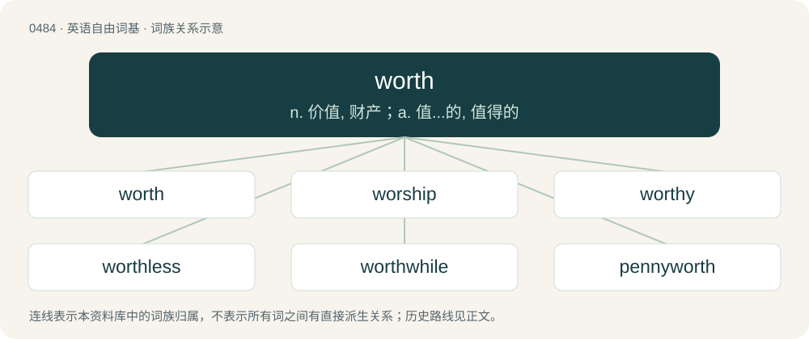

# 0549 · worth — n. 价值, 财产；a. 值...的, 值得的

[总目录](../00_总目录_按常用程度.md)

**类型**：英语自由词基　｜　**来源语言**：见词源记录

## 核心含义与来源

- 核心含义：n. 价值, 财产；a. 值...的, 值得的
- 英文含义：Having a value of; proper to be exchanged for.
- 词形：worth

**来源记录 1**（形容词；Having a value of; proper to be exchanged for.）

From Middle English worth, from Old English weorþ, from Proto-West Germanic \*werþ, from Proto-Germanic \*werþaz (“worthy, valuable”); from Proto-Indo-European \*wert-. Cognate with Scots wirth (“worth”), Cimbrian bèart (“worth, value”), Dutch waard, weerd (“worth”), German wert (“worth”) (the source of Polish wart (“worth”), Ukrainian вартість (vartistʹ, “worth, value”), etc), Luxembourgish wäert (“worth”), Yiddish ווערט (vert), ווערד (verd, “worth, value”), Danish værd (“worth”), Faroese and Icelandic verður (“worth”), Norwegian Bokmål verdt (“worth”), Norwegian Nynorsk verd (“worth”), Swedish värd (“worth”), Gothic 𐍅𐌰𐌹𐍂𐌸 (wairþ, “worth, value”), Welsh gwerth (“worth, value”).

## 词族图

## 单词速览（常用到不常用）

| 单词 | 音标 | 释义 |
|---|---|---|
| [worth](#w-1) | 英 /ˈwɜːθ/；美 /wɝθ/ | n. 价值, 财产；a. 值...的, 值得的 |
| [worship](#w-2) | 英 /ˈwɜː.ʃɪp/；美 /ˈwɝ.ʃɪp/ | n. 崇拜, 礼拜, 尊敬；vi. 参加礼拜；vt. 崇拜, 尊敬 |
| [worthy](#w-3) | 英 /ˈwɜː.ði/；美 /ˈwɝ.ði/ | n. 杰出人物；a. 有价值的, 可敬的, 值得的 |
| [worthless](#w-4) | 英 /ˈwɜːθ.ləs/；美 /ˈwɝθ.ləs/ | a. 无价值的, 无益的, 无足轻重的；\[法\] 无价值的, 无用的 |
| [worthwhile](#w-5) | 英 /ˌwɜː(ɹ)θˈʍaɪl/；/ˌwɜː(ɹ)θˈwaɪl/ | a. 值得花时间的, 值得做的, 有真实价值的 |
| [pennyworth](#w-6) | /ˈpeniwəːθ/ | n. 一便士的价钱, 价值一便士之物, 少量, 交易 |

## 逐词详解

### 1. worth

**词性**：形容词　｜　**音标**：英 /ˈwɜːθ/；美 /wɝθ/

**中文释义**：n. 价值, 财产；a. 值...的, 值得的

**英文义项**：Having a value of; proper to be exchanged for. / Deserving of.

**词源与演化**：

From Middle English worth, from Old English weorþ, from Proto-West Germanic \*werþ, from Proto-Germanic \*werþaz (“worthy, valuable”); from Proto-Indo-European \*wert-. Cognate with Scots wirth (“worth”), Cimbrian bèart (“worth, value”), Dutch waard, weerd (“worth”), German wert (“worth”) (the source of Polish wart (“worth”), Ukrainian вартість (vartistʹ, “worth, value”), etc), Luxembourgish wäert (“worth”), Yiddish ווערט (vert), ווערד (verd, “worth, value”), Danish værd (“worth”), Faroese and Icelandic verður (“worth”), Norwegian Bokmål verdt (“worth”), Norwegian Nynorsk verd (“worth”), Swedish värd (“worth”), Gothic 𐍅𐌰𐌹𐍂𐌸 (wairþ, “worth, value”), Welsh gwerth (“worth, value”).

**例句**：

> Is it well worth visiting your hometown? -Nah, Leicester is not worth it at all.

该用例对应义项：Having a value of; proper to be exchanged for.

### 2. worship

**词性**：名词　｜　**音标**：英 /ˈwɜː.ʃɪp/；美 /ˈwɝ.ʃɪp/

**中文释义**：n. 崇拜, 礼拜, 尊敬；vi. 参加礼拜；vt. 崇拜, 尊敬

**英文义项**：The devotion accorded to a deity or to a sacred object. / The adoration (or latria) owed to God alone, as greater than the hyperdulia that is given to Saint Mary only and the veneration (or dulia) accorded to all other Roman Catholic saints.

**构词拆分**：By surface analysis, wor(th) + -ship

**词源与演化**：

Inherited from Middle English worschippe /worthschipe, inherited from Old English weorþsċiepe. Cognate with Scots worschip (“worship”). By surface analysis, wor(th) + -ship.

**例句**：

> Polytheistic theology and worship had to go underground.

该用例对应义项：The devotion accorded to a deity or to a sacred object.

### 3. worthy

**词性**：名词　｜　**音标**：英 /ˈwɜː.ði/；美 /ˈwɝ.ði/

**中文释义**：n. 杰出人物；a. 有价值的, 可敬的, 值得的

**英文义项**：A distinguished or eminent person. / a good, wise and virtuous person.

**构词拆分**：worth + -y

**词源与演化**：

From Middle English worthy, wurthi, from Old English \*weorþiġ (“worthy”), equivalent to worth + -y. Cognate with Dutch waardig (“worthy”), Middle Low German werdig (“worthy”), German würdig (“worthy”), Swedish värdig (“worthy”), Icelandic verðugur (“worthy”).

**例句**：

> Never tell the truth to people who are not worthy of it.

### 4. worthless

**词性**：形容词　｜　**音标**：英 /ˈwɜːθ.ləs/；美 /ˈwɝθ.ləs/

**中文释义**：a. 无价值的, 无益的, 无足轻重的；\[法\] 无价值的, 无用的

**英文义项**：Having no worth or use; without value.

**构词拆分**：worth + -less

**词源与演化**：

From Middle English \*worthles, from Old English weorþlēas (“worthless”), equivalent to worth + -less. Cognate with Dutch waardeloos (“worthless”), German wertlos (“worthless”), Swedish värdelös (“worthless”).

**例句**：

> Lies are as important as truth, for without lies, the truth is worthless.

该用例对应义项：Having no worth or use; without value.

### 5. worthwhile

**词性**：形容词　｜　**音标**：英 /ˌwɜː(ɹ)θˈʍaɪl/；/ˌwɜː(ɹ)θˈwaɪl/

**中文释义**：a. 值得花时间的, 值得做的, 有真实价值的

**英文义项**：Good and important enough to spend time, effort, or money on.

**构词拆分**：worth (adjective) + while (noun)

**词源与演化**：

From worth (adjective) + while (noun).

**例句**：

> Doing volunteer work to help others is truly worthwhile.

该用例对应义项：Good and important enough to spend time, effort, or money on.

### 6. pennyworth

**词性**：名词　｜　**音标**：/ˈpeniwəːθ/

**中文释义**：n. 一便士的价钱, 价值一便士之物, 少量, 交易

**英文义项**：The amount that can be bought for a penny. / A small quantity or value.

**构词拆分**：penny + worth

**词源与演化**：

From penny + worth.
