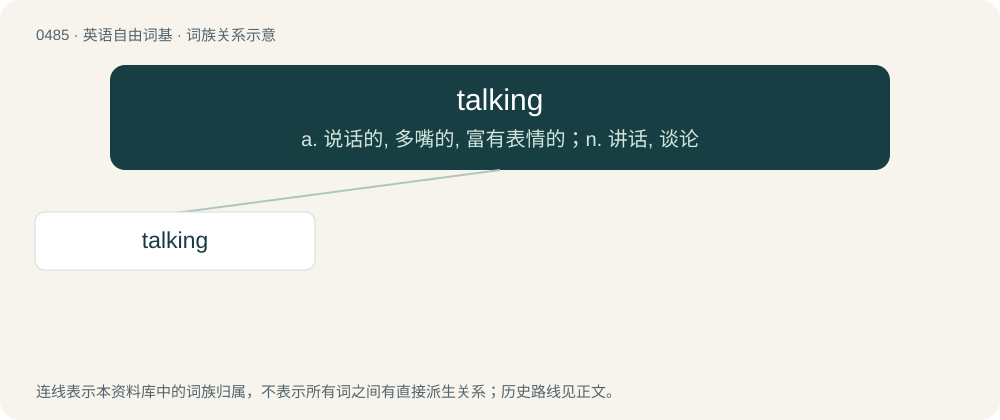

# 0550 · talking — a. 说话的, 多嘴的, 富有表情的；n. 讲话, 谈论

[总目录](../00_总目录_按常用程度.md)

**类型**：英语自由词基　｜　**来源语言**：见词源记录

## 核心含义与来源

- 核心含义：a. 说话的, 多嘴的, 富有表情的；n. 讲话, 谈论
- 英文含义：The action of the verb talk.
- 词形：talking

**来源记录 1**（名词；The action of the verb talk.）

From Middle English talkynge. By surface analysis, talk + -ing.

## 词族图

## 单词速览（常用到不常用）

| 单词 | 音标 | 释义 |
|---|---|---|
| [talking](#w-1) | 英 /ˈtɔːkɪŋ/；美 /ˈtɔkɪŋ/ | a. 说话的, 多嘴的, 富有表情的；n. 讲话, 谈论 |

## 逐词详解

### 1. talking

**词性**：名词　｜　**音标**：英 /ˈtɔːkɪŋ/；美 /ˈtɔkɪŋ/

**中文释义**：a. 说话的, 多嘴的, 富有表情的；n. 讲话, 谈论

**英文义项**：The action of the verb talk.

**构词拆分**：By surface analysis, talk + -ing

**词源与演化**：

From Middle English talkynge. By surface analysis, talk + -ing.

**例句**：

> It's been nice talking to you, but I really must go now.
