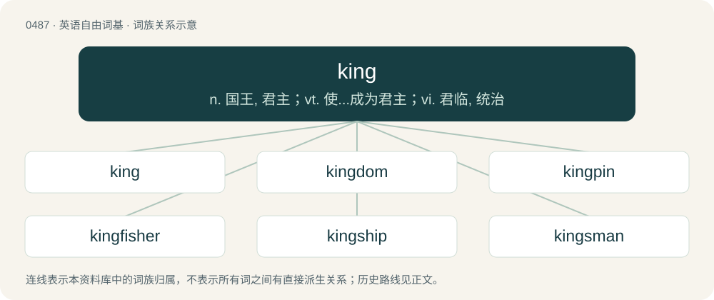

# 0552 · king — n. 国王, 君主；vt. 使...成为君主；vi. 君临, 统治

[总目录](../00_总目录_按常用程度.md)

**类型**：英语自由词基　｜　**来源语言**：见词源记录

## 核心含义与来源

- 核心含义：n. 国王, 君主；vt. 使...成为君主；vi. 君临, 统治
- 英文含义：A male monarch; a man who heads a monarchy; in an absolute monarchy, the supreme ruler of his nation.
- 词形：king

**来源记录 1**（名词；A male monarch; a man who heads a monarchy; in an absolute monarchy, the supreme ruler of his nation.）

From Middle English king, kyng, kynge, from Old English cening, cing, cining, cuning, cyncg, cyneg, cyng, cyngc, cynig, cyning, king, kining, kuning, kyning, kyningc (“king”), from Proto-West Germanic \*kuning, from Proto-Germanic \*kuningaz, \*kunungaz (“king”), from \*kunją (“clan, family, kin”), from Proto-Indo-European \*ǵenh₁- (“to produce; to beget”). Equivalent to kin + -ing. Doublet of cyning and knez. Cognates Cognate with Yola king, kinge (“king”), North Frisian kining, köning (“king”), Saterland Frisian Kening, König, Köänig (“king”), West Frisian kening (“king”), Alemannic German Chüng, Künig (“king”), Bavarian Kini (“king”), Central Franconian Künning (“king”), Cimbrian khuuneg (“king”), Dutch koning (“king”), German König (“king”), Luxembourgish Kinnek (“king”), Vilamovian kyng (“king”), Yiddish קעניג (kenig), קיניג (kinig, “king”), Danish kong, konge, konning (“king”), Elfdalian kunungg (“king”), Faroese kongur (“king”), Icelandic kóngur, konungur (“king”), Norwegian Bokmål konge (“king”), Norwegian Nynorsk konge (“king”), Scanian káng (“king”), Swedish konung, kung (“king”), Latgalian and Latvian kungs (“gentlemen”), Lithuanian kunigas (“priest”), Belarusian, Russian, and Ukrainian князь (knjazʹ, “prince; duke”), Bulgarian кнез (knez), княз (knjaz, “prince”), Czech kněz (“priest”), kníže (“prince”), Macedonian кнез (knez, “prince”), Polish ksiądz, xiądz (“priest; prince”), Serbo-Croatian кне̑з, knȇz (“prince”), Slovak kňaz (“priest”), knieža (“prince”), Slovene knez (“prince”), Estonian and Finnish kuningas (“king”), Ingrian kunigas, kunikas, kuningas (“king”), Veps kunigaz (“king”), Votic kunikõz (“king”), Võro kuning (“king”), Inari Sami kunâgâs (“king”), Kildin Sami коа̄нгэсс (kåångess), ко̄нгэс (kōnges, “bridegroom; king”), Lule Sami and Pite Sami gånågis (“king”), Northern Sami gonagas (“king”), Skolt Sami koonǥõs (“king”), Ter Sami конагас (konâgas, “king”); also Breton genel (“to bear”), Irish and Scottish Gaelic gin (“birth; fetus; offspring”), Welsh geni (“to be born”), Latin genō (“to bear, beget; to produce, yield”), Greek γενεά (geneá), γενιά (geniá, “ancestry, kin; generation”), Albanian dhen, dhën (“caprids, small livestock”), Lithuanian žentas (“son-in-law”), Belarusian зяць (zjacʹ, “brother-in-law; son-in-law”), Bulgarian and Macedonian зет (zet, “brother-in-law; son-in-law”), Czech zeť (“son-in-law”), Polish zięć (“son-on-law”), Russian зять (zjatʹ, “brother-in-law; son-in-law”), Serbo-Croatian зе̏т, zȅt (“brother-in-law; son-in-law”), Slovak zať (“son-in-law”), Slovene zet (“son-in-law”), Ukrainian зєть (zjetʹ), зять (zjatʹ, “brother-in-law; son-in-law”), Armenian ծնել (cnel, “to bear”), Avestan 𐬰𐬄𐬚𐬀𐬭 (ząθar, “father, progenitor; Creator”), Pashto زېږېدل (zeǵedël, “to be born”), Persian زادن (zādan / zâdan), زاییدن (zāyīdan / zâyidan, “to give birth”), Sanskrit जनति (janati, “to beget, create, produce; to assign, procure”). Eclipsed non-native Middle English roy (“king”) (Early Modern English roy), borrowed from Old French rei, roi, roy (“king”). The verb is inherited from Middle English kingen, kyngen (“to perform the duties of a king”), itself from the noun.

## 词族图

## 单词速览（常用到不常用）

| 单词 | 音标 | 释义 |
|---|---|---|
| [king](#w-1) | 英 /ˈkɪŋɡ/；/ˈkɪŋ/ | n. 国王, 君主；vt. 使...成为君主；vi. 君临, 统治 |
| [kingdom](#w-2) | 英 /ˈkɪŋdəm/ | n. 王国, 领域；\[医\] 界(动物,植物,矿物) |
| [kingpin](#w-3) | /ˈkɪŋ.pɪn/ | n. 中心立轴, (非正式)中心人物, 首脑, 关键人物, (非正式)主要成分 |
| [kingfisher](#w-4) | 英 /ˈkɪŋˌfɪʃə/ | n. 鱼狗, 翠鸟 |
| [kingship](#w-5) | 美 /ˈkɪŋʃɪp/ | n. 君主身分, 王位, 王权；\[法\] 王权, 帝王统治, 君王的身分 |
| [kingsman](#w-6) |  | 【英文】The lowest enlisted rank in the Duke of Lancaster's Regiment of the British Army, equivalent to private in the rest of the British Army. |
| [kingmaker](#w-7) | 英 /ˈkɪŋmeɪkə/；美 /ˈkɪŋˌmeɪkɚ/ | n. 拥立国王者, 有权支配要职的任命者 |
| [kingly](#w-8) | /ˈkiŋli/ | a. 国王的, 高贵的, 威严的；\[法\] 王的, 国王的, 适于君王的 |
| [kingfish](#w-9) | /ˈkiŋfiʃ/ | n. 大海鱼, (美)(非正式)首领, 头子 |
| [kingwood](#w-10) | /ˈkiŋ,wud/ | n. \[植\] 西阿拉黄檀树(产于南美洲), 西阿拉黄檀木 |
| [kingslayer](#w-11) | /ˈkɪŋˌsleɪ.ə(ɹ)/ | 【英文】One who kills a king. |

## 逐词详解

### 1. king

**词性**：名词　｜　**音标**：英 /ˈkɪŋɡ/；/ˈkɪŋ/

**中文释义**：n. 国王, 君主；vt. 使...成为君主；vi. 君临, 统治

**英文义项**：A male monarch; a man who heads a monarchy; in an absolute monarchy, the supreme ruler of his nation. / The monarch with the most power and authority in a monarchy, regardless of sex.

**构词拆分**：kin + -ing

**词源与演化**：

From Middle English king, kyng, kynge, from Old English cening, cing, cining, cuning, cyncg, cyneg, cyng, cyngc, cynig, cyning, king, kining, kuning, kyning, kyningc (“king”), from Proto-West Germanic \*kuning, from Proto-Germanic \*kuningaz, \*kunungaz (“king”), from \*kunją (“clan, family, kin”), from Proto-Indo-European \*ǵenh₁- (“to produce; to beget”). Equivalent to kin + -ing. Doublet of cyning and knez. Cognates Cognate with Yola king, kinge (“king”), North Frisian kining, köning (“king”), Saterland Frisian Kening, König, Köänig (“king”), West Frisian kening (“king”), Alemannic German Chüng, Künig (“king”), Bavarian Kini (“king”), Central Franconian Künning (“king”), Cimbrian khuuneg (“king”), Dutch koning (“king”), German König (“king”), Luxembourgish Kinnek (“king”), Vilamovian kyng (“king”), Yiddish קעניג (kenig), קיניג (kinig, “king”), Danish kong, konge, konning (“king”), Elfdalian kunungg (“king”), Faroese kongur (“king”), Icelandic kóngur, konungur (“king”), Norwegian Bokmål konge (“king”), Norwegian Nynorsk konge (“king”), Scanian káng (“king”), Swedish konung, kung (“king”), Latgalian and Latvian kungs (“gentlemen”), Lithuanian kunigas (“priest”), Belarusian, Russian, and Ukrainian князь (knjazʹ, “prince; duke”), Bulgarian кнез (knez), княз (knjaz, “prince”), Czech kněz (“priest”), kníže (“prince”), Macedonian кнез (knez, “prince”), Polish ksiądz, xiądz (“priest; prince”), Serbo-Croatian кне̑з, knȇz (“prince”), Slovak kňaz (“priest”), knieža (“prince”), Slovene knez (“prince”), Estonian and Finnish kuningas (“king”), Ingrian kunigas, kunikas, kuningas (“king”), Veps kunigaz (“king”), Votic kunikõz (“king”), Võro kuning (“king”), Inari Sami kunâgâs (“king”), Kildin Sami коа̄нгэсс (kåångess), ко̄нгэс (kōnges, “bridegroom; king”), Lule Sami and Pite Sami gånågis (“king”), Northern Sami gonagas (“king”), Skolt Sami koonǥõs (“king”), Ter Sami конагас (konâgas, “king”); also Breton genel (“to bear”), Irish and Scottish Gaelic gin (“birth; fetus; offspring”), Welsh geni (“to be born”), Latin genō (“to bear, beget; to produce, yield”), Greek γενεά (geneá), γενιά (geniá, “ancestry, kin; generation”), Albanian dhen, dhën (“caprids, small livestock”), Lithuanian žentas (“son-in-law”), Belarusian зяць (zjacʹ, “brother-in-law; son-in-law”), Bulgarian and Macedonian зет (zet, “brother-in-law; son-in-law”), Czech zeť (“son-in-law”), Polish zięć (“son-on-law”), Russian зять (zjatʹ, “brother-in-law; son-in-law”), Serbo-Croatian зе̏т, zȅt (“brother-in-law; son-in-law”), Slovak zať (“son-in-law”), Slovene zet (“son-in-law”), Ukrainian зєть (zjetʹ), зять (zjatʹ, “brother-in-law; son-in-law”), Armenian ծնել (cnel, “to bear”), Avestan 𐬰𐬄𐬚𐬀𐬭 (ząθar, “father, progenitor; Creator”), Pashto زېږېدل (zeǵedël, “to be born”), Persian زادن (zādan / zâdan), زاییدن (zāyīdan / zâyidan, “to give birth”), Sanskrit जनति (janati, “to beget, create, produce; to assign, procure”). Eclipsed non-native Middle English roy (“king”) (Early Modern English roy), borrowed from Old French rei, roi, roy (“king”). The verb is inherited from Middle English kingen, kyngen (“to perform the duties of a king”), itself from the noun.

**例句**：

> Charles the third became the new king of England from 2022.

该用例对应义项：A male monarch; a man who heads a monarchy; in an absolute monarchy, the supreme ruler of his nation.

### 2. kingdom

**词性**：名词　｜　**音标**：英 /ˈkɪŋdəm/

**中文释义**：n. 王国, 领域；\[医\] 界(动物,植物,矿物)

**英文义项**：A realm having a king or queen as its actual or nominal sovereign. / A realm, region, or conceptual space where something is dominant.

**构词拆分**：king + -dom

**词源与演化**：

From Middle English kingdom, kyngdom, from Old English cyningdōm from Proto-Germanic \*kuningadōmaz, equivalent to king + -dom. Cognate with Scots kingdom, West Frisian keuningdom, Dutch koningdom, German Königtum, Danish kongedømme, Swedish kungadöme, and Icelandic konungdómur. Etymology tree Proto-Indo-European \*ǵenh₁- Proto-Indo-European \*-yós Proto-Germanic \*kunją Proto-Indo-European \*-n̥kʷo-der.? Proto-Indo-European \*-nós Proto-Indo-European \*-iHnos Proto-Germanic \*-īnaz Proto-Indo-European \*-kos Proto-Germanic \*-gaz ? Proto-Germanic \*-ingaz Proto-Germanic \*kuningaz Proto-Indo-European \*dʰeh₁- Proto-Indo-European \*-mos Proto-Indo-European \*dʰóh₁mos Proto-Germanic \*dōmaz Proto-Germanic \*-dōmaz Proto-Germanic \*kuningadōmaz Proto-West Germanic \*kuningadōm Old English cyningdōm Middle English kingdom English kingdom

**用法示例／搭配（非完整句）**：

> the kingdom of the dead

该用例对应义项：A realm, region, or conceptual space where something is dominant.

### 3. kingpin

**词性**：名词　｜　**音标**：/ˈkɪŋ.pɪn/

**中文释义**：n. 中心立轴, (非正式)中心人物, 首脑, 关键人物, (非正式)主要成分

**英文义项**：The axis around which steered wheels pivot; a bolt that holds the axis in place. / The pivot or connector between a tractor and trailer in the fifth-wheel coupling of semi-trailer truck.

**构词拆分**：king + pin

**词源与演化**：

From king + pin.

### 4. kingfisher

**词性**：名词　｜　**音标**：英 /ˈkɪŋˌfɪʃə/

**中文释义**：n. 鱼狗, 翠鸟

**英文义项**：Any of various birds of the suborder Alcedines (or the family Alcedinidae sensu lato), having a large head, short tail and brilliant colouration; they feed mostly on fish. / common kingfisher (Alcedo atthis)

**构词拆分**：king + fisher

**词源与演化**：

Originally king's fisher, from Middle English kyngys fyschare; equivalent to king + fisher. So named for obscure reasons.

**例句**：

> Most species of kingfisher are found in tropical regions.

### 5. kingship

**词性**：名词　｜　**音标**：美 /ˈkɪŋʃɪp/

**中文释义**：n. 君主身分, 王位, 王权；\[法\] 王权, 帝王统治, 君王的身分

**英文义项**：The dignity, rank, or office of a king; the state of being a king. / A monarchy.

**构词拆分**：king + -ship

**词源与演化**：

From king + -ship.

### 6. kingsman

**词性**：名词

**英文义项**：The lowest enlisted rank in the Duke of Lancaster's Regiment of the British Army, equivalent to private in the rest of the British Army.

**构词拆分**：king + -s- + man

**词源与演化**：

From king + -s- + man.

### 7. kingmaker

**词性**：名词　｜　**音标**：英 /ˈkɪŋmeɪkə/；美 /ˈkɪŋˌmeɪkɚ/

**中文释义**：n. 拥立国王者, 有权支配要职的任命者

**英文义项**：Someone who has strong influence over the choice of a leader. / A player who is unable to win but powerful enough to decide which of the other viable players will eventually win.

**构词拆分**：king + maker

**词源与演化**：

From king + maker, originally used in the 16th century in “Warwick the Kingmaker”, an epithet of Richard Neville, 16th Earl of Warwick (1428–1471), a key figure in the Wars of the Roses whose actions led to King Henry VI being deposed in 1461 and Edward IV appointed in his place, then Edward IV being replaced by Henry VI again in 1470.

**例句**：

> The Earl of Warwick was the first kingmaker.

该用例对应义项：an important person who can bring leaders to power through the exercise of political influence

### 8. kingly

**词性**：形容词　｜　**音标**：/ˈkiŋli/

**中文释义**：a. 国王的, 高贵的, 威严的；\[法\] 王的, 国王的, 适于君王的

**英文义项**：Of or belonging to a king or kings; exercised by a king. / Characteristic of kings, majestic, regal; as befits a king, in the manner of a king.

**构词拆分**：king + -ly

**词源与演化**：

From Middle English kyngly, from Old English \*cyninglīċ (“kingly, royal”), equivalent to king + -ly. Cognate with Dutch koninklijk (“kingly, royal”), German königlich (“kingly”), Swedish kunglig (“kingly”). Compare also Old English cynelīċ (“kingly, royal, public”).

**例句**：

> The murder of his kingly guest.

该用例对应义项：having the rank of or resembling or befitting a king

### 9. kingfish

**词性**：名词　｜　**音标**：/ˈkiŋfiʃ/

**中文释义**：n. 大海鱼, (美)(非正式)首领, 头子

**英文义项**：Any of several food fishes of the genus Menticirrhus from the Atlantic; kingcroakers. / opah (Lampris guttatus), of the United Kingdom

**构词拆分**：king + fish

**词源与演化**：

From king + fish.

### 10. kingwood

**词性**：名词　｜　**音标**：/ˈkiŋ,wud/

**中文释义**：n. \[植\] 西阿拉黄檀树(产于南美洲), 西阿拉黄檀木

**英文义项**：Dalbergia cearensis, a Brazilian tree having a violet-brown, hard texture. / The wood of this tree, used in cabinetmaking.

**构词拆分**：king + wood

**词源与演化**：

From king + wood.

### 11. kingslayer

**词性**：名词　｜　**音标**：/ˈkɪŋˌsleɪ.ə(ɹ)/

**英文义项**：One who kills a king.

**构词拆分**：king + slayer

**词源与演化**：

From king + slayer.
