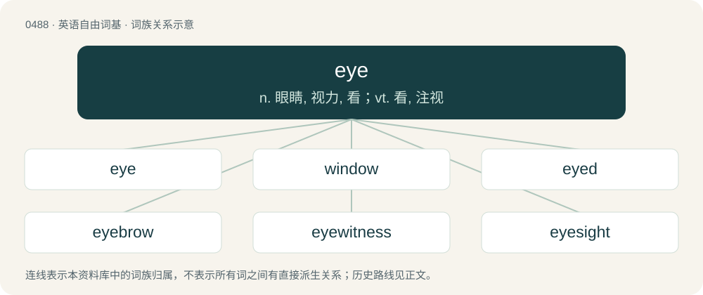

# 0553 · eye — n. 眼睛, 视力, 看；vt. 看, 注视

[总目录](../00_总目录_按常用程度.md)

**类型**：英语自由词基　｜　**来源语言**：见词源记录

## 核心含义与来源

- 核心含义：n. 眼睛, 视力, 看；vt. 看, 注视
- 英文含义：An organ through which animals see (“perceive surroundings via light”).
- 词形：eye

**多个词源／构词路径**：同一拼写可能有不同来源；以下按词性和含义分别列出。

**来源记录 1**（名词；An organ through which animals see (“perceive surroundings via light”).）

From Middle English e, eye, eyghe, eyȝe, eȝhe, iȝe, ye, yhe, from Old English ēage, ēge (“eye”), from Proto-West Germanic \*augā, from Proto-Germanic \*augô (“eye”), from Proto-Indo-European \*h₃ekʷ- (“eye; to see”). Related to ogle. Cognates Cognate with Yola iee (“eye”), Scots ee, eh (“eye”), North Frisian oog, uuch, uug (“eye”), Saterland Frisian Oge, Ooge (“eye”), West Frisian each (“eye”), Alemannic German, Bavarian Aug (“eye”), Central Franconian Au, Auch, Ooch (“eye”), Dutch oog (“eye”), German Aug, Auge (“eye”), Low German Auge, Oog (“eye”), Luxembourgish A (“eye”), Vilamovian aojg, aug, oüg (“eye”), Yiddish אויג (oyg, “eye”), Danish øje (“eye”), Elfdalian oga (“eye”), Faroese eyga (“eye”), Icelandic auga (“eye”), Norwegian Bokmål øye (“eye”), Norwegian Nynorsk aua, aue, auga, auge (“eye”), Scanian yva (“eye”), Swedish öga (“eye”), Crimean Gothic oeghene (“eyes”), Gothic 𐌰𐌿𐌲𐍉 (augō, “eye”), Estonian auk (“hole”), Finnish and Votic aukko (“hole”), Ingrian aukko, aukku (“hole”), Livonian ouk (“hole; hollow”). Other Indo-European cognates include Breton eneb (“inverse; face; honour”), Cornish enep (“face; exterior; surface”), Gaulish ops (“eye”), Old Irish enech (“face; front; honour”), Welsh wyneb (“face; front; cheek”), Latin oclus, oculus (“eye”), Ancient Greek ὄψ (óps, “eye; face”), Albanian sy (“eye”), Latgalian and Latvian acs (“eye”), Lithuanian and Samogitian akis (“eye”), Old Prussian ackis (“eye”), Belarusian во́ка (vóka, “eye”), Bulgarian and Macedonian око́ (okó, “eye”), Carpathian Rusyn, Russian, and Ukrainian о́ко (óko, “eye”), Czech, Polish, Slovak, and Slovene oko (“eye”), Kashubian òkò (“eye”), Lower Sorbian hoko, woko (“eye”), Polabian våťü (“eye”), Serbo-Croatian о̏ко, ȍko (“eye”), Silesian ôko (“eye”), Slovincian wôkô (“eye”), Upper Sorbian woko (“eye”), Armenian ակն (akn, “eye”), Northern Kurdish enî (“forehead”), Ashkun aċĩ (“eye”), Kamkata-viri ače, ačẽ, ači (“eye”), Prasuni ižī, ižĩ (“eye”), Tregami ac̣ĩ (“eye”), Waigali ačẽ (“eye”), Tocharian A ak (“eye”), Tocharian B ek (“eye”), Sanskrit अक्षि (akṣi, “eye”). The archaic plural form eyen is from Middle English eyen, from Old English ēaġan, nominative and accusative plural of ēaġe (“eye”).

**来源记录 2**（名词；A brood.）

Probably from rebracketing of a nye as an eye.

## 词族图

## 单词速览（常用到不常用）

| 单词 | 音标 | 释义 |
|---|---|---|
| [eye](#w-1) | /ˈaɪ̯/ | n. 眼睛, 视力, 看；vt. 看, 注视 |
| [window](#w-2) | 英 /ˈwɪndəʊ/；美 /ˈwɪndoʊ/ | n. 窗户, 窗子, 窗口；vt. 给...开窗；\[计\] 窗口 |
| [eyed](#w-3) | /aɪd/ | a. 有眼的 |
| [eyebrow](#w-4) | /ˈaɪˌbɹaʊ/ | n. 眉毛；\[医\] 眉 |
| [eyewitness](#w-5) | /ˈaɪˌwɪt.nəs/ | n. 目击者, 见证人 |
| [eyesight](#w-6) | 美 /ˈaɪˌsaɪt/ | n. 视力, 目力 |
| [eyeliner](#w-7) | 美 /ˈaɪˌlaɪnɚ/ | n. 眼线膏 |
| [eyeball](#w-8) | 英 /ˈaɪ.bɔːl/；美 /ˈaɪ.bɔl/ | n. 眼球；\[医\] 眼球 |
| [eyelid](#w-9) | /ˈaɪ.lɪd/ | n. 眼皮, 眼睑；\[医\] 睑 |
| [eyelash](#w-10) | /ˈaɪlæʃ/ | n. 睫毛；\[医\] 睫\[毛\] |
| [popeye](#w-11) | /ˈpɒp.aɪ/ | 【英文】Exophthalmia. |
| [bullseye](#w-12) | 英 /ˈbʊlzaɪ/ | n. 靶眼；圆心；牛眼灯 |
| [eyeglasses](#w-13) | 美 /ˈaɪ.ɡlæsɪz/ | n. 眼镜（等于glasses） |
| [eyewear](#w-14) | /ˈaɪweə(r)/ | \[医\]护目镜 |
| [ogle](#w-15) | 英 /ˈəʊɡl̩/；美 /ˈoʊɡl̩/ | n. 眉目传情；vt. 挑逗地注视；vi. 做媚眼 |
| [goldeneye](#w-16) | 英 /ˈɡəʊldənaɪ/ | n. 鹊鸭 |
| [eyesore](#w-17) | 英 /ˈaɪsɔː/；美 /ˈaɪsoɹ/ | n. 眼中钉 |
| [eyepiece](#w-18) | /ˈaipiːs/ | n. (接)目镜；\[化\] 目镜 |
| [fisheye](#w-19) | /ˈfɪʃˌaɪ/ | n. 鱼眼石, 怀疑的注视 |
| [eyeglass](#w-20) | 美 /ˈaɪˌɡlæs/ | n. 镜片 |
| [eyeless](#w-21) | /ˈaɪ.ləs/ | a. 盲目的 |

## 逐词详解

### 1. eye

**词性**：名词　｜　**音标**：/ˈaɪ̯/

**中文释义**：n. 眼睛, 视力, 看；vt. 看, 注视

**英文义项**：An organ through which animals see (“perceive surroundings via light”). / The visual sense.

**词源与演化**：

From Middle English e, eye, eyghe, eyȝe, eȝhe, iȝe, ye, yhe, from Old English ēage, ēge (“eye”), from Proto-West Germanic \*augā, from Proto-Germanic \*augô (“eye”), from Proto-Indo-European \*h₃ekʷ- (“eye; to see”). Related to ogle. Cognates Cognate with Yola iee (“eye”), Scots ee, eh (“eye”), North Frisian oog, uuch, uug (“eye”), Saterland Frisian Oge, Ooge (“eye”), West Frisian each (“eye”), Alemannic German, Bavarian Aug (“eye”), Central Franconian Au, Auch, Ooch (“eye”), Dutch oog (“eye”), German Aug, Auge (“eye”), Low German Auge, Oog (“eye”), Luxembourgish A (“eye”), Vilamovian aojg, aug, oüg (“eye”), Yiddish אויג (oyg, “eye”), Danish øje (“eye”), Elfdalian oga (“eye”), Faroese eyga (“eye”), Icelandic auga (“eye”), Norwegian Bokmål øye (“eye”), Norwegian Nynorsk aua, aue, auga, auge (“eye”), Scanian yva (“eye”), Swedish öga (“eye”), Crimean Gothic oeghene (“eyes”), Gothic 𐌰𐌿𐌲𐍉 (augō, “eye”), Estonian auk (“hole”), Finnish and Votic aukko (“hole”), Ingrian aukko, aukku (“hole”), Livonian ouk (“hole; hollow”). Other Indo-European cognates include Breton eneb (“inverse; face; honour”), Cornish enep (“face; exterior; surface”), Gaulish ops (“eye”), Old Irish enech (“face; front; honour”), Welsh wyneb (“face; front; cheek”), Latin oclus, oculus (“eye”), Ancient Greek ὄψ (óps, “eye; face”), Albanian sy (“eye”), Latgalian and Latvian acs (“eye”), Lithuanian and Samogitian akis (“eye”), Old Prussian ackis (“eye”), Belarusian во́ка (vóka, “eye”), Bulgarian and Macedonian око́ (okó, “eye”), Carpathian Rusyn, Russian, and Ukrainian о́ко (óko, “eye”), Czech, Polish, Slovak, and Slovene oko (“eye”), Kashubian òkò (“eye”), Lower Sorbian hoko, woko (“eye”), Polabian våťü (“eye”), Serbo-Croatian о̏ко, ȍko (“eye”), Silesian ôko (“eye”), Slovincian wôkô (“eye”), Upper Sorbian woko (“eye”), Armenian ակն (akn, “eye”), Northern Kurdish enî (“forehead”), Ashkun aċĩ (“eye”), Kamkata-viri ače, ačẽ, ači (“eye”), Prasuni ižī, ižĩ (“eye”), Tregami ac̣ĩ (“eye”), Waigali ačẽ (“eye”), Tocharian A ak (“eye”), Tocharian B ek (“eye”), Sanskrit अक्षि (akṣi, “eye”). The archaic plural form eyen is from Middle English eyen, from Old English ēaġan, nominative and accusative plural of ēaġe (“eye”).

**例句**：

> Natalie’s brown eyes looked into Jim’s blue eyes, and the girl and boy flirted.

该用例对应义项：The iris of the eye, being of a specified colour.

### 2. window

**词性**：名词　｜　**音标**：英 /ˈwɪndəʊ/；美 /ˈwɪndoʊ/

**中文释义**：n. 窗户, 窗子, 窗口；vt. 给...开窗；\[计\] 窗口

**英文义项**：An opening, usually covered by one or more panes of clear glass, to allow light and air from outside to enter a building or vehicle. / An opening, usually covered by glass, in a shop which allows people to view the shop and its products from outside; a shop window.

**构词拆分**：wind + eye

**词源与演化**：

From Middle English wyndowe, wyndown, from Old Norse vindauga (“window”, literally “wind-eye; wind-hole”), equivalent to wind + eye. Cognate with Scots windae and windock, Faroese vindeyga, Norwegian Bokmål vindu, Norwegian Nynorsk vindauge, Danish vindue, archaic Swedish vindöga, Elfdalian windog. Displaced native Old English ēagþȳrel (literally “eye hole”) (the rare direct descendant is eyethurl (“window, pupil, etc.”)). The “windows” among early Germanic peoples were just unglazed holes (eyes) in the wall or roof that permitted wind to pass through .

**例句**：

> You have a two-hour window of clear weather to finish working on the lawn.

该用例对应义项：A period of time when something is available or possible; a limited opportunity.

### 3. eyed

**词性**：形容词　｜　**音标**：/aɪd/

**中文释义**：a. 有眼的

**英文义项**：Having eyes. / Having eye-like spots.

**构词拆分**：eye + -ed

**词源与演化**：

From Middle English eyed, eied, iȝed, y-yȝed, equivalent to eye + -ed.

**例句**：

> The back of the beetle was eyed to make it appear to be a snake to a predator.

该用例对应义项：Having eye-like spots.

### 4. eyebrow

**词性**：名词　｜　**音标**：/ˈaɪˌbɹaʊ/

**中文释义**：n. 眉毛；\[医\] 眉

**英文义项**：The hair that grows over the bone ridge above the eye socket. / A dormer, usually of small size, whose roof line over the upright face is typically an arched curve, turning into a reverse curve to meet the horizontal line at either end.

**构词拆分**：eye + brow

**词源与演化**：

From Middle English eȝebreu, alteration of Old English ēaganbrū (“eyebrow”), equivalent to eye + brow. The corresponding Old English ēagbrǣw meant "eyelid". Compare Dutch oogbrauw (“eyelid; eyelash; eyebrow”), German Augenbraue (“eyebrow”).

**例句**：

> Benedito raised an eyebrow as his billy goat sniffed curiously at a clump of rocks.

### 5. eyewitness

**词性**：名词　｜　**音标**：/ˈaɪˌwɪt.nəs/

**中文释义**：n. 目击者, 见证人

**英文义项**：Someone who sees an event and can report or testify about it.

**构词拆分**：eye + witness

**词源与演化**：

From eye + witness.

**例句**：

> One eyewitness is worth more than ten people who have heard it told.

### 6. eyesight

**词性**：名词　｜　**音标**：美 /ˈaɪˌsaɪt/

**中文释义**：n. 视力, 目力

**英文义项**：Vision or the faculty of sight. / View or the range of vision.

**构词拆分**：eye + sight

**词源与演化**：

From Middle English eiȝesiht, ieȝesihte, ehsihthe, eihsihthe, eȝhesihthe, equivalent to eye + sight.

**例句**：

> His eyesight began to fail with age.

该用例对应义项：Vision or the faculty of sight.

### 7. eyeliner

**词性**：名词　｜　**音标**：美 /ˈaɪˌlaɪnɚ/

**中文释义**：n. 眼线膏

**英文义项**：Makeup used to outline the eye, generally applied along or close to the lashline.

**构词拆分**：eye + liner

**词源与演化**：

From eye + liner.

**例句**：

> I'm wearing some foundation, a bit of blush and some eyeliner.

### 8. eyeball

**词性**：名词　｜　**音标**：英 /ˈaɪ.bɔːl/；美 /ˈaɪ.bɔl/

**中文释义**：n. 眼球；\[医\] 眼球

**英文义项**：The ball of the eye. / An instance of eyeballing something.

**构词拆分**：eye + ball

**词源与演化**：

From eye + ball. Compare Middle English balle off the eye, balle of þe eyȝe (“eyeball”, literally “ball of the eye”).

**例句**：

> We need compelling content for the new Web site so we can attract more eyeballs.

该用例对应义项：A readership or viewership.

### 9. eyelid

**词性**：名词　｜　**音标**：/ˈaɪ.lɪd/

**中文释义**：n. 眼皮, 眼睑；\[医\] 睑

**英文义项**：A thin skin membrane that covers and moves over an eye.

**构词拆分**：eye + lid

**词源与演化**：

From Middle English eyelidd, eye-led, eiȝelid, eghe-lydd, yȝe-lydd, ehlid, yhelidd, from an unrecorded Old English \*ēaghlid (“eyelid”), from Proto-West Germanic \*augahlid (“eyelid”), equivalent to eye + lid. Cognate with Saterland Frisian Oogenlid (“eyelid”), West Frisian eachlid (“eyelid”), Dutch ooglid (“eyelid”), German Low German Ooglidd (“eyelid”), German Augenlid (“eyelid”). Generally superseded non-native Middle English palpebre (“eyelid”), borrowed from Latin palpebra (“eyelid”) (see Modern English palpebra).

**例句**：

> Tim's mother did not bat an eyelid when he came out as gay.

### 10. eyelash

**词性**：名词　｜　**音标**：/ˈaɪlæʃ/

**中文释义**：n. 睫毛；\[医\] 睫\[毛\]

**英文义项**：One of the hairs which grows along the edge of eyelids.

**构词拆分**：eye + lash

**词源与演化**：

From eye + lash.

**例句**：

> I hate it when I get an eyelash in my eye.

### 11. popeye

**词性**：名词　｜　**音标**：/ˈpɒp.aɪ/

**英文义项**：Exophthalmia. / Coryphaenoides cinereus (syn. Macrurus cinereus), a deep sea fish.

**构词拆分**：pop + eye

**词源与演化**：

From pop + eye.

**例句**：

> When Popeye eats spinach, he can do what seems impossible.

### 12. bullseye

**词性**：名词　｜　**音标**：英 /ˈbʊlzaɪ/

**中文释义**：n. 靶眼；圆心；牛眼灯

**英文义项**：The centre of a target, inside the inner and magpie. / A shot which hits the centre of a target.

**构词拆分**：bull's + eye

**词源与演化**：

From bull's + eye. May have come from the practice of English archers shooting an arrow through the eye socket of a bull's skull as a test of skill. The connection to philately comes from the shape of the key plate or vignette.

**例句**：

> Yanni emptied three quarters of the resin tube into the windshield bullseye.

### 13. eyeglasses

**词性**：名词　｜　**音标**：美 /ˈaɪ.ɡlæsɪz/

**中文释义**：n. 眼镜（等于glasses）

**英文义项**：Spectacles, glasses.

**构词拆分**：eye + glasses

**词源与演化**：

From eye + glasses.

**例句**：

> Luckily, when Tom dropped his eyeglasses, his lenses didn't get scratched.

### 14. eyewear

**词性**：名词　｜　**音标**：/ˈaɪweə(r)/

**中文释义**：\[医\]护目镜

**英文义项**：A vision aid or similar device worn over the eyes, such as eyeglasses, contact lenses, or protective goggles.

**构词拆分**：eye + -wear

**词源与演化**：

From eye + -wear.

**例句**：

> Almost all patients require corrective eyewear after cataract surgery.

### 15. ogle

**词性**：动词　｜　**音标**：英 /ˈəʊɡl̩/；美 /ˈoʊɡl̩/

**中文释义**：n. 眉目传情；vt. 挑逗地注视；vi. 做媚眼

**英文义项**：To stare at (someone or something), especially impertinently, amorously, or covetously.

**构词拆分**：By surface analysis, eye + -le

**词源与演化**：

17th century. Probably from Low German ögeln (“to ogle, to flirt with one's eyes”), from Middle Low German ö̂gelen, frequentative of Middle Low German ö̂gen, from Old Saxon ōgian, from Proto-West Germanic \*augijan (“to show”). Alternatively from an equivalent Dutch \*ogelen, but this seems unattested (only the simplex ogen). By surface analysis, eye + -le.

### 16. goldeneye

**词性**：名词　｜　**音标**：英 /ˈɡəʊldənaɪ/

**中文释义**：n. 鹊鸭

**英文义项**：Any of several seaducks, of the genus Bucephala, having black and white plumage. / Any of several lacewings of the family Chrysopidae.

**构词拆分**：golden + eye

**词源与演化**：

From golden + eye.

### 17. eyesore

**词性**：名词　｜　**音标**：英 /ˈaɪsɔː/；美 /ˈaɪsoɹ/

**中文释义**：n. 眼中钉

**英文义项**：An eye lesion. / A displeasing sight; something prominently ugly or unsightly.

**构词拆分**：eye + sore

**词源与演化**：

From Middle English eye sor, eie-sor, eyen soore, eæge-sare, equivalent to eye + sore.

**例句**：

> The building, towering over its surroundings with its square concrete frame and reflective walls of gold-tinted glass, was an eyesore visible throughout the city.

该用例对应义项：A displeasing sight; something prominently ugly or unsightly.

### 18. eyepiece

**词性**：名词　｜　**音标**：/ˈaipiːs/

**中文释义**：n. (接)目镜；\[化\] 目镜

**英文义项**：The lens (or the component containing a combination of lenses) at the eye end of a microscope or telescope by which the image is viewed.

**构词拆分**：eye + piece

**词源与演化**：

From eye + piece.

### 19. fisheye

**词性**：名词　｜　**音标**：/ˈfɪʃˌaɪ/

**中文释义**：n. 鱼眼石, 怀疑的注视

**英文义项**：An unfriendly or suspicious glance. / An undesirable effect in paint, particularly automotive finishes, normally caused by oil or other contaminants on the painted surface.

**构词拆分**：fish + eye

**词源与演化**：

From fish + eye.

### 20. eyeglass

**词性**：名词　｜　**音标**：美 /ˈaɪˌɡlæs/

**中文释义**：n. 镜片

**英文义项**：An artificial lens, especially one of a pair. / A monocle.

**构词拆分**：eye + glass

**词源与演化**：

From eye + glass.

**例句**：

> Tom broke his eyeglass frames when he dropped his glasses.

### 21. eyeless

**词性**：形容词　｜　**音标**：/ˈaɪ.ləs/

**中文释义**：a. 盲目的

**英文义项**：Having no eyes (organs of sight). / Having no sight; blind.

**构词拆分**：eye + -less

**词源与演化**：

From Middle English eyles, eieles, equivalent to eye + -less. Compare West Frisian eachleas (“eyeless”), Dutch oogloos (“eyeless”), German augenlos (“eyeless”), Swedish ögalös (“eyeless”), Icelandic augnalaus (“eyeless”).

**例句**：

> Huge eyeless crabs roam the ocean floor around hydrothermal vents.

该用例对应义项：Having no eyes (organs of sight).
