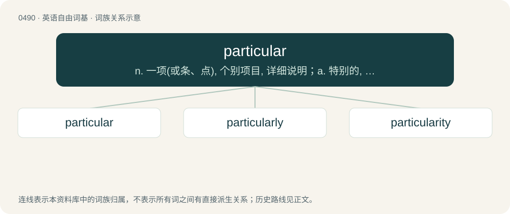

# 0554 · particular — n. 一项(或条、点), 个别项目, 详细说明；a. 特别的, 独有的, 挑剔的, 详尽的

[总目录](../00_总目录_按常用程度.md)

**类型**：英语自由词基　｜　**来源语言**：见词源记录

## 核心含义与来源

- 核心含义：n. 一项(或条、点), 个别项目, 详细说明；a. 特别的, 独有的, 挑剔的, 详尽的
- 英文含义：Specific; discrete; concrete.
- 词形：particular

**来源记录 1**（形容词；Specific; discrete; concrete.）

From Middle English particuler, from Anglo-Norman particuler, Middle French particuler, particulier, from Late Latin particularis (“partial; separate, individual”), from Latin particula (“(small) part”). Equivalent to particle + -ar. Compare particle.

## 词族图

## 单词速览（常用到不常用）

| 单词 | 音标 | 释义 |
|---|---|---|
| [particular](#w-1) | 英 /pəˈtɪk.jʊ.lə/；美 /pɑrˈtɪk.jə.lɚ/ | n. 一项(或条、点), 个别项目, 详细说明；a. 特别的, 独有的, 挑剔的, 详尽的 |
| [particularly](#w-2) | 英 /pəˈtɪkjələli/；美 /pɚˈtɪkjəlɚli/ | adv. 特别, 格外, 尤其, 详细地, 细致地 |
| [particularity](#w-3) | 英 /pəˌtɪkjʊˈlæɹɪti/；美 /pə(ɹ)ˌtɪkjəˈlɛɹəti/ | n. 特殊性, 特质, 个性, 细致, 苛求 |

## 逐词详解

### 1. particular

**词性**：形容词　｜　**音标**：英 /pəˈtɪk.jʊ.lə/；美 /pɑrˈtɪk.jə.lɚ/

**中文释义**：n. 一项(或条、点), 个别项目, 详细说明；a. 特别的, 独有的, 挑剔的, 详尽的

**英文义项**：Specific; discrete; concrete. / Specialised; characteristic of a specific person or thing.

**构词拆分**：particle + -ar

**词源与演化**：

From Middle English particuler, from Anglo-Norman particuler, Middle French particuler, particulier, from Late Latin particularis (“partial; separate, individual”), from Latin particula (“(small) part”). Equivalent to particle + -ar. Compare particle.

**例句**：

> He is very particular about his food and if it isn't cooked to perfection he will send it back.

该用例对应义项：Of a person, concerned with, or attentive to, details; fastidious.

### 2. particularly

**词性**：副词　｜　**音标**：英 /pəˈtɪkjələli/；美 /pɚˈtɪkjəlɚli/

**中文释义**：adv. 特别, 格外, 尤其, 详细地, 细致地

**英文义项**：Especially, extremely. / To a great extent.

**构词拆分**：particular + -ly

**词源与演化**：

From particular + -ly.

**例句**：

> The apéritifs were particularly stimulating.

该用例对应义项：Especially, extremely.

### 3. particularity

**词性**：名词　｜　**音标**：英 /pəˌtɪkjʊˈlæɹɪti/；美 /pə(ɹ)ˌtɪkjəˈlɛɹəti/

**中文释义**：n. 特殊性, 特质, 个性, 细致, 苛求

**英文义项**：A particular thing. / A distinctive characteristic or quality; a peculiarity.

**构词拆分**：particular + -ity (suffix forming nouns from adjectives, referring to the properties, qualities, or states of what is denoted by the adjectives)

**词源与演化**：

From Middle French particularité (“part of a whole; something particular, particularity”) (modern French particularité), and from its etymon Late Latin particularitas (“fact or quality of being particular; something particular, particularity”), from Latin particulāris (“particular; partial”) + -tās (suffix forming feminine abstract nouns indicating a state of being). Particulāris is derived from particula (“particle, small part”) (from pars (“a part, piece, portion, share”) (probably ultimately from Proto-Indo-European \*perh₃- (“to provide, produce, beget”)) + -cula (diminutive suffix)) + -āris (suffix denoting a relationship, forming adjectives). The English word is analysable as particular + -ity (suffix forming nouns from adjectives, referring to the properties, qualities, or states of what is denoted by the adjectives).

**例句**：

> Donny’s obsession for trains is just a harmless particularity of his.

该用例对应义项：A distinctive characteristic or quality; a peculiarity.
