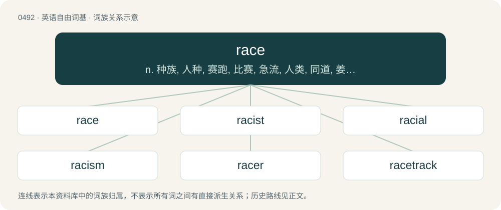

# 0556 · race — n. 种族, 人种, 赛跑, 比赛, 急流, 人类, 同道, 姜根；vi. 赛跑, 竞赛, 疾走；vt. 与...赛跑, 使疾走, 使猛转

[总目录](../00_总目录_按常用程度.md)

**类型**：英语自由词基　｜　**来源语言**：见词源记录

## 核心含义与来源

- 核心含义：n. 种族, 人种, 赛跑, 比赛, 急流, 人类, 同道, 姜根；vi. 赛跑, 竞赛, 疾走；vt. 与...赛跑, 使疾走, 使猛转
- 英文含义：A contest between people, animals, vehicles, etc. where the goal is to be the first to reach some objective.
- 词形：race

**多个词源／构词路径**：同一拼写可能有不同来源；以下按词性和含义分别列出。

**来源记录 1**（名词；A contest between people, animals, vehicles, etc. where the goal is to be the first to reach some objective.）

From Middle English race, partially from Old English rǣs (“a race, swift or violent running, rush, onset”), from Proto-West Germanic \*rās; and partially from Old Norse rás (“a running, race”); both from Proto-Germanic \*rēsō (“a course”), from Proto-Indo-European \*h₁reh₁s- (“to flow, rush”). Cognate with Middle Low German râs ("a strong current"; whence German Low German Raas (“mad rush, rage, fury”)), Dutch ras (“a strong whirling current”), Danish ræs, Norwegian and Swedish ras, Norwegian rås.

**来源记录 2**（名词；A large group of people distinguished from others on the basis of a common heritage.）

1560s, via Middle French race from Italian razza (early 14th century), of uncertain origin. Partially displaced native Middle English kinde (“kind, type, sort, race, nature”), whence English kind. Fully displaced native Old English cnōsl and hād. theories \* Diez and some other scholars suggest derivation from Proto-Germanic \*raitō (whence Old High German reiza (“line”) and Old Norse ríta (“to score, log, outline”)), perhaps via Lombardic \*raiza (“line”), which Körting notes is a literal rendering of Latin linea sanguinis (“bloodline of descent”). Anatoly Liberman says "the semantic fit is good" but the chronology falters; he says the Germanic word went out of use before the Italian word arose, and he says the intermediary is not attested. \* Some scholars suggest derivation from Old Spanish raza, rasa, from earlier ras, res (“head of cattle”), from Arabic رَأْس (raʔs, “head”), but Italian razza predates the Spanish word according to Diez and Meyer-Lübke. \* Meyer-Lübke suggested Latin generatio as the root; Körting says "the disappearance of two initial syllables hardly seems credible", but Meyer-Lübke notes the Venetian form narazza and the Old Bellunesian form naraccia, positing that after the first syllable ge- was lost, the remaining (una) narazza came to be reanalysed as una razza. \* Gianfranco Contini suggests the Italian word comes from Old French haraz (“troop of horses”), whence Modern French haras (“breeding farm for horses; stud farm”), from Old Norse hárr (“grey-haired; hoary”). Liberman considers this derivation the most likely. \* Other suggested Latin etyma: \*\* radius (perhaps via Vulgar Latin \*radia) (per Baist). \*\* radix (“root”) (per Ulrich); Liberman says "the semantic match is excellent", and race (“rhizome of ginger”) (which definitely derives from radix) shows that the phonology is plausible. \*\* \*raptiare (“breed falcons”) (per Körting). \*\* The nominative of ratio (perhaps via an unattested intermediate form \*razzo), as opposed to ragione which derives from the accusative rationem. \* Other implausible suggestions include Slavic raz and Basque arraca, supposedly meaning "stud animal" (Basque arrazza, "race", derives from Spanish).

**来源记录 3**（名词；A rhizome or root, especially of ginger.）

Mid 16th century. From Middle French raïz, raiz, rais (“root”), from Latin radix (“root”), from Proto-Italic \*wrādīks, from Proto-Indo-European \*wréh₂ds.

**来源记录 4**（动词；To cut, scratch, or tear (someone or something) with a sharp object; to lacerate, to slash; specifically (nautical), to make marks on (something, such as a piece of wood) using a race knife.）

A variant of raze. From Middle English rasen, racen, rase (“to scrape; to shave; to erase; to rend; to cleave; etc”), from Anglo-Norman raser, rasere, rasser, Middle French raser, and Old French raser (“to shave; to demolish”), from Vulgar Latin \*raso (“to shave; to scrape”), from Latin rāsus (“scraped; shaved”), the perfect passive participle of rādō (“to scrape, scratch”). Doublet of rash (etymology 2 and etymology 7).

## 词族图

## 单词速览（常用到不常用）

| 单词 | 音标 | 释义 |
|---|---|---|
| [race](#w-1) | 英 /ɹeɪs/ | n. 种族, 人种, 赛跑, 比赛, 急流, 人类, 同道, 姜根；vi. 赛跑, 竞赛, 疾走；vt. 与...赛跑, 使疾走, 使猛转 |
| [racist](#w-2) | 英 /ˈɹeɪ.sɪst/ | n. 种族主义者；\[法\] 种族主义的, 种族歧视 |
| [racial](#w-3) | /ˈɹeɪʃəl/ | a. 人种的, 种族的；\[医\] 种族的 |
| [racism](#w-4) | 美 /ˈɹeɪsɪzm̩/ | n. 种族主义, 种族偏见；\[法\] 种族主义, 种族歧视, 种族歧视主张 |
| [racer](#w-5) | 英 /ˈɹeɪ.sə/；美 /ˈɹeɪ.səɹ/ | n. 比赛者, 游蛇属黑蛇 |
| [racetrack](#w-6) | /ˈɹeɪsˌtɹæk/ | n. 跑道 |
| [racecourse](#w-7) | /ˈreiskɔːs/ | n. 赛马场, 水道, 跑道 |
| [racehorse](#w-8) | /ˈreishɒːs/ | n. (赛马用的)马 |
| [raceway](#w-9) | 美 /ˈɹeɪsˌweɪ/ | n. 水道, 座圈；\[电\] 槽板 |
| [racy](#w-10) | /ˈɹeɪsi/ | a. 保持原味的, 活泼的, 生动的, 为竞赛设计的 |

## 逐词详解

### 1. race

**词性**：名词　｜　**音标**：英 /ɹeɪs/

**中文释义**：n. 种族, 人种, 赛跑, 比赛, 急流, 人类, 同道, 姜根；vi. 赛跑, 竞赛, 疾走；vt. 与...赛跑, 使疾走, 使猛转

**英文义项**：A contest between people, animals, vehicles, etc. where the goal is to be the first to reach some objective. / Swift progress; rapid motion; an instance of moving or driving at high speed.

**词源与演化**：

From Middle English race, partially from Old English rǣs (“a race, swift or violent running, rush, onset”), from Proto-West Germanic \*rās; and partially from Old Norse rás (“a running, race”); both from Proto-Germanic \*rēsō (“a course”), from Proto-Indo-European \*h₁reh₁s- (“to flow, rush”). Cognate with Middle Low German râs ("a strong current"; whence German Low German Raas (“mad rush, rage, fury”)), Dutch ras (“a strong whirling current”), Danish ræs, Norwegian and Swedish ras, Norwegian rås.

**例句**：

> Several horses ran in a horse race: the first one to reach the finishing post won.

该用例对应义项：A contest between people, animals, vehicles, etc. where the goal is to be the first to reach some objective.

### 2. racist

**词性**：形容词　｜　**音标**：英 /ˈɹeɪ.sɪst/

**中文释义**：n. 种族主义者；\[法\] 种族主义的, 种族歧视

**英文义项**：Constituting, exhibiting, advocating, or pertaining to racism. / Discriminatory.

**构词拆分**：race + -ist

**词源与演化**：

1932 (noun), 1938 (adjective). Formed from racism (1928), paralleling French raciste (1892). Replaced older racialist (1910). Equivalent to race + -ist.

**例句**：

> They don't allow Muslims and gays to join the club? That's racist!

该用例对应义项：Discriminatory.

### 3. racial

**词性**：形容词　｜　**音标**：/ˈɹeɪʃəl/

**中文释义**：a. 人种的, 种族的；\[医\] 种族的

**英文义项**：Of or relating to a race (or a people).

**构词拆分**：race + -ial

**词源与演化**：

From race + -ial.

**用法示例／搭配（非完整句）**：

> the racial complexion

该用例对应义项：Of or relating to a race (or a people).

### 4. racism

**词性**：名词　｜　**音标**：美 /ˈɹeɪsɪzm̩/

**中文释义**：n. 种族主义, 种族偏见；\[法\] 种族主义, 种族歧视, 种族歧视主张

**英文义项**：The belief that there are distinct human races with inherent differences which determine their abilities, and generally that some are superior and others inferior. / The policies, practices, or systems (e.g. government or political) promoting this belief or promoting the dominance of one or more races over others.

**构词拆分**：race + -ism

**词源与演化**：

Borrowed from French racisme, equivalent to race + -ism.

**例句**：

> Martin Luther King spoke out against racism.

该用例对应义项：The policies, practices, or systems (e.g. government or political) promoting this belief or promoting the dominance of one or more races over others.

### 5. racer

**词性**：名词　｜　**音标**：英 /ˈɹeɪ.sə/；美 /ˈɹeɪ.səɹ/

**中文释义**：n. 比赛者, 游蛇属黑蛇

**英文义项**：A person who participates in races, especially an athlete. / A racehorse.

**构词拆分**：race + -er

**词源与演化**：

From race + -er. First attested in 1648.

**例句**：

> Cycling through slush on a racer isn't wise, but this year there's no alternative.

### 6. racetrack

**词性**：名词　｜　**音标**：/ˈɹeɪsˌtɹæk/

**中文释义**：n. 跑道

**英文义项**：A course over which any type of races are run. / A characteristic circular erosion pattern in deposition processes.

**构词拆分**：race + track

**词源与演化**：

From race + track.

**例句**：

> Do you think she'll still take me for a lap around the racetrack?

### 7. racecourse

**词性**：名词　｜　**音标**：/ˈreiskɔːs/

**中文释义**：n. 赛马场, 水道, 跑道

**英文义项**：A course over which races are run. / A racetrack where horse races are run.

**构词拆分**：race + course

**词源与演化**：

From race + course.

**例句**：

> The racecourse was set in a valley, about a mile from the town centre.

### 8. racehorse

**词性**：名词　｜　**音标**：/ˈreishɒːs/

**中文释义**：n. (赛马用的)马

**英文义项**：A horse that competes in races. / Any member of certain species of genus Congiopodus.

**构词拆分**：race + horse

**词源与演化**：

From race + horse.

**例句**：

> An investigation established that the racehorse had been doped.

### 9. raceway

**词性**：名词　｜　**音标**：美 /ˈɹeɪsˌweɪ/

**中文释义**：n. 水道, 座圈；\[电\] 槽板

**英文义项**：A place where races are held; a racetrack. / An easily-accessible conduit or tray for organizing runs of data or power cabling.

**构词拆分**：race + way

**词源与演化**：

From race + way.

### 10. racy

**词性**：形容词　｜　**音标**：/ˈɹeɪsi/

**中文释义**：a. 保持原味的, 活泼的, 生动的, 为竞赛设计的

**英文义项**：Mildly risqué. / Having a strong flavor indicating origin; of distinct characteristic taste; tasting of the soil.

**构词拆分**：race (“having a characteristic taste (of wines, fruits, etc.)”) + -y

**词源与演化**：

From race (“having a characteristic taste (of wines, fruits, etc.)”) + -y.

**例句**：

> She wore a racy dress that was just barely appropriate for the occasion.

该用例对应义项：Mildly risqué.
