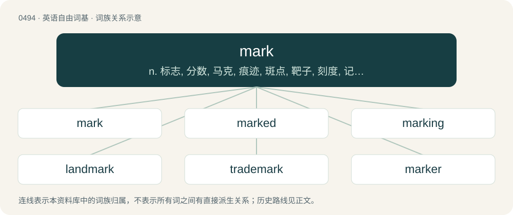

# 0557 · mark — n. 标志, 分数, 马克, 痕迹, 斑点, 靶子, 刻度, 记号, 符号, 戳记, 标准, 起跑线；vt. 做标记于, 留意, 打分数, 表明, 标志, 记录；vi. 作记号, 记得分

[总目录](../00_总目录_按常用程度.md)

**类型**：英语自由词基　｜　**来源语言**：见词源记录

## 核心含义与来源

- 核心含义：n. 标志, 分数, 马克, 痕迹, 斑点, 靶子, 刻度, 记号, 符号, 戳记, 标准, 起跑线；vt. 做标记于, 留意, 打分数, 表明, 标志, 记录；vi. 作记号, 记得分
- 英文含义：A stone or post used to indicate position and guide travellers.
- 词形：mark

**来源记录 1**（名词；A stone or post used to indicate position and guide travellers.）

From Middle English mark, merk, merke, from Old English mearc (“mark, sign, line of division; standard; boundary, limit, term, border; defined area, district, province”), from Proto-West Germanic \*marku, from Proto-Germanic \*markō (“boundary; boundary marker”), from Proto-Indo-European \*mórǵs (“edge, boundary, border”). Compare march. Cognates \* Dutch mark, merk (“mark, brand”) \* German Mark (“mark; borderland”), Marke (“mark, brand”) \* Swedish mark (“mark, land, territory”) \* Icelandic mark (“mark, sign”) \* Latin margō (“edge, margin”) \* Persian مرز (marz, “limit, boundary”) \* Sanskrit मर्या (maryā, “limit, mark, boundary”), मार्ग (mārga, “mark, section”).

## 词族图

## 单词速览（常用到不常用）

| 单词 | 音标 | 释义 |
|---|---|---|
| [mark](#w-1) | 英 /mɑːk/；美 /mɑɹk/ | n. 标志, 分数, 马克, 痕迹, 斑点, 靶子, 刻度, 记号, 符号, 戳记, 标准, 起跑线；vt. 做标记于, 留意, 打分数, 表明, 标志, 记录；vi. 作记号, 记得分 |
| [marked](#w-2) | 英 /mɑːkt/；美 /mɑɹkt/ | a. 有记号的, 显著的, 醒目的；\[化\] 有记号的; 显著的 |
| [marking](#w-3) | 英 /ˈmɑːkɪŋ/；美 /ˈmɑɹkɪŋ/ | n. 印记, 印, 分；\[计\] 标志 |
| [landmark](#w-4) | 英 /ˈlændmɑːk/；美 /ˈlændmɑɹk/ | n. 陆标, 划时代的事, 地界标；\[医\] 界标 |
| [trademark](#w-5) | 英 /ˈtɹeɪdmɑːk/；美 /ˈtɹeɪdmɑɹk/ | n. 商标；\[法\] 商标 |
| [marker](#w-6) | /ˈmɑː(ɹ)kə(ɹ)/ | n. 作记号的人, 记分员, 书签, 纪念碑, 里程碑, 标识物, 标记；\[计\] 标记 |
| [remark](#w-7) | 英 /ɹɪˈmɑːk/；美 /ɹɪˈmɑɹk/ | n. 评论, 注意；vt. 评论, 注意；vi. 评论, 谈论 |
| [benchmark](#w-8) | 英 /ˈbɛnt͡ʃmɑːk/；美 /ˈbɛnt͡ʃmɑɹk/ | \[计\] 基准程序; 基准 |
| [hallmark](#w-9) | 英 /ˈhɔːlmɑːk/；美 /ˈhɔlmɑɹk/ | n. 纯度检验证明, 品质证明；vt. 加盖纯度检验证明 |
| [bookmark](#w-10) | 英 /ˈbʊkmɑːk/；美 /ˈbʊkmɑːɹk/ | n. 书签；\[计\] 书签 |
| [watermark](#w-11) | /ˈwɔːtəmɑːk/ | n. 水位标志, 水印；vt. 印水印于 |
| [marksman](#w-12) | 美 /ˈmɑɹksmən/ | n. 射手, 狙击兵, 神射手；\[法\] 按手印者, 不能用笔署名者 |
| [birthmark](#w-13) | 美 /ˈbɝθˌmɑɹk/ | n. 胎记, 胎痣；\[医\] 胎记, 胎痣 |
| [postmark](#w-14) | 美 /ˈpoʊstˌmɑɹk/ | n. 邮戳；vt. 盖邮戳于 |
| [earmark](#w-15) | 英 /ˈɪəmɑːk/；美 /ˈɪ(ə)ɹˌmɑɹk/ | n. 耳上记号, 特征, 记号, 标记；vt. 在耳朵上做记号, 标记, 指定...作特定用途 |
| [checkmark](#w-16) | /ˈtʃek,maːk/ | n. 选择目录；检查标志；注销记录 |

## 逐词详解

### 1. mark

**词性**：名词　｜　**音标**：英 /mɑːk/；美 /mɑɹk/

**中文释义**：n. 标志, 分数, 马克, 痕迹, 斑点, 靶子, 刻度, 记号, 符号, 戳记, 标准, 起跑线；vt. 做标记于, 留意, 打分数, 表明, 标志, 记录；vi. 作记号, 记得分

**英文义项**：A stone or post used to indicate position and guide travellers. / The line indicating an athlete's starting-point.

**词源与演化**：

From Middle English mark, merk, merke, from Old English mearc (“mark, sign, line of division; standard; boundary, limit, term, border; defined area, district, province”), from Proto-West Germanic \*marku, from Proto-Germanic \*markō (“boundary; boundary marker”), from Proto-Indo-European \*mórǵs (“edge, boundary, border”). Compare march. Cognates \* Dutch mark, merk (“mark, brand”) \* German Mark (“mark; borderland”), Marke (“mark, brand”) \* Swedish mark (“mark, land, territory”) \* Icelandic mark (“mark, sign”) \* Latin margō (“edge, margin”) \* Persian مرز (marz, “limit, boundary”) \* Sanskrit मर्या (maryā, “limit, mark, boundary”), मार्ग (mārga, “mark, section”).

**例句**：

> The font wasn't able to render all the diacritical marks properly.

该用例对应义项：A written character or sign.

### 2. marked

**词性**：形容词　｜　**音标**：英 /mɑːkt/；美 /mɑɹkt/

**中文释义**：a. 有记号的, 显著的, 醒目的；\[化\] 有记号的; 显著的

**英文义项**：Having a visible or identifying mark. / Having a secret mark on the back for cheating.

**构词拆分**：mark (“sign, characteristic, visible impression”) + -ed

**词源与演化**：

From mark (“sign, characteristic, visible impression”) + -ed. Less common disyllabic pronunciation (/ˈmɑː.kɪd/) is likely an analogy derived from markedness (explaining its restriction to sense 2).

**例句**：

> The eighth century BC saw a marked increase in the general wealth of Cyprus.

该用例对应义项：Clearly evident; noticeable; conspicuous.

### 3. marking

**词性**：名词　｜　**音标**：英 /ˈmɑːkɪŋ/；美 /ˈmɑɹkɪŋ/

**中文释义**：n. 印记, 印, 分；\[计\] 标志

**英文义项**：The action of marking. / A mark.

**构词拆分**：mark + -ing

**词源与演化**：

From Middle English marking, merking, merkunge, from Old English mearcung, from Proto-West Germanic \*markungu, equivalent to mark + -ing.

**例句**：

> The markings on the plane identified it as belonging to law enforcement.

该用例对应义项：A symbol or set of letters used to identify the type or identity of an object.

### 4. landmark

**词性**：名词　｜　**音标**：英 /ˈlændmɑːk/；美 /ˈlændmɑɹk/

**中文释义**：n. 陆标, 划时代的事, 地界标；\[医\] 界标

**英文义项**：A recognizable natural or man-made feature used for navigation. / A notable location with historical, cultural, or geographical significance.

**构词拆分**：land + mark

**词源与演化**：

From Middle English \*landmark, from Old English landmearc (“boundary”), from Proto-West Germanic \*landamarku (“boundary, landmark”). Equivalent to land + mark. Cognate with German Landmarke (“landmark”), Danish landemærke (“landmark”), Swedish landmärke (“landmark”), Norwegian landemerke (“landmark”) and Faroese landamark (“land frontier”). Compare also Middle English londes-mark (“boundary”).

**用法示例／搭配（非完整句）**：

> an important landmark in human history

该用例对应义项：A major event or discovery.

### 5. trademark

**词性**：名词　｜　**音标**：英 /ˈtɹeɪdmɑːk/；美 /ˈtɹeɪdmɑɹk/

**中文释义**：n. 商标；\[法\] 商标

**英文义项**：A word, symbol, or phrase used to identify a particular company's product and differentiate it from other companies' products. / Especially, such a term that is registered with a government agency so as to have legal protection against use by other companies.

**构词拆分**：trade + mark

**词源与演化**：

From trade + mark.

**例句**：

> "A" logo is a trademark or registered trademark of A Corporation.

### 6. marker

**词性**：名词　｜　**音标**：/ˈmɑː(ɹ)kə(ɹ)/

**中文释义**：n. 作记号的人, 记分员, 书签, 纪念碑, 里程碑, 标识物, 标记；\[计\] 标记

**英文义项**：A felt-tipped pen, a marker pen. / A scorekeeper, especially one who tallies billiard scores.

**构词拆分**：mark + -er

**词源与演化**：

From mark + -er.

**例句**：

> We may not be able to do this alone. Maybe it’s time to call in some of our markers.

该用例对应义项：A personal favor owed to someone, whether written or not.

### 7. remark

**词性**：名词　｜　**音标**：英 /ɹɪˈmɑːk/；美 /ɹɪˈmɑɹk/

**中文释义**：n. 评论, 注意；vt. 评论, 注意；vi. 评论, 谈论

**英文义项**：An act of pointing out or noticing; notice or observation. / An expression, in speech or writing, of something remarked or noticed; a mention of something

**构词拆分**：re- (“again”) + mark

**词源与演化**：

From Middle French remarquer, from Old French remarquer, from re- (“again”) + marquer (“to mark”), equivalent to re- (“again”) + mark.

**用法示例／搭配（非完整句）**：

> a biting remark

该用例对应义项：An expression, in speech or writing, of something remarked or noticed; a mention of something

### 8. benchmark

**词性**：名词　｜　**音标**：英 /ˈbɛnt͡ʃmɑːk/；美 /ˈbɛnt͡ʃmɑɹk/

**中文释义**：\[计\] 基准程序; 基准

**英文义项**：A standard by which something is evaluated or measured. / A surveyor's mark made on some stationary object and shown on a map; used as a reference point.

**构词拆分**：bench + mark

**词源与演化**：

From bench + mark. First use appears c. 1842. Originally a mark cut into a stone by land surveyors to secure a bench (from land surveying jargon in the 19th century, meaning a type of bracket), to mount measuring equipment. The figurative sense first appears c. 1884.

**例句**：

> His painting sets the benchmark of quality.

该用例对应义项：a standard by which something can be measured or judged

### 9. hallmark

**词性**：名词　｜　**音标**：英 /ˈhɔːlmɑːk/；美 /ˈhɔlmɑɹk/

**中文释义**：n. 纯度检验证明, 品质证明；vt. 加盖纯度检验证明

**英文义项**：A distinguishing characteristic. / An official marking made by a trusted party, usually an assay office, on items made of precious metals.

**构词拆分**：hall + mark

**词源与演化**：

1721. From hall + mark, from Goldsmiths' Hall in London, the site of the assay office, official stamp of purity in gold and silver articles. The general sense of “mark of quality” first recorded 1864. Use as a verb from 1773.

**例句**：

> A certain hallmark of wisdom is the cheerful benevolence it confers.

### 10. bookmark

**词性**：名词　｜　**音标**：英 /ˈbʊkmɑːk/；美 /ˈbʊkmɑːɹk/

**中文释义**：n. 书签；\[计\] 书签

**英文义项**：A strip of material used to mark a place in a book. / A record of the address of a file or Internet page, serving as a shortcut to it.

**构词拆分**：book + mark

**词源与演化**：

From Middle English \*boke-merk, \*boke-merke (attested only in the bare form merk (“bookmark”)), equivalent to book + mark. Cognate with Danish bogmærke (“bookmark”), Swedish bokmärke (“bookmark”), Norwegian bokmerke (“bookmark”), Icelandic bókamerki (“bookmark”). Eclipsed non-native Old English æstel (“bookmark”), from Old Irish astal, from Latin hastula (“little spear, splint”).

**例句**：

> He placed a bookmark on page 234, which had an interesting footnote from the author.

该用例对应义项：A strip of material used to mark a place in a book.

### 11. watermark

**词性**：名词　｜　**音标**：/ˈwɔːtəmɑːk/

**中文释义**：n. 水位标志, 水印；vt. 印水印于

**英文义项**：A translucent design impressed on the surface of paper and visible when the paper is held to the light. / A logo superimposed on a digital image, a television broadcast, etc.

**构词拆分**：water + mark

**词源与演化**：

From water + mark.

**例句**：

> The documents are saved as read-only PDFs with a watermark including the dates and times of receipt (timestamping by the court).

### 12. marksman

**词性**：名词　｜　**音标**：美 /ˈmɑɹksmən/

**中文释义**：n. 射手, 狙击兵, 神射手；\[法\] 按手印者, 不能用笔署名者

**英文义项**：A man or person skilled at hitting targets, as with a firearm, bow, or thrown object. / Goalscorer.

**构词拆分**：mark + -s- + man

**词源与演化**：

From mark + -s- + man.

**例句**：

> At that instant Holmes sprang like a tiger on to the marksman’s back, and hurled him flat upon his face.

### 13. birthmark

**词性**：名词　｜　**音标**：美 /ˈbɝθˌmɑɹk/

**中文释义**：n. 胎记, 胎痣；\[医\] 胎记, 胎痣

**英文义项**：A mark on the skin formed before birth.

**构词拆分**：birth + mark

**词源与演化**：

From birth + mark. Displaced earlier terms longing mark and mother's mark.

**例句**：

> The detective identified him by a distinctive birthmark.

该用例对应义项：A mark on the skin formed before birth.

### 14. postmark

**词性**：名词　｜　**音标**：美 /ˈpoʊstˌmɑɹk/

**中文释义**：n. 邮戳；vt. 盖邮戳于

**英文义项**：A marking made by a postal service on a delivery, usually indicating the place where and the date and time when the item was received or processed for the first time, mostly serving to cancel a postage stamp.

**构词拆分**：post + mark

**词源与演化**：

Compound of post + mark.

**例句**：

> The postmark indicates that this letter was mailed a week ago.

### 15. earmark

**词性**：动词　｜　**音标**：英 /ˈɪəmɑːk/；美 /ˈɪ(ə)ɹˌmɑɹk/

**中文释义**：n. 耳上记号, 特征, 记号, 标记；vt. 在耳朵上做记号, 标记, 指定...作特定用途

**英文义项**：To make a mark or attach a tag to the ear of (an animal, chiefly a livestock animal), generally to identify or indicate something about the animal, such as ownership. / To put a distinguishing or identifying mark or sign on (something); to make (something) distinctive or identifiable.

**构词拆分**：ear + mark

**词源与演化**：

The noun is derived from ear + mark. The verb is derived from the noun.

**例句**：

> You can donate to the organization as a whole, or you can earmark your contribution for a particular project.

该用例对应义项：Chiefly followed by for: to designate (certain funds) to be used for a specific purpose.

### 16. checkmark

**词性**：动词　｜　**音标**：/ˈtʃek,maːk/

**中文释义**：n. 选择目录；检查标志；注销记录

**英文义项**：To mark with a ✓ symbol; to tick.

**构词拆分**：From check + mark.

**词源与演化**：

From check + mark.

**例句**：

> A double checkmark indicates that the message has been read by the recipient.
