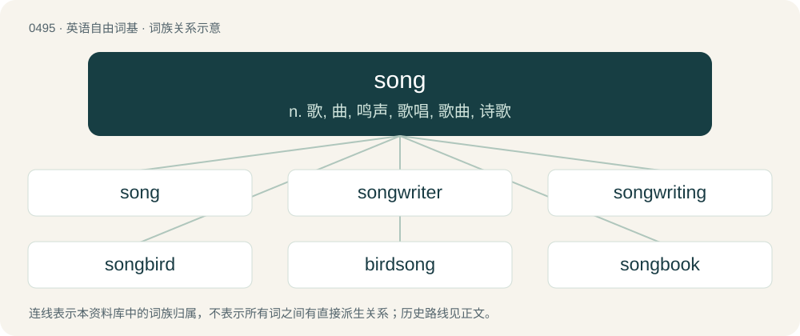

# 0558 · song — n. 歌, 曲, 鸣声, 歌唱, 歌曲, 诗歌

[总目录](../00_总目录_按常用程度.md)

**类型**：英语自由词基　｜　**来源语言**：见词源记录

## 核心含义与来源

- 核心含义：n. 歌, 曲, 鸣声, 歌唱, 歌曲, 诗歌
- 英文含义：A musical composition with lyrics for voice or voices, performed by singing.
- 词形：song

**来源记录 1**（名词；A musical composition with lyrics for voice or voices, performed by singing.）

From Middle English song, sang, from Old English sang, from Proto-West Germanic \*sangu, from Proto-Germanic \*sangwaz (“singing, song”), from Proto-Indo-European \*sengʷʰ- (“to sing”). Cognate with Scots sang, song (“singing, song”), Saterland Frisian Song (“song”), West Frisian sang (“song”), Dutch zang (“song”), Low German sang (“song”), German Sang (“singing, song”), Swedish sång (“song”), Norwegian Bokmål sang (“song”), Norwegian Nynorsk song (“song”), Icelandic söngur (“song”), Ancient Greek ὀμφή (omphḗ, “voice, oracle”). More at sing.

## 词族图

## 单词速览（常用到不常用）

| 单词 | 音标 | 释义 |
|---|---|---|
| [song](#w-1) | 英 /sɒŋ/；/sɔŋ/ | n. 歌, 曲, 鸣声, 歌唱, 歌曲, 诗歌 |
| [songwriter](#w-2) |  | n. 流行歌曲的作者 |
| [songwriting](#w-3) |  | 歌曲创作 |
| [songbird](#w-4) | 英 /ˈsɒŋˌbɜːd/；美 /ˈsɔŋˌbɝd/ | n. 燕雀, 歌鸟, 女歌手 |
| [birdsong](#w-5) | /ˈbɜːdsɒŋ/ | n. 鸟鸣声 |
| [songbook](#w-6) | /ˈsɒŋbuk/ | n. 歌谣集, 歌集 |
| [evensong](#w-7) | /ˈiːvənsɒŋ/ | n. (天主教的)晚祷, (英国国教的)晚祷 |

## 逐词详解

### 1. song

**词性**：名词　｜　**音标**：英 /sɒŋ/；/sɔŋ/

**中文释义**：n. 歌, 曲, 鸣声, 歌唱, 歌曲, 诗歌

**英文义项**：A musical composition with lyrics for voice or voices, performed by singing. / Any musical composition.

**词源与演化**：

From Middle English song, sang, from Old English sang, from Proto-West Germanic \*sangu, from Proto-Germanic \*sangwaz (“singing, song”), from Proto-Indo-European \*sengʷʰ- (“to sing”). Cognate with Scots sang, song (“singing, song”), Saterland Frisian Song (“song”), West Frisian sang (“song”), Dutch zang (“song”), Low German sang (“song”), German Sang (“singing, song”), Swedish sång (“song”), Norwegian Bokmål sang (“song”), Norwegian Nynorsk song (“song”), Icelandic söngur (“song”), Ancient Greek ὀμφή (omphḗ, “voice, oracle”). More at sing.

**例句**：

> Thomas listened to his favorite song on the radio yesterday.

该用例对应义项：A musical composition with lyrics for voice or voices, performed by singing.

### 2. songwriter

**词性**：名词

**中文释义**：n. 流行歌曲的作者

**英文义项**：A musician who composes songs; especially writing the song's lyrics and/or creating a melody or a tune for the song.

**构词拆分**：song + writer

**词源与演化**：

From song + writer.

**例句**：

> We are now collaborating with a famous songwriter.

该用例对应义项：A musician who composes songs; especially writing the song's lyrics and/or creating a melody or a tune for the song.

### 3. songwriting

**词性**：名词

**中文释义**：歌曲创作

**英文义项**：The work of a songwriter.

**构词拆分**：song + writing

**词源与演化**：

From song + writing.

**例句**：

> Matoub was so prolific in his songwriting.

### 4. songbird

**词性**：名词　｜　**音标**：英 /ˈsɒŋˌbɜːd/；美 /ˈsɔŋˌbɝd/

**中文释义**：n. 燕雀, 歌鸟, 女歌手

**英文义项**：A bird having a melodious song or call. / Any bird in the passerine suborder Passeri, which are distinguished by a more sophisticated vocal apparatus.

**构词拆分**：song + bird

**词源与演化**：

From song + bird.

**例句**：

> The blackbird is a well-known songbird.

### 5. birdsong

**词性**：名词　｜　**音标**：/ˈbɜːdsɒŋ/

**中文释义**：n. 鸟鸣声

**英文义项**：Vocalisations made by birds, considered collectively. / A vocalisation made by a bird, more complex than a call, for purposes associated with courtship and territory.

**构词拆分**：bird + song

**词源与演化**：

From bird + song.

**例句**：

> First a solitary blackbird started up, and soon the whole forest was alive with birdsong.

该用例对应义项：Vocalisations made by birds, considered collectively.

### 6. songbook

**词性**：名词　｜　**音标**：/ˈsɒŋbuk/

**中文释义**：n. 歌谣集, 歌集

**英文义项**：A book containing songs. / A repertoire of songs.

**构词拆分**：song + book

**词源与演化**：

From Middle English song boke, from Old English sangbōc (“a music book; songbook”), equivalent to song + book. Compare Saterland Frisian Songbouk (“songbook”), West Frisian sjongboek (“songbook”), Dutch zangboek (“songbook”), German Low German Sangbook (“songbook; hymnbook; hymnal”), German Gesangbuch (“songbook; hymnbook; hymnal”), Danish sangbog (“songbook”), Swedish sångbok (“songbook”), Faroese songbók (“songbook”), Icelandic söngbók (“songbook”).

**用法示例／搭配（非完整句）**：

> the great American songbook

该用例对应义项：A repertoire of songs.

### 7. evensong

**词性**：名词　｜　**音标**：/ˈiːvənsɒŋ/

**中文释义**：n. (天主教的)晚祷, (英国国教的)晚祷

**英文义项**：A religious service, most commonly seen in the Anglican or Episcopal Church, that takes place in the early hours of the evening; originally, and sometimes still, an alternative name for vespers or a service combining vespers and compline.

**构词拆分**：even + song

**词源与演化**：

From Old English ǣfensang, equivalent to even + song. The use of even to mean evening is now obsolete except in poetry.
