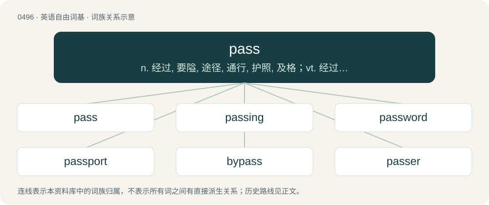

# 0563 · pass — n. 经过, 要隘, 途径, 通行, 护照, 及格；vt. 经过, 越过, 通过, 批准, 度过, 传递, 忽略；vi. 经过, 变化, 流通, 及格, 宣判, 终止, 消逝, 被忽略, 不叫牌, 传递

[总目录](../00_总目录_按常用程度.md)

**类型**：英语自由词基　｜　**来源语言**：见词源记录

## 核心含义与来源

- 核心含义：n. 经过, 要隘, 途径, 通行, 护照, 及格；vt. 经过, 越过, 通过, 批准, 度过, 传递, 忽略；vi. 经过, 变化, 流通, 及格, 宣判, 终止, 消逝, 被忽略, 不叫牌, 传递
- 英文含义：To move or be moved from one place to another.
- 词形：pass

**多个词源／构词路径**：同一拼写可能有不同来源；以下按词性和含义分别列出。

**来源记录 1**（动词；To move or be moved from one place to another.）

From Middle English passen, from Old French passer (“to step, walk, pass”), from Vulgar Latin \*passāre (“step, walk, pass”), derived from Latin passus (“a step”), from Proto-Italic \*pat-s-tus, from Proto-Indo-European \*peth₂- (“to spread, stretch out”). Cognate with Old English fæþm (“armful, fathom”). More at fathom. Displaced native Old English genġan.

**来源记录 2**（名词；An opening, road, or track, available for passing; especially, one through or over some dangerous or otherwise impracticable barrier such as a mountain range; a passageway; a defile; a ford.）

From Middle English pas, pase, pace, from passen (“to pass”).

**来源记录 3**（名词；A password (especially one for a restricted-access website).）

Clipping of password.

## 词族图

## 单词速览（常用到不常用）

| 单词 | 音标 | 释义 |
|---|---|---|
| [pass](#w-1) | /pɑːs/ | n. 经过, 要隘, 途径, 通行, 护照, 及格；vt. 经过, 越过, 通过, 批准, 度过, 传递, 忽略；vi. 经过, 变化, 流通, 及格, 宣判, 终止, 消逝, 被忽略, 不叫牌, 传递 |
| [passing](#w-2) | 英 /ˈpɑːsɪŋ/ | n. 通过, 逝去, 死, 流逝；a. 经过的, 流逝的, 目前的, 短暂的, 及格的, 仓促的 |
| [password](#w-3) | 美 /ˈpæs.wɜɹd/ | n. 密码, 口令, 通行手段；\[计\] 口令 |
| [passport](#w-4) | 英 /ˈpɑːspɔːt/；美 /ˈpæspɔɹt/ | n. 护照, 手段, 通行证；\[法\] 通行证, 护照 |
| [bypass](#w-5) | 英 /ˈbaɪpɑːs/；美 /ˈbaɪpæs/ | n. 旁路；vt. 省略, 绕过, 忽视, 回避 |
| [passer](#w-6) | 英 /ˈpɑːsə/；美 /ˈpæsəɹ/ | n. 过路人, 旅客, 考试合格者, 检查合格证；\[化\] 成品检查员 |
| [overpass](#w-7) | /ˈəʊvə(ɹ)pæs/ | n. 天桥, 旱桥, 立交桥；vt. 超越, 胜过, 通过, 忽略, 侵犯 |
| [passable](#w-8) | 美 /ˈpæsəbəl/ | a. 可通行的, 可渡过的, 尚可的, 可流通的 |
| [impassable](#w-9) | /ɪmˈpɑː.sə.bəl/ | a. 不能通行的, 不可逾越的；\[医\] 不通的, 不\[渗\]透的 |
| [passcode](#w-10) |  | 密码 |
| [underpass](#w-11) | /ˈʌndəpɑːs/ | n. 地道 |
| [passphrase](#w-12) |  | n. 密码 |
| [passbook](#w-13) | /ˈpæsbuk/ | n. 存款簿, 银行存折 |

## 逐词详解

### 1. pass

**词性**：动词　｜　**音标**：/pɑːs/

**中文释义**：n. 经过, 要隘, 途径, 通行, 护照, 及格；vt. 经过, 越过, 通过, 批准, 度过, 传递, 忽略；vi. 经过, 变化, 流通, 及格, 宣判, 终止, 消逝, 被忽略, 不叫牌, 传递

**英文义项**：To move or be moved from one place to another. / To go past, by, over, or through; to proceed from one side to the other of; to move past.

**词源与演化**：

From Middle English passen, from Old French passer (“to step, walk, pass”), from Vulgar Latin \*passāre (“step, walk, pass”), derived from Latin passus (“a step”), from Proto-Italic \*pat-s-tus, from Proto-Indo-European \*peth₂- (“to spread, stretch out”). Cognate with Old English fæþm (“armful, fathom”). More at fathom. Displaced native Old English genġan.

**例句**：

> When it's finished cooking, you should pass the sauce to get rid of any lumps.

该用例对应义项：To put through a sieve.

### 2. passing

**词性**：形容词　｜　**音标**：英 /ˈpɑːsɪŋ/

**中文释义**：n. 通过, 逝去, 死, 流逝；a. 经过的, 流逝的, 目前的, 短暂的, 及格的, 仓促的

**英文义项**：That passes away; ephemeral. / Vague, cursory.

**构词拆分**：pass + -ing

**词源与演化**：

From pass + -ing.

**用法示例／搭配（非完整句）**：

> to have a passing acquaintance with somebody or something

该用例对应义项：Vague, cursory.

### 3. password

**词性**：名词　｜　**音标**：美 /ˈpæs.wɜɹd/

**中文释义**：n. 密码, 口令, 通行手段；\[计\] 口令

**英文义项**：A word relayed to a person to gain admittance to a place or to gain access to information. / A string of characters used to log in to a computer or network, to access a level in a video game, and so on; archetypally a word but nowadays often an alphanumeric string or a phrase.

**构词拆分**：pass + word

**词源与演化**：

From pass + word. The sentry-passing sense predates the cryptographic sense and was its inspiration.

**例句**：

> A strong password has a mixture of lowercase and uppercase letters, numbers, and punctuation marks.

该用例对应义项：A string of characters used to log in to a computer or network, to access a level in a video game, and so on; archetypally a word but nowadays often an alphanumeric string or a phrase.

### 4. passport

**词性**：名词　｜　**音标**：英 /ˈpɑːspɔːt/；美 /ˈpæspɔɹt/

**中文释义**：n. 护照, 手段, 通行证；\[法\] 通行证, 护照

**英文义项**：An official document normally used for international journeys, which proves the identity and nationality of the person for whom it was issued. / Any document that allows entry or passage.

**构词拆分**：pass + port

**词源与演化**：

From French passeport, from passer (“pass”) + port (“port”). Compare portpass. Equivalent to pass + port.

**例句**：

> The tenor's voice was his passport to the international concert circuit.

该用例对应义项：Something which enables someone to do or achieve something.

### 5. bypass

**词性**：名词　｜　**音标**：英 /ˈbaɪpɑːs/；美 /ˈbaɪpæs/

**中文释义**：n. 旁路；vt. 省略, 绕过, 忽视, 回避

**英文义项**：A road that passes around something, such as a residential area or business district. / A replacement road for obsolete road that is no longer in use because devastating natural disasters (earthquakes, tsunamis, landslides).

**构词拆分**：by- + pass

**词源与演化**：

From Middle English \*bypassen, \*bipassen (suggested by past participle by-past, bipast), equivalent to by- + pass.

**例句**：

> There was a pile-up on the town bypass involving about twenty cars.

### 6. passer

**词性**：名词　｜　**音标**：英 /ˈpɑːsə/；美 /ˈpæsəɹ/

**中文释义**：n. 过路人, 旅客, 考试合格者, 检查合格证；\[化\] 成品检查员

**英文义项**：One who succeeds in passing a test, etc. / One who passes something along; a distributor.

**构词拆分**：pass + -er

**词源与演化**：

From pass + -er.

**用法示例／搭配（非完整句）**：

> a passer of counterfeit banknotes

该用例对应义项：One who passes something along; a distributor.

### 7. overpass

**词性**：名词　｜　**音标**：/ˈəʊvə(ɹ)pæs/

**中文释义**：n. 天桥, 旱桥, 立交桥；vt. 超越, 胜过, 通过, 忽略, 侵犯

**英文义项**：A section of a road or path that crosses over an obstacle, especially another road, railway, etc.

**构词拆分**：over- + pass

**词源与演化**：

From over- + pass.

**例句**：

> The homeless man had built a little shelter, complete with cook-stove, beneath a concrete overpass.

该用例对应义项：A section of a road or path that crosses over an obstacle, especially another road, railway, etc.

### 8. passable

**词性**：形容词　｜　**音标**：美 /ˈpæsəbəl/

**中文释义**：a. 可通行的, 可渡过的, 尚可的, 可流通的

**英文义项**：That may be passed or traversed. / Tolerable; adequate; no more than satisfactory.

**构词拆分**：pass + -able

**词源与演化**：

From French passable, equivalent to pass + -able.

**例句**：

> The road is passable.

该用例对应义项：able to be passed or traversed or crossed

### 9. impassable

**词性**：形容词　｜　**音标**：/ɪmˈpɑː.sə.bəl/

**中文释义**：a. 不能通行的, 不可逾越的；\[医\] 不通的, 不\[渗\]透的

**英文义项**：Incapable of being passed over, crossed, or negotiated. / Incapable of being overcome or surmounted.

**构词拆分**：in- + pass + -able

**词源与演化**：

From im- + pass + -able.

**例句**：

> In the winter, the road becomes impassable, and is groomed for cross-country skiing.

### 10. passcode

**词性**：名词

**中文释义**：密码

**英文义项**：A string of characters used for authentication on a digital device.

**构词拆分**：pass + code

**词源与演化**：

From pass + code.

**例句**：

> Remember to lock your phone with a passcode to protect your privacy.

### 11. underpass

**词性**：名词　｜　**音标**：/ˈʌndəpɑːs/

**中文释义**：n. 地道

**英文义项**：A passage, especially for pedestrians, that crosses underneath a road, railroad or obstacle.

**构词拆分**：under- + pass

**词源与演化**：

From under- + pass.

**例句**：

> Tom was lying on a cardboard in an underpass, looking shabby.

### 12. passphrase

**词性**：名词

**中文释义**：n. 密码

**英文义项**：A password that comprises a whole phrase.

**构词拆分**：pass + phrase

**词源与演化**：

From pass + phrase.

### 13. passbook

**词性**：名词　｜　**音标**：/ˈpæsbuk/

**中文释义**：n. 存款簿, 银行存折

**英文义项**：A customer's record of deposits and withdrawals from a savings account or current account at a bank, typically recorded in a small booklet. The bank keeps its own record, which is final in any dispute. / A book that passes between a trader and a customer, used to record credit purchases.

**构词拆分**：pass + book

**词源与演化**：

From pass + book.
