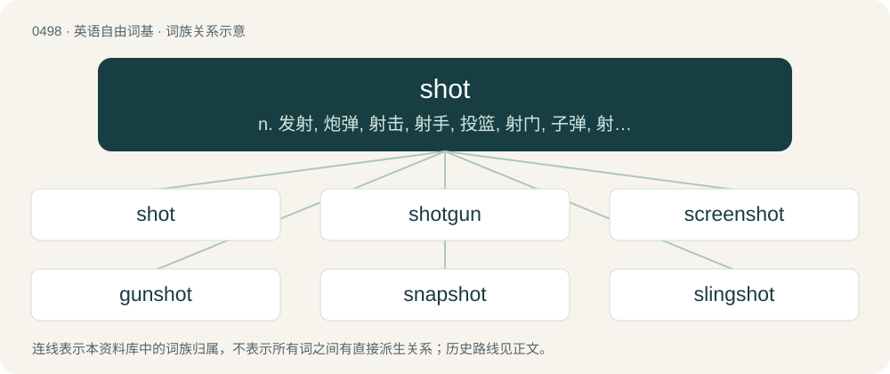

# 0564 · shot — n. 发射, 炮弹, 射击, 射手, 投篮, 射门, 子弹, 射程, 拍摄, 注射；vt. 装弹, 使成颗粒状；a. 杂色的, 交织着的, 渗透的, 点焊的, 破旧的

[总目录](../00_总目录_按常用程度.md)

**类型**：英语自由词基　｜　**来源语言**：见词源记录

## 核心含义与来源

- 核心含义：n. 发射, 炮弹, 射击, 射手, 投篮, 射门, 子弹, 射程, 拍摄, 注射；vt. 装弹, 使成颗粒状；a. 杂色的, 交织着的, 渗透的, 点焊的, 破旧的
- 英文含义：Tired, weary.
- 词形：shot

**多个词源／构词路径**：同一拼写可能有不同来源；以下按词性和含义分别列出。

**来源记录 1**（形容词；Tired, weary.）

The past participle of shoot.

**来源记录 2**（名词；The result of launching a projectile or bullet.）

Inherited from Middle English schot, from Old English sċeot, from Proto-Germanic \*skutą; compare the doublet scot.

## 词族图

## 单词速览（常用到不常用）

| 单词 | 音标 | 释义 |
|---|---|---|
| [shot](#w-1) | 英 /ʃɒt/；美 /ʃɑt/ | n. 发射, 炮弹, 射击, 射手, 投篮, 射门, 子弹, 射程, 拍摄, 注射；vt. 装弹, 使成颗粒状；a. 杂色的, 交织着的, 渗透的, 点焊的, 破旧的 |
| [shotgun](#w-2) | 英 /ˈʃɒtɡʌn/；美 /ˈʃɑtɡʌn/ | n. 散弹猎枪, 媒人；v. 用猎枪射击 |
| [screenshot](#w-3) | 英 /ˈskriːn.ʃɒt/；美 /ˈskriːn.ʃɑt/ | 屏幕截图 |
| [gunshot](#w-4) | 英 /ˈɡʌn.ʃɒt/；美 /ˈɡʌn.ʃɑt/ | n. 枪弹, (枪炮)射击, 炮击, 射程；a. 射击的 |
| [snapshot](#w-5) | /ˈsnæpʃɒt/ | n. 快照, 抽点打印；\[计\] 瞬象; 抽点打印 |
| [slingshot](#w-6) | 英 /ˈslɪŋʃɒt/ | n. 弹弓 |
| [headshot](#w-7) | /hedˈʃɒt/ | 拍摄头部 |
| [hotshot](#w-8) | /ˈhɒtˌʃɒt/ | n. 艺高而自负的人, 货物快车, 快速交通工具, 大人物 |
| [upshot](#w-9) | 英 /ˈʌpʃɒt/；美 /ˈʌpʃɑt/ | n. 结果, 结局, (论证的)要点 |
| [earshot](#w-10) | 英 /ˈɪəˌʃɒt/；美 /ˈɪɹˌʃɑt/ | n. 听力所及之范围, 可听距离 |
| [bloodshot](#w-11) | /ˈblʌdʃɒt/ | a. 充血的 |
| [cumshot](#w-12) | /ˈkʌm.ʃɒt/ | 射精 |
| [buckshot](#w-13) | /ˈbʌkʃɔt/ | n. &lt;美&gt;(猎兽用)大型铅弹 |

## 逐词详解

### 1. shot

**词性**：形容词　｜　**音标**：英 /ʃɒt/；美 /ʃɑt/

**中文释义**：n. 发射, 炮弹, 射击, 射手, 投篮, 射门, 子弹, 射程, 拍摄, 注射；vt. 装弹, 使成颗粒状；a. 杂色的, 交织着的, 渗透的, 点焊的, 破旧的

**英文义项**：Tired, weary. / Discharged, cleared, or rid of something.

**词源与演化**：

The past participle of shoot.

**例句**：

> The rear axle will have to be replaced. It’s shot.

该用例对应义项：Worn out or broken.

### 2. shotgun

**词性**：名词　｜　**音标**：英 /ˈʃɒtɡʌn/；美 /ˈʃɑtɡʌn/

**中文释义**：n. 散弹猎枪, 媒人；v. 用猎枪射击

**英文义项**：A gun which fires loads typically consisting of small metal balls, called shot, from a cartridge. / The front passenger seat in a vehicle, next to the driver; so called because the position of the shotgun-armed guard on a horse-drawn stage-coach, wagon train, or gold transport was next to the driver on a forward-mounted bench seat. Can also be used in situations of claiming other resources such as bedrooms.

**构词拆分**：shot + gun

**词源与演化**：

From shot + gun. Front passenger seat sense comes from ride shotgun.

**例句**：

> The farmer's son brought home a Thanksgiving turkey from the wild that he killed with his shotgun.

该用例对应义项：A gun which fires loads typically consisting of small metal balls, called shot, from a cartridge.

### 3. screenshot

**词性**：名词　｜　**音标**：英 /ˈskriːn.ʃɒt/；美 /ˈskriːn.ʃɑt/

**中文释义**：屏幕截图

**英文义项**：An image of computer or smartphone screen output at a given moment in time.

**构词拆分**：screen + shot (“(photography) single unbroken sequence of photographic exposures”)

**词源与演化**：

From screen + shot (“(photography) single unbroken sequence of photographic exposures”).

**例句**：

> I grabbed a screenshot of my desktop.

该用例对应义项：An image of computer or smartphone screen output at a given moment in time.

### 4. gunshot

**词性**：名词　｜　**音标**：英 /ˈɡʌn.ʃɒt/；美 /ˈɡʌn.ʃɑt/

**中文释义**：n. 枪弹, (枪炮)射击, 炮击, 射程；a. 射击的

**英文义项**：The discharging a firearm. / The firing of guns; gunfire.

**构词拆分**：gun + shot

**词源与演化**：

From gun + shot.

**用法示例／搭配（非完整句）**：

> they heard gunshot all around them

该用例对应义项：The firing of guns; gunfire.

### 5. snapshot

**词性**：名词　｜　**音标**：/ˈsnæpʃɒt/

**中文释义**：n. 快照, 抽点打印；\[计\] 瞬象; 抽点打印

**英文义项**：A photograph, especially one taken quickly or in a sudden moment of opportunity. / A glimpse of something; a portrayal of something at a moment in time.

**构词拆分**：snap + shot

**词源与演化**：

From snap + shot.

**例句**：

> This game is so hard that I find myself taking a snapshot every few seconds in case I get killed.

该用例对应义项：A file or set of files captured at a particular time, often capable of being reloaded to restore the earlier state.

### 6. slingshot

**词性**：动词　｜　**音标**：英 /ˈslɪŋʃɒt/

**中文释义**：n. 弹弓

**英文义项**：To move or cause to move in a manner resembling a projectile shot from a slingshot. / To use the gravity of a moving planet to add momentum to a spacecraft.

**构词拆分**：sling + shot

**词源与演化**：

From sling + shot.

**例句**：

> The shuttle will slingshot around Jupiter on its way to Saturn.

该用例对应义项：To use the gravity of a moving planet to add momentum to a spacecraft.

### 7. headshot

**词性**：名词　｜　**音标**：/hedˈʃɒt/

**中文释义**：拍摄头部

**英文义项**：A portrait for branding or social media. / A gunshot to the head.

**构词拆分**：head + shot

**词源与演化**：

From head + shot.

**例句**：

> In many games, a headshot is an instant kill.

### 8. hotshot

**词性**：形容词　｜　**音标**：/ˈhɒtˌʃɒt/

**中文释义**：n. 艺高而自负的人, 货物快车, 快速交通工具, 大人物

**英文义项**：Highly skilled. / Displaying talent.

**构词拆分**：hot + shot

**词源与演化**：

From hot + shot.

**例句**：

> Keep up those hotshot baskets, and the scouts are sure to take notice.

该用例对应义项：Displaying talent.

### 9. upshot

**词性**：名词　｜　**音标**：英 /ˈʌpʃɒt/；美 /ˈʌpʃɑt/

**中文释义**：n. 结果, 结局, (论证的)要点

**英文义项**：The final result, or outcome of something. / A concise summary.

**构词拆分**：up- + shot

**词源与演化**：

Presumed from up- + shot, referring to the last shot in a match of archery.

**例句**：

> One of the major upshots of prefab building is its decreased environmental impact.

该用例对应义项：A positive aspect or consequence, often either unexpected or in contrast to other negative aspects.

### 10. earshot

**词性**：名词　｜　**音标**：英 /ˈɪəˌʃɒt/；美 /ˈɪɹˌʃɑt/

**中文释义**：n. 听力所及之范围, 可听距离

**英文义项**：A distance from which sound is still audible.

**构词拆分**：ear + shot

**词源与演化**：

From ear + shot.

**例句**：

> I'll row out on the lake but stay within earshot.

该用例对应义项：A distance from which sound is still audible.

### 11. bloodshot

**词性**：形容词　｜　**音标**：/ˈblʌdʃɒt/

**中文释义**：a. 充血的

**英文义项**：Reddened and inflamed because of congested blood vessels.

**构词拆分**：blood + shot

**词源与演化**：

From blood + shot.

**例句**：

> She said she was perfectly fine but I could tell she was tired; her eyes were all bloodshot.

该用例对应义项：Reddened and inflamed because of congested blood vessels.

### 12. cumshot

**词性**：名词　｜　**音标**：/ˈkʌm.ʃɒt/

**中文释义**：射精

**英文义项**：A sex act in pornographic films in which a person ejaculates onto their partner's body. / The portrayal of ejaculation.

**构词拆分**：cum + shot

**词源与演化**：

From cum + shot.

### 13. buckshot

**词性**：名词　｜　**音标**：/ˈbʌkʃɔt/

**中文释义**：n. &lt;美&gt;(猎兽用)大型铅弹

**英文义项**：Lead shot used in shotgun cartridges, made of larger pellets than birdshot and suitable for hunting larger game.

**构词拆分**：buck + shot

**词源与演化**：

From buck + shot.

**例句**：

> I couldn't find anywhere to buy buckshot.
