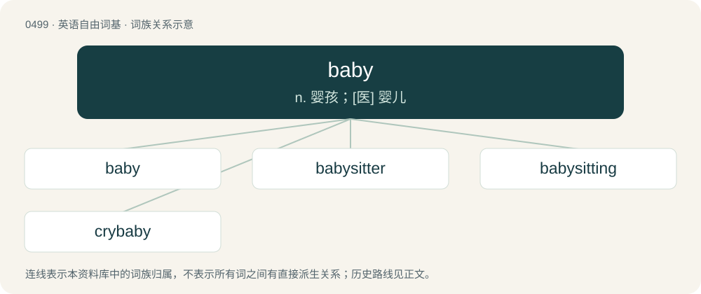

# 0566 · baby — n. 婴孩；\[医\] 婴儿

[总目录](../00_总目录_按常用程度.md)

**类型**：英语自由词基　｜　**来源语言**：见词源记录

## 核心含义与来源

- 核心含义：n. 婴孩；\[医\] 婴儿
- 英文含义：A very young human, particularly from birth to a couple of years old or until walking is fully mastered.
- 词形：baby

**来源记录 1**（名词；A very young human, particularly from birth to a couple of years old or until walking is fully mastered.）

From Middle English baby, babie (“baby”), a diminutive form of babe (“babe, baby”), equivalent to babe + -y/-ie (“endearing and diminutive suffix”). Perhaps ultimately imitative of baby talk (compare babble).

## 词族图

## 单词速览（常用到不常用）

| 单词 | 音标 | 释义 |
|---|---|---|
| [baby](#w-1) | 英 /ˈbeɪ.bi/ | n. 婴孩；\[医\] 婴儿 |
| [babysitter](#w-2) | 英 /ˈbeɪ̯biˌsɪtə/；美 /ˈbeɪ̯biˌsɪtɚ/ | n. 临时照顾幼儿者 |
| [babysitting](#w-3) |  | n. 当临时保姆 |
| [crybaby](#w-4) | /ˈkɹaɪˌbeɪbi/ | n. 爱哭的人, 软弱容易哭的人 |

## 逐词详解

### 1. baby

**词性**：名词　｜　**音标**：英 /ˈbeɪ.bi/

**中文释义**：n. 婴孩；\[医\] 婴儿

**英文义项**：A very young human, particularly from birth to a couple of years old or until walking is fully mastered. / A very young human, even if not yet born.

**构词拆分**：babe + -y/-ie (“endearing and diminutive suffix”)

**词源与演化**：

From Middle English baby, babie (“baby”), a diminutive form of babe (“babe, baby”), equivalent to babe + -y/-ie (“endearing and diminutive suffix”). Perhaps ultimately imitative of baby talk (compare babble).

**例句**：

> Her baby had always been active, even before he was born, when he would kick her bladder.

该用例对应义项：A very young human, even if not yet born.

### 2. babysitter

**词性**：名词　｜　**音标**：英 /ˈbeɪ̯biˌsɪtə/；美 /ˈbeɪ̯biˌsɪtɚ/

**中文释义**：n. 临时照顾幼儿者

**英文义项**：A person who cares for one or more babies or children for a short period of time in place of their legal guardians. / A person who has to watch or attend to anything or anyone unnecessarily closely; a coddler or handholder.

**构词拆分**：baby + sitter

**词源与演化**：

From baby + sitter.

**例句**：

> My neighbor is sometimes a babysitter for other mothers’ children.

该用例对应义项：A person who cares for one or more babies or children for a short period of time in place of their legal guardians.

### 3. babysitting

**词性**：名词

**中文释义**：n. 当临时保姆

**英文义项**：The work of a babysitter; the care of children in the temporary absence of their parents or guardians.

**构词拆分**：baby + sitting

**词源与演化**：

From baby + sitting.

**例句**：

> When I was in high school, I used to earn extra money babysitting.

### 4. crybaby

**词性**：名词　｜　**音标**：/ˈkɹaɪˌbeɪbi/

**中文释义**：n. 爱哭的人, 软弱容易哭的人

**英文义项**：A baby who cries excessively. / Someone whose feelings are very easily hurt, often by trivial matters.

**构词拆分**：cry + baby

**词源与演化**：

From cry + baby.

**例句**：

> I know that Tom is a crybaby.
