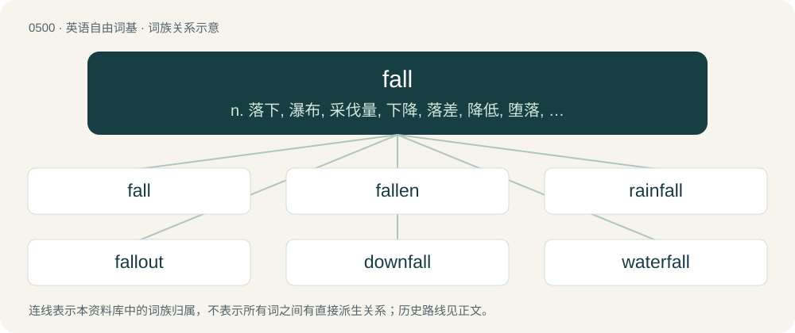

# 0567 · fall — n. 落下, 瀑布, 采伐量, 下降, 落差, 降低, 堕落, 秋天；vi. 倒下, 落下, 来临, 失守, 阵亡, 下跌, 减弱, 倾斜, 垮台, 轮到, 变成, 降低；a. 秋天的

[总目录](../00_总目录_按常用程度.md)

**类型**：英语自由词基　｜　**来源语言**：见词源记录

## 核心含义与来源

- 核心含义：n. 落下, 瀑布, 采伐量, 下降, 落差, 降低, 堕落, 秋天；vi. 倒下, 落下, 来临, 失守, 阵亡, 下跌, 减弱, 倾斜, 垮台, 轮到, 变成, 降低；a. 秋天的
- 英文含义：To move to a lower position under the effect of gravity.
- 词形：fall

**多个词源／构词路径**：同一拼写可能有不同来源；以下按词性和含义分别列出。

**来源记录 1**（动词；To move to a lower position under the effect of gravity.）

Verb from Middle English fallen, from Old English feallan (“to fall, fail, decay, die, attack”), from Proto-West Germanic \*fallan (“to fall”), from Proto-Germanic \*fallaną (“to fall”), from Proto-Indo-European \*h₃elh₁- (“to collapse, fall; to destroy”). Cognates Cognate with Scots faw (“to fall”), Yola vale, vall, vole (“to fall”), North Frisian faal, fåle (“to fall”), Saterland Frisian faale (“to fall”), West Frisian falle (“to fall”), Bavarian foin (“to fall”), Cimbrian ballan, vallan (“to fall”), Dutch vallen (“to fall”), German and Low German fallen (“to fall”), Luxembourgish falen (“to fall”), Yiddish פֿאַלן (faln, “to fall”), Danish falde (“to fall”), Faroese, Icelandic, and Swedish falla (“to fall”), Norwegian Bokmål falle (“to fall”), Norwegian Nynorsk falla, falle (“to fall”); also Latin aboleō (“to destroy; to die”), Ancient Greek ὄλλῡμι (óllūmi, “to destroy; to lose”), Armenian եղեռն (eġeṙn, “crime; calamity, catastrophe; slaughter”), Lithuanian pùlti (“to fall; to attack, assault”). Noun from Middle English fal, fall, falle, from Old English feall, ġefeall (“a falling, fall”) and Old English fealle (“trap, snare”), from Proto-Germanic \*fallą, \*fallaz (“a fall, trap”). Cognate with Yola vall (“fall”), Dutch val (“fall”), German Fall (“fall”), Danish fald (“fall”), Faroese, Icelandic, Norwegian Bokmål, Norwegian Nynorsk, and Swedish fall (“fall”). Sense of "autumn" is attested by the 1660s in England as a shortening of fall of the leaf (1540s), from the falling of leaves during this season. Along with autumn, it mostly replaced the older name harvest as that name began to be associated strictly with the act of harvesting. Compare spring, which began as a shortening of “spring of the leaf”.

**来源记录 2**（感叹词；The cry given when a whale is sighted, or harpooned.）

Perhaps from the north-eastern Scottish pronunciation of whale.

## 词族图

## 单词速览（常用到不常用）

| 单词 | 音标 | 释义 |
|---|---|---|
| [fall](#w-1) | 英 /fɔːl/；/fɔl/ | n. 落下, 瀑布, 采伐量, 下降, 落差, 降低, 堕落, 秋天；vi. 倒下, 落下, 来临, 失守, 阵亡, 下跌, 减弱, 倾斜, 垮台, 轮到, 变成, 降低；a. 秋天的 |
| [fallen](#w-2) | 英 /ˈfɔːlən/；美 /ˈfɔlən/ | a. 堕落的, 落下来的, 陷落的；fall的过去分词 |
| [rainfall](#w-3) | /ˈreinfɒːl/ | n. 降雨, 降雨量；\[经\] 降雨量 |
| [fallout](#w-4) | 英 /ˈfɔːlaʊt/；美 /ˈfɔlˌaʊt/ | n. 原子尘的降下, 辐射性微尘, 原子尘, 附带结果；\[医\] \[放射尘\]回降 |
| [downfall](#w-5) | /ˈdaʊnfɔːl/ | n. 衰败, 大雨 |
| [waterfall](#w-6) | 英 /ˈwɔːtəfɔːl/；/ˈwɔtɚfɔl/ | n. 瀑布 |
| [nightfall](#w-7) | /ˈnaɪt.fɔl/ | n. 傍晚, 黄昏, 日暮 |
| [landfall](#w-8) | 英 /ˈlænd.fɔːl/；美 /ˈlænd.fɔl/ | n. 初见陆地, 到达陆地, 着陆 |
| [shortfall](#w-9) | /ˈʃɒːtfɒːl/ | n. 不足, 不足量；\[经\] 缺少, 不足, 亏舱运费 |
| [windfall](#w-10) | 英 /ˈwɪnd.fɔːl/；/ˈwɪnd.fɔl/ | n. 被风吹落的果子, 横财；\[经\] 意外损失 |
| [befall](#w-11) | 英 /bɪˈfɔːl/；美 /bɪˈfɔl/ | v. 降临(于) |
| [skyfall](#w-12) |  | 【英文】An unexplained falling of objects from the sky. |
| [freefall](#w-13) | /ˈfɹiːˌfɔːl/ | a. 自由落体的；n. 自由降落式（跳伞） |
| [pitfall](#w-14) | 英 /ˈpɪtfɔːl/；美 /ˈpɪtfɔl/ | n. 陷阱, 诱惑, 阴谋, 易犯的错误, 意想不到的困难 |
| [offal](#w-15) | 英 /ˈɒfəl/；/ˈɔfəl/ | n. 碎屑, 残渣, 下水, 不能吃的部份, 垃圾, 被鄙弃的人；\[化\] 废料; 下角料 |
| [footfall](#w-16) | 英 /ˈfʊtfɔːl/；/ˈfʊtfɔl/ | n. 脚声, 踏步, 脚步 |
| [outfall](#w-17) | 美 /ˈaʊtˌfɔl/ | n. 河口, 排水口, 袭击 |
| [faller](#w-18) | /ˈfɒːlə/ | n. 砍伐树木的人 |

## 逐词详解

### 1. fall

**词性**：动词　｜　**音标**：英 /fɔːl/；/fɔl/

**中文释义**：n. 落下, 瀑布, 采伐量, 下降, 落差, 降低, 堕落, 秋天；vi. 倒下, 落下, 来临, 失守, 阵亡, 下跌, 减弱, 倾斜, 垮台, 轮到, 变成, 降低；a. 秋天的

**英文义项**：To move to a lower position under the effect of gravity. / To come down, to drop or descend.

**词源与演化**：

Verb from Middle English fallen, from Old English feallan (“to fall, fail, decay, die, attack”), from Proto-West Germanic \*fallan (“to fall”), from Proto-Germanic \*fallaną (“to fall”), from Proto-Indo-European \*h₃elh₁- (“to collapse, fall; to destroy”). Cognates Cognate with Scots faw (“to fall”), Yola vale, vall, vole (“to fall”), North Frisian faal, fåle (“to fall”), Saterland Frisian faale (“to fall”), West Frisian falle (“to fall”), Bavarian foin (“to fall”), Cimbrian ballan, vallan (“to fall”), Dutch vallen (“to fall”), German and Low German fallen (“to fall”), Luxembourgish falen (“to fall”), Yiddish פֿאַלן (faln, “to fall”), Danish falde (“to fall”), Faroese, Icelandic, and Swedish falla (“to fall”), Norwegian Bokmål falle (“to fall”), Norwegian Nynorsk falla, falle (“to fall”); also Latin aboleō (“to destroy; to die”), Ancient Greek ὄλλῡμι (óllūmi, “to destroy; to lose”), Armenian եղեռն (eġeṙn, “crime; calamity, catastrophe; slaughter”), Lithuanian pùlti (“to fall; to attack, assault”). Noun from Middle English fal, fall, falle, from Old English feall, ġefeall (“a falling, fall”) and Old English fealle (“trap, snare”), from Proto-Germanic \*fallą, \*fallaz (“a fall, trap”). Cognate with Yola vall (“fall”), Dutch val (“fall”), German Fall (“fall”), Danish fald (“fall”), Faroese, Icelandic, Norwegian Bokmål, Norwegian Nynorsk, and Swedish fall (“fall”). Sense of "autumn" is attested by the 1660s in England as a shortening of fall of the leaf (1540s), from the falling of leaves during this season. Along with autumn, it mostly replaced the older name harvest as that name began to be associated strictly with the act of harvesting. Compare spring, which began as a shortening of “spring of the leaf”.

**例句**：

> And so it falls to me to make this important decision.

该用例对应义项：To be allotted to; to arrive through chance, fate, or inheritance.

### 2. fallen

**词性**：形容词　｜　**音标**：英 /ˈfɔːlən/；美 /ˈfɔlən/

**中文释义**：a. 堕落的, 落下来的, 陷落的；fall的过去分词

**英文义项**：Having dropped by the force of gravity. / Killed, especially in battle.

**构词拆分**：fall + -en

**词源与演化**：

Morphologically fall + -en.

**例句**：

> Fallen leaves covered the forest floor.

该用例对应义项：having dropped by the force of gravity

### 3. rainfall

**词性**：名词　｜　**音标**：/ˈreinfɒːl/

**中文释义**：n. 降雨, 降雨量；\[经\] 降雨量

**英文义项**：The amount of rain that falls on a single occasion / The occurrence of liquid precipitation, the fall of rain.

**构词拆分**：rain + fall

**词源与演化**：

From rain + fall.

**例句**：

> Asia possesses 12 of the Top 19 world single-day rainfall records.

### 4. fallout

**词性**：名词　｜　**音标**：英 /ˈfɔːlaʊt/；美 /ˈfɔlˌaʊt/

**中文释义**：n. 原子尘的降下, 辐射性微尘, 原子尘, 附带结果；\[医\] \[放射尘\]回降

**英文义项**：The event of small airborne particles falling to the ground in significant quantities as a result of major industrial activity, volcano eruption, sandstorm, nuclear explosion, etc. / The particles themselves.

**构词拆分**：fall + out

**词源与演化**：

Deverbal from fall out; fall + out.

**例句**：

> On 26 April 1986 the reactor number four at the Chernobyl Nuclear Power Plant located in the Soviet Union near Pripyat in Ukraine exploded. Further explosions and the resulting fire sent a plume of highly radioactive fallout into the atmosphere and over an extensive geographical area.

该用例对应义项：The particles themselves.

### 5. downfall

**词性**：名词　｜　**音标**：/ˈdaʊnfɔːl/

**中文释义**：n. 衰败, 大雨

**英文义项**：A precipitous decline in fortune; death or rapid deterioration, as in status or wealth. / The cause of such a fall; a critical blow or error.

**构词拆分**：down- + fall

**词源与演化**：

From down- + fall. In this spelling, from 16th century; spelled as two words from 13th century.

**例句**：

> Many economic and political reasons led to the downfall of the Roman Empire.

该用例对应义项：A precipitous decline in fortune; death or rapid deterioration, as in status or wealth.

### 6. waterfall

**词性**：名词　｜　**音标**：英 /ˈwɔːtəfɔːl/；/ˈwɔtɚfɔl/

**中文释义**：n. 瀑布

**英文义项**：A flow of water over the edge of a cliff. / A waterfall-like outpouring of liquid, smoke, etc.

**构词拆分**：water + fall

**词源与演化**：

From Middle English waterfal, waterfalle, from Old English wæterġefeall (“waterfall”), equivalent to water + fall. Cognate with West Frisian wetterfal (“waterfall”), Dutch waterval (“waterfall”), German Wasserfall (“waterfall”), Swedish vattenfall (“waterfall”).

**例句**：

> Hey man, can I take a waterfall from your bottle?

该用例对应义项：The action of drinking from a vessel without touching it with the lips, considered more sanitary for a shared vessel.

### 7. nightfall

**词性**：名词　｜　**音标**：/ˈnaɪt.fɔl/

**中文释义**：n. 傍晚, 黄昏, 日暮

**英文义项**：The close of the day; the coming of night. / Nocturnal emission.

**构词拆分**：night + fall

**词源与演化**：

From night + fall. Cf. dewfall.

**用法示例／搭配（非完整句）**：

> at nightfall

该用例对应义项：The close of the day; the coming of night.

### 8. landfall

**词性**：名词　｜　**音标**：英 /ˈlænd.fɔːl/；美 /ˈlænd.fɔl/

**中文释义**：n. 初见陆地, 到达陆地, 着陆

**英文义项**：An arrival at the shore by a ship, or sighting of the shore from a ship. / The point at which a hurricane or similar storm reaches land.

**构词拆分**：land + fall

**词源与演化**：

From land + fall.

**例句**：

> We made landfall at the most god-forsaken, barren, desolate, and hellish location possible to image; and we were grateful, anything to get off that ship!

该用例对应义项：An arrival at the shore by a ship, or sighting of the shore from a ship.

### 9. shortfall

**词性**：名词　｜　**音标**：/ˈʃɒːtfɒːl/

**中文释义**：n. 不足, 不足量；\[经\] 缺少, 不足, 亏舱运费

**英文义项**：An instance of falling short, of not meeting a quota, an obligation, or more generally any expected target. / The amount by which such a quota, obligation, etc., was missed.

**构词拆分**：By surface analysis, short + fall

**词源与演化**：

Deverbal from fall short. By surface analysis, short + fall.

**例句**：

> Due to a shortfall in revenue, we will have to make some cuts.

该用例对应义项：An instance of falling short, of not meeting a quota, an obligation, or more generally any expected target.

### 10. windfall

**词性**：名词　｜　**音标**：英 /ˈwɪnd.fɔːl/；/ˈwɪnd.fɔl/

**中文释义**：n. 被风吹落的果子, 横财；\[经\] 意外损失

**英文义项**：Something that has been blown down by the wind. / The act of something being blown down by wind.

**构词拆分**：wind + fall

**词源与演化**：

From Middle English windfal, wyndfall, equivalent to wind + fall. Cognate with Middle High German wintval, wintfal, German Windfall.

**例句**：

> They couldn't reach the branches, so they ate the windfalls.

该用例对应义项：A fruit that has fallen from a tree naturally, as from wind.

### 11. befall

**词性**：动词　｜　**音标**：英 /bɪˈfɔːl/；美 /bɪˈfɔl/

**中文释义**：v. 降临(于)

**英文义项**：To fall upon; fall all over; overtake. / To happen.

**构词拆分**：be- + fall

**词源与演化**：

From Middle English bifallen, from Old English befeallan, from Proto-West Germanic \*bifallan, from Proto-Germanic \*bifallaną; equivalent to be- + fall.

**例句**：

> At dusk an unusual calm befalls the wetlands.

该用例对应义项：To fall upon; fall all over; overtake.

### 12. skyfall

**词性**：名词

**英文义项**：An unexplained falling of objects from the sky.

**构词拆分**：sky + fall

**词源与演化**：

sky + fall

### 13. freefall

**词性**：名词　｜　**音标**：/ˈfɹiːˌfɔːl/

**中文释义**：a. 自由落体的；n. 自由降落式（跳伞）

**英文义项**：A state of motion affected by no acceleration or force other than that of gravity. / A state of motion but allowing for the presence of incidental air resistance not caused intentionally by devices such parachutes or wings.

**构词拆分**：free + fall

**词源与演化**：

From free + fall.

**例句**：

> As civil war continues in Iraq, the U.S. president's approval ratings are in freefall.

该用例对应义项：A rapid, uncontrolled decline or worsening.

### 14. pitfall

**词性**：名词　｜　**音标**：英 /ˈpɪtfɔːl/；美 /ˈpɪtfɔl/

**中文释义**：n. 陷阱, 诱惑, 阴谋, 易犯的错误, 意想不到的困难

**英文义项**：A type of trap consisting of a concealed pit in the ground, into which the victim is supposed to fall and not be able to get out from. / A potential, unsuspected, hidden problem, hazard, or danger that is easily encountered but not immediately obvious.

**构词拆分**：pit + fall

**词源与演化**：

First recorded use in the 14th century from pit + fall in the sense of "pit trap, pit snare", from Old English fealle (“trap, snare”), from Proto-Germanic \*fallą, \*fallaz (“a fall, trap”), from Proto-Indo-European \*(s)pōl-. Cognate with German Falle (“trap, snare”).

**例句**：

> It's usually a simple task, but you should know the pitfalls before you attempt it yourself.

该用例对应义项：A potential, unsuspected, hidden problem, hazard, or danger that is easily encountered but not immediately obvious.

### 15. offal

**词性**：名词　｜　**音标**：英 /ˈɒfəl/；/ˈɔfəl/

**中文释义**：n. 碎屑, 残渣, 下水, 不能吃的部份, 垃圾, 被鄙弃的人；\[化\] 废料; 下角料

**英文义项**：The internal organs of an animal (entrails or innards), used as food. / A by-product of the grain milling process, which may include bran, husks, etc.

**构词拆分**：off- + fall

**词源与演化**：

From Middle English offal, offall, offalle (“offal, refuse, scrap waste”), equivalent to off- + fall. Cognate with Saterland Frisian Oufal (“offal”), West Frisian ôffal (“offal”), Dutch afval (“waste, refuse”), German Low German Offall (“offal”), German Abfall (“waste, refuse”), Danish affald (“waste, refuse”), Swedish avfall (“waste, refuse”), Old English offeallan (“to cut off”).

**例句**：

> In Mary's butcher shop, you can also find an offal shop.

### 16. footfall

**词性**：名词　｜　**音标**：英 /ˈfʊtfɔːl/；/ˈfʊtfɔl/

**中文释义**：n. 脚声, 踏步, 脚步

**英文义项**：The sound made by a footstep; also, the footstep or step itself. / The number of pedestrians going into or passing through a place (especially a commercial venue such as a shop) during a specified time period; also, the pedestrians in a particular place regarded collectively; foot traffic.

**构词拆分**：foot (“part of the human leg below the ankle”) + fall (“act of moving to a lower position under the effect of gravity”, noun)

**词源与演化**：

From foot (“part of the human leg below the ankle”) + fall (“act of moving to a lower position under the effect of gravity”, noun).

**用法示例／搭配（非完整句）**：

> However, footfall is still below pre-Covid levels while there is also a surge of incoming supply. - "Are There Too Many Retail Malls In Malaysia?", BFM 89.9

该用例对应义项：The number of pedestrians going into or passing through a place (especially a commercial venue such as a shop) during a specified time period; also, the pedestrians in a particular place regarded collectively; foot traffic.

### 17. outfall

**词性**：名词　｜　**音标**：美 /ˈaʊtˌfɔl/

**中文释义**：n. 河口, 排水口, 袭击

**英文义项**：A quarrel; a falling out. / The point or place of discharge of a river, drain, culvert, sewer, etc.; mouth; embouchure.

**构词拆分**：out- + fall

**词源与演化**：

From out- + fall. Compare Dutch uitval (“outburst, sally, eruption”), German Ausfall (“falling out, sally”), Swedish utfall (“sally, issue”).

### 18. faller

**词性**：名词　｜　**音标**：/ˈfɒːlə/

**中文释义**：n. 砍伐树木的人

**英文义项**：One who falls. / A fruit that falls from the tree, rather than being picked.

**构词拆分**：fall + -er

**词源与演化**：

From fall + -er.

**例句**：

> One of them was safe but they were unable to save the faller.

该用例对应义项：a person who falls
