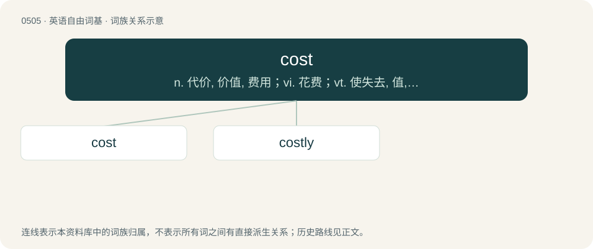

# 0569 · cost — n. 代价, 价值, 费用；vi. 花费；vt. 使失去, 值, 使花费

[总目录](../00_总目录_按常用程度.md)

**类型**：英语自由词基　｜　**来源语言**：见词源记录

## 核心含义与来源

- 核心含义：n. 代价, 价值, 费用；vi. 花费；vt. 使失去, 值, 使花费
- 英文含义：To incur a charge of; to require payment of a (specified) price.
- 词形：cost

**多个词源／构词路径**：同一拼写可能有不同来源；以下按词性和含义分别列出。

**来源记录 1**（动词；To incur a charge of; to require payment of a (specified) price.）

From Middle English costen, from Old French coster, couster (“to cost”), from Medieval Latin cōstō, from Latin cōnstō (“stand together”).

**来源记录 2**（名词；Amount of money, time, etc. that is required or used.）

From Middle English cost, coust, from costen (“to cost”), from the same source as above.

**来源记录 3**（名词；Quality; condition; property; value; worth; a wont or habit; disposition; nature; kind; characteristic.）

From Middle English cost, from Old English cost (“option, choice, possibility, manner, way, condition”), from Old Norse kostr (“choice, opportunity, chance, condition, state, quality”), from Proto-Germanic \*kustuz (“choice, trial”) (or Proto-Germanic \*kustiz (“choice, trial”)), from Proto-Indo-European \*ǵéwstus (“to enjoy, taste”). Cognate with Icelandic kostur, German dialectal Kust (“taste, flavour”), Dutch kust (“choice, choosing”), North Frisian kest (“choice, estimation, virtue”), West Frisian kêst (“article of law, statute”), Old English cyst (“free-will, choice, election, the best of anything, the choicest, picked host, moral excellence, virtue, goodness, generosity, munificence”), Latin gustus (“taste”). Related to choose. Doublet of gusto.

**来源记录 4**（名词；A cottise.）

From Middle English coste, from Old French coste, from Latin costa. Doublet of coast and cuesta.

## 词族图

## 单词速览（常用到不常用）

| 单词 | 音标 | 释义 |
|---|---|---|
| [cost](#w-1) | 英 /kɒst/；/kɔst/ | n. 代价, 价值, 费用；vi. 花费；vt. 使失去, 值, 使花费 |
| [costly](#w-2) | 英 /ˈkɒst.li/ | a. 昂贵的, 奢华的, 费用大的 |

## 逐词详解

### 1. cost

**词性**：动词　｜　**音标**：英 /kɒst/；/kɔst/

**中文释义**：n. 代价, 价值, 费用；vi. 花费；vt. 使失去, 值, 使花费

**英文义项**：To incur a charge of; to require payment of a (specified) price. / To cause something to be lost; to cause the expenditure or relinquishment of.

**词源与演化**：

From Middle English costen, from Old French coster, couster (“to cost”), from Medieval Latin cōstō, from Latin cōnstō (“stand together”).

**例句**：

> Trying to rescue the man from the burning building cost them their lives.

该用例对应义项：To cause something to be lost; to cause the expenditure or relinquishment of.

### 2. costly

**词性**：形容词　｜　**音标**：英 /ˈkɒst.li/

**中文释义**：a. 昂贵的, 奢华的, 费用大的

**英文义项**：Of high cost; expensive.

**构词拆分**：cost + -ly

**词源与演化**：

From Middle English costly, costely, costeley, equivalent to cost + -ly.

**用法示例／搭配（非完整句）**：

> a costly activity

该用例对应义项：Of high cost; expensive.
