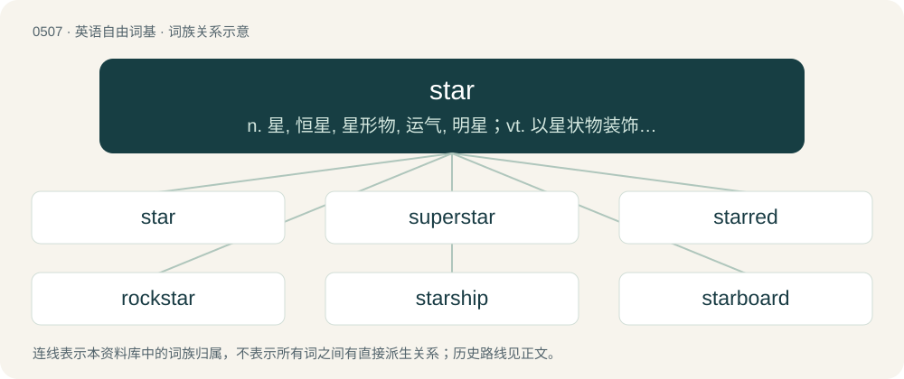

# 0571 · star — n. 星, 恒星, 星形物, 运气, 明星；vt. 以星状物装饰, 用星号标, 使成为明星；vi. 变成明星

[总目录](../00_总目录_按常用程度.md)

**类型**：英语自由词基　｜　**来源语言**：见词源记录

## 核心含义与来源

- 核心含义：n. 星, 恒星, 星形物, 运气, 明星；vt. 以星状物装饰, 用星号标, 使成为明星；vi. 变成明星
- 英文含义：Any small, natural and bright dot in the sky, most visible in the night or twilight sky. This sense includes the planets, but it is now sometimes used in exclusion of them due to influence from the technical astronomical sense.
- 词形：star

**来源记录 1**（名词；Any small, natural and bright dot in the sky, most visible in the night or twilight sky. This sense includes the planets, but it is now sometimes used in exclusion of them due to influence from the technical astronomical sense.）

From Middle English sterre, from Old English steorra (“star”), from Proto-West Germanic \*sterrō, variant of \*sternō, from Proto-Germanic \*sternô, \*sternǭ (“star”), from Proto-Indo-European \*h₂stḗr (“star”). Doublet of aster; related to estoile, étoile, stella, and stelo. Cognates Cognate with Scots starn, ster (“star”), Yola starr, steor (“star”), Saterland Frisian Stiern (“star”), West Frisian stjer (“star”), Cimbrian stèrn (“star”), Dutch ster (“star”), German Stern (“star”), Luxembourgish Stär (“star”), Mòcheno stern (“star”), Vilamovian śtaom (“star”), Yiddish שטערן (shtern, “star”), Danish and Norwegian Bokmål stjerne (“star”), Faroese stjørna (“star”), Gutnish stjännå (“star”), Icelandic stjarna (“star”), Norwegian Nynorsk skjødna, stjerne (“star”), Swedish stjärna (“star”), Crimean Gothic stein (“star”), Gothic 𐍃𐍄𐌰𐌹𐍂𐌽𐍉 (stairnō, “star”), French étoile (“star”), Istriot stila (“star”), Istro-Romanian ste (“star”), Italian stella (“star”), Megleno-Romanian steau̯ă (“star”), Mirandese streilha (“star”), Occitan estela (“star”), Portuguese estrela (“star”), Romansh staila (“star”), Romanian stea (“star”), Sardinian isteddu (“star”), Sicilian stidda (“star”), Spanish estrella (“star”), Venetan stéła (“star”), Walloon sitoele (“star”), Latin stēlla (“star”), Ancient Greek ἀστήρ (astḗr, “star”), Greek αστέρι (astéri, “star”), Old Armenian աստղ (astł, “star”), Persian ستاره (setâre, “star”), Tajik ситора (sitora, “star”), Pashto ستوری (storay, “star”), Mazanderani اساره (ëssâre, “star”), Northern Kurdish stêr (“star”), Central Kurdish ئەستێرە (estêre, “star”), Zazaki astare (“star”), Ossetian стъалы (st’aly, “star”), Hindi तारा (tārā, “star”), Urdu تارا (tārā, “star”), Punjabi ਤਾਰਾ (tārā, “star”), Gujarati તારો (tāro, “star”), Sanskrit तारा (tārā, “star”).

## 词族图

## 单词速览（常用到不常用）

| 单词 | 音标 | 释义 |
|---|---|---|
| [star](#w-1) | 英 /stɑː(ɹ)/；美 /stɑɹ/ | n. 星, 恒星, 星形物, 运气, 明星；vt. 以星状物装饰, 用星号标, 使成为明星；vi. 变成明星 |
| [superstar](#w-2) | 英 /ˈsuː.pəˌstɑː/；美 /ˈsu.pɚˌstɑɹ/ | n. 超级明星 |
| [starred](#w-3) | /ˈstɑː(ɹ)d/ | a. 用星装饰的, 用星号标明的, 受命运支配的, 担任主角的；\[计\] 加星号的 |
| [rockstar](#w-4) |  | 摇滚歌星（游戏名） |
| [starship](#w-5) | /stɑɹʃɪp/ | 恒星飞船 |
| [starboard](#w-6) | /ˈstɑːbɒːd/ | 【英文】A list that shows messages starred in a community space. |
| [stardust](#w-7) | 英 /ˈstɑːdʌst/；美 /ˈstɑɹˌdʌst/ | n. 星团, 幻觉 |
| [starry](#w-8) | 英 /ˈstɑː.ɹi/；美 /ˈstɑɹ.i/ | a. 星光照耀的, 多星的, 星形的, 明亮的 |
| [starlight](#w-9) | /ˈstɑː(ɹ)laɪt/ | n. 星光 |
| [stardom](#w-10) | 美 /ˈstɑɹdəm/ | n. 明星身分, 明星们 |
| [stargate](#w-11) | 美 /ˈstɑɹˌɡeɪt/ | n. 星际之门（电视剧名） |
| [starfish](#w-12) | /ˈstɑː(ɹ)fɪʃ/ | n. 海星 |
| [starcraft](#w-13) | /ˈstɑːkrɑːft. -kræft/ | n. 占星学 |
| [starlet](#w-14) | 英 /ˈstɑːlɪt/；美 /ˈstɑɹlɪt/ | n. 小星星, 小明星 |
| [starburst](#w-15) | /ˈstɑːbɜːst/ | n. 星暴; 光芒四射的亮光 |
| [costar](#w-16) | /ˈkəʊstɑː(ɹ)/ | n. 合演者, 合演明星；vi. 合演 |
| [megastar](#w-17) | /ˈmegəstɑː(r)/ | n. 巨星, 演艺巨星 |
| [starfighter](#w-18) |  | 星座式战斗机 |
| [instar](#w-19) | 英 /ɪnˈstɑː/；美 /ɪnˈstɑɹ/ | 【英文】To make a star of; set as a star. |
| [starrer](#w-20) |  | 【英文】A film featuring a particular movie star. |
| [stargazer](#w-21) | 美 /ˈstɑɹˌɡeɪzɚ/ | n. 看星星的人, 占星师, 天文学家 |
| [tristar](#w-22) |  | 【英文】Having three stars, or three star shapes. |
| [starman](#w-23) | 英 /ˈstɑːˌmæn/；美 /ˈstɑɹˌmæn/ | \[人名\] 斯塔曼; \[电影\]外星恋 |
| [starbase](#w-24) |  | 【英文】A base (for trading, military operations, etc.) located in space, among the stars. |
| [lodestar](#w-25) | 英 /ˈləʊd.stɑː(ɹ)/；美 /ˈloʊd.stɑɹ/ | n. 指示方向之星, 北极星, 指导原理 |

## 逐词详解

### 1. star

**词性**：名词　｜　**音标**：英 /stɑː(ɹ)/；美 /stɑɹ/

**中文释义**：n. 星, 恒星, 星形物, 运气, 明星；vt. 以星状物装饰, 用星号标, 使成为明星；vi. 变成明星

**英文义项**：Any small, natural and bright dot in the sky, most visible in the night or twilight sky. This sense includes the planets, but it is now sometimes used in exclusion of them due to influence from the technical astronomical sense. / A planet thought to influence one's fate; (figuratively) fate or luck.

**词源与演化**：

From Middle English sterre, from Old English steorra (“star”), from Proto-West Germanic \*sterrō, variant of \*sternō, from Proto-Germanic \*sternô, \*sternǭ (“star”), from Proto-Indo-European \*h₂stḗr (“star”). Doublet of aster; related to estoile, étoile, stella, and stelo. Cognates Cognate with Scots starn, ster (“star”), Yola starr, steor (“star”), Saterland Frisian Stiern (“star”), West Frisian stjer (“star”), Cimbrian stèrn (“star”), Dutch ster (“star”), German Stern (“star”), Luxembourgish Stär (“star”), Mòcheno stern (“star”), Vilamovian śtaom (“star”), Yiddish שטערן (shtern, “star”), Danish and Norwegian Bokmål stjerne (“star”), Faroese stjørna (“star”), Gutnish stjännå (“star”), Icelandic stjarna (“star”), Norwegian Nynorsk skjødna, stjerne (“star”), Swedish stjärna (“star”), Crimean Gothic stein (“star”), Gothic 𐍃𐍄𐌰𐌹𐍂𐌽𐍉 (stairnō, “star”), French étoile (“star”), Istriot stila (“star”), Istro-Romanian ste (“star”), Italian stella (“star”), Megleno-Romanian steau̯ă (“star”), Mirandese streilha (“star”), Occitan estela (“star”), Portuguese estrela (“star”), Romansh staila (“star”), Romanian stea (“star”), Sardinian isteddu (“star”), Sicilian stidda (“star”), Spanish estrella (“star”), Venetan stéła (“star”), Walloon sitoele (“star”), Latin stēlla (“star”), Ancient Greek ἀστήρ (astḗr, “star”), Greek αστέρι (astéri, “star”), Old Armenian աստղ (astł, “star”), Persian ستاره (setâre, “star”), Tajik ситора (sitora, “star”), Pashto ستوری (storay, “star”), Mazanderani اساره (ëssâre, “star”), Northern Kurdish stêr (“star”), Central Kurdish ئەستێرە (estêre, “star”), Zazaki astare (“star”), Ossetian стъалы (st’aly, “star”), Hindi तारा (tārā, “star”), Urdu تارا (tārā, “star”), Punjabi ਤਾਰਾ (tārā, “star”), Gujarati તારો (tāro, “star”), Sanskrit तारा (tārā, “star”).

**例句**：

> What's in the stars for you today? Find out in our horoscope.

该用例对应义项：A planet thought to influence one's fate; (figuratively) fate or luck.

### 2. superstar

**词性**：名词　｜　**音标**：英 /ˈsuː.pəˌstɑː/；美 /ˈsu.pɚˌstɑɹ/

**中文释义**：n. 超级明星

**英文义项**：Someone who has accumulated a vast amount of fame; a high-level celebrity. / An exceptionally productive employee.

**构词拆分**：super- + star

**词源与演化**：

From super- + star.

**例句**：

> Dr. Sadiq was a superstar in the community.

### 3. starred

**词性**：形容词　｜　**音标**：/ˈstɑː(ɹ)d/

**中文释义**：a. 用星装饰的, 用星号标明的, 受命运支配的, 担任主角的；\[计\] 加星号的

**英文义项**：Having a star or stars. / Judged as ungrammatical.

**构词拆分**：star (noun) + -ed

**词源与演化**：

From Middle English sterred, equivalent to star (noun) + -ed.

**用法示例／搭配（非完整句）**：

> a Michelin-starred restaurant

该用例对应义项：Having a star or stars.

### 4. rockstar

**词性**：名词

**中文释义**：摇滚歌星（游戏名）

**英文义项**：A member of a rock band, or a solo artist in the genre, especially one with celebrity status. / A person who is renowned or revered in his or her field of accomplishment.

**构词拆分**：rock + star

**词源与演化**：

From rock + star.

**例句**：

> By 1985, Michael Jordan had become a rockstar of the NBA.

该用例对应义项：A person who is renowned or revered in his or her field of accomplishment.

### 5. starship

**词性**：名词　｜　**音标**：/stɑɹʃɪp/

**中文释义**：恒星飞船

**英文义项**：A type of spacecraft capable of traveling to the solar systems of other stars.

**构词拆分**：star + ship

**词源与演化**：

From star + ship.

**例句**：

> I flew a starship to the other side of the galaxy.

### 6. starboard

**词性**：名词　｜　**音标**：/ˈstɑːbɒːd/

**英文义项**：A list that shows messages starred in a community space. / A system that enables such a list.

**构词拆分**：star + board

**词源与演化**：

From star + board. The earliest known use was in 2013 on Meta Stack Exchange.

### 7. stardust

**词性**：名词　｜　**音标**：英 /ˈstɑːdʌst/；美 /ˈstɑɹˌdʌst/

**中文释义**：n. 星团, 幻觉

**英文义项**：Small fragments of dustlike material found in space; specifically, a type of cosmic dust that formed from cooling gases ejected from presolar stars, which was then incorporated into the cloud from which the Solar System condensed. / A distant cluster of stars resembling a cloud of dust, especially if the individual stars of which cannot be resolved with a telescope.

**构词拆分**：star + dust

**词源与演化**：

From star + dust.

**例句**：

> My sister’s eyes were full of stardust – she’d spend hours lazily planning her future life when she would make her big break in the movies.

该用例对应义项：An imaginary magic dust or powder that, when in one's eyes, supposedly causes one to view a person or thing favourably, even though this might not actually be warranted.

### 8. starry

**词性**：形容词　｜　**音标**：英 /ˈstɑː.ɹi/；美 /ˈstɑɹ.i/

**中文释义**：a. 星光照耀的, 多星的, 星形的, 明亮的

**英文义项**：Having stars visible. / Resembling or shaped like a star.

**构词拆分**：star + -y

**词源与演化**：

From Middle English sterry, equivalent to star + -y.

**例句**：

> Despite a starry cast, the film performed poorly at the box office.

该用例对应义项：Full of stars or celebrities.

### 9. starlight

**词性**：名词　｜　**音标**：/ˈstɑː(ɹ)laɪt/

**中文释义**：n. 星光

**英文义项**：Light emitted from stars. / Light emitted by those other than the Sun.

**构词拆分**：star + light

**词源与演化**：

From star + light.

**例句**：

> I can give you the starlight and a cup of tea.

### 10. stardom

**词性**：名词　｜　**音标**：美 /ˈstɑɹdəm/

**中文释义**：n. 明星身分, 明星们

**英文义项**：The status or position of a performer acknowledged to be a star; fame; celebrity.

**构词拆分**：star + -dom

**词源与演化**：

From star + -dom.

**例句**：

> Stardom meant nothing to her.

该用例对应义项：the status of being acknowledged as a star

### 11. stargate

**词性**：名词　｜　**音标**：美 /ˈstɑɹˌɡeɪt/

**中文释义**：n. 星际之门（电视剧名）

**英文义项**：A hypothetical device consisting of a traversable portal (typically a wormhole) that can send one to another location light years away nearly instantaneously.

**构词拆分**：star + gate

**词源与演化**：

From star + gate. A science-fiction film of this title, Stargate, was released in 1994.

### 12. starfish

**词性**：名词　｜　**音标**：/ˈstɑː(ɹ)fɪʃ/

**中文释义**：n. 海星

**英文义项**：Any of various echinoderms (not in fact fish) with usually five arms, many of which eat bivalves or corals by everting their stomach. / A woman (or, less commonly, a gay man) who reluctantly takes part in sexual intercourse, and lies on the back while spreading the limbs.

**构词拆分**：star + fish

**词源与演化**：

From star + fish.

**例句**：

> Rocky coasts of BC often have plenty of starfish, many purple.

### 13. starcraft

**词性**：名词　｜　**音标**：/ˈstɑːkrɑːft. -kræft/

**中文释义**：n. 占星学

**英文义项**：The art of interpreting or reading the stars, astrology.

**构词拆分**：star + -craft

**词源与演化**：

From star + -craft, the latter part from Old English -cræft (“-craft”).

### 14. starlet

**词性**：名词　｜　**音标**：英 /ˈstɑːlɪt/；美 /ˈstɑɹlɪt/

**中文释义**：n. 小星星, 小明星

**英文义项**：A young actress with a promising career ahead of her. / An accomplished and important supporting player in a sports team.

**构词拆分**：star + -let

**词源与演化**：

From star + -let.

**例句**：

> The starlet showed up at the premier flanked by two big bodyguards.

### 15. starburst

**词性**：名词　｜　**音标**：/ˈstɑːbɜːst/

**中文释义**：n. 星暴; 光芒四射的亮光

**英文义项**：A violent explosion, or the pattern (likened to the shape of a star) supposed to be made by such an explosion. / A symbol similar to an asterisk, but with additional rays: ✺.

**构词拆分**：star + burst

**词源与演化**：

From star + burst.

**例句**：

> The Milky Way will see a starburst in approximately 200,000,000 years.

该用例对应义项：A period in time during which a region of space experiences an unusually high rate of star formation.

### 16. costar

**词性**：名词　｜　**音标**：/ˈkəʊstɑː(ɹ)/

**中文释义**：n. 合演者, 合演明星；vi. 合演

**英文义项**：A person who shares star billing with another. / A person who slightly lacks the status to be considered a star.

**构词拆分**：co- + star

**词源与演化**：

From co- + star.

**例句**：

> The once famous actor objected to his costar having a bigger dressing room.

该用例对应义项：A person who shares star billing with another.

### 17. megastar

**词性**：名词　｜　**音标**：/ˈmegəstɑː(r)/

**中文释义**：n. 巨星, 演艺巨星

**英文义项**：A very famous or successful celebrity.

**构词拆分**：mega- + star

**词源与演化**：

From mega- + star.

### 18. starfighter

**词性**：名词

**中文释义**：星座式战斗机

**英文义项**：A fictional type of spacecraft that is intended to be used like a fighter plane in outer space.

**构词拆分**：star + fighter

**词源与演化**：

From star + fighter.

### 19. instar

**词性**：动词　｜　**音标**：英 /ɪnˈstɑː/；美 /ɪnˈstɑɹ/

**英文义项**：To make a star of; set as a star.

**构词拆分**：in- + star

**词源与演化**：

From in- + star.

### 20. starrer

**词性**：名词

**英文义项**：A film featuring a particular movie star. / Something meriting a rating of the specified number of stars.

**构词拆分**：star + -er

**词源与演化**：

From star + -er.

### 21. stargazer

**词性**：名词　｜　**音标**：美 /ˈstɑɹˌɡeɪzɚ/

**中文释义**：n. 看星星的人, 占星师, 天文学家

**英文义项**：Someone who gazes at the stars; an astronomer or astrologer (now especially an amateur one). / Any member of the family Uranoscopidae of bottom-dwelling fish.

**构词拆分**：star + gazer

**词源与演化**：

From star + gazer.

### 22. tristar

**词性**：形容词

**英文义项**：Having three stars, or three star shapes.

**构词拆分**：tri- + star

**词源与演化**：

From tri- + star.

### 23. starman

**词性**：名词　｜　**音标**：英 /ˈstɑːˌmæn/；美 /ˈstɑɹˌmæn/

**中文释义**：\[人名\] 斯塔曼; \[电影\]外星恋

**英文义项**：A spaceman. / An alien; a person who comes from another star system.

**构词拆分**：star + -man

**词源与演化**：

From star + -man.

### 24. starbase

**词性**：名词

**英文义项**：A base (for trading, military operations, etc.) located in space, among the stars.

**构词拆分**：star + base

**词源与演化**：

From star + base.

### 25. lodestar

**词性**：名词　｜　**音标**：英 /ˈləʊd.stɑː(ɹ)/；美 /ˈloʊd.stɑɹ/

**中文释义**：n. 指示方向之星, 北极星, 指导原理

**英文义项**：A star used as a navigation reference, particularly a pole star such as Polaris. / A guiding tenet or principle.

**构词拆分**：lode (“journey, course”) + star

**词源与演化**：

From Middle English lode (“journey, course”) + star, where lode is an archaic noun from the verb lithe (“to go, journey”), related to lead. Other Middle English spellings include: 14th century loode sterre, lood-sterre, lade-sterne; and 15th century lode sterre. Cognate with Old Norse leiðarstjarna, Dutch leidster, German Leitstern, Danish ledestjerne, Swedish ledstjärna.

**例句**：

> The North Star served as a lodestar for sailors crossing the dark sea.
