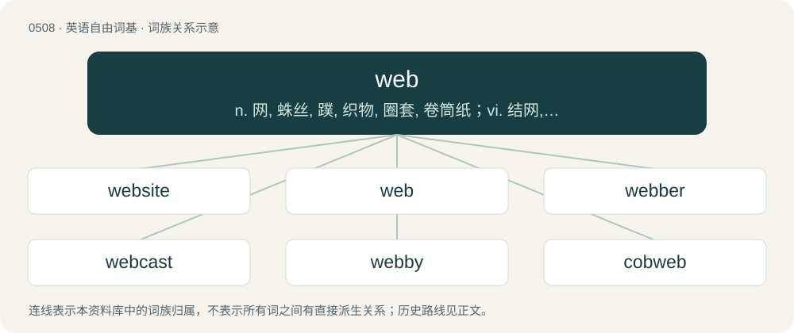

# 0572 · web — n. 网, 蛛丝, 蹼, 织物, 圈套, 卷筒纸；vi. 结网, 形成网；vt. 织蜘蛛网于, 使落入圈套

[总目录](../00_总目录_按常用程度.md)

**类型**：英语自由词基　｜　**来源语言**：见词源记录

## 核心含义与来源

- 核心含义：n. 网, 蛛丝, 蹼, 织物, 圈套, 卷筒纸；vi. 结网, 形成网；vt. 织蜘蛛网于, 使落入圈套
- 英文含义：The silken structure which a spider builds using silk secreted from the spinnerets at the caudal tip of its abdomen; a spiderweb.
- 词形：web

**来源记录 1**（名词；The silken structure which a spider builds using silk secreted from the spinnerets at the caudal tip of its abdomen; a spiderweb.）

From Middle English web, webbe, from Old English webb, from Proto-West Germanic \*wabi, from Proto-Germanic \*wabją (“web”), from Proto-Germanic \*webaną (“to weave”), from Proto-Indo-European \*webʰ- (“to braid, weave”). Cognates Cognate with Scots wab (“web”), North Frisian wääb (“web”), Saterland Frisian Wäb (“web”), West Frisian and Dutch web (“web”), Danish væv (“web”), Faroese vevur (“web”), Icelandic vefur (“web”), Norwegian Bokmål and Norwegian Nynorsk vev (“web”), Swedish väv (“web”); also Cornish goghi (“wasps”), Irish foich, foiche, puch (“wasp”), Welsh gwchi (“drone”), Latin vespa (“wasp”), Ancient Greek ὑφή (huphḗ, “web”), ὑφαίνω (huphaínō, “to weave”) (whence Greek ανυφαίνω (anyfaíno), υφαίνω (yfaíno, “to weave”)), Albanian vej (“to weave”), Latvian lapsene (“wasp”), Lithuanian vapsvà (“wasp”), Old Prussian wobse (“wasp”), Belarusian аса́ (asá, “wasp”), Bulgarian, Macedonian, Russian, and Ukrainian оса́ (osá, “wasp”), Czech vosa (“wasp”), Polish, Slovak, and Slovene osa (“wasp”), Serbo-Croatian о̀са, òsa (“wasp”), Armenian մոզ (moz, “a kind of fly that bites horses and cattle”), Northern Kurdish moz (“hornet; wasp”), Persian بافتن (bâftan, “to weave”), Tocharian A wäp- (“to weave”), Tocharian B wāp- (“to weave”), Sanskrit उभ्नाति (ubhnāti, “to hurt, kill; to cover; fill”).

## 词族图

## 单词速览（常用到不常用）

| 单词 | 音标 | 释义 |
|---|---|---|
| [website](#w-1) | /ˈwɛb(ˌ)saɪt/ | n. 网站（全球资讯网的主机站） |
| [web](#w-2) | /wɛb/ | n. 网, 蛛丝, 蹼, 织物, 圈套, 卷筒纸；vi. 结网, 形成网；vt. 织蜘蛛网于, 使落入圈套 |
| [webber](#w-3) |  | 【英文】An animal that creates webs, such as a spider. |
| [webcast](#w-4) |  | n. 网路广播；网络广播；网络直播 |
| [webby](#w-5) | /ˈwebi/ | a. 丝网的 |
| [cobweb](#w-6) | /ˈkɒbwɛb/ | n. 蜘蛛网, 蛛丝, 混乱；vt. 使布满蛛网 |
| [spiderweb](#w-7) | 英 /ˈspaɪ̯dəwɛb/；美 /ˈspaɪ̯dɚwɛb/ | n. 蜘蛛网 |
| [webstore](#w-8) |  | 【英文】A sales outlet which supplies goods or services over the World Wide Web. |

## 逐词详解

### 1. website

**词性**：名词　｜　**音标**：/ˈwɛb(ˌ)saɪt/

**中文释义**：n. 网站（全球资讯网的主机站）

**英文义项**：A collection of interlinked web pages on the World Wide Web that are typically accessible from the same base URL and reside on the same server.

**构词拆分**：web + site

**词源与演化**：

From web + site.

**例句**：

> You can find complete information about the products on the company's website.

该用例对应义项：A collection of interlinked web pages on the World Wide Web that are typically accessible from the same base URL and reside on the same server.

### 2. web

**词性**：名词　｜　**音标**：/wɛb/

**中文释义**：n. 网, 蛛丝, 蹼, 织物, 圈套, 卷筒纸；vi. 结网, 形成网；vt. 织蜘蛛网于, 使落入圈套

**英文义项**：The silken structure which a spider builds using silk secreted from the spinnerets at the caudal tip of its abdomen; a spiderweb. / Any of several similar materials, such as that created by tent caterpillars.

**词源与演化**：

From Middle English web, webbe, from Old English webb, from Proto-West Germanic \*wabi, from Proto-Germanic \*wabją (“web”), from Proto-Germanic \*webaną (“to weave”), from Proto-Indo-European \*webʰ- (“to braid, weave”). Cognates Cognate with Scots wab (“web”), North Frisian wääb (“web”), Saterland Frisian Wäb (“web”), West Frisian and Dutch web (“web”), Danish væv (“web”), Faroese vevur (“web”), Icelandic vefur (“web”), Norwegian Bokmål and Norwegian Nynorsk vev (“web”), Swedish väv (“web”); also Cornish goghi (“wasps”), Irish foich, foiche, puch (“wasp”), Welsh gwchi (“drone”), Latin vespa (“wasp”), Ancient Greek ὑφή (huphḗ, “web”), ὑφαίνω (huphaínō, “to weave”) (whence Greek ανυφαίνω (anyfaíno), υφαίνω (yfaíno, “to weave”)), Albanian vej (“to weave”), Latvian lapsene (“wasp”), Lithuanian vapsvà (“wasp”), Old Prussian wobse (“wasp”), Belarusian аса́ (asá, “wasp”), Bulgarian, Macedonian, Russian, and Ukrainian оса́ (osá, “wasp”), Czech vosa (“wasp”), Polish, Slovak, and Slovene osa (“wasp”), Serbo-Croatian о̀са, òsa (“wasp”), Armenian մոզ (moz, “a kind of fly that bites horses and cattle”), Northern Kurdish moz (“hornet; wasp”), Persian بافتن (bâftan, “to weave”), Tocharian A wäp- (“to weave”), Tocharian B wāp- (“to weave”), Sanskrit उभ्नाति (ubhnāti, “to hurt, kill; to cover; fill”).

**例句**：

> Careful—she knows how to spin a good web, but don't lean too hard on what she says.

该用例对应义项：A tall tale with more complexity than a myth or legend.

### 3. webber

**词性**：名词

**英文义项**：An animal that creates webs, such as a spider. / A person who weaves webs, especially one who manufactures webbing.

**构词拆分**：web + -er

**词源与演化**：

From Middle English webbere, webber; equivalent to web + -er.

### 4. webcast

**词性**：名词

**中文释义**：n. 网路广播；网络广播；网络直播

**英文义项**：A video and/or audio broadcast transmitted via the Internet

**构词拆分**：web + -cast

**词源与演化**：

From web + -cast, from broadcast.

**例句**：

> It’s not on television. It’s a webcast.

### 5. webby

**词性**：形容词　｜　**音标**：/ˈwebi/

**中文释义**：a. 丝网的

**英文义项**：Consisting of, resembling, or having webs or a web. / Characteristic of the World Wide Web.

**构词拆分**：web + -y

**词源与演化**：

From web + -y.

### 6. cobweb

**词性**：名词　｜　**音标**：/ˈkɒbwɛb/

**中文释义**：n. 蜘蛛网, 蛛丝, 混乱；vt. 使布满蛛网

**英文义项**：A spiderweb, especially a large one, an old abandoned one covered with debris and dust or an asymmetrical one woven with an irregular pattern of threads. / One of a spiderweb's filaments; gossamer; anything flimsy and gauzy, intricately interconnected or otherwise like a cobweb.

**构词拆分**：By surface analysis, cob (“spider”, obsolete) + web

**词源与演化**：

From Middle English copweb, coppeweb, coppewebbe, from Old English ātorcoppe (“spider”) + Old English webb. Compare Middle Dutch kopwebbe, German Low German Kobbenwebbe (Westphalian). By surface analysis, cob (“spider”, obsolete) + web.

**例句**：

> I was confused by the cobwebs of contract law.

该用例对应义项：An intricate plot to catch the unwary; something entangling or confusing.

### 7. spiderweb

**词性**：名词　｜　**音标**：英 /ˈspaɪ̯dəwɛb/；美 /ˈspaɪ̯dɚwɛb/

**中文释义**：n. 蜘蛛网

**英文义项**：The net-like construct of a spider containing sticky strands to catch prey. / Something that resembles a spider's web in being mesh-like, entrapping, or fragile.

**构词拆分**：spider + web

**词源与演化**：

From Middle English spiþere webb, equivalent to spider + web.

**例句**：

> In the dark, Rodolfo jumped when his hand brushed against a spiderweb.

### 8. webstore

**词性**：名词

**英文义项**：A sales outlet which supplies goods or services over the World Wide Web.

**构词拆分**：web + store

**词源与演化**：

From web + store.
