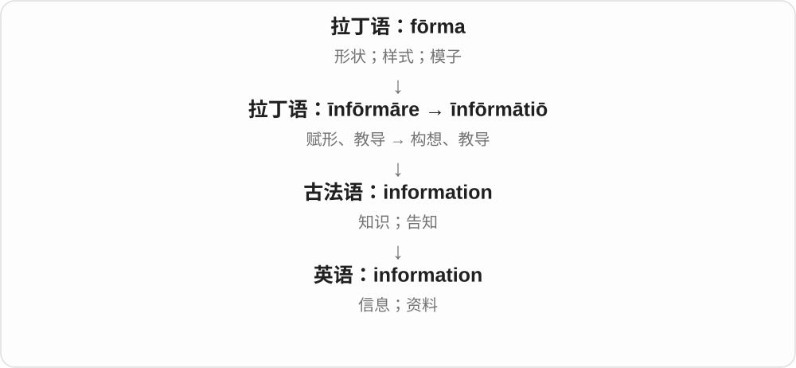
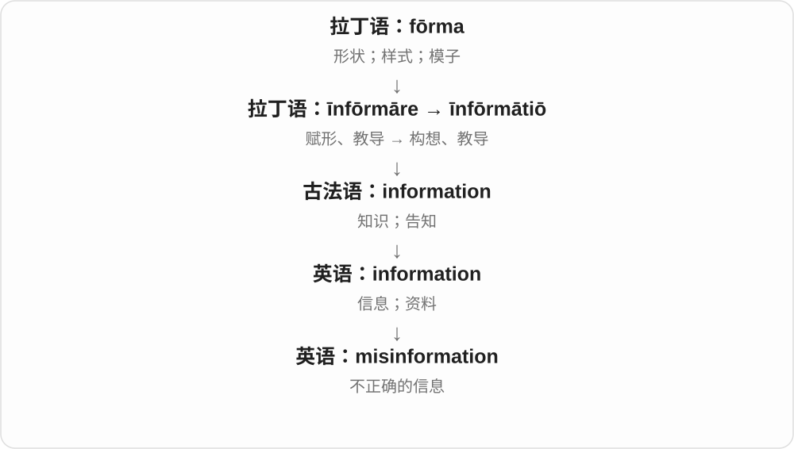
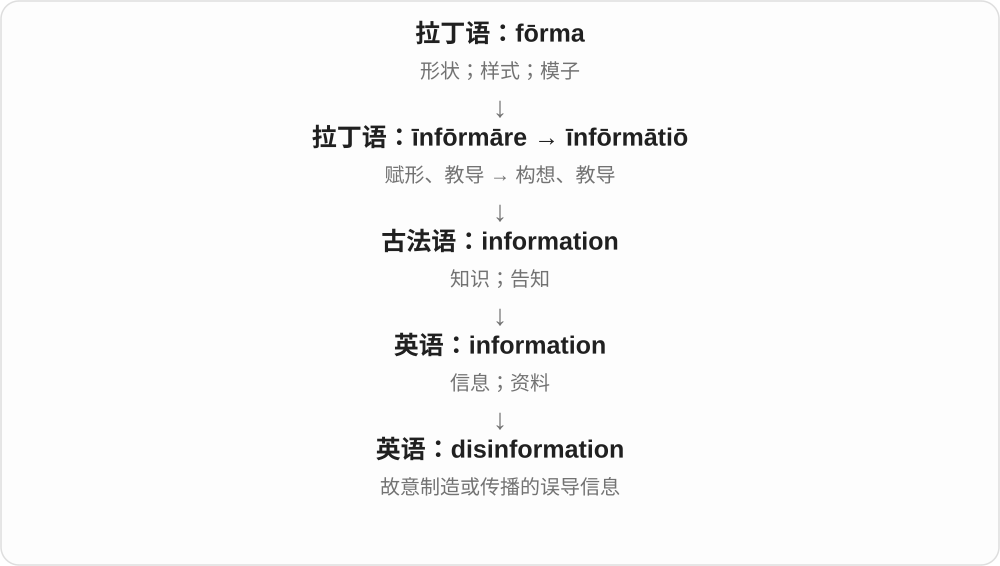

# 0574 · information — 信息；与信息相关的用途和研究

[逐词精讲目录](../00_逐词精讲目录.md) · [总目录](../00_总目录_按常用程度.md)

## 核心词根与来源

information 来自经拉丁语、法语发展的说明、教导词族；其现代技术学科名称形成得很晚，不能把计算机义塞进古拉丁语。

**INFORMATION：让人知道情况，再看信息怎样处理**

基础词是信息本身；informational 说明提供信息的用途，informatics 则是研究信息处理的领域。

- **信息、信息用途与信息学**：information · informational · informatics
- **错误信息与蓄意误导**：misinformation · disinformation

## 词形与演化规律

information → informational、informatics；misinformation、disinformation 放在信息出错与蓄意误导一组对照。

## 单词速览（按词族由简到繁）

同一基础词的相关扩展放在一起，先读基础形式，再读扩展；各组之间优先读常用的。具体词源关系见各词讲解。

| 单词 | 音标 | 核心意思 |
|---|---|---|
| [information](#w-1) | 英 /ˌɪnfəˈmeɪʃən/；美 /ˌɪnfərˈmeɪʃən/ | 信息；资料；消息 |
| [informational](#w-3) | 英 /ˌɪnfəˈmeɪʃənəl/；美 /ˌɪnfərˈmeɪʃənəl/ | 提供信息的；与信息有关的 |
| [informatics](#w-4) | 英 /ˌɪnfəˈmætɪks/；美 /ˌɪnfərˈmætɪks/ | 信息学；信息处理及其应用研究 |
| [misinformation](#w-2) | 英 /ˌmɪsɪnfəˈmeɪʃən/；美 /ˌmɪsɪnfərˈmeɪʃən/ | 错误信息 |
| [disinformation](#w-5) | 英 /ˌdɪsɪnfəˈmeɪʃən/；美 /ˌdɪsɪnfərˈmeɪʃən/ | 为误导而传播的虚假信息 |

## 逐词讲解

### 1. information — 信息；资料；消息

**音标**：英 /ˌɪnfəˈmeɪʃən/；美 /ˌɪnfərˈmeɪʃən/

**先抓住这个画面**

你原先不知道几点、在哪里、怎么做，补上这些空白的内容就是 information。

**怎么拆**

来自法语 information、拉丁语 īnfōrmātiō；与 inform 同族，但英语 information 不是必须由英语 inform 后来造出。

**怎么变成今天的意思**

历史上的教导、构想变成让人知道情况的内容。现代通常是不可数名词：一条信息说 a piece of information。

**常见搭配与例句**

provide information；useful information；information about…。

> The website provides information about train services.

这个网站提供列车服务的信息。

> We need more information before deciding.

我们需要更多信息才能作决定。

**别混淆**

data 是记录的数据；information 强调能告诉我们情况的内容。普通英语不说 an information。

### 2. informational — 提供信息的；与信息有关的

**音标**：英 /ˌɪnfəˈmeɪʃənəl/；美 /ˌɪnfərˈmeɪʃənəl/

**先抓住这个画面**

目的主要是把情况说明白，让人知道怎么回事。

**怎么拆**

information + -al，形成与信息相关的形容词；不是把 information 误看成动词后再加时态。

**怎么变成今天的意思**

**拉丁语 informāre → informātiō 等词族形式**  
赋予形态；教导、告知；说明

↓

**经法语、英语历史发展 → information**  
信息、消息；现代又产生相关技术、学科名称

↓

**information + -al → informational**  
信息 → 提供信息、与信息有关的

an informational leaflet 信息说明传单；an informational meeting 介绍情况的会议；for informational purposes 供了解情况之用。

**常见搭配与例句**

informational materials；an informational video；for informational purposes。

> The library prepared an informational leaflet for new members.

图书馆为新会员准备了一份信息介绍传单。

> The school held an informational meeting about the exchange programme.

学校举行了一次交流项目情况说明会。

**别混淆**

informational 常说明用途、类别；informative 常评价内容让人得到知识、很有信息量。两者有重叠，不是绝对互斥。

### 3. informatics — 信息学；信息处理及其应用研究

**音标**：英 /ˌɪnfəˈmætɪks/；美 /ˌɪnfərˈmætɪks/

**先抓住这个画面**

研究信息怎样被获取、组织、处理、传递，以及这些过程怎样服务人和系统。

**怎么拆**

20世纪形成的学科名称，构词与 information 的词干、学科后缀 -ics 有关，也有德语 Informatik、法语 informatique 等命名背景。不是说一堆信息的复数。

**怎么变成今天的意思**

**拉丁语 informāre → informātiō 等词族形式**  
赋予形态；教导、告知；说明

↓

**经法语、英语历史发展 → information**  
信息、消息；现代又产生相关技术、学科名称

↓

**information 相关词干 + -ics → informatics**  
信息 → 研究信息处理及其应用的学科名称

health informatics 健康、医疗信息学；bioinformatics 生物信息学。学校、行业对 informatics 的具体边界可能不同，不能处处直接等同某一门编程课。

**常见搭配与例句**

study informatics；health informatics；a school of informatics。

> She studies informatics and is interested in how people use data.

她学习信息学，对人们如何使用数据很感兴趣。

> The university offers a course in health informatics.

大学开设了一门健康信息学课程。

**别混淆**

information 是信息，informatics 是研究领域；词尾 s 属于 -ics 学科名，通常说 Informatics is...，不是一定要用 are。

### 4. misinformation — 错误信息

**音标**：英 /ˌmɪsɪnfəˈmeɪʃən/；美 /ˌmɪsɪnfərˈmeɪʃən/

**先抓住这个画面**

消息在传播，可里面的内容不对；转发的人甚至可能以为自己在帮忙。

**怎么拆**

mis- + information，错误的信息。

**怎么变成今天的意思**

通常先说信息是否可靠，不要求传播者有欺骗意图。过时的路线、错记的日期都可能成为 misinformation。

**常见搭配与例句**

spread misinformation；correct misinformation；misinformation about…。

> The website corrected the misinformation about ticket prices.

网站纠正了关于票价的错误信息。

> An old screenshot can spread misinformation if its date is missing.

旧截图如果没了日期，可能传播错误信息。

**别混淆**

disinformation 通常突出故意欺骗；misinformation 本身不一定故意。

### 5. disinformation — 为误导而传播的虚假信息

**音标**：英 /ˌdɪsɪnfəˈmeɪʃən/；美 /ˌdɪsɪnfərˈmeɪʃən/

**先抓住这个画面**

明知内容不真实，还设计、散布它，让别人形成错误认识。

**怎么拆**

dis- + information；现代主要义强调有意误导，不能只按 dis- 机械理解成“没有信息”。

**怎么变成今天的意思**

常涉及有组织的虚假消息，但一个人也可能故意散布。判断时既要看内容，也要看有无误导意图。

**常见搭配与例句**

a disinformation campaign；spread disinformation；counter disinformation。

> The report exposed a campaign of deliberate disinformation.

报告揭露了一场蓄意散布虚假信息的行动。

> They fabricated documents as part of the disinformation effort.

他们伪造文件，作为误导行动的一部分。

**别混淆**

信息有错，不足以单独证明是 disinformation；无意误传通常用 misinformation。

## 这一组要分清什么

informational 常说用途，informative 常说内容有启发；informatics 学科名不是 information 的复数。

## 串起来练习

The informational video explains what students can study in informatics.

这段介绍视频说明了学生在信息学领域可以学习哪些内容。
