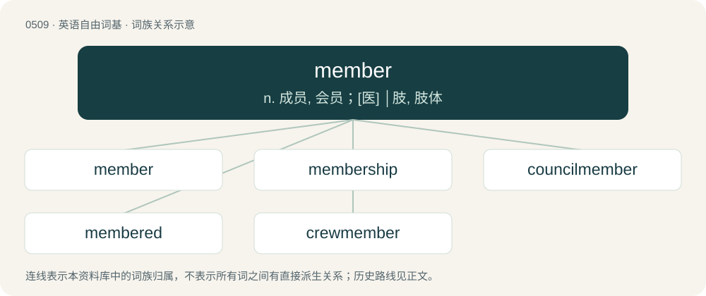

# 0574 · member — n. 成员, 会员；\[医\] │肢, 肢体

[总目录](../00_总目录_按常用程度.md)

**类型**：英语自由词基　｜　**来源语言**：见词源记录

## 核心含义与来源

- 核心含义：n. 成员, 会员；\[医\] │肢, 肢体
- 英文含义：One who belongs to a group.
- 词形：member

**来源记录 1**（名词；One who belongs to a group.）

From Middle English membre, from Old French membre, from Latin membrum (“limb, body part”), from Proto-Italic \*memzrom, from Proto-Indo-European \*mḗms, \*mēms-rom (“flesh”). Akin to Gothic 𐌼𐌹𐌼𐌶 (mimz, “meat, flesh”), Crimean Gothic menus. Coexists with native limb, from Old English lim (“limb, joint, main branch”). Mostly displaced lith (“limb, joint, member”), from Old English liþ (“limb, member, join, tip”), which still survives in British dialect.

## 词族图

## 单词速览（常用到不常用）

| 单词 | 音标 | 释义 |
|---|---|---|
| [member](#w-1) | 英 /ˈmɛm.bə/；美 /ˈmɛm.bɚ/ | n. 成员, 会员；\[医\] │肢, 肢体 |
| [membership](#w-2) | /ˈmembəʃip/ | n. 会员的资格, 全体会员, 会员数目；\[法\] 会员资格, 成员资格, 会籍 |
| [councilmember](#w-3) | /ˈkaunsəl,membə/ | n. 委员，议员 |
| [membered](#w-4) | /ˈmembəd/ | a. 分成几部分的；由几个部分组成的；有手脚的 |
| [crewmember](#w-5) | 英 /ˈkɹuːmɛmbə/；美 /ˈkɹuːmɛmbɚ/ | n. 组员；船员水手；工作班人员 |

## 逐词详解

### 1. member

**词性**：名词　｜　**音标**：英 /ˈmɛm.bə/；美 /ˈmɛm.bɚ/

**中文释义**：n. 成员, 会员；\[医\] │肢, 肢体

**英文义项**：One who belongs to a group. / A part of a whole.

**词源与演化**：

From Middle English membre, from Old French membre, from Latin membrum (“limb, body part”), from Proto-Italic \*memzrom, from Proto-Indo-European \*mḗms, \*mēms-rom (“flesh”). Akin to Gothic 𐌼𐌹𐌼𐌶 (mimz, “meat, flesh”), Crimean Gothic menus. Coexists with native limb, from Old English lim (“limb, joint, main branch”). Mostly displaced lith (“limb, joint, member”), from Old English liþ (“limb, member, join, tip”), which still survives in British dialect.

**例句**：

> The zip file holding the source code of this application has 245 members.

该用例对应义项：A file stored within an archive file.

### 2. membership

**词性**：名词　｜　**音标**：/ˈmembəʃip/

**中文释义**：n. 会员的资格, 全体会员, 会员数目；\[法\] 会员资格, 成员资格, 会籍

**英文义项**：The state of being a member of a group or organization. / The body of members of an organization.

**构词拆分**：member + -ship

**词源与演化**：

From member + -ship.

**例句**：

> The memberships of the state chapters elect delegates to the national convention.

该用例对应义项：The body of members of an organization.

### 3. councilmember

**词性**：名词　｜　**音标**：/ˈkaunsəl,membə/

**中文释义**：n. 委员，议员

**英文义项**：A councilman or councilwoman; a member of a council, often a city council or town council.

**构词拆分**：council + member

**词源与演化**：

From council + member.

### 4. membered

**词性**：形容词　｜　**音标**：/ˈmembəd/

**中文释义**：a. 分成几部分的；由几个部分组成的；有手脚的

**英文义项**：Having a specified number of members. / Having limbs.

**构词拆分**：From member + -ed.

**词源与演化**：

From member + -ed.

### 5. crewmember

**词性**：名词　｜　**音标**：英 /ˈkɹuːmɛmbə/；美 /ˈkɹuːmɛmbɚ/

**中文释义**：n. 组员；船员水手；工作班人员

**英文义项**：A member of a crew.

**构词拆分**：crew + member

**词源与演化**：

From crew + member.

**例句**：

> The crewmembers held an emergency meeting in their cabin.

该用例对应义项：A member of a crew.
