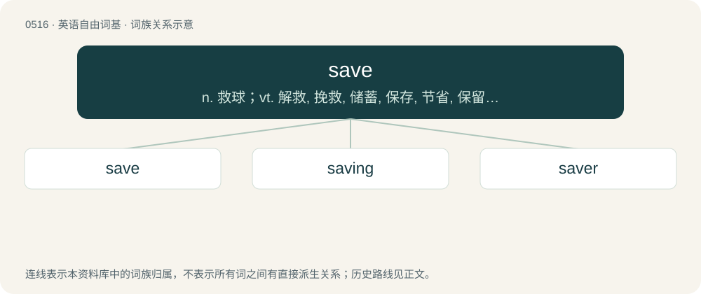

# 0576 · save — n. 救球；vt. 解救, 挽救, 储蓄, 保存, 节省, 保留；vi. 挽救, 节省, 救球

[总目录](../00_总目录_按常用程度.md)

**类型**：英语自由词基　｜　**来源语言**：见词源记录

## 核心含义与来源

- 核心含义：n. 救球；vt. 解救, 挽救, 储蓄, 保存, 节省, 保留；vi. 挽救, 节省, 救球
- 英文含义：To help (somebody) to survive, or rescue (somebody or something) from harm.
- 词形：save

**来源记录 1**（动词；To help (somebody) to survive, or rescue (somebody or something) from harm.）

From Middle English saven, sauven, a borrowing from Old French sauver, from Late Latin salvāre (“to save”). Displaced native Old English nerian.

## 词族图

## 单词速览（常用到不常用）

| 单词 | 音标 | 释义 |
|---|---|---|
| [save](#w-1) | 英 /seɪv/ | n. 救球；vt. 解救, 挽救, 储蓄, 保存, 节省, 保留；vi. 挽救, 节省, 救球 |
| [saving](#w-2) | 英 /ˈseɪ.vɪŋ/ | n. 存款, 挽救, 节约；a. 搭救的, 节约的, 保留的, 补偿的；prep. 除...之外 |
| [saver](#w-3) | 英 /ˈseɪvə/；美 /ˈseɪvəɹ/ | n. 节省...的器具, 节约装置, 省俭的人；\[化\] 回收器; 收集器 |

## 逐词详解

### 1. save

**词性**：动词　｜　**音标**：英 /seɪv/

**中文释义**：n. 救球；vt. 解救, 挽救, 储蓄, 保存, 节省, 保留；vi. 挽救, 节省, 救球

**英文义项**：To help (somebody) to survive, or rescue (somebody or something) from harm. / To keep (something) safe; to safeguard.

**词源与演化**：

From Middle English saven, sauven, a borrowing from Old French sauver, from Late Latin salvāre (“to save”). Displaced native Old English nerian.

**例句**：

> Save electricity by turning off the lights when you leave the room.

该用例对应义项：To conserve or prevent the wasting of.

### 2. saving

**词性**：名词　｜　**音标**：英 /ˈseɪ.vɪŋ/

**中文释义**：n. 存款, 挽救, 节约；a. 搭救的, 节约的, 保留的, 补偿的；prep. 除...之外

**英文义项**：A reduction in cost or expenditure. / Something (usually money) that is saved, particularly money that has been set aside for the future.

**构词拆分**：save + -ing

**词源与演化**：

From save + -ing.

**例句**：

> The collapse of Enron wiped out the life savings of many people, leaving them poor in their retirement.

该用例对应义项：Something (usually money) that is saved, particularly money that has been set aside for the future.

### 3. saver

**词性**：名词　｜　**音标**：英 /ˈseɪvə/；美 /ˈseɪvəɹ/

**中文释义**：n. 节省...的器具, 节约装置, 省俭的人；\[化\] 回收器; 收集器

**英文义项**：One who saves. / One who keeps savings more than usual.

**构词拆分**：save + -er

**词源与演化**：

From save + -er.

**例句**：

> He’s a saver and she’s a spender; you’d think the marriage would be doomed, but he keeps them from going into bankruptcy and she makes sure they have a lot of fun.

该用例对应义项：One who keeps savings more than usual.
