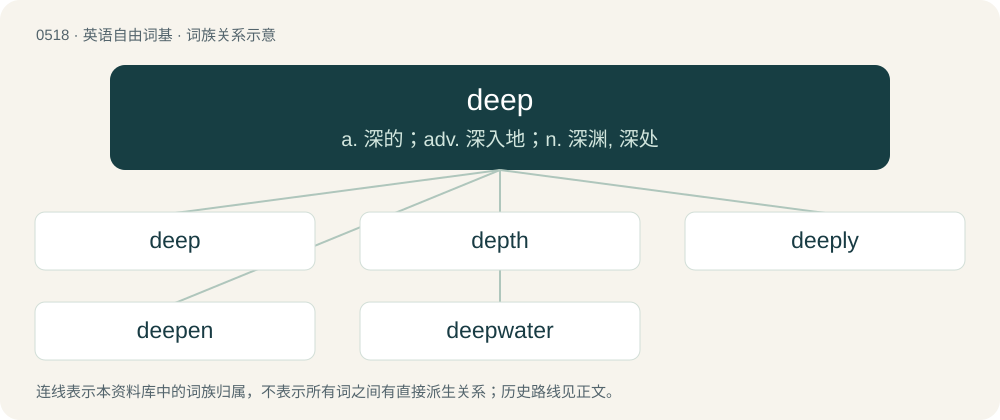

# 0579 · deep — a. 深的；adv. 深入地；n. 深渊, 深处

[总目录](../00_总目录_按常用程度.md)

**类型**：英语自由词基　｜　**来源语言**：见词源记录

## 核心含义与来源

- 核心含义：a. 深的；adv. 深入地；n. 深渊, 深处
- 英文含义：Extending far down from the top, or surface, to the bottom, literally or figuratively.
- 词形：deep

**来源记录 1**（形容词；Extending far down from the top, or surface, to the bottom, literally or figuratively.）

From Middle English dep, deep, depe, from Old English dēop (“deep, profound; awful, mysterious; heinous; serious, solemn, earnest; extreme, great”), from Proto-West Germanic \*deup, from Proto-Germanic \*deupaz (“deep”), from Proto-Indo-European \*dʰewbʰ- (“deep”). Cognates Cognate with Scots depe (“deep”), North Frisian diip, jip (“deep”), Saterland Frisian djoop (“deep”), West Frisian djip (“deep”), Dutch diep (“deep”), Low German deep (“deep”), Luxembourgish déif (“deep”), Central Franconian deep, deef (“deep”), German tief (“deep”), Alemannic German tüüf (“deep”), Mòcheno tiaf (“deep”), Vilamovian tif, tīf, tiif (“deep”), Yiddish טיף (tif, “deep”), Danish dyb (“deep”), Norwegian Nynorsk and Swedish djup (“deep”), Scanian djyber (“deep”), Norwegian Bokmål djup, dyp (“deep”), Faroese and Icelandic djúpur (“deep”), Gothic 𐌳𐌹𐌿𐍀𐍃 (diups, “deep”), Lithuanian dubùs (“deep, hollow”), Albanian det (“sea”), Welsh dwfn (“deep”).

## 词族图

## 单词速览（常用到不常用）

| 单词 | 音标 | 释义 |
|---|---|---|
| [deep](#w-1) | /diːp/ | a. 深的；adv. 深入地；n. 深渊, 深处 |
| [depth](#w-2) | /dɛpθ/ | n. 深度, 深处, 深奥；\[计\] 深度 |
| [deeply](#w-3) | /ˈdi(ː)pli/ | adv. 深刻地, 在深处, 深沉地 |
| [deepen](#w-4) | /ˈdiːpən/ | vi. 深化；vt. 使加深, 使强烈 |
| [deepwater](#w-5) | /ˈdiːp,wɔːtə(r)/ | a. 深海的,海洋上的,靠近海洋的 |

## 逐词详解

### 1. deep

**词性**：形容词　｜　**音标**：/diːp/

**中文释义**：a. 深的；adv. 深入地；n. 深渊, 深处

**英文义项**：Extending far down from the top, or surface, to the bottom, literally or figuratively. / Positioned far from the surface or other reference point, especially down through something or into something.

**词源与演化**：

From Middle English dep, deep, depe, from Old English dēop (“deep, profound; awful, mysterious; heinous; serious, solemn, earnest; extreme, great”), from Proto-West Germanic \*deup, from Proto-Germanic \*deupaz (“deep”), from Proto-Indo-European \*dʰewbʰ- (“deep”). Cognates Cognate with Scots depe (“deep”), North Frisian diip, jip (“deep”), Saterland Frisian djoop (“deep”), West Frisian djip (“deep”), Dutch diep (“deep”), Low German deep (“deep”), Luxembourgish déif (“deep”), Central Franconian deep, deef (“deep”), German tief (“deep”), Alemannic German tüüf (“deep”), Mòcheno tiaf (“deep”), Vilamovian tif, tīf, tiif (“deep”), Yiddish טיף (tif, “deep”), Danish dyb (“deep”), Norwegian Nynorsk and Swedish djup (“deep”), Scanian djyber (“deep”), Norwegian Bokmål djup, dyp (“deep”), Faroese and Icelandic djúpur (“deep”), Gothic 𐌳𐌹𐌿𐍀𐍃 (diups, “deep”), Lithuanian dubùs (“deep, hollow”), Albanian det (“sea”), Welsh dwfn (“deep”).

**例句**：

> There was a deep layer of dust on the floor; the room had not been disturbed for many years.

该用例对应义项：Extending far down from the top, or surface, to the bottom, literally or figuratively.

### 2. depth

**词性**：名词　｜　**音标**：/dɛpθ/

**中文释义**：n. 深度, 深处, 深奥；\[计\] 深度

**英文义项**：the vertical distance below a surface; the degree to which something is deep / the distance between the front and the back, as the depth of a drawer or closet

**构词拆分**：deep + -th (abstract nominal suffix)

**词源与演化**：

From Middle English depthe, from Old English \*dīepþ (“depth”), from Proto-Germanic \*diupiþō (“depth”), equivalent to deep + -th (abstract nominal suffix). Cognates Cognate with Scots deepth, Saterland Frisian Djüpte, West Frisian djipte (“depth; abyss, chasm”), Dutch diepte, German Low German Deepd, Luxembourgish Déift, Danish, Norwegian Bokmål dybde (“depth”), Faroese dýpd (“depth”), Icelandic dýpt, Norwegian Nynorsk djupt, dypt, and Gothic 𐌳𐌹𐌿𐍀𐌹𐌸𐌰 (diupiþa, “depth”); further to Old English diepe, German Tiefe, Icelandic dýpi, Norwegian Nynorsk djup, djupn, Swedish djup.

**例句**：

> Measure the depth of the water in this part of the bay.

该用例对应义项：the vertical distance below a surface; the degree to which something is deep

### 3. deeply

**词性**：副词　｜　**音标**：/ˈdi(ː)pli/

**中文释义**：adv. 深刻地, 在深处, 深沉地

**英文义项**：To a deep extent or degree; very greatly. / So as to extend far down or far into something.

**构词拆分**：deep + -ly

**词源与演化**：

From Middle English deply, depely, from Old English dēoplīċe (“deeply”, adverb), from dēoplīc (“deep”), equivalent to deep + -ly.

**例句**：

> The surface of the planet was deeply cratered.

该用例对应义项：So as to extend far down or far into something.

### 4. deepen

**词性**：动词　｜　**音标**：/ˈdiːpən/

**中文释义**：vi. 深化；vt. 使加深, 使强烈

**英文义项**：To make deep or deeper / To make darker or more intense; to darken

**构词拆分**：deep + -en

**词源与演化**：

From deep + -en.

**例句**：

> The water deepens as you go toward the middle of the channel.

该用例对应义项：To become deeper

### 5. deepwater

**词性**：名词　｜　**音标**：/ˈdiːp,wɔːtə(r)/

**中文释义**：a. 深海的,海洋上的,靠近海洋的

**英文义项**：Brine collected in a seafloor depression (brine pool).

**构词拆分**：deep + water

**词源与演化**：

From deep + water.
