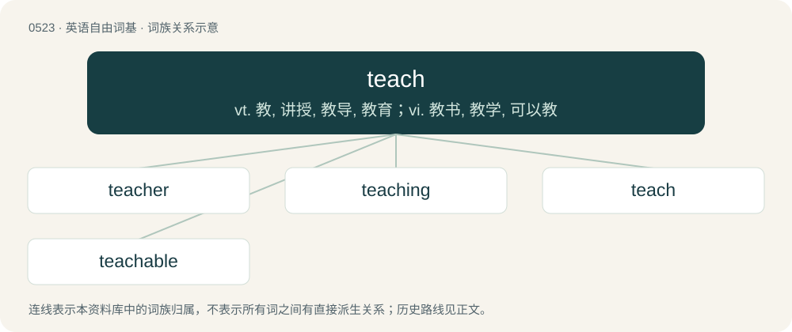

# 0586 · teach — vt. 教, 讲授, 教导, 教育；vi. 教书, 教学, 可以教

[总目录](../00_总目录_按常用程度.md)

**类型**：英语自由词基　｜　**来源语言**：见词源记录

## 核心含义与来源

- 核心含义：vt. 教, 讲授, 教导, 教育；vi. 教书, 教学, 可以教
- 英文含义：To pass on knowledge to.
- 词形：teach

**多个词源／构词路径**：同一拼写可能有不同来源；以下按词性和含义分别列出。

**来源记录 1**（动词；To pass on knowledge to.）

From Middle English techen, from Old English tǣċan (“to show, declare, demonstrate; teach, instruct, train; assign, prescribe, direct; warn; persuade”), from Proto-West Germanic \*taikijan, from Proto-Germanic \*taikijaną (“to show”), from Proto-Indo-European \*deyḱ- (“to show”). Cognate with Scots tech, teich (“to teach”), German zeigen (“to show, point out”), zeihen (“accuse, blame”), Gothic 𐌲𐌰𐍄𐌴𐌹𐌷𐌰𐌽 (gateihan, “to announce, declare, tell, show, display”), Latin dīcō (“speak, say, tell”), Ancient Greek δείκνυμι (deíknumi, “show, point out, explain, teach”), Sanskrit दिशति (diśati, “to point out, show, tell, teach”). More at token.

**来源记录 2**（名词；teacher）

Clipping of teacher.

## 词族图

## 单词速览（常用到不常用）

| 单词 | 音标 | 释义 |
|---|---|---|
| [teacher](#w-1) | 英 /ˈtiː.t͡ʃəː/；美 /ˈti.t͡ʃɚ/ | n. 教师, 老师, 导师 |
| [teaching](#w-2) | /ˈtiːt͡ʃɪŋ/ | n. 教学, 学说, 教导 |
| [teach](#w-3) | /ˈtiːt͡ʃ/ | vt. 教, 讲授, 教导, 教育；vi. 教书, 教学, 可以教 |
| [teachable](#w-4) | /ˈtiːt͡ʃəbəl/ | a. 可教的, 听教训的 |

## 逐词详解

### 1. teacher

**词性**：名词　｜　**音标**：英 /ˈtiː.t͡ʃəː/；美 /ˈti.t͡ʃɚ/

**中文释义**：n. 教师, 老师, 导师

**英文义项**：A person who teaches, especially one employed in a school; preceptor. / The index finger; the forefinger.

**构词拆分**：teach + -er

**词源与演化**：

From Middle English techere, equivalent to teach + -er. More at teach.

**例句**：

> Experience is a demanding teacher.

该用例对应义项：a personified abstraction that teaches

### 2. teaching

**词性**：名词　｜　**音标**：/ˈtiːt͡ʃɪŋ/

**中文释义**：n. 教学, 学说, 教导

**英文义项**：Something taught by a religious or philosophical authority. / The profession of educating people; the activity that a teacher does when he/she teaches.

**构词拆分**：teach + -ing

**词源与演化**：

From Middle English teching, techinge, from Old English tǣċing, tǣċung (“instruction, direction, teaching”), equivalent to teach + -ing.

**例句**：

> Teaching has seen continual changes over the past decades.

该用例对应义项：The profession of educating people; the activity that a teacher does when he/she teaches.

### 3. teach

**词性**：动词　｜　**音标**：/ˈtiːt͡ʃ/

**中文释义**：vt. 教, 讲授, 教导, 教育；vi. 教书, 教学, 可以教

**英文义项**：To pass on knowledge to. / To pass on knowledge generally, especially as one's profession; to act as a teacher.

**词源与演化**：

From Middle English techen, from Old English tǣċan (“to show, declare, demonstrate; teach, instruct, train; assign, prescribe, direct; warn; persuade”), from Proto-West Germanic \*taikijan, from Proto-Germanic \*taikijaną (“to show”), from Proto-Indo-European \*deyḱ- (“to show”). Cognate with Scots tech, teich (“to teach”), German zeigen (“to show, point out”), zeihen (“accuse, blame”), Gothic 𐌲𐌰𐍄𐌴𐌹𐌷𐌰𐌽 (gateihan, “to announce, declare, tell, show, display”), Latin dīcō (“speak, say, tell”), Ancient Greek δείκνυμι (deíknumi, “show, point out, explain, teach”), Sanskrit दिशति (diśati, “to point out, show, tell, teach”). More at token.

**例句**：

> Can you teach me to sew? Can you teach sewing to me?

该用例对应义项：To pass on knowledge to.

### 4. teachable

**词性**：形容词　｜　**音标**：/ˈtiːt͡ʃəbəl/

**中文释义**：a. 可教的, 听教训的

**英文义项**：Capable of being taught; apt to learn. / Willing to receive instruction or to learn; docile.

**构词拆分**：teach + -able

**词源与演化**：

From Middle English techeable, techeabyll, techeabylle, equivalent to teach + -able.

**例句**：

> Common sense is not a teachable subject.

该用例对应义项：That can be taught.
