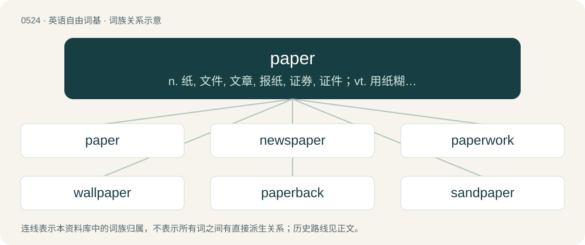

# 0588 · paper — n. 纸, 文件, 文章, 报纸, 证券, 证件；vt. 用纸糊, 贴壁纸于, 用纸包装；vi. 贴壁纸

[总目录](../00_总目录_按常用程度.md)

**类型**：英语自由词基　｜　**来源语言**：见词源记录

## 核心含义与来源

- 核心含义：n. 纸, 文件, 文章, 报纸, 证券, 证件；vt. 用纸糊, 贴壁纸于, 用纸包装；vi. 贴壁纸
- 英文含义：A sheet material typically used for writing on or printing on (or as a non-waterproof container), usually made by draining cellulose fibres from a suspension in water.
- 词形：paper

**来源记录 1**（名词；A sheet material typically used for writing on or printing on (or as a non-waterproof container), usually made by draining cellulose fibres from a suspension in water.）

From Middle English paper, from Anglo-Norman paper, from Old Catalan paper, borrowed from Latin papȳrus (and given the Catalan suffix -er), from Ancient Greek πάπυρος (pápuros).

## 词族图

## 单词速览（常用到不常用）

| 单词 | 音标 | 释义 |
|---|---|---|
| [paper](#w-1) | 英 /ˈpeɪ̯.pə/；美 /ˈpeɪ̯.pəɹ/ | n. 纸, 文件, 文章, 报纸, 证券, 证件；vt. 用纸糊, 贴壁纸于, 用纸包装；vi. 贴壁纸 |
| [newspaper](#w-2) | 英 /ˈnjuːsˌpeɪpə/；美 /ˈn(j)usˌpeɪpɚ/ | n. 报纸 |
| [paperwork](#w-3) | /ˈpeɪ.pɚˌwɝk/ | n. 文书工作 |
| [wallpaper](#w-4) | /ˈwɔːlˌpeɪpə/ | n. 壁纸, 墙纸；v. 贴墙纸；\[计\] 壁纸 |
| [paperback](#w-5) | 英 /ˈpeɪ.pə.bæk/；美 /ˈpeɪ.pɚˌbæk/ | n. 平装本, 纸面本 |
| [sandpaper](#w-6) | 美 /ˈsændˌpeɪpɚ/ | n. 砂纸；\[机\] 砂纸 |
| [paperless](#w-7) | /ˈpeipəlis/ | a. 无纸传输信息(或数据)的 |
| [paperweight](#w-8) | /ˈpeipəweit/ | n. 镇纸, 压纸物, 压纸器 |
| [paperboard](#w-9) | /ˈpeipbɒːd/ | n. 纸板 |
| [paperboy](#w-10) | /ˈpeɪpərbɔɪ/ | n. 报童, 送报人 |
| [paperwhite](#w-11) | /ˈpeipəhwait/ | n. \[植\]多花水仙 |
| [papermaking](#w-12) | /ˈpeipə,meikiŋ/ | n. 造纸, 造纸业, 造纸学 |
| [papery](#w-13) | /ˈpeipəri/ | a. 薄如纸的 |

## 逐词详解

### 1. paper

**词性**：名词　｜　**音标**：英 /ˈpeɪ̯.pə/；美 /ˈpeɪ̯.pəɹ/

**中文释义**：n. 纸, 文件, 文章, 报纸, 证券, 证件；vt. 用纸糊, 贴壁纸于, 用纸包装；vi. 贴壁纸

**英文义项**：A sheet material typically used for writing on or printing on (or as a non-waterproof container), usually made by draining cellulose fibres from a suspension in water. / An open hand (a handshape resembling a sheet of paper), that beats rock and loses to scissors. It loses to lizard and beats Spock in rock-paper-scissors-lizard-Spock.

**词源与演化**：

From Middle English paper, from Anglo-Norman paper, from Old Catalan paper, borrowed from Latin papȳrus (and given the Catalan suffix -er), from Ancient Greek πάπυρος (pápuros).

**例句**：

> I can't go out tonight. I have a paper due tomorrow, and I need to finish it tonight.

该用例对应义项：A written document, generally shorter than a book; usually written as a school assignment or a government report.

### 2. newspaper

**词性**：名词　｜　**音标**：英 /ˈnjuːsˌpeɪpə/；美 /ˈn(j)usˌpeɪpɚ/

**中文释义**：n. 报纸

**英文义项**：A publication, usually published daily or weekly, containing news and other articles. Traditionally a print publication typically printed on cheap, low-quality paper; today usually digital and often also available in print. / The news organization that produces such a publication.

**构词拆分**：news + paper

**词源与演化**：

From news + paper.

**例句**：

> The paper boy delivers her newspaper to her front porch every weekday.

该用例对应义项：A publication, usually published daily or weekly, containing news and other articles. Traditionally a print publication typically printed on cheap, low-quality paper; today usually digital and often also available in print.

### 3. paperwork

**词性**：名词　｜　**音标**：/ˈpeɪ.pɚˌwɝk/

**中文释义**：n. 文书工作

**英文义项**：Routine work involving written documents. / Written documents.

**构词拆分**：paper + work

**词源与演化**：

From paper + work.

**用法示例／搭配（非完整句）**：

> to have bad paperwork

该用例对应义项：Court documents or pre-sentencing investigation reports detailing the prisoner's criminal history (usually in the context of discerning whether an inmate has been charged for sex-related offenses or is likely to be an informant).

### 4. wallpaper

**词性**：名词　｜　**音标**：/ˈwɔːlˌpeɪpə/

**中文释义**：n. 壁纸, 墙纸；v. 贴墙纸；\[计\] 壁纸

**英文义项**：Decorative paper-like material used to cover the inner walls of buildings. / A roll of such paper.

**构词拆分**：wall + paper

**词源与演化**：

From wall + paper.

**例句**：

> He is letting her select the wallpapers for the whole house.

该用例对应义项：A style or design of such material.

### 5. paperback

**词性**：名词　｜　**音标**：英 /ˈpeɪ.pə.bæk/；美 /ˈpeɪ.pɚˌbæk/

**中文释义**：n. 平装本, 纸面本

**英文义项**：A book with flexible binding.

**构词拆分**：paper + back

**词源与演化**：

From paper + back, a shortening of the older term paper-backed book.

**例句**：

> I bought the novel in paperback because it was cheaper than the hardcover.

### 6. sandpaper

**词性**：名词　｜　**音标**：美 /ˈsændˌpeɪpɚ/

**中文释义**：n. 砂纸；\[机\] 砂纸

**英文义项**：Strong paper coated with (traditionally) sand or (today) manufactured aluminum oxide, silicon carbide, or other abrasive material, used for smoothing and polishing. / A sheet of such paper.

**构词拆分**：sand + paper

**词源与演化**：

From sand + paper.

**例句**：

> They like to finish it off with a piece of 600-grit sandpaper before cleaning and painting.

该用例对应义项：Strong paper coated with (traditionally) sand or (today) manufactured aluminum oxide, silicon carbide, or other abrasive material, used for smoothing and polishing.

### 7. paperless

**词性**：形容词　｜　**音标**：/ˈpeipəlis/

**中文释义**：a. 无纸传输信息(或数据)的

**英文义项**：Without paper. / Relating to or involving the communication or storage of information electronically, rather than with paper.

**构词拆分**：paper + -less

**词源与演化**：

From paper + -less.

**例句**：

> The paperless walls of the bedroom looked grey and cheerless.

该用例对应义项：Without paper.

### 8. paperweight

**词性**：名词　｜　**音标**：/ˈpeipəweit/

**中文释义**：n. 镇纸, 压纸物, 压纸器

**英文义项**：A small, decorative, somewhat weighty object placed on one or more pieces of paper to keep them from fluttering away. / Any object used for this purpose.

**构词拆分**：paper + weight

**词源与演化**：

From paper + weight.

**例句**：

> On Windows, the card has a working driver. On Linux right now, it's a paperweight.

该用例对应义项：A useless piece of equipment.

### 9. paperboard

**词性**：名词　｜　**音标**：/ˈpeipbɒːd/

**中文释义**：n. 纸板

**英文义项**：A thick paper, or thin cardboard.

**构词拆分**：paper + board

**词源与演化**：

From paper + board.

**例句**：

> The cereal box is made of recycled paperboard.

### 10. paperboy

**词性**：名词　｜　**音标**：/ˈpeɪpərbɔɪ/

**中文释义**：n. 报童, 送报人

**英文义项**：A boy who delivers newspapers to houses on a paper round.

**构词拆分**：paper + boy

**词源与演化**：

From paper + boy.

**例句**：

> Our current paperboy does a nicely consistent job of throwing the paper onto the porch. Our old paperboy sometimes would fling it into the bushes!

该用例对应义项：A boy who delivers newspapers to houses on a paper round.

### 11. paperwhite

**词性**：名词　｜　**音标**：/ˈpeipəhwait/

**中文释义**：n. \[植\]多花水仙

**英文义项**：A bulbous perennial, of species Narcissus papyraceus, native to the Mediterranean region, with fragrant bunches of white flowers. / A perennial ornamental plant (Narcissus tazetta).

**构词拆分**：paper + white

**词源与演化**：

From paper + white.

### 12. papermaking

**词性**：名词　｜　**音标**：/ˈpeipə,meikiŋ/

**中文释义**：n. 造纸, 造纸业, 造纸学

**英文义项**：The craft of making paper.

**构词拆分**：paper + making

**词源与演化**：

From paper + making.

**例句**：

> The port city of 20,000 has a reputation as one of Australia's premier papermaking centers.

### 13. papery

**词性**：形容词　｜　**音标**：/ˈpeipəri/

**中文释义**：a. 薄如纸的

**英文义项**：Of, similar to, or related to paper.

**构词拆分**：paper + -y

**词源与演化**：

From paper + -y.

**例句**：

> Medlars have a very thin papery skin.
