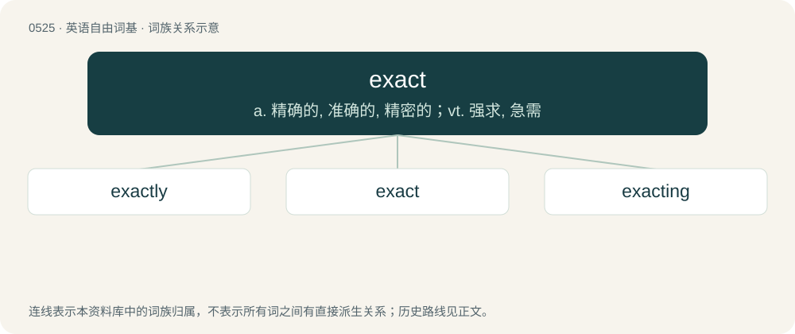

# 0589 · exact — a. 精确的, 准确的, 精密的；vt. 强求, 急需

[总目录](../00_总目录_按常用程度.md)

**类型**：英语自由词基　｜　**来源语言**：见词源记录

## 核心含义与来源

- 核心含义：a. 精确的, 准确的, 精密的；vt. 强求, 急需
- 英文含义：Precisely agreeing with a standard, a fact, or the truth; perfectly conforming; neither exceeding nor falling short in any respect.
- 词形：exact

**来源记录 1**（形容词；Precisely agreeing with a standard, a fact, or the truth; perfectly conforming; neither exceeding nor falling short in any respect.）

From Latin exāctus (the verb via Middle English exact), perfect passive participle of exigō (“demand, claim as due; measure by a standard, weigh, test”), from ex (“out”) + agō (“drive”).

## 词族图

## 单词速览（常用到不常用）

| 单词 | 音标 | 释义 |
|---|---|---|
| [exactly](#w-1) | /ɪɡˈzæk(t).li/ | adv. 确切地, 精确地, 恰好, 完全地, 确实, 恰恰正是, 确实如此 |
| [exact](#w-2) | /ɪɡˈzækt/ | a. 精确的, 准确的, 精密的；vt. 强求, 急需 |
| [exacting](#w-3) | /ɪɡˈzæktɪŋ/ | a. 苛求的, 吃力的 |

## 逐词详解

### 1. exactly

**词性**：副词　｜　**音标**：/ɪɡˈzæk(t).li/

**中文释义**：adv. 确切地, 精确地, 恰好, 完全地, 确实, 恰恰正是, 确实如此

**英文义项**：Without approximation; precisely. / Precisely, used to provide emphasis.

**构词拆分**：exact + -ly

**词源与演化**：

From exact + -ly.

**例句**：

> Measure exactly so we can be sure it is right.

该用例对应义项：Without approximation; precisely.

### 2. exact

**词性**：形容词　｜　**音标**：/ɪɡˈzækt/

**中文释义**：a. 精确的, 准确的, 精密的；vt. 强求, 急需

**英文义项**：Precisely agreeing with a standard, a fact, or the truth; perfectly conforming; neither exceeding nor falling short in any respect. / Habitually careful to agree with a standard, a rule, or a promise; accurate; methodical; punctual.

**词源与演化**：

From Latin exāctus (the verb via Middle English exact), perfect passive participle of exigō (“demand, claim as due; measure by a standard, weigh, test”), from ex (“out”) + agō (“drive”).

**例句**：

> The clock keeps exact time.

该用例对应义项：Precisely agreeing with a standard, a fact, or the truth; perfectly conforming; neither exceeding nor falling short in any respect.

### 3. exacting

**词性**：形容词　｜　**音标**：/ɪɡˈzæktɪŋ/

**中文释义**：a. 苛求的, 吃力的

**英文义项**：Making great demands; difficult to satisfy. / Of an action, task, etc., requiring precise accuracy, great care, effort, or attention.

**构词拆分**：From exact + -ing.

**词源与演化**：

From exact + -ing.

**例句**：

> Ziri is even more hellbent on exacting revenge.
