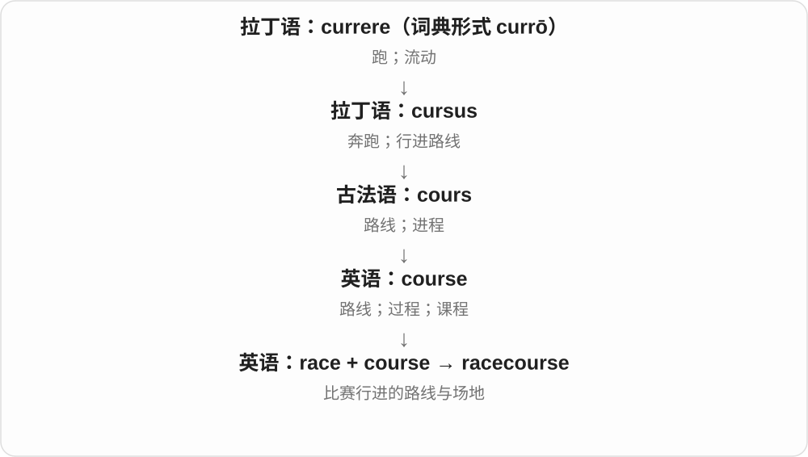

# 0590 · race — 竞速、比赛；另源的血统与种族词族

[逐词精讲目录](../00_逐词精讲目录.md) · [总目录](../00_总目录_按常用程度.md)

## 核心词根与来源

竞速分支接古英语、古诺尔斯语奔跑、奔流词族；种族分支经法语、意大利语来，更远不确定。racy 接旧风味、特质义，另列历史辨析。

**RACE：竞速和种族分两条来源**

跑道上的 race 与社会话题中的 race 不强串；racer 是参赛者，racist 则完全是另一分支的人物、性质词。

- **竞速及场地**：race · racer · racehorse · racetrack · racecourse · raceway
- **种族相关及歧视**：racial · racism · racist
- **旧特质分支的固定词**：racy
- **race → racing：快跑与竞速**：race · racing
- **race → races：竞速与族群分类另源**：race · races
- **derby：赛事专名到同城、同地区对抗**：derby · derbies

## 词形与演化规律

竞速 race → racer、racehorse、racetrack、raceway、racecourse；群体 race → racial、racism、racist；旧风味义 → racy。

本组是古英语、北欧快跑词族，另一个血统、种族 race 来源不同。

快跑支接本族、北欧词；血统分类支经法语借入。

与 race 比较比赛，不由 race 派生。Derby 赛马以德比伯爵名号命名，更远接德比地名；普通名词扩大到重大比赛，同城对抗等。不能误说赛马最初就在德比市举行。

## 单词速览（按词族由简到繁）

同一基础词的相关扩展放在一起，先读基础形式，再读扩展；各组之间优先读常用的。具体词源关系见各词讲解。

| 单词 | 音标 | 核心意思 |
|---|---|---|
| [race](#w-1) | /reɪs/ | 竞赛；快速奔跑；种族；人类等群体称呼 |
| [racing](#w-11) | /ˈreɪsɪŋ/ | 竞速；飞奔、急速运转〔现在分词、动名词〕；竞赛用的 |
| [races](#w-12) | /ˈreɪsɪz/ | 竞速比赛〔复数〕；疾跑、快速运转〔第三人称单数〕；种族等分类〔另一词源〕 |
| [racial](#w-3) | /ˈreɪʃəl/ | 种族的；与种族有关的 |
| [racism](#w-4) | /ˈreɪsɪzəm/ | 种族主义；种族歧视 |
| [racist](#w-2) | /ˈreɪsɪst/ | 种族主义者；种族主义的、带种族歧视的 |
| [racer](#w-5) | 英 /ˈreɪsə/；美 /ˈreɪsər/ | 竞速选手；赛车、赛马等 |
| [racetrack](#w-6) | /ˈreɪstræk/ | 赛道；跑道；赛马场 |
| [racecourse](#w-7) | 英 /ˈreɪskɔːs/；美 /ˈreɪskɔːrs/ | 赛马场；赛道 |
| [racehorse](#w-8) | 英 /ˈreɪshɔːs/；美 /ˈreɪshɔːrs/ | 赛马 |
| [raceway](#w-9) | /ˈreɪsweɪ/ | 赛道；水道；电线、机械等的导槽 |
| [racy](#w-10) | /ˈreɪsi/ | 生动有活力的；带性暗示、香艳的 |
| [derby](#w-13) | 英 /ˈdɑːbi/；美 /ˈdɝbi/ | 赛马等重要赛事；同城、同地区队伍的比赛；圆顶硬礼帽 |
| [derbies](#w-14) | 英 /ˈdɑːbiz/；美 /ˈdɝbiz/ | 德比战、重要赛事；圆顶硬礼帽〔复数〕 |

## 逐词讲解

### 1. race — 竞赛；快速奔跑；种族；人类等群体称呼

**音标**：/reɪs/

**先抓住这个画面**

跑道上 race 是比快，社会话题中 race 是种族；拼写相同，历史不从同一个现代意思串出来。

**怎么拆**

竞速分支接古英语 rǣs、古诺尔斯语 rás 等快跑词；血统、种族分支经法语 race、联系意大利语 razza，更远不确定。不能编成不同族群比赛所以出现种族义。

**怎么变成今天的意思**

**古英语 rǣs、古诺尔斯语 rás 等 → 英语竞速 race**  
奔涌、快跑 → 速度竞赛

↓

**另一支：法语 race、意大利语 razza → 英语群体 race**  
血统、类别等，更远来源不确定

win a race 赢比赛，race against time 争分夺秒；the human race 人类，race and ethnicity 种族与族裔。race 作动词也可说心跳、思绪飞快。

**常见搭配与例句**

win a race；race against time；the human race；a racing heart。

> She won the race by a narrow margin.

她以微弱优势赢了比赛。

> The museum explores how ideas about race changed over time.

博物馆探讨人们关于种族的观念如何随时间变化。

**别混淆**

race 比速度，match 比赛可有更广项目；race 种族通常涉及社会历史中的人群分类，不等于国籍 nationality。

### 2. racing — 竞速；飞奔、急速运转〔现在分词、动名词〕；竞赛用的

**音标**：/ˈreɪsɪŋ/

**先抓住这个画面**

为了抢先到达而跑得快，是 racing 的比赛画面；思想、心跳等很快，也能借这个速度感来形容。

**怎么拆**

race 去 e 加 -ing → racing。竞速 race 接古英语 rǣs、古诺尔斯语 rás 等奔跑词族；表示血统、种族的 race 经法语等另一路进入，本页不把两者混在一起。

**怎么变成今天的意思**

**古英语、古诺尔斯奔跑词族 → 竞速 race**  
冲、跑 → 比速度

↓

**race → racing**  
竞速活动；快速运动；竞赛用途形容词

horse racing 赛马；racing bikes 竞赛自行车；racing towards the finish 冲向终点；a racing heart 飞快的心跳。

**常见搭配与例句**

racing along the road；racing to catch the train。

> The children were racing towards the finish line.

孩子们正冲向终点线。

> The shop sells racing bikes and repair tools.

这家店出售竞赛自行车和修理工具。

**别混淆**

racing 可以是正式竞赛，也可以只是快得像比赛。racing bikes 的 ing 说明用途，a racing heart 则突出速度。

### 3. races — 竞速比赛〔复数〕；疾跑、快速运转〔第三人称单数〕；种族等分类〔另一词源〕

**音标**：/ˈreɪsɪz/

**先抓住这个画面**

比谁先到终点，是 races 的竞赛画面；心跳飞快、思绪飞转，也可用动词 races。谈族群分类的 races 则另有词源，不能和快跑编成同一故事。

**怎么拆**

race + -s，/s/ 后读 /ɪz/。快跑支接北欧 rás 及古英语同族词；血统、族群分类支经法语 race，可能联系意大利 razza，更远来源未定。

**怎么变成今天的意思**

**北欧、本族快跑词 → 竞速 race；法语分类词 → 另一 race**  
两支历史不同，今天同形同音

↓

**race + -s → races**  
多场比赛；单数主语快速移动；多种分类称呼

running races 跑步比赛；horse races 赛马；her heart races 她心跳很快。

**常见搭配与例句**

races against time 与时间赛跑；races across the field 飞快穿过场地。

> The school held several races on sports day.

学校在运动日举行了几场赛跑。

> Her heart races whenever she speaks in front of a large audience.

每当面对大批听众发言，她就心跳加快。

**别混淆**

race 的族群分类义要按社会、历史语境理解；竞速比赛义关注快慢、先后。人心里紧张时 heart races 并不要求真的在跑步。

### 4. racial — 种族的；与种族有关的

**音标**：/ˈreɪʃəl/

**先抓住这个画面**

只说这件事涉及种族分类、身份或关系；本身还没说立场是支持还是反对歧视。

**怎么拆**

race 的种族分支 + -ial，去 e，形成相关形容词；读音中 c 对应 /ʃ/，和 racism 中 /s/ 不同。

**怎么变成今天的意思**

**另一支：法语 race、意大利语 razza → 英语群体 race**  
血统、类别等，更远来源不确定

↓

**race + -ial → racial**  
种族 → 与种族有关的

racial identity 种族身份，racial equality 种族平等，racial discrimination 种族歧视；被修饰的名词决定具体在讲什么。

**常见搭配与例句**

racial equality；racial identity；racial discrimination；racial diversity。

> The course discusses racial identity in literature.

课程讨论文学中的种族身份。

> The organisation works to promote racial equality.

这个组织致力于促进种族平等。

**别混淆**

racial 种族相关，racist 种族主义的；racial equality 种族平等恰恰不是 racist equality。

### 5. racism — 种族主义；种族歧视

**音标**：/ˈreɪsɪzəm/

**先抓住这个画面**

把人按种族分出高低、据此偏见对待，或让某些群体在制度、行为中持续处于不利位置。

**怎么拆**

联系法语 racisme，现代可认 race 种族 + -ism 思想、做法。不是关于竞赛的一门理论，也不只限于当面骂人的话。

**怎么变成今天的意思**

**另一支：法语 race、意大利语 razza → 英语群体 race**  
血统、类别等，更远来源不确定

↓

**法语 racisme；race + -ism → racism**  
种族分类 → 种族优劣观、歧视及相关结构实践

challenge racism 反对种族主义，institutional racism 制度层面的种族歧视；具体讨论会有不同理论框架，应看作者如何界定。

**常见搭配与例句**

challenge racism；institutional racism；experience racism；racism in sport。

> The documentary examines racism in professional sport.

纪录片考察职业体育中的种族歧视。

> Students discussed ways to challenge racism at school.

学生们讨论了如何反对校园里的种族歧视。

**别混淆**

racism 是思想、行为、结构等问题，racist 可是形容词或持相关偏见的人；racial 则只是有关种族，评价不同。

### 6. racist — 种族主义者；种族主义的、带种族歧视的

**音标**：/ˈreɪsɪst/

**先抓住这个画面**

可说持种族偏见、歧视立场的人，也可直接评价一句话、一项做法带有这类歧视。

**怎么拆**

race 种族 + -ist，联系 racism 的人物、性质词。不是 racer 赛车手，也不是一切谈种族的人。

**怎么变成今天的意思**

**另一支：法语 race、意大利语 razza → 英语群体 race**  
血统、类别等，更远来源不确定

↓

**race + -ist → racist**  
种族主义立场的人；带种族歧视的

a racist remark 带种族歧视的话，racist abuse 种族歧视性辱骂；作名词 a racist 是种族主义者。

**常见搭配与例句**

a racist remark；racist abuse；racist attitudes；a racist。

> The club condemned the racist abuse directed at the player.

俱乐部谴责了针对那名球员的种族歧视性辱骂。

> The essay explains why the remark was racist.

文章解释了那句话为什么带有种族歧视。

**别混淆**

racial 说明话题有关种族，racist 评价歧视性质；研究 racial history 的人，不因此就成为 racist。

### 7. racer — 竞速选手；赛车、赛马等

**音标**：英 /ˈreɪsə/；美 /ˈreɪsər/

**先抓住这个画面**

参加速度比赛的人、动物或车辆，先看句子到底说谁在参赛。

**怎么拆**

race 的竞速动词义 + -er；-er 不一定只形成表示人的词。另有按快速移动命名的动物用法，本轮主学常用竞赛义。

**怎么变成今天的意思**

**古英语 rǣs、古诺尔斯语 rás 等 → 英语竞速 race**  
奔涌、快跑 → 速度竞赛

↓

**race + -er → racer**  
竞速 → 参赛人、动物、车辆

a motorcycle racer 摩托车赛车手，a road racer 公路赛选手或赛车；a racer 在车辆叙述中也可能是车本身。

**常见搭配与例句**

a motorcycle racer；a professional racer；a racing car and its racer。

> The young racer completed every lap.

年轻赛车手跑完了每一圈。

> The old racer is now displayed in a museum.

那辆旧赛车如今陈列在博物馆里。

**别混淆**

racer 竞速者，racist 种族主义者；两者不能只按更短、更长的人物后缀互换。

### 8. racetrack — 赛道；跑道；赛马场

**音标**：/ˈreɪstræk/

**先抓住这个画面**

把比赛路线做成专门场地，让人、动物或车辆沿规定路线比快。

**怎么拆**

race 竞速 + track 轨迹、跑道，形成比赛场地名称。不同项目赛道形状、材料不同，不只椭圆跑道。

**怎么变成今天的意思**

**race 竞速；track 跑道、路线**  
并列构词部分

↓

**racetrack**  
用于竞速比赛的专门路线或场地

a motor racetrack 赛车道，a horse racetrack 赛马场；on the racetrack 在赛道上。

**常见搭配与例句**

a motor racetrack；on the racetrack；a racetrack circuit。

> The driver tested the car on a closed racetrack.

车手在封闭赛道上测试汽车。

> Spectators gathered around the racetrack.

观众聚集在赛道周围。

**别混淆**

racetrack 与 racecourse 在赛马场等范围有重叠，track 更凸显路线、跑道；racecourse 也随地区有不同习惯。

### 9. racecourse — 赛马场；赛道

**音标**：英 /ˈreɪskɔːs/；美 /ˈreɪskɔːrs/

**先抓住这个画面**

把一条供比赛跑完的路线及周边场地专门圈出来，就是 racecourse，现代尤其常指赛马场。

**怎么拆**

race（竞赛）+ course（路线）。

**怎么变成今天的意思**

course 的路线义在这里很具体：选手沿预定路径比赛。赛马语境最常见，但不是课程培训地点。

**常见搭配与例句**

at the racecourse；a famous racecourse；the racecourse entrance。

> Thousands of spectators arrived at the racecourse.

成千上万名观众来到赛马场。

> The old racecourse is now used for public events.

旧赛马场现在用来举办公众活动。

**别混淆**

racecourse 常说赛马场；running track 更常说田径跑道。racecourse 不是“比赛课程”。

### 10. racehorse — 赛马

**音标**：英 /ˈreɪshɔːs/；美 /ˈreɪshɔːrs/

**先抓住这个画面**

主要为竞速比赛训练、使用的马，不是马跑起来就临时都成了赛马。

**怎么拆**

race 速度竞赛 + horse 马，按用途形成动物角色名称。

**怎么变成今天的意思**

**race 速度竞赛；horse 马**  
并列构词部分

↓

**racehorse**  
供竞速比赛的马

train a racehorse 训练赛马，a retired racehorse 退役赛马；退役后仍可用这个称谓说明其经历。

**常见搭配与例句**

a racehorse；train a racehorse；a retired racehorse。

> The racehorse was resting in its stable.

赛马正在马厩里休息。

> She helped care for a retired racehorse.

她帮忙照料一匹退役赛马。

**别混淆**

racehorse 是马，racer 既可能是人也可能是马、车；racecourse、racetrack 是竞赛场地。

### 11. raceway — 赛道；水道；电线、机械等的导槽

**音标**：/ˈreɪsweɪ/

**先抓住这个画面**

让某种运动沿一个限定通道进行；有时跑的是赛车，有时走的是水、电缆或机械滚动部件。

**怎么拆**

race 奔流、通行或竞速相关义 + way 通道，形成多种专门槽道名称。竞赛、水流、机械、电气的具体义项分别认，不把每个 raceway 都译赛车场。

**怎么变成今天的意思**

**race 奔流、通行、竞速相关义；way 通道**  
并列构词部分

↓

**raceway**  
竞速赛道；水流或部件、线缆通道

a motor raceway 赛车道；a cable raceway 线缆槽道；在轴承等机械语境里还可指滚道。

**常见搭配与例句**

a motor raceway；a cable raceway；a bearing raceway。

> The raceway hosted a weekend motor event.

赛车场周末举办了一场汽车赛事。

> The cables run through a plastic raceway.

线缆穿过一条塑料线槽。

**别混淆**

raceway 比较依赖技术语境，racehorse 明确是马；cable raceway 是布置线缆的通道，不是电线比谁跑得快。

### 12. racy — 生动有活力的；带性暗示、香艳的

**音标**：/ˈreɪsi/

**先抓住这个画面**

文字、故事很有味道、很带劲，现代还常暗示内容有点大胆、带性意味。

**怎么拆**

来自 race 较旧的风味、品种特质义 + -y，较早用于酒、水果等有鲜明风味，后来有生动、有劲，再到大胆、带性暗示。不是竞速快所以有色情义。

**怎么变成今天的意思**

**旧 race 的风味、品种特质义 + -y → racy**  
风味鲜明、带活力的

↓

**英语 racy 的后续引申**  
生动鲜活 → 大胆、带性暗示的

a racy novel 香艳、情节大胆的小说，racy dialogue 大胆、有性暗示的对白；a racy style 在较传统文评里也可赞文风生动。

**常见搭配与例句**

a racy novel；racy dialogue；a racy style。

> The review describes the novel as racy but well written.

书评说这部小说内容大胆，不过文笔很好。

> The editor removed some racy dialogue from the family edition.

编辑从家庭阅读版中删去了一些带性暗示的对白。

**别混淆**

racy 不等于 racial 种族的，也不是 racing 正在比赛；现代小说介绍里常先考虑大胆、性暗示义。

### 13. derby — 赛马等重要赛事；同城、同地区队伍的比赛；圆顶硬礼帽

**音标**：英 /ˈdɑːbi/；美 /ˈdɝbi/

**先抓住这个画面**

体育报道里的 local derby，常是本地两支队伍的直接较量。名称起初借自一场有名的赛马，又扩大到更多比赛。

**怎么拆**

Derby 赛马以德比伯爵名号命名，赛事起源地是 Epsom。名号更远接 Derby 地名，包含旧鹿名与北欧居住地材料；现代比赛义不能直接按鹿村来猜。

**怎么变成今天的意思**

**德比地名 → 德比伯爵名号 → Derby 赛马名**  
赛事在 Epsom 起源，不是以所在德比市直接命名

↓

**重大赛事名称扩大为普通 derby**  
现代也常见同城、同地区队伍对抗；名词另有圆顶硬礼帽用法

a local derby 是本地对抗赛；a football derby 是足球德比；美国语境 a derby 还可指圆顶硬礼帽。读音英式第一元音 /ɑː/，美式常见 /ɝ/。

**常见搭配与例句**

a local derby；a football derby；a derby race。

> The two local clubs meet in a derby on Saturday.

两家本地俱乐部周六将在德比战中交锋。

> The costume included a dark derby and a long coat.

这套服装包括一顶深色圆顶硬礼帽和一件长外套。

**别混淆**

Derby 作为赛事专名、地名可大写；普通一场 derby 可小写。不能因为赛马名带 Derby，就断定比赛发生在德比市。

### 14. derbies — 德比战、重要赛事；圆顶硬礼帽〔复数〕

**音标**：英 /ˈdɑːbiz/；美 /ˈdɝbiz/

**先抓住这个画面**

一个赛季有好几场本地对抗，这些比赛就是 derbies。复数也能数几顶 derby 礼帽，要看谈的是体育还是服装。

**怎么拆**

derby 词尾辅音字母 b + y，变 y 为 i + -es → derbies；原词末尾 /i/ 保留，再接 /z/，不另加一个音节。

**怎么变成今天的意思**

**德比地名 → 德比伯爵名号 → Derby 赛马名**  
赛事在 Epsom 起源，不是以所在德比市直接命名

↓

**重大赛事名称扩大为普通 derby**  
现代也常见同城、同地区队伍对抗；名词另有圆顶硬礼帽用法

↓

**derby 变 y 为 i + -es → derbies**  
多个赛事或帽子；词尾 /biz/

local derbies 是本地对抗赛；fierce derbies 是激烈德比战；bowler hats 在美式也可称 derbies。

**常见搭配与例句**

local derbies；football derbies；several derbies。

> Local derbies usually draw large crowds.

本地德比战通常吸引大批观众。

> The shop displays several old derbies beside the coats.

店里在外套旁陈列着几顶旧圆顶硬礼帽。

**别混淆**

derbies、abbeys 都以字母 y 收尾，但 derby 前是辅音 b，需要改 ies；abbey 前是元音 e，直接加 s。

## 这一组要分清什么

racer 不是 racist；racial 不等于 racist；racy 不从赛车刺激硬推，也不等于 racial。

## 串起来练习

The racer joined a campaign against racism in sport.

赛车手参加了反对体育中种族歧视的活动。
