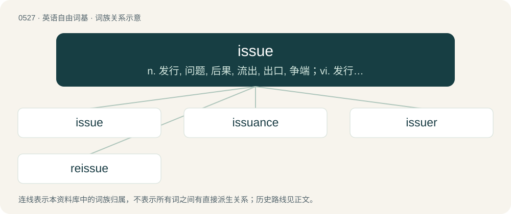

# 0591 · issue — n. 发行, 问题, 后果, 流出, 出口, 争端；vi. 发行, 流出, 造成...结果, 传下；vt. 使流出, 放出, 发行, 发布, 发给

[总目录](../00_总目录_按常用程度.md)

**类型**：英语自由词基　｜　**来源语言**：见词源记录

## 核心含义与来源

- 核心含义：n. 发行, 问题, 后果, 流出, 出口, 争端；vi. 发行, 流出, 造成...结果, 传下；vt. 使流出, 放出, 发行, 发布, 发给
- 英文含义：The outflow of a bodily fluid, particularly (now rare) in abnormal amounts.
- 词形：issue

**来源记录 1**（名词；The outflow of a bodily fluid, particularly (now rare) in abnormal amounts.）

From Middle English issue, from Old French issue (“an exit, a way out”), feminine past participle of issir (“to exit”), from Latin exeō (“go out, exit”), from prefix ex- (“out”) + eō (“go”). The legal meaning originated from the concept of "the end or result of pleadings in a suit (by presenting the point to be determined by trial)," leading to the sense of "the controversy over facts in a trial" (early 14th century, Anglo-French). This later extended to mean "a point of contention between two parties" (early 15th century) and more generally, "an important point to be decided" (1836). Consequently, the verbal phrase take issue with emerged in 1797 (preceded by join issue in the 1690s), meaning "to adopt an affirmative or negative stance in a dispute with another." The expression to have issues, meaning "to have unresolved conflicts," dates to 1990.

## 词族图

## 单词速览（常用到不常用）

| 单词 | 音标 | 释义 |
|---|---|---|
| [issue](#w-1) | 美 /ˈɪʃ(j)u/；/ˈɪʃuː/ | n. 发行, 问题, 后果, 流出, 出口, 争端；vi. 发行, 流出, 造成...结果, 传下；vt. 使流出, 放出, 发行, 发布, 发给 |
| [issuance](#w-2) | 美 /ˈɪʃ(j)uəns/ | n. 发行, 发布；\[经\] 发行, 发给 |
| [issuer](#w-3) | /ˈiʃjuə/ | n. 发行者；\[法\] 发行人, 发布人 |
| [reissue](#w-4) | /.riːˈisjuː/ | vt. 再发给, 重新发行；vi. 再发给；n. 重新发行, 再版物 |

## 逐词详解

### 1. issue

**词性**：名词　｜　**音标**：美 /ˈɪʃ(j)u/；/ˈɪʃuː/

**中文释义**：n. 发行, 问题, 后果, 流出, 出口, 争端；vi. 发行, 流出, 造成...结果, 传下；vt. 使流出, 放出, 发行, 发布, 发给

**英文义项**：The outflow of a bodily fluid, particularly (now rare) in abnormal amounts. / Progeny: all one's lineal descendants.

**词源与演化**：

From Middle English issue, from Old French issue (“an exit, a way out”), feminine past participle of issir (“to exit”), from Latin exeō (“go out, exit”), from prefix ex- (“out”) + eō (“go”). The legal meaning originated from the concept of "the end or result of pleadings in a suit (by presenting the point to be determined by trial)," leading to the sense of "the controversy over facts in a trial" (early 14th century, Anglo-French). This later extended to mean "a point of contention between two parties" (early 15th century) and more generally, "an important point to be decided" (1836). Consequently, the verbal phrase take issue with emerged in 1797 (preceded by join issue in the 1690s), meaning "to adopt an affirmative or negative stance in a dispute with another." The expression to have issues, meaning "to have unresolved conflicts," dates to 1990.

**例句**：

> For chrissakes, John, don't make an issue out of it. Just sleep on the floor if you want.

该用例对应义项：Anything in dispute, an area of disagreement whose resolution is being debated or decided.

### 2. issuance

**词性**：名词　｜　**音标**：美 /ˈɪʃ(j)uəns/

**中文释义**：n. 发行, 发布；\[经\] 发行, 发给

**英文义项**：The act of issuing, or giving out. / Something issued.

**构词拆分**：issue + -ance

**词源与演化**：

From issue + -ance.

**用法示例／搭配（非完整句）**：

> the issuance of an order

该用例对应义项：The act of issuing, or giving out.

### 3. issuer

**词性**：名词　｜　**音标**：/ˈiʃjuə/

**中文释义**：n. 发行者；\[法\] 发行人, 发布人

**英文义项**：One who issues, emits, or publishes.

**构词拆分**：issue + -er

**词源与演化**：

From issue + -er.

### 4. reissue

**词性**：名词　｜　**音标**：/.riːˈisjuː/

**中文释义**：vt. 再发给, 重新发行；vi. 再发给；n. 重新发行, 再版物

**英文义项**：Something that has issued, or been issued again. / A second or subsequent printing of postage stamps from old plates.

**构词拆分**：re- + issue

**词源与演化**：

From re- + issue.

**例句**：

> Copies of the original comic are valued by collectors, but the reissues are worthless.

该用例对应义项：Something that has issued, or been issued again.
