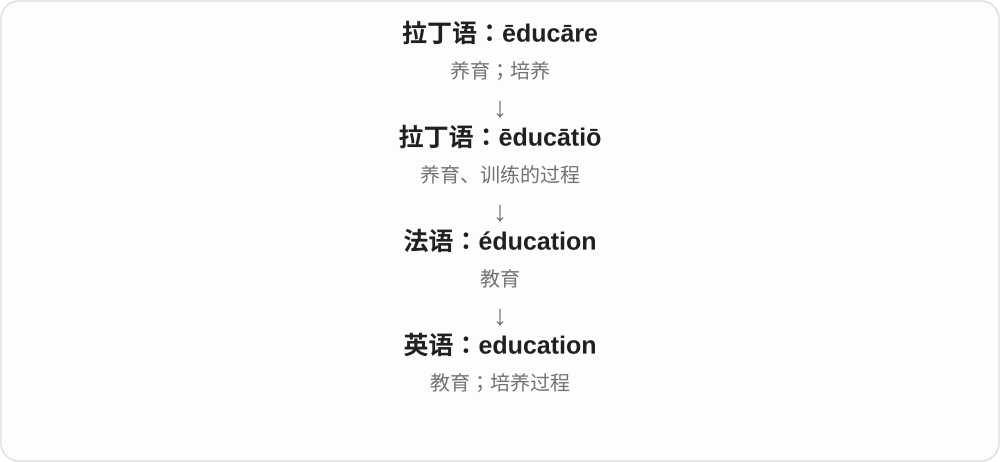
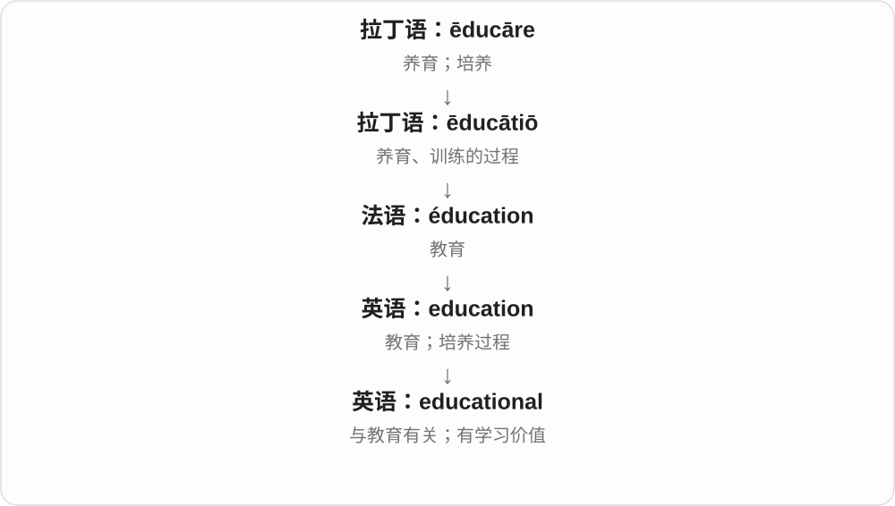

# 0592 · educate — 教育、培养；受教育与教育作用

[逐词精讲目录](../00_逐词精讲目录.md) · [总目录](../00_总目录_按常用程度.md)

## 核心词根与来源

educate 来自拉丁语 ēducātus，背后是 ēducāre 养育、训练；与更远的引导词族有关，但不能硬把每个音节当成现代英语独立词。

**EDUCATE：使人学习、成长，结果与作用分开说**

educate 说行动，education 说过程；educated 说受过培养，educative 说能起教育作用。

- **动作与过程**：educate · education
- **学习结果与教育作用**：educated · educative · educational

## 词形与演化规律

educate → education、educated、educative；educational 与 educative 对照。

## 单词速览（按词族由简到繁）

同一基础词的相关扩展放在一起，先读基础形式，再读扩展；各组之间优先读常用的。具体词源关系见各词讲解。

| 单词 | 音标 | 核心意思 |
|---|---|---|
| [educate](#w-3) | 英 /ˈedʒʊkeɪt/；美 /ˈedʒəkeɪt/ | 教育；培养；使了解 |
| [education](#w-1) | 英 /ˌedʒʊˈkeɪʃən/；美 /ˌedʒəˈkeɪʃən/ | 教育；受教育的经历或过程 |
| [educational](#w-5) | 英 /ˌedʒʊˈkeɪʃənəl/；美 /ˌedʒəˈkeɪʃənəl/ | 教育的；能学到东西的 |
| [educated](#w-2) | 常见 /ˈedʒəkeɪtɪd/；英式也 /ˈedjuːkeɪtɪd/ | 受过教育的；有知识根据的 |
| [educative](#w-4) | 英 /ˈedʒukətɪv/；美 /ˈedʒəkeɪtɪv/ | 有教育作用的；能让人学到东西的 |

## 逐词讲解

### 1. educate — 教育；培养；使了解

**音标**：英 /ˈedʒʊkeɪt/；美 /ˈedʒəkeɪt/

**先抓住这个画面**

educate 像长期带着一个人认识世界、学会判断和做事。它也可指让公众了解某个原本不熟悉的问题。

**怎么拆**

直接来自拉丁语 ēducāre“养育、培养、训练”及其分词 ēducātus；ēducāre 与 ēdūcere“带出、养育”有关。

**怎么变成今天的意思**

这确实属于“带领”词族，但“教育本义就是引出内心潜能”是一种现代解释，不能当作已经证实的古代定义。先记真实的养育、训练路线。

**常见搭配与例句**

educate children（教育孩子）；educate the public about…（使公众了解……）；educate oneself（自学）。

> The program educates children about local wildlife.

这个项目让孩子们了解当地野生动物。

> She used the library to educate herself.

她利用图书馆自学。

**别混淆**

teach 可教一项具体知识或技能；educate 常指更广的培养和知识发展。

### 2. education — 教育；受教育的经历或过程

**音标**：英 /ˌedʒʊˈkeɪʃən/；美 /ˌedʒəˈkeɪʃən/

**先抓住这个画面**

education 是一个人被培养、不断学会理解和做事的过程。学校教育是其中一部分，也可以谈职业训练和终身学习。

**怎么拆**

来自拉丁语 ēducātiō“养育、训练”，经法语等路线进入英语；现代与 educate 对照理解。

**怎么变成今天的意思**

它从培养、养育发展到系统教学，也能指某人的教育背景。an education 可指某一段或某一种教育经历；泛指教育常不可数。

**常见搭配与例句**

higher education（高等教育）；access to education（受教育机会）；a good education（良好教育）。

> Everyone should have access to a good education.

每个人都应有机会接受良好教育。

> His education continued long after he left school.

离开学校很久以后，他仍在不断学习。

**别混淆**

education 是教育过程和经历；qualification 是取得的资历或资格。受过教育不等于一定持有某张证书。

### 3. educational — 教育的；能学到东西的

**音标**：英 /ˌedʒʊˈkeɪʃənəl/；美 /ˌedʒəˈkeɪʃənəl/

**先抓住这个画面**

educational 既能说一件事属于教育领域，也能说它让你学到了东西。参观工厂觉得长见识，就是 an educational visit。

**怎么拆**

education + -al，把名词“教育”变成形容词。

**怎么变成今天的意思**

educational policy 是教育政策；educational game 则强调游戏有学习用途。前者是领域关系，后者是实际作用。

**常见搭配与例句**

educational resources（教育资源）；an educational visit（有教育意义的参观）；educational opportunities（教育机会）。

> The website offers free educational resources.

这个网站提供免费的教育资源。

> Our visit to the workshop was surprisingly educational.

这次参观车间出乎意料地让我们学到了很多。

**别混淆**

educational 形容活动或材料有教育性质；educated 形容人受过教育，不能互换。

### 4. educated — 受过教育的；有知识根据的

**音标**：常见 /ˈedʒəkeɪtɪd/；英式也 /ˈedjuːkeɪtɪd/

**先抓住这个画面**

一个人接受过学习培养；一个猜测也可不是瞎蒙，而是有已有知识托着。

**怎么拆**

educate + -ed，过去分词形容词化。an educated guess 进一步借受过训练、有知识的背景，表示有根据的推测。

**怎么变成今天的意思**

**拉丁语 ēducāre → ēducātus、ēducātiō 词族**  
养育、训练、教育；相应分词和活动名词

↓

**英语 educate、education 及其派生**  
教育、培养；教育活动、过程

↓

**educate → educated**  
教育、培养 → 受过教育；有知识根据的

an educated reader 有一定知识背景的读者；an educated guess 有依据推测。受过教育不自动等于精通所有领域。

**常见搭配与例句**

highly educated；an educated guess；an educated opinion。

> She made an educated guess based on the earlier figures.

她根据先前数字作了一个有依据的推测。

> The article is written for educated readers without specialist training.

文章面向有一定知识背景、但未受专业训练的读者。

**别混淆**

educated guess 仍是推测，不是已证实事实；education 名词、educated 形容词不要混用。

### 5. educative — 有教育作用的；能让人学到东西的

**音标**：英 /ˈedʒukətɪv/；美 /ˈedʒəkeɪtɪv/

**先抓住这个画面**

一次经历、一种活动，不只是发生了，还让人从中明白点什么。

**怎么拆**

educate 去 e + -ive，形成表示具有教育作用的形容词。与 educational 用法有重合，但常更强调活动本身能教给人东西。

**怎么变成今天的意思**

**拉丁语 ēducāre → ēducātus、ēducātiō 词族**  
养育、训练、教育；相应分词和活动名词

↓

**英语 educate、education 及其派生**  
教育、培养；教育活动、过程

↓

**educate + -ive → educative**  
教育 → 有教育、启发作用的

an educative experience 有教育意义的经历；the educative role of museums 博物馆的教育作用，偏正式表达。

**常见搭配与例句**

an educative experience；an educative function；an educative role。

> The exhibition was entertaining as well as educative.

展览既有趣，也让人学到东西。

> The report emphasizes the educative role of public libraries.

报告强调公共图书馆的教育作用。

**别混淆**

educative 有教育作用，educated 已受教育；前者说能教什么，后者说学过或有知识根据。

## 这一组要分清什么

educated guess 是有依据推测，不是已证事实；educative experience 是让人学到东西的经历。

## 串起来练习

An educative experience can help us make a more educated guess next time.

一次让人学到东西的经历，可以帮助我们下次作出更有依据的推测。
