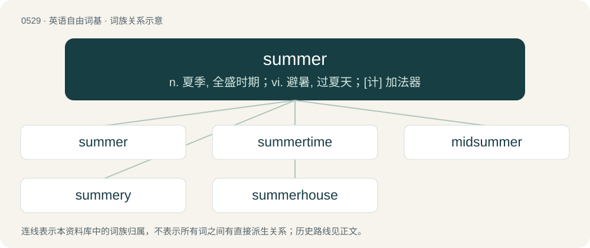

# 0593 · summer — n. 夏季, 全盛时期；vi. 避暑, 过夏天；\[计\] 加法器

[总目录](../00_总目录_按常用程度.md)

**类型**：英语自由词基　｜　**来源语言**：见词源记录

## 核心含义与来源

- 核心含义：n. 夏季, 全盛时期；vi. 避暑, 过夏天；\[计\] 加法器
- 英文含义：One of four seasons, traditionally the second, marked by the longest and typically hottest days of the year due to the inclination of the Earth and thermal lag. Typically regarded as spanning either the period between the summer solstice to the autumnal equinox, or the months of June, July, and August in the Northern Hemisphere and the months of December, January and February in the Southern Hemisphere.
- 词形：summer

**多个词源／构词路径**：同一拼写可能有不同来源；以下按词性和含义分别列出。

**来源记录 1**（名词；One of four seasons, traditionally the second, marked by the longest and typically hottest days of the year due to the inclination of the Earth and thermal lag. Typically regarded as spanning either the period between the summer solstice to the autumnal equinox, or the months of June, July, and August in the Northern Hemisphere and the months of December, January and February in the Southern Hemisphere.）

From Middle English somer, sumer, from Old English sumor m, from Proto-West Germanic \*sumar m, from Proto-Germanic \*sumaraz m, derived from Proto-Indo-European \*semh₂- (“summer”). Cognates Cognate with Scots somer, sumer, simer, West Frisian simmer, Saterland Frisian Suumer, Dutch zomer, Low German Sommer, German Sommer, Danish and Norwegian Bokmål sommer, Swedish sommar, Norwegian Nynorsk and Icelandic sumar; Welsh haf, Armenian ամ (am, “year”), ամառ (amaṙ, “summer”), Sanskrit समा (sámā, “a half-year, season, weather, year”), Avestan 𐬵𐬀𐬨 (ham-), Middle Persian ḥʾmyn (hāmīn), Northern Kurdish havîn, Central Kurdish ھاوین (hawîn).

**来源记录 2**（名词；A horizontal beam supporting a building.）

From Middle English somer, from Anglo-Norman summer, sumer, from Vulgar Latin saumārius, for Late Latin sagmārius, from Latin sagma (“sum”). Compare sumpter.

**来源记录 3**（名词；A person who sums.）

From sum + -er.

## 词族图

## 单词速览（常用到不常用）

| 单词 | 音标 | 释义 |
|---|---|---|
| [summer](#w-1) | 英 /ˈsʌmə/；美 /ˈsʌmɚ/ | n. 夏季, 全盛时期；vi. 避暑, 过夏天；\[计\] 加法器 |
| [summertime](#w-2) | /ˈsʌmətaim/ | n. 全盛时期, 夏季 |
| [midsummer](#w-3) | /mɪdˈsʌmə(ɹ)/ | n. 仲夏, 夏至期；a. 仲夏的 |
| [summery](#w-4) | /ˈsʌməɹi/ | a. 夏的, 夏天似的 |
| [summerhouse](#w-5) | /ˈsʌməhaus/ | n. 凉亭, 亭子 |

## 逐词详解

### 1. summer

**词性**：名词　｜　**音标**：英 /ˈsʌmə/；美 /ˈsʌmɚ/

**中文释义**：n. 夏季, 全盛时期；vi. 避暑, 过夏天；\[计\] 加法器

**英文义项**：One of four seasons, traditionally the second, marked by the longest and typically hottest days of the year due to the inclination of the Earth and thermal lag. Typically regarded as spanning either the period between the summer solstice to the autumnal equinox, or the months of June, July, and August in the Northern Hemisphere and the months of December, January and February in the Southern Hemisphere. / year; used to give the age of a person, usually a young one.

**词源与演化**：

From Middle English somer, sumer, from Old English sumor m, from Proto-West Germanic \*sumar m, from Proto-Germanic \*sumaraz m, derived from Proto-Indo-European \*semh₂- (“summer”). Cognates Cognate with Scots somer, sumer, simer, West Frisian simmer, Saterland Frisian Suumer, Dutch zomer, Low German Sommer, German Sommer, Danish and Norwegian Bokmål sommer, Swedish sommar, Norwegian Nynorsk and Icelandic sumar; Welsh haf, Armenian ամ (am, “year”), ամառ (amaṙ, “summer”), Sanskrit समा (sámā, “a half-year, season, weather, year”), Avestan 𐬵𐬀𐬨 (ham-), Middle Persian ḥʾmyn (hāmīn), Northern Kurdish havîn, Central Kurdish ھاوین (hawîn).

**例句**：

> Gradually, the end of summer hove into sight.

该用例对应义项：One of four seasons, traditionally the second, marked by the longest and typically hottest days of the year due to the inclination of the Earth and thermal lag. Typically regarded as spanning either the period between the summer solstice to the autumnal equinox, or the months of June, July, and August in the Northern Hemisphere and the months of December, January and February in the Southern Hemisphere.

### 2. summertime

**词性**：名词　｜　**音标**：/ˈsʌmətaim/

**中文释义**：n. 全盛时期, 夏季

**英文义项**：The period or season of summer.

**构词拆分**：summer + time

**词源与演化**：

From Middle English somertime, equivalent to summer + time. Compare Dutch zomertijd (“summertime”), German Sommerzeit (“summertime”), Danish sommertiden (“summertime”), Swedish sommartid (“summertime”). Compare summertide.

**例句**：

> I like to eat peaches in the summertime when they're in season.

### 3. midsummer

**词性**：名词　｜　**音标**：/mɪdˈsʌmə(ɹ)/

**中文释义**：n. 仲夏, 夏至期；a. 仲夏的

**英文义项**：The period around the summer solstice; around June 21st in the northern hemisphere. / The first day of summer.

**构词拆分**：mid- + summer

**词源与演化**：

From Middle English midsomer, midsumer, from Old English midsumer, midsumor (“midsummer”), from Proto-West Germanic \*midisumar, from Proto-Germanic \*midjasumaraz (“midsummer”), equivalent to mid- + summer. Cognate with West Frisian midsimmer (“midsummer”), Dutch midzomer (“midsummer”), German Mittsommer (“midsummer”), Danish midsommer (“midsummer”), Swedish midsommar (“midsummer”), Icelandic miðsumar (“midsummer”).

**例句**：

> There are often many parties around Midsummer.

### 4. summery

**词性**：形容词　｜　**音标**：/ˈsʌməɹi/

**中文释义**：a. 夏的, 夏天似的

**英文义项**：Relating to the summer. / Of weather, typical of summer.

**构词拆分**：summer + -y

**词源与演化**：

From Middle English somery; equivalent to summer + -y. Compare Swedish somrig (“summery”).

**例句**：

> She wore a light summery dress.

该用例对应义项：Relating to the summer.

### 5. summerhouse

**词性**：名词　｜　**音标**：/ˈsʌməhaus/

**中文释义**：n. 凉亭, 亭子

**英文义项**：A house owned not as a primary residence and used as vacation home during warm weather months of the year. / An outbuilding in a garden where the owners can relax in warm weather.

**构词拆分**：summer + house

**词源与演化**：

From Middle English somer-hous, from Old English sumerhūs, sumorhūs, equivalent to summer + house. Compare Dutch zomerhuis, German Sommerhaus, Danish sommerhus, Swedish sommarhus.
