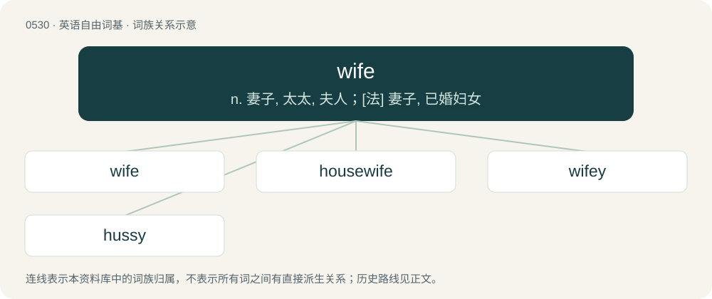

# 0594 · wife — n. 妻子, 太太, 夫人；\[法\] 妻子, 已婚妇女

[总目录](../00_总目录_按常用程度.md)

**类型**：英语自由词基　｜　**来源语言**：见词源记录

## 核心含义与来源

- 核心含义：n. 妻子, 太太, 夫人；\[法\] 妻子, 已婚妇女
- 英文含义：A married woman, especially in relation to her spouse.
- 词形：wife

**来源记录 1**（名词；A married woman, especially in relation to her spouse.）

Inherited from Middle English wyf, wif, from Old English wīf (“woman, wife”), from Proto-West Germanic \*wīb, from Proto-Germanic \*wībą (“woman; wife”). Cognates Germanic cognates include Scots wife (“wife; woman”), North Frisian wuf, wüf (“wife, woman”), Saterland Frisian Wieuw (“woman; wife; female”), West Frisian wiif (“wife; woman”), Cimbrian baibe, baip (“wife; woman”), Dutch wijf (“woman; female”), German Weib (“woman; wife; female”), German Low German Wiev (“woman; female”), Mòcheno baib (“woman”), Vilamovian bow (“wife; woman”), Yiddish ווײַב (vayb, “wife; woman”) Danish, Norwegian Bokmål, Norwegian Nynorsk, and Swedish viv (“wife; woman”), Faroese vív (“wife; woman”), Icelandic víf (“wife; woman”). The further etymology is unknown, with a number of disputed suggestions. One suggestion connects Tocharian A/B kip/kwīpe (“genitals, female pudenda”), for a hypothetical Indo-European \*gʰwíbʰ- (“pudenda”). Another suggestion connects Old English wǣfan (“wrap, clothe”), Old Norse vífa (“wrap, veil”) for a suggested original motive of "married woman wearing a scarf". Yet another suggestion connects Old High German weibōn (“move to and fro”), Old Norse veifa (“swing, throw”), for a motive of "one who is moving busily; housekeeper, maidservant" (cf. German Weibel (“manservant, usher”)).

## 词族图

## 单词速览（常用到不常用）

| 单词 | 音标 | 释义 |
|---|---|---|
| [wife](#w-1) | /waɪf/ | n. 妻子, 太太, 夫人；\[法\] 妻子, 已婚妇女 |
| [housewife](#w-2) | /ˈhaʊs.waɪf/ | n. 主妇, 家庭妇女 |
| [wifey](#w-3) |  | 【英文】Of, befitting, pertaining to, or characteristic of a wife. |
| [hussy](#w-4) | /ˈhʌzi/ | n. 粗野女子, 轻佻女子 |

## 逐词详解

### 1. wife

**词性**：名词　｜　**音标**：/waɪf/

**中文释义**：n. 妻子, 太太, 夫人；\[法\] 妻子, 已婚妇女

**英文义项**：A married woman, especially in relation to her spouse. / The female of a pair of mated animals.

**词源与演化**：

Inherited from Middle English wyf, wif, from Old English wīf (“woman, wife”), from Proto-West Germanic \*wīb, from Proto-Germanic \*wībą (“woman; wife”). Cognates Germanic cognates include Scots wife (“wife; woman”), North Frisian wuf, wüf (“wife, woman”), Saterland Frisian Wieuw (“woman; wife; female”), West Frisian wiif (“wife; woman”), Cimbrian baibe, baip (“wife; woman”), Dutch wijf (“woman; female”), German Weib (“woman; wife; female”), German Low German Wiev (“woman; female”), Mòcheno baib (“woman”), Vilamovian bow (“wife; woman”), Yiddish ווײַב (vayb, “wife; woman”) Danish, Norwegian Bokmål, Norwegian Nynorsk, and Swedish viv (“wife; woman”), Faroese vív (“wife; woman”), Icelandic víf (“wife; woman”). The further etymology is unknown, with a number of disputed suggestions. One suggestion connects Tocharian A/B kip/kwīpe (“genitals, female pudenda”), for a hypothetical Indo-European \*gʰwíbʰ- (“pudenda”). Another suggestion connects Old English wǣfan (“wrap, clothe”), Old Norse vífa (“wrap, veil”) for a suggested original motive of "married woman wearing a scarf". Yet another suggestion connects Old High German weibōn (“move to and fro”), Old Norse veifa (“swing, throw”), for a motive of "one who is moving busily; housekeeper, maidservant" (cf. German Weibel (“manservant, usher”)).

**例句**：

> A new wife for the gander is introduced into the pen.

该用例对应义项：The female of a pair of mated animals.

### 2. housewife

**词性**：名词　｜　**音标**：/ˈhaʊs.waɪf/

**中文释义**：n. 主妇, 家庭妇女

**英文义项**：A woman whose main employment is homemaking, maintaining the upkeep of her home and tending to household affairs; often, such a woman whose sole \[unpaid\] employment is homemaking. / The wife of a householder; the mistress of a family; the female head of a household.

**构词拆分**：house + wife

**词源与演化**：

From Middle English houswyf, housewif, huswijf, equivalent to house + wife; a doublet of hussy, which it was long distinguished from and displaced due to gradual negative connotation (see Online Etymology Dictionary entry). Cognate with West Frisian húswiif, Dutch huiswijf, German Low German Huuswief, German Hausweib.

**例句**：

> The worried housewife heard the telephone ring and quickly picked up the receiver.

### 3. wifey

**词性**：形容词

**英文义项**：Of, befitting, pertaining to, or characteristic of a wife.

**构词拆分**：wife + -y

**词源与演化**：

From wife + -y (adjectival suffix).

### 4. hussy

**词性**：名词　｜　**音标**：/ˈhʌzi/

**中文释义**：n. 粗野女子, 轻佻女子

**英文义项**：A sexually immoral woman. / A cheeky or disrespectful girl; a woman showing inappropriate or improper behavior.

**构词拆分**：house + wife

**词源与演化**：

From earlier hussive, hussif, the regular evolution of Middle English houswyf (“housewife”), equivalent to house + wife. Modern housewife is a restoration of the compound (and thus is a doublet), after its component parts had become unrecognisable through regular phonetic change, as well as gradual negative senses and historical factors. The traditional pronunciation of the word is /ˈhʌzi/; the pronunciation with /s/ is a spelling pronunciation.
