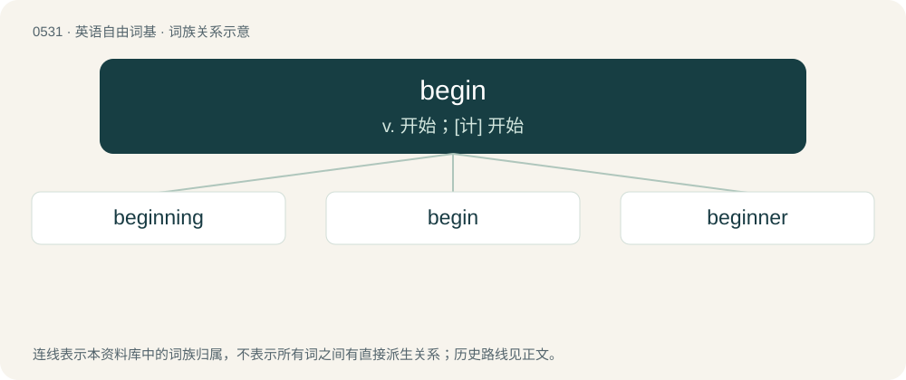

# 0595 · begin — v. 开始；\[计\] 开始

[总目录](../00_总目录_按常用程度.md)

**类型**：英语自由词基　｜　**来源语言**：见词源记录

## 核心含义与来源

- 核心含义：v. 开始；\[计\] 开始
- 英文含义：To start, to initiate or take the first step into something.
- 词形：begin

**来源记录 1**（动词；To start, to initiate or take the first step into something.）

From Middle English beginnen, from Old English beginnan (“to begin”), from Proto-West Germanic \*biginnan, from Proto-Germanic \*biginnaną (“to begin”), from be- + base verb \*ginnaną also found in Old English onginnan.

## 词族图

## 单词速览（常用到不常用）

| 单词 | 音标 | 释义 |
|---|---|---|
| [beginning](#w-1) | 英 /bɪˈɡɪn.ɪŋ/ | n. 开始 |
| [begin](#w-2) | /bɪˈɡɪn/ | v. 开始；\[计\] 开始 |
| [beginner](#w-3) | 英 /bɪˈɡɪnə/；美 /bəˈɡɪnɚ/ | n. 初学者 |

## 逐词详解

### 1. beginning

**词性**：名词　｜　**音标**：英 /bɪˈɡɪn.ɪŋ/

**中文释义**：n. 开始

**英文义项**：The act of doing that which begins anything; commencement of an action, state, or space of time; entrance into being or upon a course; the first act, effort, or state of a succession of acts or states. / That which is begun; a rudiment or element.

**构词拆分**：begin + -ing

**词源与演化**：

From Middle English biginning, beginninge, beginnunge, equivalent to begin + -ing.

**例句**：

> The author describes the main character’s youth at the beginning of the story.

该用例对应义项：The initial portion of some extended thing.

### 2. begin

**词性**：动词　｜　**音标**：/bɪˈɡɪn/

**中文释义**：v. 开始；\[计\] 开始

**英文义项**：To start, to initiate or take the first step into something. / To come into existence.

**词源与演化**：

From Middle English beginnen, from Old English beginnan (“to begin”), from Proto-West Germanic \*biginnan, from Proto-Germanic \*biginnaną (“to begin”), from be- + base verb \*ginnaną also found in Old English onginnan.

**例句**：

> Now that everyone is here, we should begin the presentation.

该用例对应义项：To start, to initiate or take the first step into something.

### 3. beginner

**词性**：名词　｜　**音标**：英 /bɪˈɡɪnə/；美 /bəˈɡɪnɚ/

**中文释义**：n. 初学者

**英文义项**：Someone who is just starting at something, or has only recently started. / Someone who sets something in motion.

**构词拆分**：begin + -er

**词源与演化**：

From Middle English begynner, equivalent to begin + -er. Cognate with West Frisian begjinner (“beginner”), Dutch beginner (“beginner”), Low German begünner (“beginner”), Danish nybegynder (“beginner, novice”, literally “new-beginner”).

**例句**：

> The beginner of the games lit the ceremonial torch.

该用例对应义项：Someone who sets something in motion.
