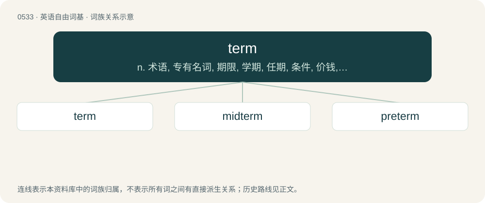

# 0596 · term — n. 术语, 专有名词, 期限, 学期, 任期, 条件, 价钱, 关系, 地位, 项, 界石；vt. 称, 呼；\[计\] 检索词; 项

[总目录](../00_总目录_按常用程度.md)

**类型**：英语自由词基　｜　**来源语言**：见词源记录

## 核心含义与来源

- 核心含义：n. 术语, 专有名词, 期限, 学期, 任期, 条件, 价钱, 关系, 地位, 项, 界石；vt. 称, 呼；\[计\] 检索词; 项
- 英文含义：That which limits the extent of anything; limit, extremity, bound, boundary, terminus.
- 词形：term

**多个词源／构词路径**：同一拼写可能有不同来源；以下按词性和含义分别列出。

**来源记录 1**（名词；That which limits the extent of anything; limit, extremity, bound, boundary, terminus.）

From Middle English terme, borrowed from Old French terme, from Latin terminus (“a bound, boundary, limit, end; in Medieval Latin, also a time, period, word, covenant, etc.”), ultimately from Proto-Indo-European \*térmn̥ (“stump, end, boundary”). Doublet of terminus and termon. Old English had termen, from the same source.

**来源记录 2**（名词；A computer program that emulates a physical terminal.）

Clipping of terminal.

**来源记录 3**（动词；To terminate someone's employment.）

Short for terminate, termination, terminated employee, etc.

## 词族图

## 单词速览（常用到不常用）

| 单词 | 音标 | 释义 |
|---|---|---|
| [term](#w-1) | 英 /tɜːm/；美 /tɜɹm/ | n. 术语, 专有名词, 期限, 学期, 任期, 条件, 价钱, 关系, 地位, 项, 界石；vt. 称, 呼；\[计\] 检索词; 项 |
| [midterm](#w-2) | 美 /ˈmɪdˌtɚm/ | a. 中期的；n. 期中考试 |
| [preterm](#w-3) | /ˌpriːˈtɜːm/ | a. 早产的 |

## 逐词详解

### 1. term

**词性**：名词　｜　**音标**：英 /tɜːm/；美 /tɜɹm/

**中文释义**：n. 术语, 专有名词, 期限, 学期, 任期, 条件, 价钱, 关系, 地位, 项, 界石；vt. 称, 呼；\[计\] 检索词; 项

**英文义项**：That which limits the extent of anything; limit, extremity, bound, boundary, terminus. / Any of the binding conditions or promises in a contract or agreement.

**词源与演化**：

From Middle English terme, borrowed from Old French terme, from Latin terminus (“a bound, boundary, limit, end; in Medieval Latin, also a time, period, word, covenant, etc.”), ultimately from Proto-Indo-European \*térmn̥ (“stump, end, boundary”). Doublet of terminus and termon. Old English had termen, from the same source.

**例句**：

> The latest models are available now, on the lowest terms you'll find anywhere, guaranteed.

该用例对应义项：Specifically, the conditions in a legal contract that specify the price and also how and when payment must be made.

### 2. midterm

**词性**：形容词　｜　**音标**：美 /ˈmɪdˌtɚm/

**中文释义**：a. 中期的；n. 期中考试

**英文义项**：Halfway through a term, or roughly so.

**构词拆分**：mid- + term

**词源与演化**：

From mid- + term.

**例句**：

> The administration is suffering from the usual midterm drop in approval ratings.

该用例对应义项：Halfway through a term, or roughly so.

### 3. preterm

**词性**：形容词　｜　**音标**：/ˌpriːˈtɜːm/

**中文释义**：a. 早产的

**英文义项**：Of a premature birth or baby.

**构词拆分**：pre- + term

**词源与演化**：

From pre- + term.
