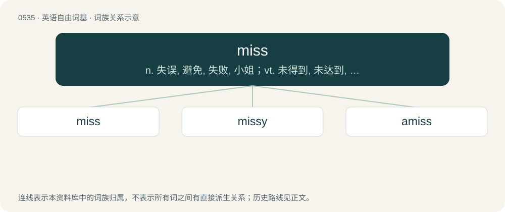

# 0603 · miss — n. 失误, 避免, 失败, 小姐；vt. 未得到, 未达到, 未听到, 未觉察, 逃脱, 遗漏, 错过, 思念；vi. 失败, 击不中

[总目录](../00_总目录_按常用程度.md)

**类型**：英语自由词基　｜　**来源语言**：见词源记录

## 核心含义与来源

- 核心含义：n. 失误, 避免, 失败, 小姐；vt. 未得到, 未达到, 未听到, 未觉察, 逃脱, 遗漏, 错过, 思念；vi. 失败, 击不中
- 英文含义：To fail to hit, catch, grasp, etc.
- 词形：miss

**多个词源／构词路径**：同一拼写可能有不同来源；以下按词性和含义分别列出。

**来源记录 1**（动词；To fail to hit, catch, grasp, etc.）

Verb from Middle English missen, from Old English missan (“to miss, escape the notice of a person”), from Proto-West Germanic \*missijan, from Proto-Germanic \*missijaną (“to miss, go wrong, fail”), from Proto-Indo-European \*meyth₂- (“to change, exchange, trade”). Cognate with West Frisian misse (“to miss”), Dutch missen (“to miss”), German missen (“to miss”), Norwegian Bokmål and Danish miste (“to lose”), Swedish missa (“to miss”), Norwegian Nynorsk, Icelandic missa (“to lose”) and Latin mittere (“to send, let go”). Noun from Middle English misse, mis, from Old English miss (“loss, absence”), from Proto-West Germanic \*miss, from Proto-Germanic \*miss- (“loss”). Cognate with Scots miss (“a loss, want, cause of grief or mourning”), Middle High German misse, mis (“lack, missing, absence”), Icelandic missir (“loss”). Related also to Scots mis (“wrongdoing, sin, guilt”), Dutch mis (“misdeed, wrongdoing, mistake”), Middle Low German misse (“sin, wrong”).

**来源记录 2**（名词；An unmarried woman; a girl.）

From mistress.

## 词族图

## 单词速览（常用到不常用）

| 单词 | 音标 | 释义 |
|---|---|---|
| [miss](#w-1) | 英 /mɪs/ | n. 失误, 避免, 失败, 小姐；vt. 未得到, 未达到, 未听到, 未觉察, 逃脱, 遗漏, 错过, 思念；vi. 失败, 击不中 |
| [missy](#w-2) | /ˈmɪs.i/ | n. 少女, 姑娘, 小姐 |
| [amiss](#w-3) | 英 /əˈmɪs/ | a. 有毛病的, 出差错的；adv. 错误地, 不顺当, 有缺陷地 |

## 逐词详解

### 1. miss

**词性**：动词　｜　**音标**：英 /mɪs/

**中文释义**：n. 失误, 避免, 失败, 小姐；vt. 未得到, 未达到, 未听到, 未觉察, 逃脱, 遗漏, 错过, 思念；vi. 失败, 击不中

**英文义项**：To fail to hit, catch, grasp, etc. / To avoid hitting.

**词源与演化**：

Verb from Middle English missen, from Old English missan (“to miss, escape the notice of a person”), from Proto-West Germanic \*missijan, from Proto-Germanic \*missijaną (“to miss, go wrong, fail”), from Proto-Indo-European \*meyth₂- (“to change, exchange, trade”). Cognate with West Frisian misse (“to miss”), Dutch missen (“to miss”), German missen (“to miss”), Norwegian Bokmål and Danish miste (“to lose”), Swedish missa (“to miss”), Norwegian Nynorsk, Icelandic missa (“to lose”) and Latin mittere (“to send, let go”). Noun from Middle English misse, mis, from Old English miss (“loss, absence”), from Proto-West Germanic \*miss, from Proto-Germanic \*miss- (“loss”). Cognate with Scots miss (“a loss, want, cause of grief or mourning”), Middle High German misse, mis (“lack, missing, absence”), Icelandic missir (“loss”). Related also to Scots mis (“wrongdoing, sin, guilt”), Dutch mis (“misdeed, wrongdoing, mistake”), Middle Low German misse (“sin, wrong”).

**例句**：

> "Is Polly still here?" — "No, sorry, you've just missed her. She left a couple of minutes ago."

该用例对应义项：To be too late to connect with or meet something or someone (a means of transportation, a deadline, etc.).

### 2. missy

**词性**：名词　｜　**音标**：/ˈmɪs.i/

**中文释义**：n. 少女, 姑娘, 小姐

**英文义项**：A young female, or miss; as a term of mild disparagement, typically used jokingly or rebukingly. / A female nurse.

**构词拆分**：miss + -y

**词源与演化**：

From miss + -y.

**例句**：

> That's enough out of you, missy!

该用例对应义项：A young female, or miss; as a term of mild disparagement, typically used jokingly or rebukingly.

### 3. amiss

**词性**：形容词　｜　**音标**：英 /əˈmɪs/

**中文释义**：a. 有毛病的, 出差错的；adv. 错误地, 不顺当, 有缺陷地

**英文义项**：Wrong; faulty; out of order; improper or otherwise incorrect.

**构词拆分**：From a- + miss.

**词源与演化**：

From a- + miss.

**例句**：

> Something amiss in the arrangements had distracted the staff.

该用例对应义项：Wrong; faulty; out of order; improper or otherwise incorrect.
