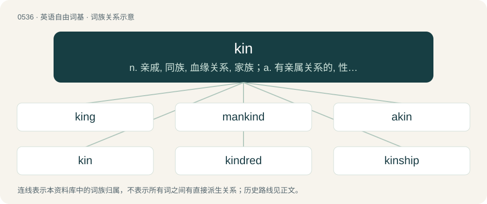

# 0605 · kin — n. 亲戚, 同族, 血缘关系, 家族；a. 有亲属关系的, 性质类似的, 同类的

[总目录](../00_总目录_按常用程度.md)

**类型**：英语自由词基　｜　**来源语言**：见词源记录

## 核心含义与来源

- 核心含义：n. 亲戚, 同族, 血缘关系, 家族；a. 有亲属关系的, 性质类似的, 同类的
- 英文含义：Race; family; breed; kind.
- 词形：kin

**多个词源／构词路径**：同一拼写可能有不同来源；以下按词性和含义分别列出。

**来源记录 1**（名词；Race; family; breed; kind.）

From Middle English kyn, from Old English cynn (“kind, sort, rank”), from Proto-West Germanic \*kuni, from Proto-Germanic \*kunją (“race, generation, descent”), from Proto-Indo-European \*ǵn̥h₁yom, from \*ǵenh₁- (“to produce”). Cognate with Scots kin (“relatives, kinfolk”), North Frisian kinn, kenn (“gender, race, family, kinship”), Dutch kunne (“gender, sex”), Middle Low German kunne (“gender, sex, race, family, lineage”), Danish køn (“gender, sex”), Norwegian Bokmål and Norwegian Nynorsk kjønn (“gender, sex”), Swedish kön (“gender, sex”), Faroese and Icelandic kyn (“gender”), Finnish kunnia (“honour, glory”), Ingrian kunnia (“reputation”), and through Indo-European, with Latin genus (“kind, sort, ancestry, birth”), Ancient Greek γένος (génos, “kind, race”), Sanskrit जनस् (jánas, “kind, race”), Albanian dhen (“(herd of) small cattle”).

**来源记录 2**（动词；To identify with; as in spiritually connect to a fictional or non-fictional being.）

Clipping of fictionkin.

## 词族图

## 单词速览（常用到不常用）

| 单词 | 音标 | 释义 |
|---|---|---|
| [king](#w-1) | 英 /ˈkɪŋɡ/；/ˈkɪŋ/ | n. 国王, 君主；vt. 使...成为君主；vi. 君临, 统治 |
| [mankind](#w-2) | /mænˈkaɪnd/ | n. 人类, 男性 |
| [akin](#w-3) | 英 /əˈkɪn/；美 /ʌˈkɪn/ | a. 同类的, 同族的, 同源的 |
| [kin](#w-4) | /kɪn/ | n. 亲戚, 同族, 血缘关系, 家族；a. 有亲属关系的, 性质类似的, 同类的 |
| [kindred](#w-5) | /ˈkɪndɹɪd/ | n. 家族, 相似, 亲戚关系；a. 同族的, 同类的, 血缘的 |
| [kinship](#w-6) | 美 /ˈkɪnʃɪp/ | n. 亲属关系；\[法\] 亲属关系, 家族关系, 关系 |
| [kinsman](#w-7) | /ˈkinzmən/ | n. 男亲戚, 亲属 |
| [kinfolk](#w-8) | /ˈkinfəuk/ | \[法\] 家属, 亲属, 亲戚 |

## 逐词详解

### 1. king

**词性**：名词　｜　**音标**：英 /ˈkɪŋɡ/；/ˈkɪŋ/

**中文释义**：n. 国王, 君主；vt. 使...成为君主；vi. 君临, 统治

**英文义项**：A male monarch; a man who heads a monarchy; in an absolute monarchy, the supreme ruler of his nation. / The monarch with the most power and authority in a monarchy, regardless of sex.

**构词拆分**：kin + -ing

**词源与演化**：

From Middle English king, kyng, kynge, from Old English cening, cing, cining, cuning, cyncg, cyneg, cyng, cyngc, cynig, cyning, king, kining, kuning, kyning, kyningc (“king”), from Proto-West Germanic \*kuning, from Proto-Germanic \*kuningaz, \*kunungaz (“king”), from \*kunją (“clan, family, kin”), from Proto-Indo-European \*ǵenh₁- (“to produce; to beget”). Equivalent to kin + -ing. Doublet of cyning and knez. Cognates Cognate with Yola king, kinge (“king”), North Frisian kining, köning (“king”), Saterland Frisian Kening, König, Köänig (“king”), West Frisian kening (“king”), Alemannic German Chüng, Künig (“king”), Bavarian Kini (“king”), Central Franconian Künning (“king”), Cimbrian khuuneg (“king”), Dutch koning (“king”), German König (“king”), Luxembourgish Kinnek (“king”), Vilamovian kyng (“king”), Yiddish קעניג (kenig), קיניג (kinig, “king”), Danish kong, konge, konning (“king”), Elfdalian kunungg (“king”), Faroese kongur (“king”), Icelandic kóngur, konungur (“king”), Norwegian Bokmål konge (“king”), Norwegian Nynorsk konge (“king”), Scanian káng (“king”), Swedish konung, kung (“king”), Latgalian and Latvian kungs (“gentlemen”), Lithuanian kunigas (“priest”), Belarusian, Russian, and Ukrainian князь (knjazʹ, “prince; duke”), Bulgarian кнез (knez), княз (knjaz, “prince”), Czech kněz (“priest”), kníže (“prince”), Macedonian кнез (knez, “prince”), Polish ksiądz, xiądz (“priest; prince”), Serbo-Croatian кне̑з, knȇz (“prince”), Slovak kňaz (“priest”), knieža (“prince”), Slovene knez (“prince”), Estonian and Finnish kuningas (“king”), Ingrian kunigas, kunikas, kuningas (“king”), Veps kunigaz (“king”), Votic kunikõz (“king”), Võro kuning (“king”), Inari Sami kunâgâs (“king”), Kildin Sami коа̄нгэсс (kåångess), ко̄нгэс (kōnges, “bridegroom; king”), Lule Sami and Pite Sami gånågis (“king”), Northern Sami gonagas (“king”), Skolt Sami koonǥõs (“king”), Ter Sami конагас (konâgas, “king”); also Breton genel (“to bear”), Irish and Scottish Gaelic gin (“birth; fetus; offspring”), Welsh geni (“to be born”), Latin genō (“to bear, beget; to produce, yield”), Greek γενεά (geneá), γενιά (geniá, “ancestry, kin; generation”), Albanian dhen, dhën (“caprids, small livestock”), Lithuanian žentas (“son-in-law”), Belarusian зяць (zjacʹ, “brother-in-law; son-in-law”), Bulgarian and Macedonian зет (zet, “brother-in-law; son-in-law”), Czech zeť (“son-in-law”), Polish zięć (“son-on-law”), Russian зять (zjatʹ, “brother-in-law; son-in-law”), Serbo-Croatian зе̏т, zȅt (“brother-in-law; son-in-law”), Slovak zať (“son-in-law”), Slovene zet (“son-in-law”), Ukrainian зєть (zjetʹ), зять (zjatʹ, “brother-in-law; son-in-law”), Armenian ծնել (cnel, “to bear”), Avestan 𐬰𐬄𐬚𐬀𐬭 (ząθar, “father, progenitor; Creator”), Pashto زېږېدل (zeǵedël, “to be born”), Persian زادن (zādan / zâdan), زاییدن (zāyīdan / zâyidan, “to give birth”), Sanskrit जनति (janati, “to beget, create, produce; to assign, procure”). Eclipsed non-native Middle English roy (“king”) (Early Modern English roy), borrowed from Old French rei, roi, roy (“king”). The verb is inherited from Middle English kingen, kyngen (“to perform the duties of a king”), itself from the noun.

**例句**：

> Charles the third became the new king of England from 2022.

该用例对应义项：A male monarch; a man who heads a monarchy; in an absolute monarchy, the supreme ruler of his nation.

### 2. mankind

**词性**：名词　｜　**音标**：/mænˈkaɪnd/

**中文释义**：n. 人类, 男性

**英文义项**：The human race in its entirety. / Men collectively, as opposed to all women.

**构词拆分**：man + kin；man + -kind

**词源与演化**：

From Middle English mankynde, alteration (due to kynde = “kind, nature, sort”) of earlier mankyn, from Old English mancynn. Equivalent to man + kin, and/or man + -kind. Cognate with Scots mankind, Middle High German mankünne, Danish mandkøn, Icelandic mannkyn (“mankind”). See also mankin.

**例句**：

> One small step for a man can be a giant leap for mankind.

该用例对应义项：The human race in its entirety.

### 3. akin

**词性**：动词　｜　**音标**：英 /əˈkɪn/；美 /ʌˈkɪn/

**中文释义**：a. 同类的, 同族的, 同源的

**英文义项**：To relate or compare; to liken.

**构词拆分**：a- + kin

**词源与演化**：

From a corruption of of kin, from Middle English of kyn (“related, of kin”), equivalent to a- + kin (1550s). Compare Old English cyn, cynn (“akin, proper, suitable”, adj.).

**例句**：

> I like to akin the P-Diddy case to Gen-Z's version of the O.J. Simpson trial.

该用例对应义项：To relate or compare; to liken.

### 4. kin

**词性**：名词　｜　**音标**：/kɪn/

**中文释义**：n. 亲戚, 同族, 血缘关系, 家族；a. 有亲属关系的, 性质类似的, 同类的

**英文义项**：Race; family; breed; kind. / Persons of the same race or family; kindred.

**词源与演化**：

From Middle English kyn, from Old English cynn (“kind, sort, rank”), from Proto-West Germanic \*kuni, from Proto-Germanic \*kunją (“race, generation, descent”), from Proto-Indo-European \*ǵn̥h₁yom, from \*ǵenh₁- (“to produce”). Cognate with Scots kin (“relatives, kinfolk”), North Frisian kinn, kenn (“gender, race, family, kinship”), Dutch kunne (“gender, sex”), Middle Low German kunne (“gender, sex, race, family, lineage”), Danish køn (“gender, sex”), Norwegian Bokmål and Norwegian Nynorsk kjønn (“gender, sex”), Swedish kön (“gender, sex”), Faroese and Icelandic kyn (“gender”), Finnish kunnia (“honour, glory”), Ingrian kunnia (“reputation”), and through Indo-European, with Latin genus (“kind, sort, ancestry, birth”), Ancient Greek γένος (génos, “kind, race”), Sanskrit जनस् (jánas, “kind, race”), Albanian dhen (“(herd of) small cattle”).

**用法示例／搭配（非完整句）**：

> the starfish and its kin the sea urchin

该用例对应义项：Race; family; breed; kind.

### 5. kindred

**词性**：形容词　｜　**音标**：/ˈkɪndɹɪd/

**中文释义**：n. 家族, 相似, 亲戚关系；a. 同族的, 同类的, 血缘的

**英文义项**：Of the same nature, or of similar character. / Connected, related, cognate, akin.

**构词拆分**：kin + -red

**词源与演化**：

From Middle English kyndrede, from older kynrede (“kindred”), from Old English \*cynrēd, \*cynrǣden (“kindred, family, stock”), from cynn (“kind, kin, lineage”) + -rǣden (“condition, state”). Equivalent to kin + -red, see these. The -d- is epenthetic between a nasal and a liquid (as e.g. in spindle).

**用法示例／搭配（非完整句）**：

> the kindred relationship between neuroscience and neurology

该用例对应义项：Of the same nature, or of similar character.

### 6. kinship

**词性**：名词　｜　**音标**：美 /ˈkɪnʃɪp/

**中文释义**：n. 亲属关系；\[法\] 亲属关系, 家族关系, 关系

**英文义项**：Relation or connection by blood, marriage or adoption. / Relation or connection by nature or character.

**构词拆分**：kin + -ship

**词源与演化**：

From kin + -ship.

**例句**：

> Felt a deep kinship with the other students.

该用例对应义项：a close connection marked by community of interests or similarity in nature or character

### 7. kinsman

**词性**：名词　｜　**音标**：/ˈkinzmən/

**中文释义**：n. 男亲戚, 亲属

**英文义项**：A male relative.

**构词拆分**：kin + -s- + -man

**词源与演化**：

From Middle English kynnesman, equivalent to kin + -s- + -man.

**例句**：

> And he let his kinsman depart: and he returned and went into his own country.

### 8. kinfolk

**词性**：名词　｜　**音标**：/ˈkinfəuk/

**中文释义**：\[法\] 家属, 亲属, 亲戚

**英文义项**：Relatives, relations.

**构词拆分**：kin + folk

**词源与演化**：

From kin + folk.
