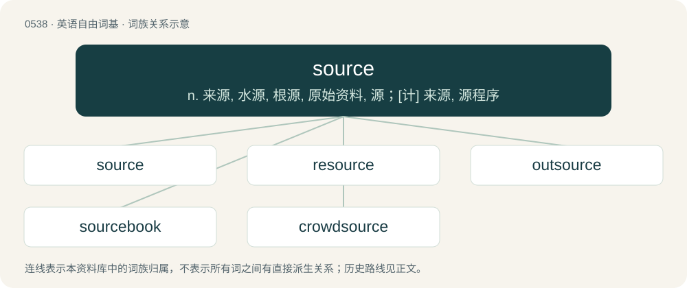

# 0606 · source — n. 来源, 水源, 根源, 原始资料, 源；\[计\] 来源, 源程序

[总目录](../00_总目录_按常用程度.md)

**类型**：英语自由词基　｜　**来源语言**：见词源记录

## 核心含义与来源

- 核心含义：n. 来源, 水源, 根源, 原始资料, 源；\[计\] 来源, 源程序
- 英文含义：The person, place, or thing from which something (information, goods, etc.) comes or is acquired.
- 词形：source

**来源记录 1**（名词；The person, place, or thing from which something (information, goods, etc.) comes or is acquired.）

From Middle English sours, from Old French sorse (“rise, beginning, spring, source”), from sors, past participle of sordre, sourdre, from Latin surgō (“to rise”), which is composed of sub- (“up from below”) + regō (“lead, rule”), ultimately from Proto-Indo-European \*h₃réǵeti (“to straighten; right”), from the root \*h₃reǵ-. Doublet of surge.

## 词族图

## 单词速览（常用到不常用）

| 单词 | 音标 | 释义 |
|---|---|---|
| [source](#w-1) | 英 /sɔːs/；美 /sɔɹs/ | n. 来源, 水源, 根源, 原始资料, 源；\[计\] 来源, 源程序 |
| [resource](#w-2) | 英 /ɹɪˈzɔːs/；美 /ˈɹisɔɹs/ | n. 资源, 财力, 办法, 策略, 急智, 消遣；\[计\] 资源 |
| [outsource](#w-3) | 英 /ˈaʊtˌsɔːs/；美 /ˈaʊtˌsoɹs/ | vt. 把…外包 |
| [sourcebook](#w-4) | /ˈsɔːsbjk/ | n. 原始资料(集),资料读物 |
| [crowdsource](#w-5) |  | 【英文】To delegate a task to a large, diffuse group. |

## 逐词详解

### 1. source

**词性**：名词　｜　**音标**：英 /sɔːs/；美 /sɔɹs/

**中文释义**：n. 来源, 水源, 根源, 原始资料, 源；\[计\] 来源, 源程序

**英文义项**：The person, place, or thing from which something (information, goods, etc.) comes or is acquired. / Spring; fountainhead; wellhead; any collection of water on or under the surface of the ground in which a stream originates.

**词源与演化**：

From Middle English sours, from Old French sorse (“rise, beginning, spring, source”), from sors, past participle of sordre, sourdre, from Latin surgō (“to rise”), which is composed of sub- (“up from below”) + regō (“lead, rule”), ultimately from Proto-Indo-European \*h₃réǵeti (“to straighten; right”), from the root \*h₃reǵ-. Doublet of surge.

**例句**：

> The accused refused to reveal the source of the illegal drugs she was selling.

该用例对应义项：The person, place, or thing from which something (information, goods, etc.) comes or is acquired.

### 2. resource

**词性**：名词　｜　**音标**：英 /ɹɪˈzɔːs/；美 /ˈɹisɔɹs/

**中文释义**：n. 资源, 财力, 办法, 策略, 急智, 消遣；\[计\] 资源

**英文义项**：Something that one uses to achieve an objective, e.g. raw materials or personnel. / A person's capacity to deal with difficulty.

**构词拆分**：re- + source

**词源与演化**：

Borrowed from Middle French ressource, from Old French resourse, resource (“a source, spring”), from resourdre, from Latin resurgō (“to rise again, spring up anew”). Equivalent to re- + source. See resourd, resurgent, source.

**用法示例／搭配（非完整句）**：

> a man or woman of resource

该用例对应义项：A person's capacity to deal with difficulty.

### 3. outsource

**词性**：动词　｜　**音标**：英 /ˈaʊtˌsɔːs/；美 /ˈaʊtˌsoɹs/

**中文释义**：vt. 把…外包

**英文义项**：To transfer the management or day-to-day execution of a business function to a third-party service provider.

**构词拆分**：out- + source

**词源与演化**：

From out- + source.

**例句**：

> They decided to outsource the design and manufacture of the system to a vendor.

该用例对应义项：To transfer the management or day-to-day execution of a business function to a third-party service provider.

### 4. sourcebook

**词性**：名词　｜　**音标**：/ˈsɔːsbjk/

**中文释义**：n. 原始资料(集),资料读物

**英文义项**：A book consisting of a collection of writings on a particular subject. / A publication intended to supplement the core materials of a roleplaying game.

**构词拆分**：source + book

**词源与演化**：

From source + book.

### 5. crowdsource

**词性**：动词

**英文义项**：To delegate a task to a large, diffuse group.

**构词拆分**：crowd + source

**词源与演化**：

From crowd + source; more at crowdsourcing.
