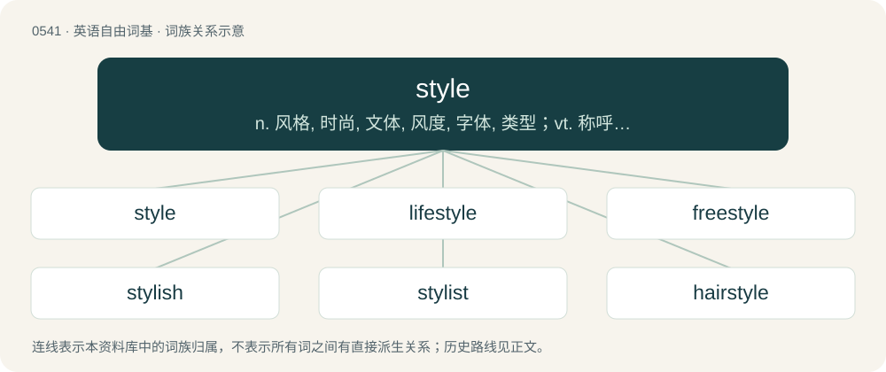

# 0609 · style — n. 风格, 时尚, 文体, 风度, 字体, 类型；vt. 称呼, (根据新款式)设计, 使合潮流；n. 风格, 样式

[总目录](../00_总目录_按常用程度.md)

**类型**：英语自由词基　｜　**来源语言**：见词源记录

## 核心含义与来源

- 核心含义：n. 风格, 时尚, 文体, 风度, 字体, 类型；vt. 称呼, (根据新款式)设计, 使合潮流；n. 风格, 样式
- 英文含义：A tool with a sharp point used in engraving; a burin, a graver, a stylet, a stylus.
- 词形：style

**来源记录 1**（名词；A tool with a sharp point used in engraving; a burin, a graver, a stylet, a stylus.）

The noun is derived from Middle English stile (“writing tool; piece of written work; characteristic mode of expression; demeanour; person's designation or title; stem of a plant; period of time”) (compare semantic development to по́черк (póčerk, “handwriting, style”)), from Old French estile, or from Medieval Latin stylus, both from Latin stilus (“pointed instrument; writing tool; composition; characteristic mode of expression; stem of a plant”), from Proto-Indo-European \*(s)teyg- (“to be sharp; to pierce, prick, puncture, stab; to goad”). Doublet of stylus. The verb is derived from the noun. Cognates \*Catalan estil (“engraving tool, stylus; gnomon; manner of doing something, style; fashionable skill, grace”) \* German Stiel (“handle; stalk”) \* Italian stilo (“needle, stylus; fountain pen; beam; gnomon; part of pistil, style”) \* Occitan estil \* Portuguese estilo (“writing tool, stylus; manner of doing something, style”) \* Spanish estilo (“writing tool, stylus; manner of doing something, style; fashionable skill, grace; part of pistil, style”).

## 词族图

## 单词速览（常用到不常用）

| 单词 | 音标 | 释义 |
|---|---|---|
| [style](#w-1) | 英 /staɪl/；/staɪ.əl/ | n. 风格, 时尚, 文体, 风度, 字体, 类型；vt. 称呼, (根据新款式)设计, 使合潮流；n. 风格, 样式 |
| [lifestyle](#w-2) | /ˈlaɪfˌstaɪl/ | n. 生活方式 |
| [freestyle](#w-3) | /ˈfɹiːˌstaɪl/ | n. 自由式 |
| [stylish](#w-4) | /ˈstaɪlɪʃ/ | a. 现代风格的, 流行的, 潇洒的 |
| [stylist](#w-5) | /ˈstaɪlɪst/ | n. 文体学家, 时装设计师 |
| [hairstyle](#w-6) | /ˈhєəstail/ | n. 发型 |
| [stylistic](#w-7) | /staɪˈlɪstɪk/ | a. 格式上的, 体裁上的 |
| [styler](#w-8) | /ˈstailə/ | n. 式样设计者；装潢设计师；时装设计师；发型设计师 |
| [slopestyle](#w-9) |  | 单板滑雪 |
| [hardstyle](#w-10) |  | 【英文】A genre of electronic dance music that combines elements of trance, techno, and hardcore, with origins in the Netherlands and Belgium. |

## 逐词详解

### 1. style

**词性**：名词　｜　**音标**：英 /staɪl/；/staɪ.əl/

**中文释义**：n. 风格, 时尚, 文体, 风度, 字体, 类型；vt. 称呼, (根据新款式)设计, 使合潮流；n. 风格, 样式

**英文义项**：A tool with a sharp point used in engraving; a burin, a graver, a stylet, a stylus. / The gnomon or pin of a sundial, the shadow of which indicates the hour.

**词源与演化**：

The noun is derived from Middle English stile (“writing tool; piece of written work; characteristic mode of expression; demeanour; person's designation or title; stem of a plant; period of time”) (compare semantic development to по́черк (póčerk, “handwriting, style”)), from Old French estile, or from Medieval Latin stylus, both from Latin stilus (“pointed instrument; writing tool; composition; characteristic mode of expression; stem of a plant”), from Proto-Indo-European \*(s)teyg- (“to be sharp; to pierce, prick, puncture, stab; to goad”). Doublet of stylus. The verb is derived from the noun. Cognates \*Catalan estil (“engraving tool, stylus; gnomon; manner of doing something, style; fashionable skill, grace”) \* German Stiel (“handle; stalk”) \* Italian stilo (“needle, stylus; fountain pen; beam; gnomon; part of pistil, style”) \* Occitan estil \* Portuguese estilo (“writing tool, stylus; manner of doing something, style”) \* Spanish estilo (“writing tool, stylus; manner of doing something, style; fashionable skill, grace; part of pistil, style”).

**例句**：

> The villagers styled him as my Liege, and this style, once established, was seldom forgone.

该用例对应义项：A legal or traditional term or formula of words used to address or refer to a person, especially a monarch or a person holding a post or having a title.

### 2. lifestyle

**词性**：名词　｜　**音标**：/ˈlaɪfˌstaɪl/

**中文释义**：n. 生活方式

**英文义项**：A style of living that reflects the attitudes and values of a person or group. / The totality of the likes and dislikes of a particular section of the market, especially when expressed in terms of the products and services that they would buy; a marketing strategy based on the self-image of such a group.

**构词拆分**：life + style

**词源与演化**：

From life + style.

**例句**：

> An orderly lifestyle and a regular diet are the keys to health.

### 3. freestyle

**词性**：名词　｜　**音标**：/ˈfɹiːˌstaɪl/

**中文释义**：n. 自由式

**英文义项**：A swimming event in which the contestants may choose any stroke. / The swimming stroke commonly referred to as the front crawl or the Australian crawl.

**构词拆分**：free + style

**词源与演化**：

From free + style.

**例句**：

> Mary reluctantly agreed to listen to another one of Tom's freestyle raps.

### 4. stylish

**词性**：形容词　｜　**音标**：/ˈstaɪlɪʃ/

**中文释义**：a. 现代风格的, 流行的, 潇洒的

**英文义项**：Having style. / Having elegance or taste or refinement in manners or dress.

**构词拆分**：style + -ish

**词源与演化**：

From style + -ish.

**例句**：

> A little less posh but every bit as stylish as Lord Peter Wimsey.

该用例对应义项：having elegance or taste or refinement in manners or dress

### 5. stylist

**词性**：名词　｜　**音标**：/ˈstaɪlɪst/

**中文释义**：n. 文体学家, 时装设计师

**英文义项**：A designer. / A hairdresser.

**构词拆分**：style + -ist

**词源与演化**：

From style + -ist. Piecewise doublet of stylista.

**例句**：

> Tom thanked his hair stylist and stunt double when accepting his Academy Award.

### 6. hairstyle

**词性**：名词　｜　**音标**：/ˈhєəstail/

**中文释义**：n. 发型

**英文义项**：The style in which someone's hair has been cut and arranged.

**构词拆分**：hair + style

**词源与演化**：

From hair + style.

**例句**：

> She walked slowly through the park to show off her new hairstyle.

### 7. stylistic

**词性**：形容词　｜　**音标**：/staɪˈlɪstɪk/

**中文释义**：a. 格式上的, 体裁上的

**英文义项**：Of or pertaining to style, especially to linguistic or literary style.

**构词拆分**：style + -istic

**词源与演化**：

From style + -istic.

**例句**：

> Take care to avoid stylistic errors while speaking.

### 8. styler

**词性**：名词　｜　**音标**：/ˈstailə/

**中文释义**：n. 式样设计者；装潢设计师；时装设计师；发型设计师

**英文义项**：Someone who styles (especially hair), a stylist.

**构词拆分**：style + -er

**词源与演化**：

From style + -er.

### 9. slopestyle

**词性**：名词

**中文释义**：单板滑雪

**英文义项**：A discipline of freestyle skiing or snowboarding involving an obstacle course.

**构词拆分**：slope + style

**词源与演化**：

From slope + style or a blend of slope + freestyle.

**例句**：

> Sage Kotsenburg won the first gold medal for the United States in the men's snowboard slopestyle.

### 10. hardstyle

**词性**：名词

**英文义项**：A genre of electronic dance music that combines elements of trance, techno, and hardcore, with origins in the Netherlands and Belgium. / In contrast to sports style, a specifically intensive workout exercise, such as a swing squat.

**构词拆分**：hard + style

**词源与演化**：

From hard + style.
