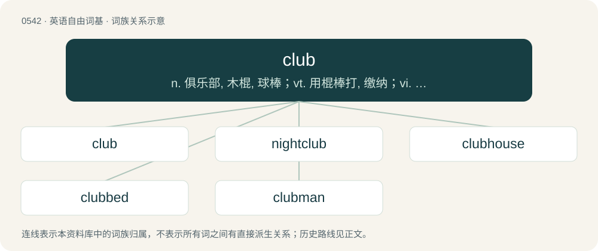

# 0610 · club — n. 俱乐部, 木棍, 球棒；vt. 用棍棒打, 缴纳；vi. 联合起来

[总目录](../00_总目录_按常用程度.md)

**类型**：英语自由词基　｜　**来源语言**：见词源记录

## 核心含义与来源

- 核心含义：n. 俱乐部, 木棍, 球棒；vt. 用棍棒打, 缴纳；vi. 联合起来
- 英文含义：A heavy object, often a kind of stick, intended for use as a bludgeoning weapon or a plaything.
- 词形：club

**来源记录 1**（名词；A heavy object, often a kind of stick, intended for use as a bludgeoning weapon or a plaything.）

Inherited from Middle English clubbe, from Old Norse klubba, klumba (“cudgel”), from Proto-Germanic \*klumpô (“clip, clasp; clump, lump; log, block”). Cognate with English clump, cloud, Latin globus, glomus; and perhaps related to Middle Low German kolve (“bulb”), German Kolben (“butt, bulb, club”).

## 词族图

## 单词速览（常用到不常用）

| 单词 | 音标 | 释义 |
|---|---|---|
| [club](#w-1) | 英 /klʌb/ | n. 俱乐部, 木棍, 球棒；vt. 用棍棒打, 缴纳；vi. 联合起来 |
| [nightclub](#w-2) | /ˈnʌɪtklʌb/ | n. 夜总会 |
| [clubhouse](#w-3) | 美 /ˈklʌbˌhaʊs/ | n. 俱乐部会所 |
| [clubbed](#w-4) | /klʌbd/ | a. 棒状的 |
| [clubman](#w-5) | /ˈklʌbmən/ | n. 俱乐部的会员, 爱好俱乐部活动的人 |

## 逐词详解

### 1. club

**词性**：名词　｜　**音标**：英 /klʌb/

**中文释义**：n. 俱乐部, 木棍, 球棒；vt. 用棍棒打, 缴纳；vi. 联合起来

**英文义项**：A heavy object, often a kind of stick, intended for use as a bludgeoning weapon or a plaything. / An implement to hit the ball in certain ball games, such as golf.

**词源与演化**：

Inherited from Middle English clubbe, from Old Norse klubba, klumba (“cudgel”), from Proto-Germanic \*klumpô (“clip, clasp; clump, lump; log, block”). Cognate with English clump, cloud, Latin globus, glomus; and perhaps related to Middle Low German kolve (“bulb”), German Kolben (“butt, bulb, club”).

**例句**：

> She was sitting in a jazz club, sipping wine and listening to a bass player's solo.

该用例对应义项：An establishment that provides staged entertainment, often with food and drink, such as a nightclub.

### 2. nightclub

**词性**：动词　｜　**音标**：/ˈnʌɪtklʌb/

**中文释义**：n. 夜总会

**英文义项**：To visit a nightclub (or nightclubs) for entertainment.

**构词拆分**：night + club

**词源与演化**：

From night + club.

**例句**：

> Tom was able to hear the music from nightclub down the street.

### 3. clubhouse

**词性**：名词　｜　**音标**：美 /ˈklʌbˌhaʊs/

**中文释义**：n. 俱乐部会所

**英文义项**：Any building used by a club for meetings or social activities. / A locker room and possibly associated rooms used by an athletic team.

**构词拆分**：club + house

**词源与演化**：

From club + house.

**例句**：

> The clubhouse needed a new roof.

该用例对应义项：a building that is occupied by a social club

### 4. clubbed

**词性**：形容词　｜　**音标**：/klʌbd/

**中文释义**：a. 棒状的

**英文义项**：Shaped like a club; grasped like, or used as, a club.

**构词拆分**：club + -ed

**词源与演化**：

From Middle English clubbyd; equivalent to club + -ed.

**例句**：

> The girls clubbed together to help the poor family.

### 5. clubman

**词性**：名词　｜　**音标**：/ˈklʌbmən/

**中文释义**：n. 俱乐部的会员, 爱好俱乐部活动的人

**英文义项**：A man who attends a social club. / A warrior who uses a club as a weapon.

**构词拆分**：club + -man

**词源与演化**：

From club + -man.
