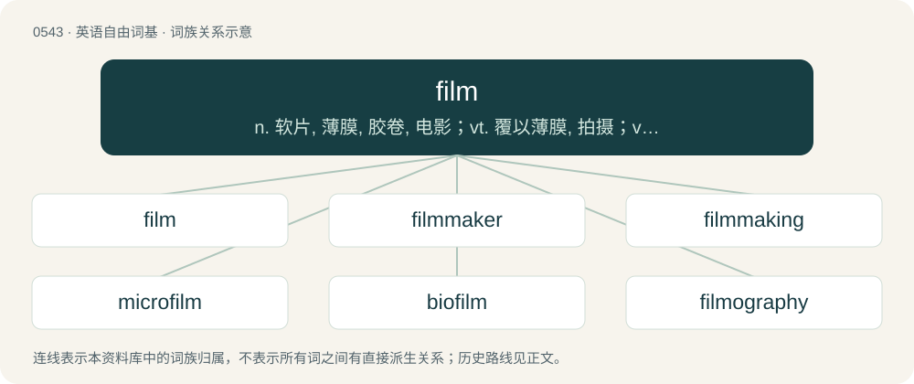

# 0611 · film — n. 软片, 薄膜, 胶卷, 电影；vt. 覆以薄膜, 拍摄；vi. 生薄膜, 拍电影

[总目录](../00_总目录_按常用程度.md)

**类型**：英语自由词基　｜　**来源语言**：见词源记录

## 核心含义与来源

- 核心含义：n. 软片, 薄膜, 胶卷, 电影；vt. 覆以薄膜, 拍摄；vi. 生薄膜, 拍电影
- 英文含义：A thin layer of some substance; a pellicle; a membranous covering, causing opacity.
- 词形：film

**来源记录 1**（名词；A thin layer of some substance; a pellicle; a membranous covering, causing opacity.）

From Middle English filme, from Old English filmen (“film, membrane, thin skin, foreskin”), from Proto-West Germanic \*filmīn-, from Proto-Germanic \*filmīn- (“thin skin, membrane”) (compare Proto-Germanic \*felma- (“skin, hide”)), from Proto-Indo-European \*pél-mo- (“membrane”), from \*pel- (“to cover, skin”). Cognate with Old Frisian filmene (“thin skin, human skin”), Middle Dutch velm, vilm (“fleece, film, membrane”), Old High German felm (“peel, skin, wrap”), Old English \*felma (in ǣġerfelma (“egg membrane”)). Related also to Dutch vel (“sheet, skin”), German Fell (“skin, hide, fur”), Swedish fjäll (“fur blanket, cloth, scale”), Norwegian fille (“rag, cloth”), Lithuanian plėvē (“membrane, scab”), Russian плева́ (plevá, “membrane”), Ancient Greek πέλμα (pélma, “sole of the foot”). More at fell. Sense of a thin coat of something is 1577, extended by 1845 to the coating of chemical gel on photographic plates. By 1895 this also meant the coating plus the paper or celluloid.

## 词族图

## 单词速览（常用到不常用）

| 单词 | 音标 | 释义 |
|---|---|---|
| [film](#w-1) | /fɪlm/ | n. 软片, 薄膜, 胶卷, 电影；vt. 覆以薄膜, 拍摄；vi. 生薄膜, 拍电影 |
| [filmmaker](#w-2) | /ˈfilm,meikə(r)/ | n. 电影制作人 |
| [filmmaking](#w-3) | /ˈfilm.meikiŋ/ | n. 制片, 电影摄制 |
| [microfilm](#w-4) | /ˈmaikrəufilm/ | n. 缩影胶卷；v. 缩微拍摄；\[计\] 缩微胶片; 缩微胶卷 |
| [biofilm](#w-5) | /ˈbɪɒfɪlm/ | 生物膜 |
| [filmography](#w-6) | /filˈmɔ^rəfi/ | (某一导演摄制或名演员导演的)全部影片目录 |
| [filmic](#w-7) | /ˈfɪlmɪk/ | a. 电影的 |
| [filmy](#w-8) | /ˈfɪlmi/ | a. 薄膜的, 薄的, 朦胧的 |
| [filmer](#w-9) |  | 【英文】One who films with a camera. |

## 逐词详解

### 1. film

**词性**：名词　｜　**音标**：/fɪlm/

**中文释义**：n. 软片, 薄膜, 胶卷, 电影；vt. 覆以薄膜, 拍摄；vi. 生薄膜, 拍电影

**英文义项**：A thin layer of some substance; a pellicle; a membranous covering, causing opacity. / A medium used to capture images in a camera.

**词源与演化**：

From Middle English filme, from Old English filmen (“film, membrane, thin skin, foreskin”), from Proto-West Germanic \*filmīn-, from Proto-Germanic \*filmīn- (“thin skin, membrane”) (compare Proto-Germanic \*felma- (“skin, hide”)), from Proto-Indo-European \*pél-mo- (“membrane”), from \*pel- (“to cover, skin”). Cognate with Old Frisian filmene (“thin skin, human skin”), Middle Dutch velm, vilm (“fleece, film, membrane”), Old High German felm (“peel, skin, wrap”), Old English \*felma (in ǣġerfelma (“egg membrane”)). Related also to Dutch vel (“sheet, skin”), German Fell (“skin, hide, fur”), Swedish fjäll (“fur blanket, cloth, scale”), Norwegian fille (“rag, cloth”), Lithuanian plėvē (“membrane, scab”), Russian плева́ (plevá, “membrane”), Ancient Greek πέλμα (pélma, “sole of the foot”). More at fell. Sense of a thin coat of something is 1577, extended by 1845 to the coating of chemical gel on photographic plates. By 1895 this also meant the coating plus the paper or celluloid.

**用法示例／搭配（非完整句）**：

> a clear plastic film for wrapping food

该用例对应义项：A thin layer of some substance; a pellicle; a membranous covering, causing opacity.

### 2. filmmaker

**词性**：名词　｜　**音标**：/ˈfilm,meikə(r)/

**中文释义**：n. 电影制作人

**英文义项**：A producer or director of films/movies.

**构词拆分**：film + maker

**词源与演化**：

From film + maker.

**例句**：

> The filmmaker's goal is to entertain, while also making her audience think.

### 3. filmmaking

**词性**：名词　｜　**音标**：/ˈfilm.meikiŋ/

**中文释义**：n. 制片, 电影摄制

**英文义项**：The activity of preparing edited video works, formerly principally films, whether for entertainment or other purposes. / The manufacture of physical film.

**构词拆分**：film + making

**词源与演化**：

From film + making.

### 4. microfilm

**词性**：名词　｜　**音标**：/ˈmaikrəufilm/

**中文释义**：n. 缩影胶卷；v. 缩微拍摄；\[计\] 缩微胶片; 缩微胶卷

**英文义项**：A continuous roll of film containing photographs of documents at a greatly reduced size.

**构词拆分**：micro- + film

**词源与演化**：

From micro- + film.

**例句**：

> The library has the paper's archives on microfilm.

### 5. biofilm

**词性**：名词　｜　**音标**：/ˈbɪɒfɪlm/

**中文释义**：生物膜

**英文义项**：A structured community of microorganisms, such as bacteria, that adhere to a surface and are embedded in a self-produced protective matrix of mucuslike extracellular material.

**构词拆分**：bio- + film

**词源与演化**：

From bio- + film. First used in the early 1970s in the context of wastewater treatment.

### 6. filmography

**词性**：名词　｜　**音标**：/filˈmɔ^rəfi/

**中文释义**：(某一导演摄制或名演员导演的)全部影片目录

**英文义项**：A selective list of movie titles that share a similar characteristic such as the same genre, the same director, the same actor etc.

**构词拆分**：film + -graphy

**词源与演化**：

From film + -ography.

### 7. filmic

**词性**：形容词　｜　**音标**：/ˈfɪlmɪk/

**中文释义**：a. 电影的

**英文义项**：Of or relating to movies; cinematic.

**构词拆分**：film + -ic

**词源与演化**：

From film + -ic. Doublet of filmy.

### 8. filmy

**词性**：形容词　｜　**音标**：/ˈfɪlmi/

**中文释义**：a. 薄膜的, 薄的, 朦胧的

**英文义项**：Resembling or made of a thin film; gauzy. / Covered by (or as if by) a film; hazy.

**构词拆分**：film + -y

**词源与演化**：

From film + -y. Cognate with Middle Dutch velmich, vilmich (“filmy, membranous”). Doublet of filmic.

**例句**：

> Filmy wings of a moth.

该用例对应义项：so thin as to transmit light

### 9. filmer

**词性**：名词

**英文义项**：One who films with a camera. / One who copies media to microfilm.

**构词拆分**：film + -er

**词源与演化**：

From film + -er.
