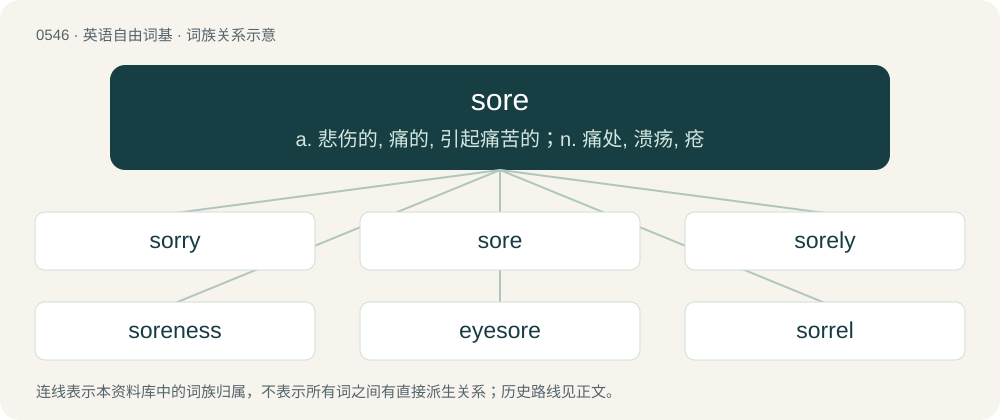

# 0615 · sore — a. 悲伤的, 痛的, 引起痛苦的；n. 痛处, 溃疡, 疮

[总目录](../00_总目录_按常用程度.md)

**类型**：英语自由词基　｜　**来源语言**：见词源记录

## 核心含义与来源

- 核心含义：a. 悲伤的, 痛的, 引起痛苦的；n. 痛处, 溃疡, 疮
- 英文含义：Causing pain or discomfort; painfully sensitive.
- 词形：sore

**多个词源／构词路径**：同一拼写可能有不同来源；以下按词性和含义分别列出。

**来源记录 1**（形容词；Causing pain or discomfort; painfully sensitive.）

From Middle English sor, from Old English sār (“ache, wound”, noun) and sār (“painful, grievous”, adjective), from Proto-West Germanic \*sair, from Proto-Germanic \*sairaz (adjective) from Proto-Indo-European \*seh₂iro-, enlargement of \*seh₂y- (“to be fierce, afflict”). See also Dutch zeer (“sore, ache”), Danish sår (“wound”), German sehr (“very”); also Hittite \[script needed\] (sāwar, “anger”), Welsh hoed (“pain”), Ancient Greek αἱμωδία (haimōdía, “sensation of having teeth on edge”).

**来源记录 2**（名词；A young hawk or falcon in its first year.）

From Middle English sor (“sorrel”), from Old French sor (“sorrel; reddish”). Compare French saur (“(archaic) reddish-brown; describing a young bird of prey”).

## 词族图

## 单词速览（常用到不常用）

| 单词 | 音标 | 释义 |
|---|---|---|
| [sorry](#w-1) | 英 /ˈsɒɹi/；美 /ˈsɑɹi/ | a. 难过的, 悲哀的, 遗憾的 |
| [sore](#w-2) | 英 /sɔː/；美 /soɹ/ | a. 悲伤的, 痛的, 引起痛苦的；n. 痛处, 溃疡, 疮 |
| [sorely](#w-3) | 英 /ˈsɔːli/；美 /ˈsɔɹli/ | adv. 疼痛地, 强烈地, 非常 |
| [soreness](#w-4) | /ˈsɒːnis/ | n. 痛苦, 悲伤, 愤慨 |
| [eyesore](#w-5) | 英 /ˈaɪsɔː/；美 /ˈaɪsoɹ/ | n. 眼中钉 |
| [sorrel](#w-6) | 英 /ˈsɒɹəl/；美 /ˈsɔɹəl/ | 【英文】A brown colour, with a tint of red. |

## 逐词详解

### 1. sorry

**词性**：形容词　｜　**音标**：英 /ˈsɒɹi/；美 /ˈsɑɹi/

**中文释义**：a. 难过的, 悲哀的, 遗憾的

**英文义项**：Regretful or apologetic for one's actions. / Grieved or saddened, especially by the loss of something or someone.

**构词拆分**：By surface analysis, sor(e) + -y

**词源与演化**：

From Middle English sory, from Old English sāriġ (“feeling or expressing grief, sorry, grieved, sorrowful, sad, mournful, bitter”), from Proto-West Germanic \*sairag, from Proto-Germanic \*sairagaz (“sad”), from Proto-Indo-European \*seh₂yro (“hard, rough, painful”). Cognate with Scots sairie (“sad, grieved”), Saterland Frisian seerich (“sore, inflamed”), West Frisian searich (“sad, sorry”), Low German serig (“sick, scabby”), German dialectal sehrig (“sore, sad, painful”), Swedish sårig. By surface analysis, sor(e) + -y. Unrelated to sorrow despite the similarity in form and meaning.

**例句**：

> The President was sorry to hear that the Ambassador was leaving.

该用例对应义项：Grieved or saddened, especially by the loss of something or someone.

### 2. sore

**词性**：形容词　｜　**音标**：英 /sɔː/；美 /soɹ/

**中文释义**：a. 悲伤的, 痛的, 引起痛苦的；n. 痛处, 溃疡, 疮

**英文义项**：Causing pain or discomfort; painfully sensitive. / Sensitive; tender; easily pained, grieved, or vexed; very susceptible of irritation.

**词源与演化**：

From Middle English sor, from Old English sār (“ache, wound”, noun) and sār (“painful, grievous”, adjective), from Proto-West Germanic \*sair, from Proto-Germanic \*sairaz (adjective) from Proto-Indo-European \*seh₂iro-, enlargement of \*seh₂y- (“to be fierce, afflict”). See also Dutch zeer (“sore, ache”), Danish sår (“wound”), German sehr (“very”); also Hittite \[script needed\] (sāwar, “anger”), Welsh hoed (“pain”), Ancient Greek αἱμωδία (haimōdía, “sensation of having teeth on edge”).

**例句**：

> The school was in sore need of textbooks, theirs having been ruined in the flood.

该用例对应义项：Dire; distressing.

### 3. sorely

**词性**：副词　｜　**音标**：英 /ˈsɔːli/；美 /ˈsɔɹli/

**中文释义**：adv. 疼痛地, 强烈地, 非常

**英文义项**：In a sore or desperate manner. / Very, extremely.

**构词拆分**：sore + -ly

**词源与演化**：

From Middle English sorely, from Old English sārlīċ (adjective), sārlīċe (adverb); equivalent to sore + -ly.

**例句**：

> The Master will teach you the discipline you sorely lack.

### 4. soreness

**词性**：名词　｜　**音标**：/ˈsɒːnis/

**中文释义**：n. 痛苦, 悲伤, 愤慨

**英文义项**：The property, state, or condition of being sore; painfulness. / A lingering emotional pain resulting in bitterness or resentment.

**构词拆分**：sore + -ness

**词源与演化**：

From Middle English sornes, sornesse, sarnesse, from Old English sārnes (“bodily pain; mental pain, affliction, grief”), from Proto-West Germanic \*sairanassī, equivalent to sore + -ness. Cognate with Scots sairness (“soreness”), Old Frisian sērnisse, sērnesse (“injury, lesion”), Middle Low German sêrnisse, sêrenisse (“wounding, injury, distress, need”).

**例句**：

> The salve made the soreness go away, but with the aches gone I suddenly noticed my other pains.

该用例对应义项：The property, state, or condition of being sore; painfulness.

### 5. eyesore

**词性**：名词　｜　**音标**：英 /ˈaɪsɔː/；美 /ˈaɪsoɹ/

**中文释义**：n. 眼中钉

**英文义项**：An eye lesion. / A displeasing sight; something prominently ugly or unsightly.

**构词拆分**：eye + sore

**词源与演化**：

From Middle English eye sor, eie-sor, eyen soore, eæge-sare, equivalent to eye + sore.

**例句**：

> The building, towering over its surroundings with its square concrete frame and reflective walls of gold-tinted glass, was an eyesore visible throughout the city.

该用例对应义项：A displeasing sight; something prominently ugly or unsightly.

### 6. sorrel

**词性**：名词　｜　**音标**：英 /ˈsɒɹəl/；美 /ˈsɔɹəl/

**英文义项**：A brown colour, with a tint of red.

**构词拆分**：sore (“reddish-brown”) + -el (diminutive suffix)

**词源与演化**：

From Middle English \*sorel, from Middle French \*sorel, sorrel, surrel, from Middle French sor (“yellowish-brown, reddish-brown”), probably from Old Frankish \*saur (“dried”), from Proto-Germanic \*sauzaz (“dry”), from Proto-Indo-European \*saus- (“dry, parched”); equivalent to sore (“reddish-brown”) + -el (diminutive suffix). Cognate with Middle Dutch soor (“dry”), Old High German sōrēn (“to become dry”), and Old English sēar (“withered, barren”). See also sere.
