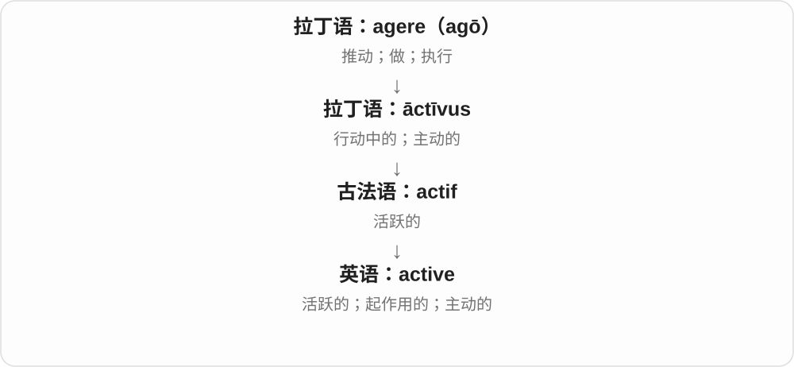
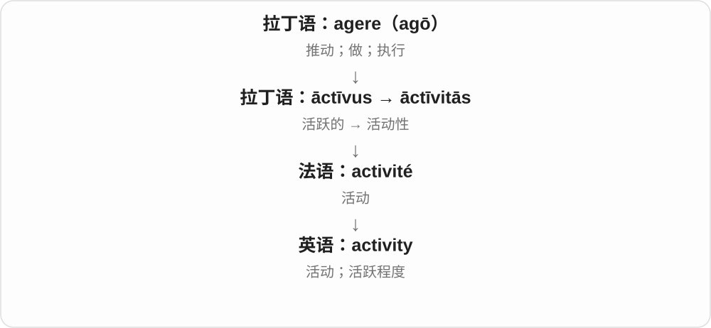
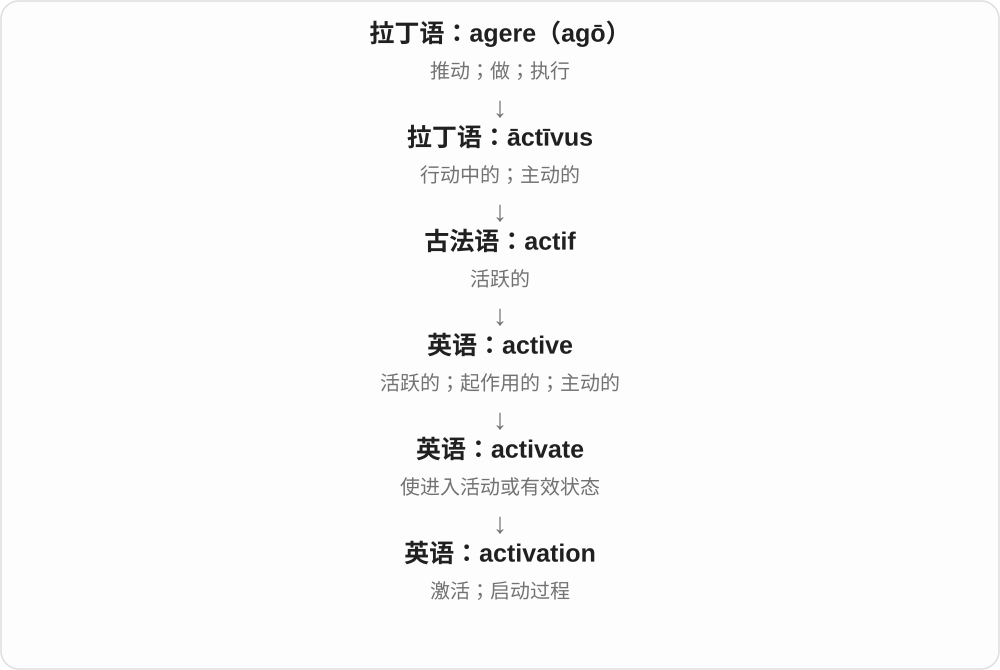
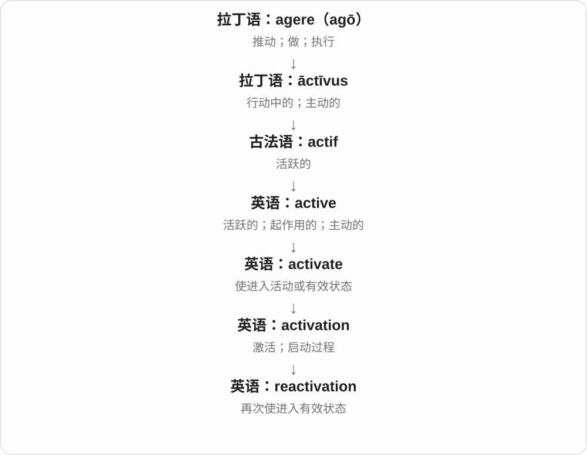
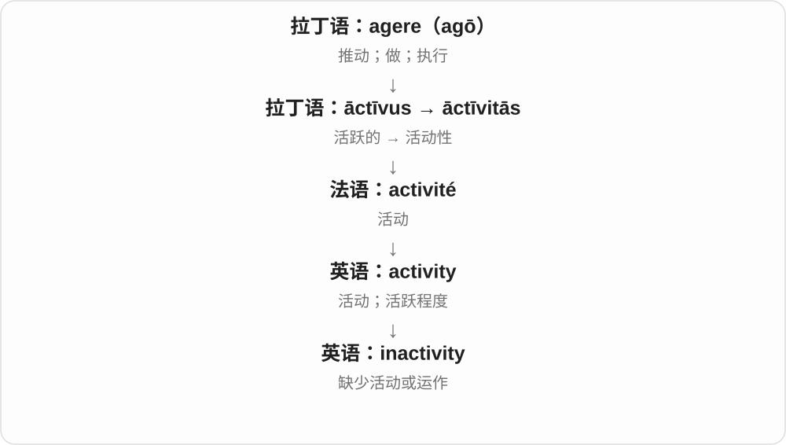
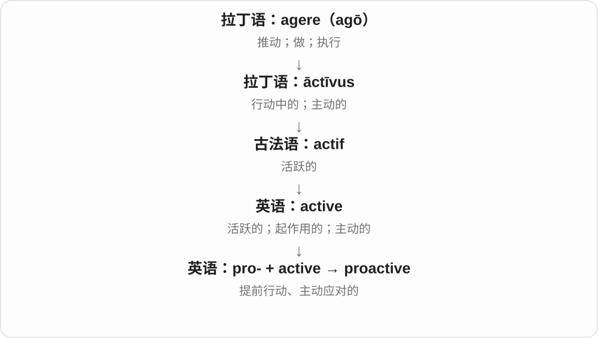

# 0616 · active — 活跃；起作用；启动；采取行动

[逐词精讲目录](../00_逐词精讲目录.md) · [总目录](../00_总目录_按常用程度.md)

## 核心词根与来源

active 经法语来自拉丁语 āctīvus，与 agere 做、行动的词族有关。英语后续用 -ate、-ist、-ism 等继续构词。

**ACTIVE：真的在行动，或者让东西开始起作用**

先区别状态 active、方式 actively、启动 activate，再看否定、再次启用与社会倡议这几支。

- **状态、方式与活动**：active · actively · activity
- **启动、停用、恢复与程度**：activate · activation · inactive · inactivity · reactivate · reactivation · overactive · hyperactive
- **倡议行动与服装名称**：activist · activism · activewear
- **其他常用历史词族组合**：interactive · proactive · retroactive · radioactive · psychoactive · bioactive
- **activist → activists：不只主张，还主动推动**：active · activist · activists

## 词形与演化规律

active → actively、activity；activate → activation；inactive → inactivity；reactivate → reactivation；overactive、hyperactive；activist ↔ activism；activewear 另看衣物类别。

active 的 activ- 词干与人物 ist 结合，再加复数 s。

## 单词速览（按词族由简到繁）

同一基础词的相关扩展放在一起，先读基础形式，再读扩展；各组之间优先读常用的。具体词源关系见各词讲解。

| 单词 | 音标 | 核心意思 |
|---|---|---|
| [active](#w-1) | /ˈæktɪv/ | 活跃的；正在起作用的；主动的 |
| [activity](#w-2) | /ækˈtɪvəti/ | 活动；活跃状态；活动量 |
| [actively](#w-3) | /ˈæktɪvli/ | 积极地；主动地；正在活跃地 |
| [activist](#w-4) | /ˈæktɪvɪst/ | 行动倡议者；积极推动社会等议题的人 |
| [activists](#w-21) | /ˈæktɪvɪsts/ | 积极行动者、活动人士〔复数〕 |
| [activate](#w-7) | /ˈæktɪveɪt/ | 激活；启动；使起作用 |
| [activation](#w-6) | /ˌæktɪˈveɪʃən/ | 激活；启动；使生效 |
| [reactivation](#w-20) | /riːˌæktɪˈveɪʃən/ | 重新启用；再激活 |
| [reactivate](#w-19) | /ˌriːˈæktɪveɪt/ | 重新激活；恢复启用 |
| [activism](#w-9) | /ˈæktɪvɪzəm/ | 行动主义；社会议题中的积极行动、倡议 |
| [activewear](#w-16) | 英 /ˈæktɪvweə/；美 /ˈæktɪvwer/ | 运动休闲服装；适合运动的服装类别 |
| [interactive](#w-5) | 英 /ˌɪntəˈræktɪv/；美 /ˌɪntərˈæktɪv/ | 互动的；交互式的 |
| [radioactive](#w-8) | 英 /ˌreɪdiəʊˈæktɪv/；美 /ˌreɪdioʊˈæktɪv/ | 有放射性的；与放射性有关的 |
| [inactive](#w-17) | /ɪnˈæktɪv/ | 不活跃的；未启用的；不起作用的 |
| [inactivity](#w-18) | /ˌɪnækˈtɪvəti/ | 不活动；闲置；停滞状态 |
| [proactive](#w-10) | 英 /prəʊˈæktɪv/；美 /proʊˈæktɪv/ | 提前行动的；主动应对的 |
| [retroactive](#w-11) | 英 /ˌretrəʊˈæktɪv/；美 /ˌretroʊˈæktɪv/ | 追溯生效的；有追溯效力的 |
| [psychoactive](#w-12) | 英 /ˌsaɪkəʊˈæktɪv/；美 /ˌsaɪkoʊˈæktɪv/ | 影响心理活动的；作用于意识、情绪等心理过程的 |
| [hyperactive](#w-13) | /ˌhaɪpərˈæktɪv/ | 过度活跃的；活动过多的 |
| [overactive](#w-14) | 英 /ˌəʊvərˈæktɪv/；美 /ˌoʊvərˈæktɪv/ | 过分活跃的；活动过度的 |
| [bioactive](#w-15) | 英 /ˌbaɪəʊˈæktɪv/；美 /ˌbaɪoʊˈæktɪv/ | 有生物活性的；能影响生物过程的 |

## 逐词讲解

### 1. active — 活跃的；正在起作用的；主动的

**音标**：/ˈæktɪv/

**先抓住这个画面**

active 像一个已经进入工作状态的按钮，也像一个愿意参与、经常活动的人。

**怎么拆**

现代对应 act + -ive；历史来自拉丁语 āctīvus，经法语传入。

**怎么变成今天的意思**

随对象变化：active member 积极参与，active account 账号有效，active ingredient 是实际发挥作用的成分。

**常见搭配与例句**

an active member；remain active；an active role；the active voice。

> She plays an active role in the club.

她积极参与俱乐部事务。

> Your account is now active.

你的账号现在已可使用。

**别混淆**

active 是参与或起作用；busy 是忙，忙碌并不保证在某件事上积极参与。

### 2. activity — 活动；活跃状态；活动量

**音标**：/ækˈtɪvəti/

**先抓住这个画面**

activity 可以是一项具体安排，也可以是一个地方或系统“有多少事正在发生”。

**怎么拆**

现代对应 active + -ity；历史经法语 activité 来自拉丁语 āctīvitās。

**怎么变成今天的意思**

可数时是一次或一类活动；不可数时是活动状态或活动量。a lot of activity 不等于很多不同项目。

**常见搭配与例句**

outdoor activities；physical activity；business activity；a classroom activity。

> The camp offers outdoor activities for children.

营地为孩子们安排户外活动。

> There was little activity in the market that morning.

那天上午市场里的交易活动很少。

**别混淆**

action 常指为目标采取的行动；activity 也可只是有组织的活动或持续运作。

### 3. actively — 积极地；主动地；正在活跃地

**音标**：/ˈæktɪvli/

**先抓住这个画面**

不是只挂着名字，而是实际投入、主动做。

**怎么拆**

active + -ly，修饰参与、寻找、鼓励等动作；具体是积极主动还是持续进行，由动词决定。

**怎么变成今天的意思**

**拉丁语 agere → āctus、āctīvus → 法语 actif**  
做、行动 → 行动、积极活动的

↓

**英语 active 及其后续构词**  
活跃、起作用；使启动；相应方式、人物与活动

↓

**active → actively**  
活跃的 → 积极、主动地

actively participate 积极参与，actively seek a job 主动找工作；actively discourage 明确、主动地劝阻，动作本身未必是支持。

**常见搭配与例句**

actively involved；actively seek；actively encourage；actively discourage。

> She actively participated in the workshop.

她积极参加了工作坊。

> The museum is actively seeking old photographs of the town.

博物馆正积极寻找这座城的旧照片。

**别混淆**

actively 强调投入或主动，不保证结果一定成功；active 也不是所有地方都只译道德上的积极。

### 4. activist — 行动倡议者；积极推动社会等议题的人

**音标**：/ˈæktɪvɪst/

**先抓住这个画面**

不只持有一个看法，还通过组织、倡议等行动试着推动改变。

**怎么拆**

active 的词干 activ- + -ist 人物、主张者后缀，形成积极行动倡议者的称呼。

**怎么变成今天的意思**

**拉丁语 agere → āctus、āctīvus → 法语 actif**  
做、行动 → 行动、积极活动的

↓

**英语 active 及其后续构词**  
活跃、起作用；使启动；相应方式、人物与活动

↓

**active + -ist → activist**  
积极行动 → 推动议题、改变的人

an environmental activist 环保行动者，a community activist 社区活动人士。立场、目标和方法要另看具体人，词本身不保证全都激进或相同。

**常见搭配与例句**

a community activist；a human rights activist；an environmental activist。

> Local activists campaigned to save the public library.

当地行动倡议者发起了保留公共图书馆的活动。

> The documentary follows a community activist working on housing issues.

纪录片跟拍了一位推动住房议题的社区活动人士。

**别混淆**

activist 是采取行动推动议题的人，active member 只是活跃成员；participant 参与者不一定有倡议、改变的角色。

### 5. activists — 积极行动者、活动人士〔复数〕

**音标**：/ˈæktɪvɪsts/

**先抓住这个画面**

不只赞同某个想法，还主动组织、倡议、行动去推动它的人，是 activists。目标可以涉及环境、社区、社会议题等。

**怎么拆**

active 的 activ- 词干 + -ist → activist，再加 -s，/t/ 后读 /s/。ist 在这里命名积极推进行动、主张的人。

**怎么变成今天的意思**

**active、activ- + -ist → activist**  
积极行动的性质 → 为议题行动、倡议的人

↓

**activist + -s → activists**  
多位活动人士、积极行动者

environmental activists 环保活动人士；local activists 当地活动人士；community activists 社区行动者。

**常见搭配与例句**

activists for a cause 为某目标行动的人；activists campaigning for change 倡议改变的活动人士。

> Local activists organised a campaign to protect the park.

当地活动人士组织了保护公园的行动。

> The meeting brought together community activists and residents.

会议把社区行动者和居民聚到了一起。

**别混淆**

activists 不只是日常活跃、爱运动的人；active students 可以只是积极的学生，activists 常围绕某项主张持续行动。

### 6. activate — 激活；启动；使起作用

**音标**：/ˈæktɪveɪt/

**先抓住这个画面**

东西已经在那里，现在让它从待着、未启用变成能工作。

**怎么拆**

active 的词干 activ- + 动词后缀 -ate，表示使变得活跃、起作用。不是再往 act 后随意加一个 vate 词根。

**怎么变成今天的意思**

**拉丁语 agere → āctus、āctīvus → 法语 actif**  
做、行动 → 行动、积极活动的

↓

**英语 active 及其后续构词**  
活跃、起作用；使启动；相应方式、人物与活动

↓

**active + -ate → activate**  
活跃、起作用 → 使启动、使起作用

activate a device 启动设备，activate an account 激活账号。具体方式与条件看对象，单词本身只说明从未启用转到起作用。

**常见搭配与例句**

activate a device；activate a feature；activate an account。

> Pressing the button activates the recorder.

按下按钮会启动录音机。

> She received an email asking her to activate the new account.

她收到一封要求激活新账号的邮件。

**别混淆**

activate 让功能起作用，create 创建出东西；账号可能先被创建，之后才激活。

### 7. activation — 激活；启动；使生效

**音标**：/ˌæktɪˈveɪʃən/

**先抓住这个画面**

activation 像把准备好的设备从待命切到工作，关键是开始发挥作用。

**怎么拆**

activate + -ion，也可对应 active + -ation；现代英语构词。

**怎么变成今天的意思**

可说账号启用、设备触发或某个过程开始起作用。具体学科中的 activation 有自己的判据，不一定真有一个开关。

**常见搭配与例句**

account activation；activation energy；automatic activation。

> Account activation takes only a few minutes.

账号激活只需几分钟。

> The sensor controls the activation of the alarm.

传感器控制警报的触发。

**别混淆**

activity 是活动状态或活动量；activation 是进入这种有效状态的过程。

### 8. reactivation — 重新启用；再激活

**音标**：/riːˌæktɪˈveɪʃən/

**先抓住这个画面**

reactivation 像把曾经停下的功能再开起来，重点是“以前有效过，现在恢复”。

**怎么拆**

re-（再次）+ activation。

**怎么变成今天的意思**

可用于账号、设备、记忆或生物学过程，具体怎样恢复由语境决定。并非一切都是按一下开关。

**常见搭配与例句**

account reactivation；reactivation of a service；memory reactivation。

> The service resumed after reactivation of the system.

系统重新启用后，服务恢复了。

> You will receive an email confirming account reactivation.

你会收到确认账号重新启用的邮件。

**别混淆**

activation 首次或一般激活；reactivation 明确含重新、再次。

### 9. reactivate — 重新激活；恢复启用

**音标**：/ˌriːˈæktɪveɪt/

**先抓住这个画面**

以前动过、后来停了，现在再让它起作用。

**怎么拆**

re- 再、重新 + activate 启动；不是所有修理都叫 reactivate，核心是恢复活动或启用状态。

**怎么变成今天的意思**

**拉丁语 agere → āctus、āctīvus → 法语 actif**  
做、行动 → 行动、积极活动的

↓

**英语 active 及其后续构词**  
活跃、起作用；使启动；相应方式、人物与活动

↓

**activate → re- + activate → reactivate**  
启动 → 再次使起作用

reactivate an account 重新启用账号，reactivate a plan 重新启动计划；具体恢复了什么，要看对象。

**常见搭配与例句**

reactivate an account；reactivate a project；reactivate an old network。

> The library reactivated my old membership.

图书馆重新启用了我的旧会员资格。

> The group plans to reactivate a project that was paused last year.

团队打算重新启动去年暂停的项目。

**别混淆**

reactivate 重新启用，repair 修理；没有坏只是停用的东西，也能被 reactivate。

### 10. activism — 行动主义；社会议题中的积极行动、倡议

**音标**：/ˈæktɪvɪzəm/

**先抓住这个画面**

把推动改变从想法变成持续的行动，这是一个活动或方式的名称。

**怎么拆**

active 的词干 activ- + -ism，形成行动方式、主张的抽象名词；与 activist 是同一现代词族的不同名词。

**怎么变成今天的意思**

**拉丁语 agere → āctus、āctīvus → 法语 actif**  
做、行动 → 行动、积极活动的

↓

**英语 active 及其后续构词**  
活跃、起作用；使启动；相应方式、人物与活动

↓

**active + -ism → activism**  
积极行动 → 以行动推动改变的活动、方式

student activism 学生社会行动，community activism 社区倡议行动。可能包括组织、宣传、抗议等多种活动，不能只等同某一种方法。

**常见搭配与例句**

community activism；political activism；environmental activism。

> The exhibition traces a century of community activism.

展览追溯了一个世纪的社区行动历史。

> She studies how online communication has changed environmental activism.

她研究网络通信如何改变环保倡议行动。

**别混淆**

activism 是活动、方式，activist 是人；表达反对意见不自动说明采取了哪一种 activism。

### 11. activewear — 运动休闲服装；适合运动的服装类别

**音标**：英 /ˈæktɪvweə/；美 /ˈæktɪvwer/

**先抓住这个画面**

为活动、锻炼而设计，也常被穿进日常生活的那类衣服。

**怎么拆**

active 活动、运动相关 + wear 穿戴物，形成服装类别名词，通常不可数。

**怎么变成今天的意思**

**active 运动、活动相关；wear 穿戴物**  
并列构词部分

↓

**activewear**  
运动、活动用途的服装类别

an activewear brand 运动休闲服品牌，an activewear collection 运动服装系列。不等于穿上就自动具有某种专业防护能力。

**常见搭配与例句**

an activewear collection；an activewear retailer；comfortable activewear。

> The shop added a range of comfortable activewear.

商店新增了一系列舒适运动休闲服。

> She designs activewear that people can also wear on ordinary days.

她设计也适合日常穿着的运动休闲服。

**别混淆**

activewear 是衣物类别，activity 是活动；sporting equipment 是运动器材，范围又不同。

### 12. interactive — 互动的；交互式的

**音标**：英 /ˌɪntəˈræktɪv/；美 /ˌɪntərˈæktɪv/

**先抓住这个画面**

你点一下、回答一句，对方就有回应；不是只坐着接收内容。

**怎么拆**

inter- + active，在英语中组成“相互起作用”的形容词；与 interact 配套。

**怎么变成今天的意思**

**拉丁语 inter → 英语 inter-**  
在……之间；彼此

↓

**英语构词：inter- + active → interactive**  
彼此作用；能回应用户操作的

互动课堂需要学生参与；交互式地图能根据点击、拖动改变显示内容。

**常见搭配与例句**

an interactive lesson；an interactive map。

> The museum has an interactive map of the ancient city.

博物馆有一张可以操作的古城地图。

> She made the lesson more interactive by asking students to solve a puzzle.

她让学生解一道谜题，使课堂增加了互动。

**别混淆**

active 可以只是积极活动；interactive 强调双方来回影响。

### 13. radioactive — 有放射性的；与放射性有关的

**音标**：英 /ˌreɪdiəʊˈæktɪv/；美 /ˌreɪdioʊˈæktɪv/

**先抓住这个画面**

物质中的不稳定原子核会自行衰变，发出相应的辐射。

**怎么拆**

来自19世纪法语科学用语 radio-actif，结合 radio-“射线”与 actif“活跃、起作用的”；英语对应 radio- + active。这里的 radio- 早于把 radio 当作收音机来理解。

**怎么变成今天的意思**

**拉丁 radius**  
棒、辐条、光线；更早来源未定

↓

**近代法语 radio- + actif → radio-actif**  
以射线为命名基础的放射性术语

↓

**英语 radioactive**  
有放射性的；与放射性过程有关的

radioactive material 说的是材料的核性质，不是“接通了无线电的材料”。新闻也会比喻一个提案 politically radioactive：谁碰它都可能付出政治代价，像大家避着走。

**常见搭配与例句**

radioactive material；radioactive decay；radioactive waste；politically radioactive。

> The samples were tested for radioactive contamination.

这些样本接受了放射性污染检测。

> The proposal became politically radioactive after the scandal.

丑闻发生后，这项提案成了各方都不愿碰的政治烫手山芋。

**别混淆**

radiation 是辐射；radioactive 是放射性的。发出无线电波或可见光，不自动等于发生放射性衰变。

### 14. inactive — 不活跃的；未启用的；不起作用的

**音标**：/ɪnˈæktɪv/

**先抓住这个画面**

没有在行动、没有正在发挥作用，可能只是暂时停着。

**怎么拆**

in- 不 + active 活跃、起作用的；否定的是活动状态，不自动等于永远损坏。

**怎么变成今天的意思**

**拉丁语 agere → āctus、āctīvus → 法语 actif**  
做、行动 → 行动、积极活动的

↓

**英语 active 及其后续构词**  
活跃、起作用；使启动；相应方式、人物与活动

↓

**in- + active → inactive**  
不活跃、未起作用的

an inactive account 不活跃或未启用的账号，an inactive member 不活跃成员；inactive ingredients 非活性成分是特定产品语境。

**常见搭配与例句**

remain inactive；an inactive account；an inactive member。

> The club reviewed its list of inactive members.

俱乐部核对了不活跃会员名单。

> The old account has been inactive for several years.

旧账号已多年没有活动。

**别混淆**

inactive 不自动等于 broken 损坏；系统、协会怎样定义不活跃，要看具体规则。

### 15. inactivity — 不活动；闲置；停滞状态

**音标**：/ˌɪnækˈtɪvəti/

**先抓住这个画面**

inactivity 像一台很久没开机的机器，或一天几乎没怎么活动的身体。

**怎么拆**

in-（不）+ activity，也可从 inactive 对应到 -ity 名词。

**怎么变成今天的意思**

常描述系统闲置、身体活动少或业务没有动静。通常比 inaction 少一些“该处理却没处理”的指责。

**常见搭配与例句**

physical inactivity；a period of inactivity；account inactivity。

> The screen locks after ten minutes of inactivity.

十分钟没有操作后，屏幕会锁定。

> After a period of inactivity, the workshop reopened.

停工一段时间后，作坊重新开门了。

**别混淆**

inactivity 是活动少或没有活动；inaction 常专指面对事情没有采取措施。

### 16. proactive — 提前行动的；主动应对的

**音标**：英 /prəʊˈæktɪv/；美 /proʊˈæktɪv/

**先抓住这个画面**

proactive 像看到乌云就收衣服，事情还没变成麻烦，先把准备做起来。

**怎么拆**

pro-（向前、预先）+ active，是现代英语组合。

**怎么变成今天的意思**

常形容预防问题、争取机会的做法。不是所有忙碌或积极表态都算 proactive，关键是是否提前采取了行动。

**常见搭配与例句**

a proactive approach；proactive steps；be proactive about maintenance。

> We took a proactive approach to equipment maintenance.

我们提前安排设备维护，防止问题发生。

> She was proactive in asking for feedback.

她主动提前征求了反馈。

**别混淆**

active 表示活跃参与；proactive 更具体地强调提前处理，而 reactive 是出现情况后回应。

### 17. retroactive — 追溯生效的；有追溯效力的

**音标**：英 /ˌretrəʊˈæktɪv/；美 /ˌretroʊˈæktɪv/

**先抓住这个画面**

决定今天才宣布，但效力从更早的日期开始算。

**怎么拆**

历史上借法语 rétroactif，接拉丁 retroagere“向后驱动”的分词词干 retroact-。现代可看成 retro- + active 帮助理解，但不能抹掉法语借入这一层。

**怎么变成今天的意思**

**拉丁语 retro**  
向后、在后面

↓

**拉丁语 retroagere；分词词干 retroact-**  
往回驱动、转回

↓

**法语 rétroactif → 英语 retroactive**  
向以前的时期发生效力

三月才宣布加薪，却从一月起补差额，这就是 a retroactive pay rise。“向后起作用”指计算、适用的时间向前覆盖，不是让过去发生的事实真的改变。

**常见搭配与例句**

a retroactive pay rise；retroactive payments；retroactive to January；have retroactive effect。

> The pay rise was announced in March but was retroactive to January.

加薪三月才宣布，但从一月起补算。

> The new refund policy has no retroactive effect on earlier purchases.

新的退款政策不追溯适用于此前的购买。

**别混淆**

retrospective 可以表示回顾，也能在特定制度语境指追溯适用；retroactive 则更明确突出效力向过去延伸。普通回忆不是 retroactive。

### 18. psychoactive — 影响心理活动的；作用于意识、情绪等心理过程的

**音标**：英 /ˌsaɪkəʊˈæktɪv/；美 /ˌsaɪkoʊˈæktɪv/

**先抓住这个画面**

一种物质进入身体后，会改变清醒程度、情绪、感知或其他心理活动。

**怎么拆**

psycho-“心理” + active“起作用的”，把作用范围指向心智。

**怎么变成今天的意思**

**希腊 psyche（ψυχή）**  
生命、灵魂、心灵；在不同思想传统中含义有变化

↓

**英语 psycho- + active → psychoactive**  
心理 + 起作用的 → 影响心理过程的

咖啡因也属于 psychoactive substance，因为它会影响清醒和注意状态。这个词是作用性质的分类，不等于“非法物质”，也不自动表示会产生幻觉。不同物质的具体作用差别很大。

**常见搭配与例句**

a psychoactive substance；psychoactive effects；a psychoactive compound。

> Caffeine is a psychoactive substance.

咖啡因是一种会影响心理活动的物质。

> The report describes the compound’s psychoactive effects.

报告描述了这种化合物对心理活动的影响。

**别混淆**

psychoactive 是较大的范围；psychedelic 是其中更特定的类别名称，不能互换。

### 19. hyperactive — 过度活跃的；活动过多的

**音标**：/ˌhaɪpərˈæktɪv/

**先抓住这个画面**

不只是动得起来，而是活动量高到难以停下来或超过情境所需。

**怎么拆**

hyper- 过度 + active 活跃的；是英语利用前缀组成的词。

**怎么变成今天的意思**

**希腊 hyper**  
在上；越过；过量

↓

**英语 hyper-**  
超过通常范围；超出

↓

**hyper- + active → hyperactive**  
活跃程度过高的

a hyperactive child 描述活动过多的孩子；a hyperactive imagination 可比喻想象特别活跃、停不下来。临床语境和日常夸张用法需要分开，不靠一个形容词判断具体诊断。

**常见搭配与例句**

hyperactive behavior；a hyperactive imagination；an unusually hyperactive period。

> The novel follows a child with a hyperactive imagination.

小说讲述了一个想象力异常活跃的孩子。

> The report describes hyperactive behavior in several different settings.

报告描述了在几种不同环境中出现的过度活跃行为。

**别混淆**

active 往往中性或正面，hyperactive 多了超过通常程度这一层。hyperactivity 是相应名词。

### 20. overactive — 过分活跃的；活动过度的

**音标**：英 /ˌəʊvərˈæktɪv/；美 /ˌoʊvərˈæktɪv/

**先抓住这个画面**

不是没动力，而是活动、反应多过了当前合适的程度。

**怎么拆**

over- 过度 + active 活跃的；over 在这里说程度超出，不是空间在上面。

**怎么变成今天的意思**

**拉丁语 agere → āctus、āctīvus → 法语 actif**  
做、行动 → 行动、积极活动的

↓

**英语 active 及其后续构词**  
活跃、起作用；使启动；相应方式、人物与活动

↓

**over- + active → overactive**  
活跃 → 过于活跃的

an overactive imagination 过度活跃的想象，常说想得太多、把小事脑补成大问题。某些医学搭配也用它描述活动过度，但需要具体看对象。

**常见搭配与例句**

an overactive imagination；an overactive mind；an overactive system。

> My overactive imagination turned every small noise into a mystery.

我过分活跃的想象把每个小声响都脑补成了谜团。

> His overactive mind kept inventing problems that never happened.

他过分活跃的头脑总在设想那些从未发生的问题。

**别混淆**

overactive 不只是 very active 很活跃，over- 常包含过头、不合适的评价。

### 21. bioactive — 有生物活性的；能影响生物过程的

**音标**：英 /ˌbaɪəʊˈæktɪv/；美 /ˌbaɪoʊˈæktɪv/

**先抓住这个画面**

它不是只待在那里，而是会让生物系统发生某种反应。

**怎么拆**

bio-“生物” + active“有活性的、起作用的”。

**怎么变成今天的意思**

**希腊 bios（βίος）**  
生命、一生、生活方式

↓

**近代构词成分 bio-**  
生命；生物；与生物有关的

↓

**英语 bio- + active → bioactive**  
在生物系统中能产生作用的

bioactive compound 可以影响细胞、酶或其他生物过程。这个词只说“能起生物作用”，没有保证作用一定有益，也没有说明需要多少、在什么条件下起作用。读产品宣传时尤其不要把它直接译成“有益健康”。

**常见搭配与例句**

a bioactive compound；bioactive molecules；bioactive substances。

> The extract contains several bioactive compounds.

这种提取物含有几种具有生物活性的化合物。

> The researchers tested whether the molecule was bioactive.

研究者测试了这个分子是否具有生物活性。

**别混淆**

bioactive 说有生物作用；biocompatible 说在特定用途下与生物组织相容。能起作用与适合接触人体是两种判断。

## 这一组要分清什么

inactive 未活动不一定损坏；activist 人，activism 行动方式；activewear 是服装类别。

## 串起来练习

The active members decided to reactivate the project and participate more actively.

活跃成员决定重新启动项目，更积极地参与。
