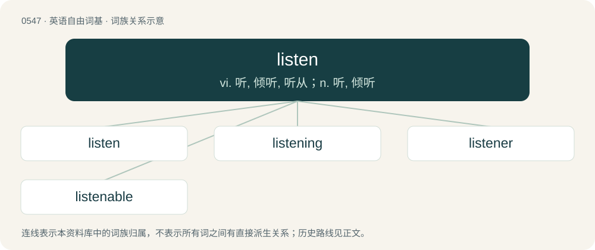

# 0616 · listen — vi. 听, 倾听, 听从；n. 听, 倾听

[总目录](../00_总目录_按常用程度.md)

**类型**：英语自由词基　｜　**来源语言**：见词源记录

## 核心含义与来源

- 核心含义：vi. 听, 倾听, 听从；n. 听, 倾听
- 英文含义：To use one's sense of hearing and auditory cognition in an intentional way; to make deliberate use of one's ears; to pay attention to or wait for a specific sound.
- 词形：listen

**来源记录 1**（动词；To use one's sense of hearing and auditory cognition in an intentional way; to make deliberate use of one's ears; to pay attention to or wait for a specific sound.）

From Middle English listenen, listnen, alteration (due to Middle English listen (“to listen, give heed to”)) of Old English hlysnan (“to listen”), from Proto-Germanic \*hlusnijaną, \*hlusnōną (compare Middle High German lüsenen), from Proto-Germanic \*hlusēną (compare Old High German hlosēn), from Proto-Indo-European \*ḱlew- (“to hear”). Cognate with Swedish lyssna (“to listen”). Compare Ancient Greek κλαίω (klaíō, “to make known, famous”), Welsh clywed (“to hear”), Latin clueō (“to be famous”), Lithuanian klausýti, Old Church Slavonic слушати (slušati, “to hear”), Sanskrit श्रोषति (śróṣati, “an exclamation used in making an offering with fire to the gods or departed spirits”) & Sanskrit श्लोक्य (ślókya, “voice, sound, noisy”)). Related to loud and German lauschen.

## 词族图

## 单词速览（常用到不常用）

| 单词 | 音标 | 释义 |
|---|---|---|
| [listen](#w-1) | /ˈlɪsən/ | vi. 听, 倾听, 听从；n. 听, 倾听 |
| [listening](#w-2) | /ˈlɪs.nɪŋ/ | n. 听, 监听；a. 助听用的 |
| [listener](#w-3) | 英 /ˈlɪsənə/；美 /ˈlɪs(ə)nɚ/ | n. 收听者, 听众 |
| [listenable](#w-4) | /ˈlisənəbl/ | a. 值得一听的 |

## 逐词详解

### 1. listen

**词性**：动词　｜　**音标**：/ˈlɪsən/

**中文释义**：vi. 听, 倾听, 听从；n. 听, 倾听

**英文义项**：To use one's sense of hearing and auditory cognition in an intentional way; to make deliberate use of one's ears; to pay attention to or wait for a specific sound. / To accept advice or obey instruction; to agree or assent.

**词源与演化**：

From Middle English listenen, listnen, alteration (due to Middle English listen (“to listen, give heed to”)) of Old English hlysnan (“to listen”), from Proto-Germanic \*hlusnijaną, \*hlusnōną (compare Middle High German lüsenen), from Proto-Germanic \*hlusēną (compare Old High German hlosēn), from Proto-Indo-European \*ḱlew- (“to hear”). Cognate with Swedish lyssna (“to listen”). Compare Ancient Greek κλαίω (klaíō, “to make known, famous”), Welsh clywed (“to hear”), Latin clueō (“to be famous”), Lithuanian klausýti, Old Church Slavonic слушати (slušati, “to hear”), Sanskrit श्रोषति (śróṣati, “an exclamation used in making an offering with fire to the gods or departed spirits”) & Sanskrit श्लोक्य (ślókya, “voice, sound, noisy”)). Related to loud and German lauschen.

**例句**：

> I could hear you talking upstairs, but I didn’t really listen to your conversation.

该用例对应义项：To use one's sense of hearing and auditory cognition in an intentional way; to make deliberate use of one's ears; to pay attention to or wait for a specific sound.

### 2. listening

**词性**：形容词　｜　**音标**：/ˈlɪs.nɪŋ/

**中文释义**：n. 听, 监听；a. 助听用的

**英文义项**：Of something or someone that listens. / Of something that is used in order to hear or to improve the ability to hear.

**构词拆分**：listen + -ing

**词源与演化**：

From Middle English listnynge, lustninde, from Old English hlysnende, equivalent to listen + -ing.

**例句**：

> He could hear better when he used his listening device.

该用例对应义项：Of something that is used in order to hear or to improve the ability to hear.

### 3. listener

**词性**：名词　｜　**音标**：英 /ˈlɪsənə/；美 /ˈlɪs(ə)nɚ/

**中文释义**：n. 收听者, 听众

**英文义项**：Someone who listens, especially to a speech or a broadcast. / A function that runs in response to an event; an event handler.

**构词拆分**：listen + -er

**词源与演化**：

From listen + -er.

**例句**：

> Mark was involved by the gossip by simply being a listener.

### 4. listenable

**词性**：形容词　｜　**音标**：/ˈlisənəbl/

**中文释义**：a. 值得一听的

**英文义项**：Pleasant or easy to listen to.

**构词拆分**：listen + -able

**词源与演化**：

From listen + -able.

**例句**：

> Mozart's music was popular because he wrote listenable works.

该用例对应义项：Pleasant or easy to listen to.
