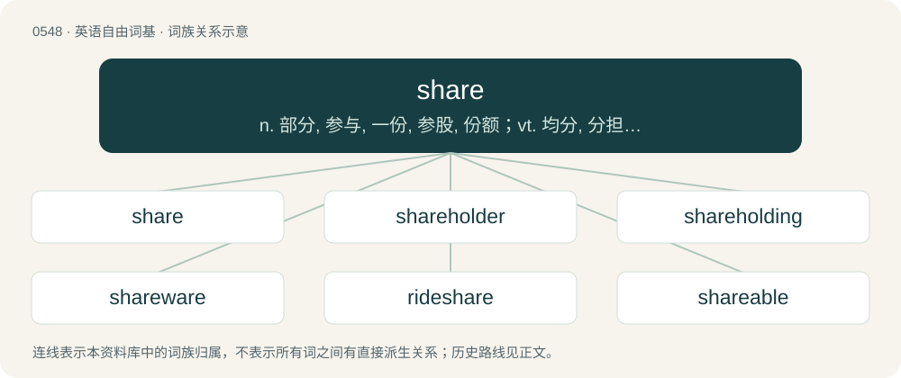

# 0617 · share — n. 部分, 参与, 一份, 参股, 份额；vt. 均分, 分担, 分享, 分配, 共有；vi. 分享

[总目录](../00_总目录_按常用程度.md)

**类型**：英语自由词基　｜　**来源语言**：见词源记录

## 核心含义与来源

- 核心含义：n. 部分, 参与, 一份, 参股, 份额；vt. 均分, 分担, 分享, 分配, 共有；vi. 分享
- 英文含义：A portion of something, especially a portion given or allotted to someone.
- 词形：share

**多个词源／构词路径**：同一拼写可能有不同来源；以下按词性和含义分别列出。

**来源记录 1**（名词；A portion of something, especially a portion given or allotted to someone.）

From Middle English schare, schere, from Old English sċearu (“a cutting, shaving, a shearing, tonsure, part, division, share”), from Proto-West Germanic \*skaru, from Proto-Germanic \*skarō (“a division, detachment”), from Proto-Indo-European \*(s)ker- (“to cut, divide”). Cognate with Saterland Frisian skar, sker (“a share in a communal pasture”), Dutch schare (“share in property”), German Schar (“band, troop, party, company”), Icelandic skor (“department”). Compare shard, shear. Doublet of eschel.

**来源记录 2**（名词；The cutting blade of an agricultural machine like a plough, a cultivator or a seeding-machine.）

From Middle English schar, schare, from Old English sċear, sċær (“ploughshare”), from Proto-Germanic \*skaraz (“ploughshare”), from Proto-Indo-European \*(s)ker- (“to cut”). Cognate with Dutch schaar (“ploughshare”), dialectal German Schar (“ploughshare”), Danish (plov)skær (“ploughshare”). More at shear.

## 词族图

## 单词速览（常用到不常用）

| 单词 | 音标 | 释义 |
|---|---|---|
| [share](#w-1) | 英 /ʃɛə/；美 /ʃɛɚ/ | n. 部分, 参与, 一份, 参股, 份额；vt. 均分, 分担, 分享, 分配, 共有；vi. 分享 |
| [shareholder](#w-2) | 英 /ˈʃɛəˌhəʊl.də(ɹ)/；美 /ˈʃɛɹˌhoʊl.dɚ/ | n. 股东；\[法\] 股东, 股票持有人 |
| [shareholding](#w-3) | /ˈʃεə.həuldiŋ/ | n. 股权 |
| [shareware](#w-4) |  | \[计\] 试用软件 |
| [rideshare](#w-5) |  | 【英文】A ridesharing arrangement in which people travel together. |
| [shareable](#w-6) | 英 /ˈʃɛəɹ.ə.bəl/；美 /ˈʃɛəɹ.ə.bəl/ | \[计\] 可共享的 |
| [sharer](#w-7) | /ˈʃєərə/ | n. 分配者, 共同收受者, 参与者；\[计\] 共享者 |

## 逐词详解

### 1. share

**词性**：名词　｜　**音标**：英 /ʃɛə/；美 /ʃɛɚ/

**中文释义**：n. 部分, 参与, 一份, 参股, 份额；vt. 均分, 分担, 分享, 分配, 共有；vi. 分享

**英文义项**：A portion of something, especially a portion given or allotted to someone. / A financial instrument that shows that one owns a part of a company that provides the benefit of limited liability.

**词源与演化**：

From Middle English schare, schere, from Old English sċearu (“a cutting, shaving, a shearing, tonsure, part, division, share”), from Proto-West Germanic \*skaru, from Proto-Germanic \*skarō (“a division, detachment”), from Proto-Indo-European \*(s)ker- (“to cut, divide”). Cognate with Saterland Frisian skar, sker (“a share in a communal pasture”), Dutch schare (“share in property”), German Schar (“band, troop, party, company”), Icelandic skor (“department”). Compare shard, shear. Doublet of eschel.

**例句**：

> The TV programme was cancelled because it only gained a 10% share of that night's viewing audience.

该用例对应义项：A portion of something, especially a portion given or allotted to someone.

### 2. shareholder

**词性**：名词　｜　**音标**：英 /ˈʃɛəˌhəʊl.də(ɹ)/；美 /ˈʃɛɹˌhoʊl.dɚ/

**中文释义**：n. 股东；\[法\] 股东, 股票持有人

**英文义项**：One who owns shares of stock in a corporation.

**构词拆分**：share + holder

**词源与演化**：

From share + holder.

**例句**：

> Shareholders are the real owners of a publicly traded business, but management runs it.

该用例对应义项：One who owns shares of stock in a corporation.

### 3. shareholding

**词性**：形容词　｜　**音标**：/ˈʃεə.həuldiŋ/

**中文释义**：n. 股权

**英文义项**：Owning shares.

**构词拆分**：share + holding

**词源与演化**：

From share + holding.

### 4. shareware

**词性**：名词

**中文释义**：\[计\] 试用软件

**英文义项**：A type of software that is distributed without payment but is limited in any combination of functionality, availability, or convenience.

**构词拆分**：share + -ware

**词源与演化**：

From share + -ware. Popularized by Bob Wallace

**例句**：

> Back in the day, programs used to be distributed as shareware.

### 5. rideshare

**词性**：名词

**英文义项**：A ridesharing arrangement in which people travel together. / A taxi or minicab hired through a ridesharing app.

**构词拆分**：ride + share

**词源与演化**：

From ride + share.

**例句**：

> The neighbors decided on a rideshare to get their kids to school, so that they wouldn't each have to drive every day.

该用例对应义项：A ridesharing arrangement in which people travel together.

### 6. shareable

**词性**：形容词　｜　**音标**：英 /ˈʃɛəɹ.ə.bəl/；美 /ˈʃɛəɹ.ə.bəl/

**中文释义**：\[计\] 可共享的

**英文义项**：Suitable for sharing.

**构词拆分**：share + -able

**词源与演化**：

From share + -able.

### 7. sharer

**词性**：名词　｜　**音标**：/ˈʃєərə/

**中文释义**：n. 分配者, 共同收受者, 参与者；\[计\] 共享者

**英文义项**：One who shares. / A dish at a restaurant, etc. intended to be shared between several people.

**构词拆分**：share + -er

**词源与演化**：

From share + -er.

**例句**：

> Can we order the seafood platter as a sharer?

该用例对应义项：A dish at a restaurant, etc. intended to be shared between several people.
