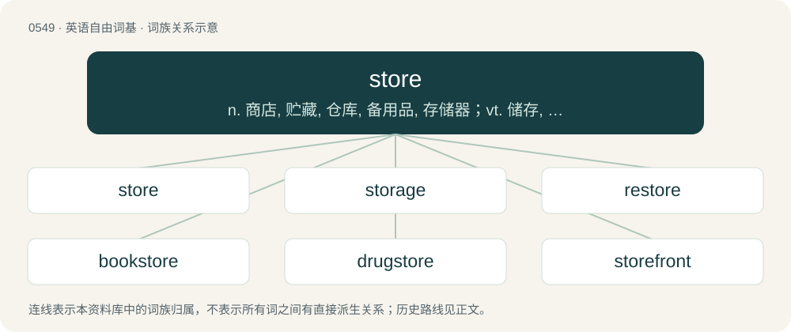

# 0618 · store — n. 商店, 贮藏, 仓库, 备用品, 存储器；vt. 储存, 贮藏, 供给；vi. 贮藏

[总目录](../00_总目录_按常用程度.md)

**类型**：英语自由词基　｜　**来源语言**：见词源记录

## 核心含义与来源

- 核心含义：n. 商店, 贮藏, 仓库, 备用品, 存储器；vt. 储存, 贮藏, 供给；vi. 贮藏
- 英文含义：A place where items may be accumulated or routinely kept.
- 词形：store

**来源记录 1**（名词；A place where items may be accumulated or routinely kept.）

Inherited from Middle English store, borrowed from Anglo-Norman stor, from Latin īnstaurāre, from īnstaurō + -āre.

## 词族图

## 单词速览（常用到不常用）

| 单词 | 音标 | 释义 |
|---|---|---|
| [store](#w-1) | 英 /stɔː/；美 /stɔɹ/ | n. 商店, 贮藏, 仓库, 备用品, 存储器；vt. 储存, 贮藏, 供给；vi. 贮藏 |
| [storage](#w-2) | 英 /ˈstɔː.ɹɪd͡ʒ/；美 /ˈstɔɹ.ɪd͡ʒ/ | n. 存储器, 储藏, 保管, 库存, 仓库；\[计\] 存放处; 存储 |
| [restore](#w-3) | 英 /ɹɪˈstɔː/；美 /ɹɪˈstoɹ/ | vt. 回复, 恢复, 归还, 修补, 修复；vt. 还原；vi. 还原 |
| [bookstore](#w-4) | 英 /ˈbʊkstɔː/ | n. 书店 |
| [drugstore](#w-5) | 英 /ˈdɹʌɡ.stɔː(ɹ)/；美 /ˈdɹʌɡ.stoɹ/ | n. 药房, 杂货店 |
| [storefront](#w-6) | /ˈstɒːfrʌnt/ | n. 店面 |
| [storehouse](#w-7) | /ˈstɔː(ɹ)haʊs/ | n. 仓库, 储藏所, 宝库；\[机\] 库房, 贮藏库, 仓库 |
| [superstore](#w-8) | /ˈsjuːpə,stɔː/ | \[经\] 超级商店 |
| [storeroom](#w-9) | /ˈstɒːrum/ | n. 储藏室, 库房；\[经\] 仓库货栈, 储藏室 |
| [storekeeper](#w-10) | /ˈstɒː.kiːpə/ | n. 店主 |
| [storer](#w-11) | /sˈtɔːrər/ | 存储器, 贮藏物资者 |
| [instore](#w-12) | /ˈinstɔː/ | a. 库存的, 仓库内的；在仓库内进行的 |
| [webstore](#w-13) |  | 【英文】A sales outlet which supplies goods or services over the World Wide Web. |

## 逐词详解

### 1. store

**词性**：名词　｜　**音标**：英 /stɔː/；美 /stɔɹ/

**中文释义**：n. 商店, 贮藏, 仓库, 备用品, 存储器；vt. 储存, 贮藏, 供给；vi. 贮藏

**英文义项**：A place where items may be accumulated or routinely kept. / A supply held in storage.

**词源与演化**：

Inherited from Middle English store, borrowed from Anglo-Norman stor, from Latin īnstaurāre, from īnstaurō + -āre.

**例句**：

> They could eat from their stores for a month or two if need be.

该用例对应义项：A supply held in storage.

### 2. storage

**词性**：名词　｜　**音标**：英 /ˈstɔː.ɹɪd͡ʒ/；美 /ˈstɔɹ.ɪd͡ʒ/

**中文释义**：n. 存储器, 储藏, 保管, 库存, 仓库；\[计\] 存放处; 存储

**英文义项**：The act of storing goods; the state of being stored. / An object or place in which something is stored.

**构词拆分**：store + -age

**词源与演化**：

From store + -age.

**例句**：

> I′d recommend backing up these files to storage before reinstalling the operating system.

该用例对应义项：Any computer device, including such as a disk, on which data is stored for a longer term than main memory.

### 3. restore

**词性**：动词　｜　**音标**：英 /ɹɪˈstɔː/；美 /ɹɪˈstoɹ/

**中文释义**：vt. 回复, 恢复, 归还, 修补, 修复；vt. 还原；vi. 还原

**英文义项**：To reestablish, or bring back into existence. / To bring back to good condition from a state of decay or ruin.

**构词拆分**：By surface analysis, re- + store

**词源与演化**：

From Middle English restoren, from Old French restorer, from Latin rēstaurāre. By surface analysis, re- + store.

**用法示例／搭配（非完整句）**：

> to restore harmony among those who are at variance

该用例对应义项：To reestablish, or bring back into existence.

### 4. bookstore

**词性**：名词　｜　**音标**：英 /ˈbʊkstɔː/

**中文释义**：n. 书店

**英文义项**：A store where books are bought and sold. / A stationery store.

**构词拆分**：book + store

**词源与演化**：

From book + store.

**例句**：

> Is it possible to buy the book at the bookstore in Akita?

### 5. drugstore

**词性**：名词　｜　**音标**：英 /ˈdɹʌɡ.stɔː(ɹ)/；美 /ˈdɹʌɡ.stoɹ/

**中文释义**：n. 药房, 杂货店

**英文义项**：Synonym of pharmacy, especially a small standalone general store which includes a pharmacy.

**构词拆分**：drug + store

**词源与演化**：

From drug + store.

**例句**：

> Tom lives on the left side of the street, opposite the drugstore.

### 6. storefront

**词性**：名词　｜　**音标**：/ˈstɒːfrʌnt/

**中文释义**：n. 店面

**英文义项**：The side of a store (or other shop) which faces the street and usually contains display windows. / An e-commerce website offering goods or services to the public.

**构词拆分**：store + front

**词源与演化**：

From store + front.

**例句**：

> The storefront doesn't look good, but the food was actually surprisingly delicious.

### 7. storehouse

**词性**：名词　｜　**音标**：/ˈstɔː(ɹ)haʊs/

**中文释义**：n. 仓库, 储藏所, 宝库；\[机\] 库房, 贮藏库, 仓库

**英文义项**：A building for keeping goods of any kind, especially provisions. / A single location or resource where a large quantity of something can be found.

**构词拆分**：store + house

**词源与演化**：

From store + house.

**例句**：

> This old book is a genuine storehouse of useful cooking tips.

该用例对应义项：A single location or resource where a large quantity of something can be found.

### 8. superstore

**词性**：名词　｜　**音标**：/ˈsjuːpə,stɔː/

**中文释义**：\[经\] 超级商店

**英文义项**：An extremely large store; a hypermarket. / A big box.

**构词拆分**：super- + store

**词源与演化**：

From super- + store.

**例句**：

> A second automated locker was installed in the superstore.

### 9. storeroom

**词性**：名词　｜　**音标**：/ˈstɒːrum/

**中文释义**：n. 储藏室, 库房；\[经\] 仓库货栈, 储藏室

**英文义项**：A room used for storage.

**构词拆分**：store + room

**词源与演化**：

From store + room.

**例句**：

> The box that you're looking for is in the storeroom.

### 10. storekeeper

**词性**：名词　｜　**音标**：/ˈstɒː.kiːpə/

**中文释义**：n. 店主

**英文义项**：One who runs a shop, either the owner or manager. / One who is in charge of stores or goods of any kind.

**构词拆分**：store + keeper

**词源与演化**：

From store + keeper.

**用法示例／搭配（非完整句）**：

> a naval storekeeper

该用例对应义项：One who is in charge of stores or goods of any kind.

### 11. storer

**词性**：名词　｜　**音标**：/sˈtɔːrər/

**中文释义**：存储器, 贮藏物资者

**英文义项**：One who lays up or forms a store.

**构词拆分**：From store + -er.

**词源与演化**：

From store + -er.

### 12. instore

**词性**：名词　｜　**音标**：/ˈinstɔː/

**中文释义**：a. 库存的, 仓库内的；在仓库内进行的

**英文义项**：a performance or other event taking place within a store or a shop

**构词拆分**：in + store

**词源与演化**：

From in + store.

**例句**：

> They are playing an instore tomorrow.

该用例对应义项：a performance or other event taking place within a store or a shop

### 13. webstore

**词性**：名词

**英文义项**：A sales outlet which supplies goods or services over the World Wide Web.

**构词拆分**：web + store

**词源与演化**：

From web + store.
