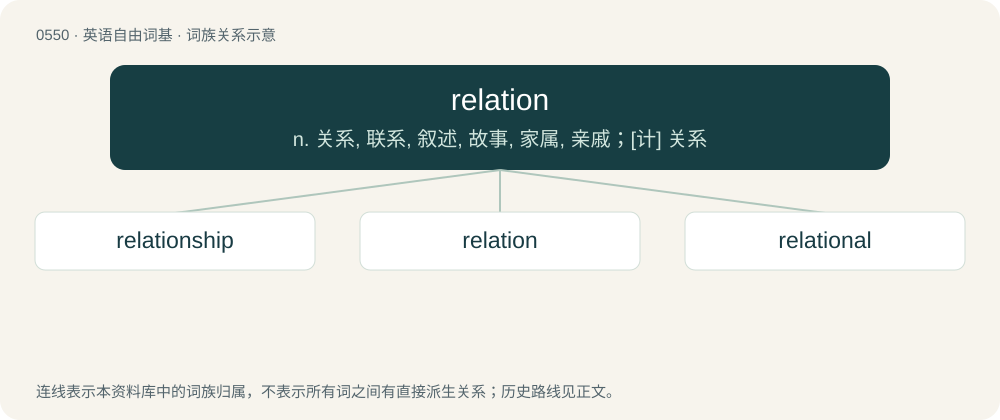

# 0619 · relation — n. 关系, 联系, 叙述, 故事, 家属, 亲戚；\[计\] 关系

[总目录](../00_总目录_按常用程度.md)

**类型**：英语自由词基　｜　**来源语言**：见词源记录

## 核心含义与来源

- 核心含义：n. 关系, 联系, 叙述, 故事, 家属, 亲戚；\[计\] 关系
- 英文含义：The manner in which two things may be associated.
- 词形：relation

**来源记录 1**（名词；The manner in which two things may be associated.）

From Middle English relacion, relacioun, from Anglo-Norman relacioun and Old French relacion (whence French relation), from Latin relātiō, noun of process form from perfect passive participle relātus (“related”), from verb referō (“to refer, to relate”), from prefix re- (“again”) + ferō (“to bear, to carry”). By surface analysis, relate + -ion. Doublet of relazione.

## 词族图

## 单词速览（常用到不常用）

| 单词 | 音标 | 释义 |
|---|---|---|
| [relationship](#w-1) | 英 /ɹɪˈleɪʃ(ə)nˌʃɪp/；/ɹəˈleɪʃ(ə)nˌʃɪp/ | n. 关系, 关联；\[医\] 关系 |
| [relation](#w-2) | 英 /ɹɪˈleɪʃ(ə)n/ | n. 关系, 联系, 叙述, 故事, 家属, 亲戚；\[计\] 关系 |
| [relational](#w-3) | /riˈleiʃənəl/ | a. 有关系的, 有联系的, 亲属的, 有亲属关系的；\[计\] 相关的, 关系的 |

## 逐词详解

### 1. relationship

**词性**：名词　｜　**音标**：英 /ɹɪˈleɪʃ(ə)nˌʃɪp/；/ɹəˈleɪʃ(ə)nˌʃɪp/

**中文释义**：n. 关系, 关联；\[医\] 关系

**英文义项**：A connection or association; the condition of being related. / The links between the x-values and y-values of ordered pairs of numbers especially coordinates.

**构词拆分**：relation + -ship

**词源与演化**：

From relation + -ship. Displaced native Old English sibb.

**例句**：

> They have been in a relationship for ten years, but have never married.

该用例对应义项：A romantic or sexual involvement.

### 2. relation

**词性**：名词　｜　**音标**：英 /ɹɪˈleɪʃ(ə)n/

**中文释义**：n. 关系, 联系, 叙述, 故事, 家属, 亲戚；\[计\] 关系

**英文义项**：The manner in which two things may be associated. / A member of one's extended family; a relative.

**词源与演化**：

From Middle English relacion, relacioun, from Anglo-Norman relacioun and Old French relacion (whence French relation), from Latin relātiō, noun of process form from perfect passive participle relātus (“related”), from verb referō (“to refer, to relate”), from prefix re- (“again”) + ferō (“to bear, to carry”). By surface analysis, relate + -ion. Doublet of relazione.

**例句**：

> This relation uses the customer's social security number as a key.

该用例对应义项：A set of tuples, implemented as a table in a relational database.

### 3. relational

**词性**：形容词　｜　**音标**：/riˈleiʃənəl/

**中文释义**：a. 有关系的, 有联系的, 亲属的, 有亲属关系的；\[计\] 相关的, 关系的

**英文义项**：Relating to relations. / Friendly and peaceful.

**构词拆分**：relation + -al

**词源与演化**：

From relation + -al. The database sense is from the definition of relation as a set of ordered tuples.

**用法示例／搭配（非完整句）**：

> essays on relational rights

该用例对应义项：Relating to relations.
