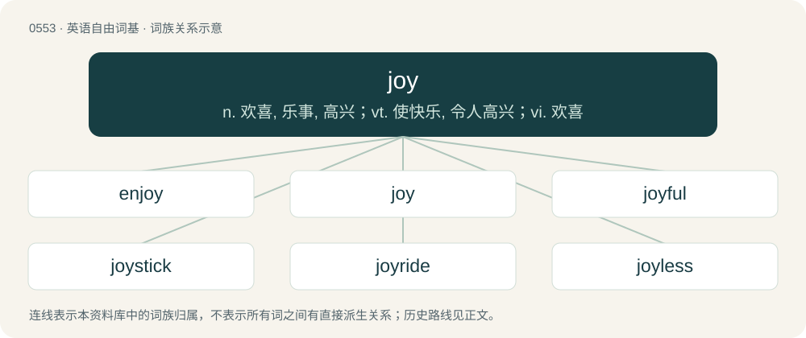

# 0620 · joy — n. 欢喜, 乐事, 高兴；vt. 使快乐, 令人高兴；vi. 欢喜

[总目录](../00_总目录_按常用程度.md)

**类型**：英语自由词基　｜　**来源语言**：见词源记录

## 核心含义与来源

- 核心含义：n. 欢喜, 乐事, 高兴；vt. 使快乐, 令人高兴；vi. 欢喜
- 英文含义：A feeling of extreme happiness or cheerfulness, especially related to the acquisition or expectation of something good.
- 词形：joy

**来源记录 1**（名词；A feeling of extreme happiness or cheerfulness, especially related to the acquisition or expectation of something good.）

The noun is from Middle English joye, borrowed from Old French joie, from Late Latin gaudia, neuter plural (mistaken as feminine singular) of Latin gaudium (“joy”), from gaudēre (“to be glad, rejoice”). Doublet of jo and gaudy (“Oxford college reunion”). Displaced native Old English ġefēa. The interjection is from the noun. The verb is from Middle English joyen, joȝen, joien, from Old French jöir, from the Old French noun (see above).

## 词族图

## 单词速览（常用到不常用）

| 单词 | 音标 | 释义 |
|---|---|---|
| [enjoy](#w-1) | 英 /ɛnˈd͡ʒɔɪ/ | vt. 享受, 喜欢, 欣赏；\[法\] 享受, 享有, 获得某种利益 |
| [joy](#w-2) | 英 /d͡ʒɔɪ/ | n. 欢喜, 乐事, 高兴；vt. 使快乐, 令人高兴；vi. 欢喜 |
| [joyful](#w-3) | /ˈd͡ʒɔɪfl̩/ | a. 欢喜的, 高兴的, 令人高兴的 |
| [joystick](#w-4) | 英 /ˈd͡ʒɔɪ.stɪk/ | n. (飞机的)操纵杆；\[计\] 控制杆, 操纵杆 |
| [joyride](#w-5) | 英 /ˈd͡ʒɔɪˌɹaɪd/ | n. 驾车兜风, 偷车乱开, 乘汽车兜风, 追求享受的行动, 胡作非为 |
| [joyless](#w-6) | /ˈdʒɒilis/ | a. 不高兴的, 不快乐的 |
| [killjoy](#w-7) | 美 /ˈkɪlˌd͡ʒɔɪ/ | n. 令人扫兴的人, 煞风景 |

## 逐词详解

### 1. enjoy

**词性**：动词　｜　**音标**：英 /ɛnˈd͡ʒɔɪ/

**中文释义**：vt. 享受, 喜欢, 欣赏；\[法\] 享受, 享有, 获得某种利益

**英文义项**：To receive pleasure or satisfaction from something. / To have the use or benefit of something.

**构词拆分**：en- + joy

**词源与演化**：

From Middle English enjoyen, from Old French enjoier, anjoier, enjoer (“to give joy, receive with joy, rejoice”), equivalent to en- + joy.

**例句**：

> I've really enjoyed you and your sister showing me around.

该用例对应义项：To receive pleasure or satisfaction from something.

### 2. joy

**词性**：名词　｜　**音标**：英 /d͡ʒɔɪ/

**中文释义**：n. 欢喜, 乐事, 高兴；vt. 使快乐, 令人高兴；vi. 欢喜

**英文义项**：A feeling of extreme happiness or cheerfulness, especially related to the acquisition or expectation of something good. / Anything that causes such a feeling.

**词源与演化**：

The noun is from Middle English joye, borrowed from Old French joie, from Late Latin gaudia, neuter plural (mistaken as feminine singular) of Latin gaudium (“joy”), from gaudēre (“to be glad, rejoice”). Doublet of jo and gaudy (“Oxford college reunion”). Displaced native Old English ġefēa. The interjection is from the noun. The verb is from Middle English joyen, joȝen, joien, from Old French jöir, from the Old French noun (see above).

**例句**：

> It is his joy to walk in the rain.

该用例对应义项：A feeling of extreme happiness or cheerfulness, especially related to the acquisition or expectation of something good.

### 3. joyful

**词性**：形容词　｜　**音标**：/ˈd͡ʒɔɪfl̩/

**中文释义**：a. 欢喜的, 高兴的, 令人高兴的

**英文义项**：Feeling or causing joy.

**构词拆分**：joy + -ful

**词源与演化**：

From joy + -ful.

**例句**：

> The children were joyful on the first day of summer break.

该用例对应义项：Feeling or causing joy.

### 4. joystick

**词性**：名词　｜　**音标**：英 /ˈd͡ʒɔɪ.stɪk/

**中文释义**：n. (飞机的)操纵杆；\[计\] 控制杆, 操纵杆

**英文义项**：A mechanical control device consisting of a handgrip mounted on a base or pedestal and typically having one or more buttons, used to control an aircraft, computer, or other equipment. / A penis.

**构词拆分**：joy + stick

**词源与演化**：

From joy + stick. First attested around 1910 (as joy-stick) as the control stick on an airplane. Its relation to the word joy is unclear.

**例句**：

> It's no use trying to find people to play Street Fighter with when you can't explain double quarter-circle joystick motions.

### 5. joyride

**词性**：名词　｜　**音标**：英 /ˈd͡ʒɔɪˌɹaɪd/

**中文释义**：n. 驾车兜风, 偷车乱开, 乘汽车兜风, 追求享受的行动, 胡作非为

**英文义项**：A ride in a vehicle taken solely for pleasure or enjoyment, especially a vehicle ride taken with no particular goal or purpose and just for the pleasure or enjoyment of a vehicle ride. / An instance of driving a motor vehicle in a carefree or reckless manner, especially a vehicle which has been taken without the permission of the owner.

**构词拆分**：joy + ride

**词源与演化**：

From joy + ride.

**例句**：

> Tom took his father's car for a joyride.

### 6. joyless

**词性**：形容词　｜　**音标**：/ˈdʒɒilis/

**中文释义**：a. 不高兴的, 不快乐的

**英文义项**：Without joy; unhappy, sad.

**构词拆分**：joy + -less

**词源与演化**：

From joy + -less.

**例句**：

> Without Joy, my life is joyless!

该用例对应义项：Without joy; unhappy, sad.

### 7. killjoy

**词性**：名词　｜　**音标**：美 /ˈkɪlˌd͡ʒɔɪ/

**中文释义**：n. 令人扫兴的人, 煞风景

**英文义项**：A person who is anti-fun, or prevents others from having fun.

**构词拆分**：kill + joy

**词源与演化**：

From kill + joy, first attested in 1776.

**例句**：

> Altan never misses a chance to be a killjoy.
