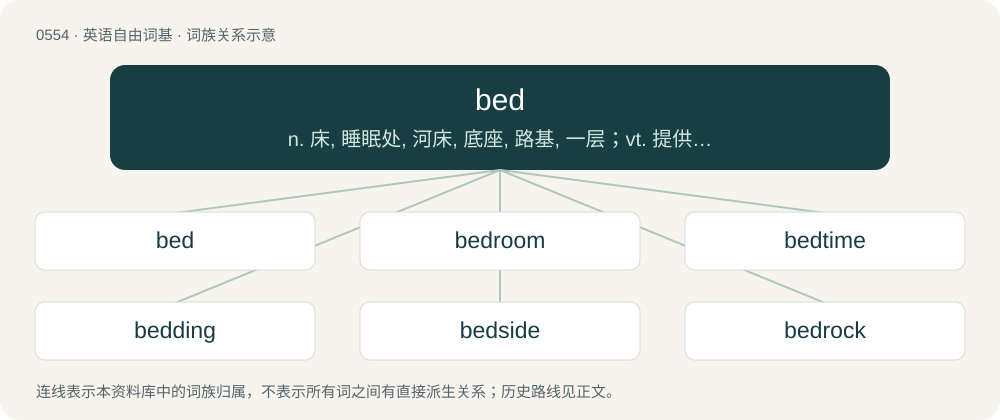

# 0622 · bed — n. 床, 睡眠处, 河床, 底座, 路基, 一层；vt. 提供宿处, 栽种, 安装；vi. 睡, 形成坚实的一层

[总目录](../00_总目录_按常用程度.md)

**类型**：英语自由词基　｜　**来源语言**：见词源记录

## 核心含义与来源

- 核心含义：n. 床, 睡眠处, 河床, 底座, 路基, 一层；vt. 提供宿处, 栽种, 安装；vi. 睡, 形成坚实的一层
- 英文含义：A piece of furniture, usually flat and soft, on which to rest or sleep.
- 词形：bed

**来源记录 1**（名词；A piece of furniture, usually flat and soft, on which to rest or sleep.）

Inherited from Middle English bed, bedde, from Old English bedd, from Proto-West Germanic \*badi, from Proto-Germanic \*badją (“resting-place, plot of ground”). Cognates Cognate with Scots bed, North Frisian baad, beed, Bēr, Saterland Frisian Bääd, West Frisian bêd, Cimbrian pett, Dutch bed, Dutch Low Saxon bedde, German Bett, Bette, German Low German Bedd, Luxembourgish Bett, Vilamovian bet, Danish and Norwegian Bokmål bed, Faroese and Icelandic beð, beður, Norwegian Nynorsk bed, bedd, Swedish bädd, Gothic 𐌱𐌰𐌳𐌹 (badi), all meaning “bed”. further possible etymology and cognates The Proto-Germanic term may in turn be from Proto-Indo-European \*bʰedʰ- (“to dig”) with various theories explaining the development in meaning. If it is, the term is also cognate with Ancient Greek βοθυρος (bothuros, “pit”), Latin fossa (“ditch”), Latvian bedre (“hole”), Welsh bedd (“grave”), Breton bez (“grave”); and probably also Russian бодать (bodatʹ, “to butt, gore”).

## 词族图

## 单词速览（常用到不常用）

| 单词 | 音标 | 释义 |
|---|---|---|
| [bed](#w-1) | 英 /bɛd/ | n. 床, 睡眠处, 河床, 底座, 路基, 一层；vt. 提供宿处, 栽种, 安装；vi. 睡, 形成坚实的一层 |
| [bedroom](#w-2) | 英 /ˈbɛdɹuːm/；美 /ˈbɛdˌɹum/ | n. 卧室 |
| [bedtime](#w-3) | /ˈbɛdtaɪm/ | n. 就寝时间 |
| [bedding](#w-4) | 美 /ˈbɛdɪŋ/ | n. 被褥, 寝具, 床上用品, 基床；\[机\] 褥草, 被褥 |
| [bedside](#w-5) | /ˈbɛdˌsaɪd/ | n. 床边；a. 床边的, 临床的 |
| [bedrock](#w-6) | 英 /ˈbɛd.ɹɒk/；美 /ˈbɛdˌɹɑk/ | n. 基岩, 基本原理, 基础 |
| [deathbed](#w-7) | 英 /ˈdɛθˌbɛd/ | n. 临死所卧之床, 临终之时 |
| [embed](#w-8) | /ɪmˈbɛd/ | vt. 使插入, 使嵌入, 使深留脑中；\[计\] 嵌入 |
| [seabed](#w-9) | /ˈsiːbed/ | n. 海底, 海床 |
| [hotbed](#w-10) | /ˈhɒt.bɛd/ | n. 温床 |
| [flatbed](#w-11) | 美 /ˈflætˌbɛd/ | n. 有平台可装货的卡车 |
| [riverbed](#w-12) | 英 /ˈɹɪv.əˌbɛd/；美 /ˈɹɪv.ɚˌbɛd/ | n. 河床 |
| [bedspread](#w-13) | 美 /ˈbɛd.spɹɛd/ | n. 床单, 床罩 |
| [testbed](#w-14) |  | \[计\] 试验台 |
| [bedbug](#w-15) | 美 /ˈbɛdˌbʌɡ/ | n. 臭虫；\[医\] 臭虫 |
| [bedsheet](#w-16) | 英 /ˈbɛdʃiːt/ | n. 床单 |
| [sunbed](#w-17) | /ˈsʌnˌbɛd/ | n. （人躺在上面照紫外线太阳灯的）太阳灯浴浴床 |
| [roadbed](#w-18) | 美 /ˈɹoʊdˌbɛd/ | n. 路基 |

## 逐词详解

### 1. bed

**词性**：名词　｜　**音标**：英 /bɛd/

**中文释义**：n. 床, 睡眠处, 河床, 底座, 路基, 一层；vt. 提供宿处, 栽种, 安装；vi. 睡, 形成坚实的一层

**英文义项**：A piece of furniture, usually flat and soft, on which to rest or sleep. / A mattress.

**词源与演化**：

Inherited from Middle English bed, bedde, from Old English bedd, from Proto-West Germanic \*badi, from Proto-Germanic \*badją (“resting-place, plot of ground”). Cognates Cognate with Scots bed, North Frisian baad, beed, Bēr, Saterland Frisian Bääd, West Frisian bêd, Cimbrian pett, Dutch bed, Dutch Low Saxon bedde, German Bett, Bette, German Low German Bedd, Luxembourgish Bett, Vilamovian bet, Danish and Norwegian Bokmål bed, Faroese and Icelandic beð, beður, Norwegian Nynorsk bed, bedd, Swedish bädd, Gothic 𐌱𐌰𐌳𐌹 (badi), all meaning “bed”. further possible etymology and cognates The Proto-Germanic term may in turn be from Proto-Indo-European \*bʰedʰ- (“to dig”) with various theories explaining the development in meaning. If it is, the term is also cognate with Ancient Greek βοθυρος (bothuros, “pit”), Latin fossa (“ditch”), Latvian bedre (“hole”), Welsh bedd (“grave”), Breton bez (“grave”); and probably also Russian бодать (bodatʹ, “to butt, gore”).

**例句**：

> When camping, he usually makes a bed for the night from hay and a blanket.

该用例对应义项：A prepared spot in which to spend the night.

### 2. bedroom

**词性**：名词　｜　**音标**：英 /ˈbɛdɹuːm/；美 /ˈbɛdˌɹum/

**中文释义**：n. 卧室

**英文义项**：A room in a house, apartment, hotel, or other dwelling where a bed is kept for sleeping. / The location of sexual activity.

**构词拆分**：bed + room

**词源与演化**：

From bed + room.

**例句**：

> "How are things in the bedroom?" asked the marriage therapist.

该用例对应义项：The location of sexual activity.

### 3. bedtime

**词性**：名词　｜　**音标**：/ˈbɛdtaɪm/

**中文释义**：n. 就寝时间

**英文义项**：The time or hour at which one retires to bed in order to sleep.

**构词拆分**：bed + time

**词源与演化**：

From Middle English bedtyme, bed-tyme, bedetyme, bedde tyme, equivalent to bed + time. Compare earlier Old English bedtīd (“bedtime”). Compare also West Frisian bêdtiid (“bedtime”), Dutch bedtijd (“bedtime”), Saterland Frisian Bädegungenstied (“bedtime”, literally “bed-goings-time”), German Low German Beddgahnstied, Bettgahnstiet (“bedtime”, literally “bed-goings-time”).

**例句**：

> Nobody knows as many bedtime stories as the god of the dream.

### 4. bedding

**词性**：名词　｜　**音标**：美 /ˈbɛdɪŋ/

**中文释义**：n. 被褥, 寝具, 床上用品, 基床；\[机\] 褥草, 被褥

**英文义项**：The textiles associated with a bed, e.g., sheets, pillowcases, bedspreads, blankets, etc. / The textiles associated with the bed, as well as the mattress, bedframe, or bed base (such as box spring).

**构词拆分**：bed + -ing

**词源与演化**：

From Middle English bedding, beddyng, from Old English bedding (“bedding”), equivalent to bed + -ing.

**例句**：

> He grew accustomed to bedding down outside.

### 5. bedside

**词性**：名词　｜　**音标**：/ˈbɛdˌsaɪd/

**中文释义**：n. 床边；a. 床边的, 临床的

**英文义项**：A position at the side of one's bed. / Any of the side panels of the bed of a truck.

**构词拆分**：bed + -side

**词源与演化**：

From Middle English bedsyde, bedde syde (also as beddes side, beddes syde), equivalent to bed + -side. Compare German Bettseite (“bedside”).

**例句**：

> The doctor stood at her bedside.

该用例对应义项：space by the side of a bed (especially the bed of a sick or dying person)

### 6. bedrock

**词性**：名词　｜　**音标**：英 /ˈbɛd.ɹɒk/；美 /ˈbɛdˌɹɑk/

**中文释义**：n. 基岩, 基本原理, 基础

**英文义项**：The solid rock found at some depth below the ground surface. / A basis or foundation.

**构词拆分**：bed (“a layer on top of which something else rests.”) + rock

**词源与演化**：

From bed (“a layer on top of which something else rests.”) + rock.

**例句**：

> If culture is the bedrock of a society, then language is the cornerstone of culture.

该用例对应义项：A basis or foundation.

### 7. deathbed

**词性**：名词　｜　**音标**：英 /ˈdɛθˌbɛd/

**中文释义**：n. 临死所卧之床, 临终之时

**英文义项**：The bed on which someone dies. / The last hours before death.

**构词拆分**：death + bed

**词源与演化**：

From Middle English dethbed, from Old English dēaþbedd (“deathbed; grave”), equivalent to death + bed. Cognate with Swedish dödsbädd (“deathbed”). Compare also Dutch sterfbed (“deathbed”), German Sterbebett and Totenbett (both “deathbed”), Danish dødsleje (“deathbed”).

**例句**：

> And when Marilyn was on her deathbed; she cried “where are my lovers?!”.

### 8. embed

**词性**：动词　｜　**音标**：/ɪmˈbɛd/

**中文释义**：vt. 使插入, 使嵌入, 使深留脑中；\[计\] 嵌入

**英文义项**：To lay (something) as in a bed; to lay in surrounding matter; to bed. / To include (something) in surrounding matter.

**构词拆分**：en- + bed

**词源与演化**：

From em- + bed.

**例句**：

> The instructions showed how to embed a chart from the spreadsheet within the wordprocessor document.

该用例对应义项：To encapsulate within another document or data file.

### 9. seabed

**词性**：名词　｜　**音标**：/ˈsiːbed/

**中文释义**：n. 海底, 海床

**英文义项**：The floor or bottom of the sea or ocean.

**构词拆分**：sea + bed

**词源与演化**：

From sea + bed.

**例句**：

> The boat was brought up from the seabed by the Algerian authorities.

### 10. hotbed

**词性**：名词　｜　**音标**：/ˈhɒt.bɛd/

**中文释义**：n. 温床

**英文义项**：A low bed of earth covered with glass, and heated with rotting manure, used for the germination of seeds and the growth of tender plants, like a miniature hothouse. / An environment that is ideal for the growth or development of something, especially of something undesirable.

**构词拆分**：hot + bed

**词源与演化**：

From hot + bed.

**例句**：

> It was a hotbed of vice.

该用例对应义项：a situation that is ideal for rapid development (especially of something bad)

### 11. flatbed

**词性**：形容词　｜　**音标**：美 /ˈflætˌbɛd/

**中文释义**：n. 有平台可装货的卡车

**英文义项**：Having a flat bed.

**构词拆分**：flat + bed

**词源与演化**：

From flat + bed.

**例句**：

> The accident left the contents of a flatbed trailer scattered across all three lanes.

该用例对应义项：Having a flat bed.

### 12. riverbed

**词性**：名词　｜　**音标**：英 /ˈɹɪv.əˌbɛd/；美 /ˈɹɪv.ɚˌbɛd/

**中文释义**：n. 河床

**英文义项**：The path where a river runs, or where a river once ran; the bottom earthen part of a river, not including the riverbanks.

**构词拆分**：river + bed

**词源与演化**：

From river + bed. Compare Dutch rivierbedding (“riverbed”), German Flussbett (“riverbed”), Swedish flodbädd (“riverbed”).

**例句**：

> Layers of sediment lay at the bottom of the riverbed.

### 13. bedspread

**词性**：名词　｜　**音标**：美 /ˈbɛd.spɹɛd/

**中文释义**：n. 床单, 床罩

**英文义项**：The topmost covering of a bed, often functioning as a blanket. / A coverlet.

**构词拆分**：bed + spread

**词源与演化**：

From bed + spread.

**例句**：

> On my bed is a coloured bedspread, which my grandma once made.

### 14. testbed

**词性**：名词

**中文释义**：\[计\] 试验台

**英文义项**：Any platform used for testing a scientific theory, computational tool or new technology.

**构词拆分**：test + bed

**词源与演化**：

From test + bed.

**例句**：

> Before we try to evaluate the products, let’s set up a testbed so we can make fair comparisons.

### 15. bedbug

**词性**：名词　｜　**音标**：美 /ˈbɛdˌbʌɡ/

**中文释义**：n. 臭虫；\[医\] 臭虫

**英文义项**：A small nocturnal insect pest of humans, of species Cimex lectularius (common bedbug) and Cimex hemipterus (tropical bedbug) that feeds on the blood of humans during sleep. / Any similar insect of family Cimicidae, that feeds on the blood of humans and certain other warm-blooded animals.

**构词拆分**：bed + bug

**词源与演化**：

From bed + bug.

**例句**：

> Fiona rapidly discovered that the hotel was infested with bedbugs.

该用例对应义项：A small nocturnal insect pest of humans, of species Cimex lectularius (common bedbug) and Cimex hemipterus (tropical bedbug) that feeds on the blood of humans during sleep.

### 16. bedsheet

**词性**：名词　｜　**音标**：英 /ˈbɛdʃiːt/

**中文释义**：n. 床单

**英文义项**：A sheet, a piece of cloth cut and finished as bedlinen.

**构词拆分**：bed + sheet

**词源与演化**：

From Middle English bedeschette, bedshete, bed shete, equivalent to bed + sheet.

**例句**：

> He wrapped himself in the bedsheet and pretended to be a ghost.

### 17. sunbed

**词性**：名词　｜　**音标**：/ˈsʌnˌbɛd/

**中文释义**：n. （人躺在上面照紫外线太阳灯的）太阳灯浴浴床

**英文义项**：A device emitting ultraviolet radiation used to produce a cosmetic suntan. / A lounger, or reclining beach chair.

**构词拆分**：sun + bed

**词源与演化**：

From sun + bed.

### 18. roadbed

**词性**：名词　｜　**音标**：美 /ˈɹoʊdˌbɛd/

**中文释义**：n. 路基

**英文义项**：The prepared location for a road, including its foundation. / A trackbed.

**构词拆分**：road + bed

**词源与演化**：

From road + bed.
