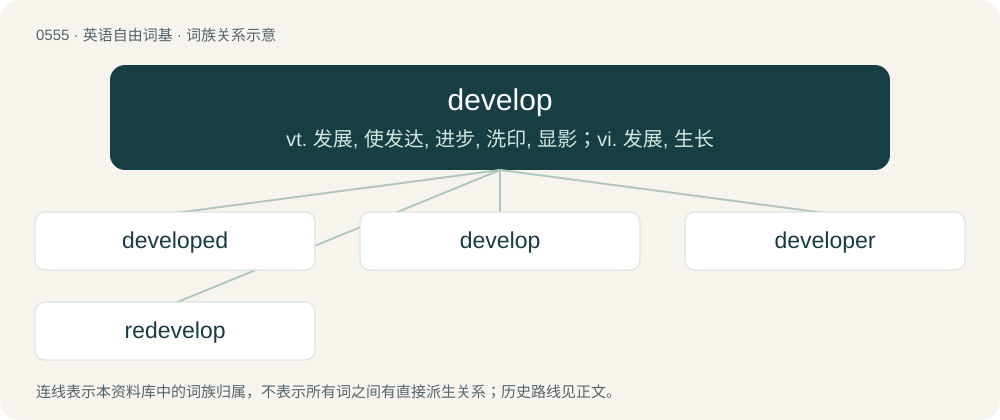

# 0623 · develop — vt. 发展, 使发达, 进步, 洗印, 显影；vi. 发展, 生长

[总目录](../00_总目录_按常用程度.md)

**类型**：英语自由词基　｜　**来源语言**：见词源记录

## 核心含义与来源

- 核心含义：vt. 发展, 使发达, 进步, 洗印, 显影；vi. 发展, 生长
- 英文含义：To change with a specific direction, progress.
- 词形：develop

**来源记录 1**（动词；To change with a specific direction, progress.）

Borrowed from French développer, from Middle French desveloper, from Old French desveloper, from des- + voloper, veloper, vloper (“to wrap, wrap up”) (compare Italian sviluppare, Old Italian alternative form goluppare (“to wrap”)) from Vulgar Latin \*vloppō, \*wloppō (“to wrap”) ultimately from Proto-Germanic \*wrappaną, \*wlappaną (“to wrap, roll up, turn, wind”), from Proto-Indo-European \*werb- (“to turn, bend”) http://www.wordnik.com/words/envelop. Akin to Middle English wlappen (“to wrap, fold”) (Modern English lap (“to wrap, involve, fold”)), Middle English wrappen (“to wrap”), Middle Dutch lappen (“to wrap up, embrace”), dialectal Danish vravle (“to wind, twist”), Middle Low German wrempen (“to wrinkle, scrunch, distort”), Old English wearp (“warp”). The word acquired its modern meaning from the 17th-century belief that an egg contains the animal in miniature and matures by growing larger and shedding its envelopes.

## 词族图

## 单词速览（常用到不常用）

| 单词 | 音标 | 释义 |
|---|---|---|
| [developed](#w-1) | /dɪˈvɛləpt/ | a. 发达的（国家或地区）；成熟的 |
| [develop](#w-2) | 英 /dɪˈvɛl.əp/ | vt. 发展, 使发达, 进步, 洗印, 显影；vi. 发展, 生长 |
| [developer](#w-3) | 英 /dɪˈvɛləpə(ɹ)/；美 /dɪˈvɛləpɚ/ | n. 开发者；\[计\] 显影器 |
| [redevelop](#w-4) | /,riːdiˈveləp/ | v. 恢复(促进)经济发展, 重点恢复 |

## 逐词详解

### 1. developed

**词性**：形容词　｜　**音标**：/dɪˈvɛləpt/

**中文释义**：a. 发达的（国家或地区）；成熟的

**英文义项**：wealthy and industrialized; not third-world. / Mature.

**构词拆分**：develop + -ed

**例句**：

> Condominiums were built on the developed site.

该用例对应义项：(of real estate) made more useful and profitable as by building or laying out roads

### 2. develop

**词性**：动词　｜　**音标**：英 /dɪˈvɛl.əp/

**中文释义**：vt. 发展, 使发达, 进步, 洗印, 显影；vi. 发展, 生长

**英文义项**：To change with a specific direction, progress. / To progress through a sequence of stages.

**词源与演化**：

Borrowed from French développer, from Middle French desveloper, from Old French desveloper, from des- + voloper, veloper, vloper (“to wrap, wrap up”) (compare Italian sviluppare, Old Italian alternative form goluppare (“to wrap”)) from Vulgar Latin \*vloppō, \*wloppō (“to wrap”) ultimately from Proto-Germanic \*wrappaną, \*wlappaną (“to wrap, roll up, turn, wind”), from Proto-Indo-European \*werb- (“to turn, bend”) http://www.wordnik.com/words/envelop. Akin to Middle English wlappen (“to wrap, fold”) (Modern English lap (“to wrap, involve, fold”)), Middle English wrappen (“to wrap”), Middle Dutch lappen (“to wrap up, embrace”), dialectal Danish vravle (“to wind, twist”), Middle Low German wrempen (“to wrinkle, scrunch, distort”), Old English wearp (“warp”). The word acquired its modern meaning from the 17th-century belief that an egg contains the animal in miniature and matures by growing larger and shedding its envelopes.

**例句**：

> I have been in England enough to develop a British accent.

该用例对应义项：To acquire something usually over a period of time.

### 3. developer

**词性**：名词　｜　**音标**：英 /dɪˈvɛləpə(ɹ)/；美 /dɪˈvɛləpɚ/

**中文释义**：n. 开发者；\[计\] 显影器

**英文义项**：A person or entity engaged in the creation or improvement of certain classes of products. / A real estate developer; a person or company who prepares a parcel of land for sale, or creates structures on that land.

**构词拆分**：develop + -er

**词源与演化**：

From develop + -er.

**例句**：

> The one that makes the most money is Adriana, the web developer.

### 4. redevelop

**词性**：动词　｜　**音标**：/,riːdiˈveləp/

**中文释义**：v. 恢复(促进)经济发展, 重点恢复

**英文义项**：To convert a neighbourhood by demolishing old buildings and building new ones, or by renovating existing ones. / To reprogram (an app).

**构词拆分**：re- + develop

**词源与演化**：

From re- + develop.

**例句**：

> They dream of redeveloping the entire downtown.

该用例对应义项：To convert a neighbourhood by demolishing old buildings and building new ones, or by renovating existing ones.
