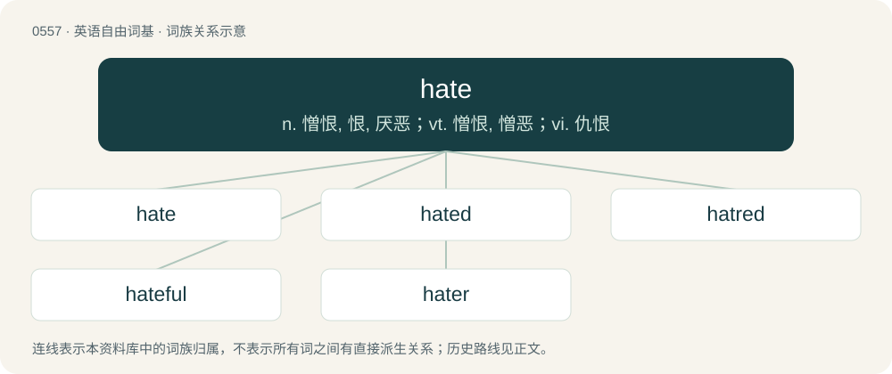

# 0624 · hate — n. 憎恨, 恨, 厌恶；vt. 憎恨, 憎恶；vi. 仇恨

[总目录](../00_总目录_按常用程度.md)

**类型**：英语自由词基　｜　**来源语言**：见词源记录

## 核心含义与来源

- 核心含义：n. 憎恨, 恨, 厌恶；vt. 憎恨, 憎恶；vi. 仇恨
- 英文含义：An object of hatred.
- 词形：hate

**来源记录 1**（名词；An object of hatred.）

From Middle English haate, hat, hate (noun), probably from Old English hatian (“to hate”, verb) and/or Old Norse hatr (“hate”, noun). Merged with Middle English het, hete (“hate”), from Old English hete, from Proto-West Germanic \*hati, from Proto-Germanic \*hataz (“hate”), from Proto-Indo-European \*ḱeh₂d- (“angriness, hatred”). Cognates Cognate with Dutch haat (“hatred”), German Hass, Haß (“hate, hatred”), Luxembourgish Haass (“hate, hatred”), Vilamovian hās (“hate, hatred”), Yiddish האַס (has, “hatred”), Danish had (“hate, hatred”), Faroese and Icelandic hatur (“hatred, spite, aversion”), Norwegian Bokmål, Norwegian Nynorsk, and Swedish hat (“hate, hatred”), Gothic 𐌷𐌰𐍄𐌹𐍃 (hatis, “hate, wrath”); also Breton and Cornish kas (“hatred”), Old Irish miscuis (“hatred”), Welsh cas (“hatred”), Oscan 𐌊𐌀𐌃𐌄𐌝𐌔 (kadeís, “enmity”), Ancient Greek κῆδος (kêdos, “care for others; troubles; mourning”), Sanskrit रि॒शाद॑स् (riśā́das, “benign or devouring or destroying enemies”). The verb is from Middle English haate, hate, haten, hatenn, hatien, hatiȝen, hatye, hatyn, heatien, from Old English hatian (“to hate, treat as an enemy”), from Proto-West Germanic \*hatēn, from Proto-Germanic \*hatāną (“to hate”), from Proto-Germanic \*hataz, from the same root as above. Cognates Cognate with Saterland Frisian hoatje (“to hate”), West Frisian haatsje (“to hate”), Cimbrian haazan (“to hate”), Dutch haten (“to hate”), German hassen (“to hate”), Luxembourgish haassen (“to hate”), Yiddish האַסן (hasn, “to hate”), Danish hade (“to hate”), Icelandic, Faroese, and Swedish hata (“to hate”), Norwegian Bokmål hate (“to hate”), Norwegian Nynorsk hata, hate (“to hate”), Gothic 𐌷𐌰𐍄𐌰𐌽 (hatan, “to hate”).

## 词族图

## 单词速览（常用到不常用）

| 单词 | 音标 | 释义 |
|---|---|---|
| [hate](#w-1) | 英 /heɪt/ | n. 憎恨, 恨, 厌恶；vt. 憎恨, 憎恶；vi. 仇恨 |
| [hated](#w-2) | /ˈheɪtɪd/ | v. 憎恨( hate的过去式和过去分词 ); 讨厌; 不愿; 为…感到抱歉 |
| [hatred](#w-3) | 英 /ˈheɪtɹɪd；美 /ˈheɪtɹɪd/ | n. 憎恨, 仇恨, 憎恶；\[法\] 敌意, 憎恨, 憎恶 |
| [hateful](#w-4) | /ˈheɪtfəl/ | a. 憎恨的, 可恨的, 可恶的 |
| [hater](#w-5) | 英 /ˈheɪtə(ɹ)/；美 /ˈheɪtɚ/ | n. 怀恨者 |

## 逐词详解

### 1. hate

**词性**：名词　｜　**音标**：英 /heɪt/

**中文释义**：n. 憎恨, 恨, 厌恶；vt. 憎恨, 憎恶；vi. 仇恨

**英文义项**：An object of hatred. / Hatred.

**词源与演化**：

From Middle English haate, hat, hate (noun), probably from Old English hatian (“to hate”, verb) and/or Old Norse hatr (“hate”, noun). Merged with Middle English het, hete (“hate”), from Old English hete, from Proto-West Germanic \*hati, from Proto-Germanic \*hataz (“hate”), from Proto-Indo-European \*ḱeh₂d- (“angriness, hatred”). Cognates Cognate with Dutch haat (“hatred”), German Hass, Haß (“hate, hatred”), Luxembourgish Haass (“hate, hatred”), Vilamovian hās (“hate, hatred”), Yiddish האַס (has, “hatred”), Danish had (“hate, hatred”), Faroese and Icelandic hatur (“hatred, spite, aversion”), Norwegian Bokmål, Norwegian Nynorsk, and Swedish hat (“hate, hatred”), Gothic 𐌷𐌰𐍄𐌹𐍃 (hatis, “hate, wrath”); also Breton and Cornish kas (“hatred”), Old Irish miscuis (“hatred”), Welsh cas (“hatred”), Oscan 𐌊𐌀𐌃𐌄𐌝𐌔 (kadeís, “enmity”), Ancient Greek κῆδος (kêdos, “care for others; troubles; mourning”), Sanskrit रि॒शाद॑स् (riśā́das, “benign or devouring or destroying enemies”). The verb is from Middle English haate, hate, haten, hatenn, hatien, hatiȝen, hatye, hatyn, heatien, from Old English hatian (“to hate, treat as an enemy”), from Proto-West Germanic \*hatēn, from Proto-Germanic \*hatāną (“to hate”), from Proto-Germanic \*hataz, from the same root as above. Cognates Cognate with Saterland Frisian hoatje (“to hate”), West Frisian haatsje (“to hate”), Cimbrian haazan (“to hate”), Dutch haten (“to hate”), German hassen (“to hate”), Luxembourgish haassen (“to hate”), Yiddish האַסן (hasn, “to hate”), Danish hade (“to hate”), Icelandic, Faroese, and Swedish hata (“to hate”), Norwegian Bokmål hate (“to hate”), Norwegian Nynorsk hata, hate (“to hate”), Gothic 𐌷𐌰𐍄𐌰𐌽 (hatan, “to hate”).

**例句**：

> There was a lot of hate in the comments on my vlog about Lady Gaga from her fans.

该用例对应义项：Negative feedback, abusive behaviour.

### 2. hated

**词性**：形容词　｜　**音标**：/ˈheɪtɪd/

**中文释义**：v. 憎恨( hate的过去式和过去分词 ); 讨厌; 不愿; 为…感到抱歉

**英文义项**：Disliked; odious; reviled.

**构词拆分**：hate + -ed

**词源与演化**：

From Middle English hated, from Old English hatod, ġehatod (“hated”, past participle), from Proto-Germanic \*hatadaz (“hated”), equivalent to hate + -ed. Cognate with Saterland Frisian haated, hoated (“hated”), Dutch gehaat (“hated”), German Low German haat (“hated”), German gehasst (“hated”), Swedish hatad (“hated”), Icelandic hataður (“hated”).

**用法示例／搭配（非完整句）**：

> universally hated

该用例对应义项：Disliked; odious; reviled.

### 3. hatred

**词性**：名词　｜　**音标**：英 /ˈheɪtɹɪd；美 /ˈheɪtɹɪd/

**中文释义**：n. 憎恨, 仇恨, 憎恶；\[法\] 敌意, 憎恨, 憎恶

**英文义项**：A strong aversion; an intense dislike.

**构词拆分**：hate + -red

**词源与演化**：

From Middle English haterede, hatrede (“hatred”), from hate (“hate”) + -rede (“suffix denoting state or condition”), equivalent to hate + -red; compare sibred, Scots luferent. Related to Icelandic hatur (“hatred”).

**例句**：

> They are unanimous in their hate for me—and I welcome their hatred.

### 4. hateful

**词性**：形容词　｜　**音标**：/ˈheɪtfəl/

**中文释义**：a. 憎恨的, 可恨的, 可恶的

**英文义项**：Evoking a feeling of hatred. / Dislikeable.

**构词拆分**：By surface analysis, hate + -ful

**词源与演化**：

From Middle English hateful. By surface analysis, hate + -ful.

**例句**：

> No vice is universally as hateful as ingratitude.

该用例对应义项：evoking or deserving hatred

### 5. hater

**词性**：名词　｜　**音标**：英 /ˈheɪtə(ɹ)/；美 /ˈheɪtɚ/

**中文释义**：n. 怀恨者

**英文义项**：One who hates. / One who expresses unfounded or inappropriate hatred or dislike, particularly if motivated by envy.

**构词拆分**：hate + -er

**词源与演化**：

From Middle English hatere, equivalent to hate + -er. Compare Old English hetend, hettend (“enemy”, literally “hater”). Cognate with Dutch hater (“hater”), German Hasser, Hässer (“hater”), Danish hader (“hater”), Swedish hatare (“hater”), Icelandic hatari (“hater”).

**例句**：

> Tom is what you might call a woman hater.
